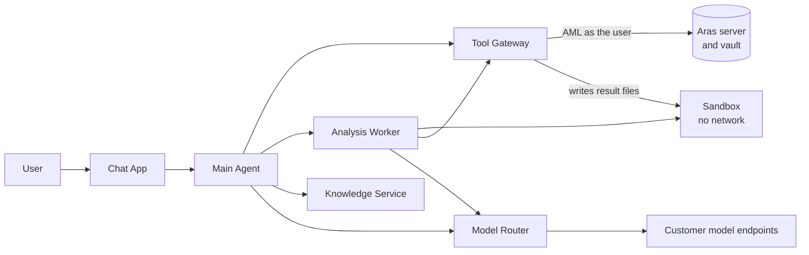

# Aras Insight

Aras Insight is a self-hosted, read-only assistant for Aras Innovator. Business users across every role ask questions in plain language, such as "which components appear most often on delayed change orders this quarter, and what do the linked engineering reports say about them?", and get answers with citations. To answer, it queries Aras as the signed-in user, reads the files Aras holds, computes numbers with code instead of estimating them, and cites every record, file passage, and piece of knowledge it used. It sees exactly what the user is allowed to see, writes nothing to Aras, runs on the customer's own infrastructure with the customer's own model endpoints, and learns the meaning of the customer's installation over time.

> **Status: specification stage.** This repository holds the product vision, architecture, module specifications, shipped skills, and prompts. There is no implementation yet. The documents are written so that an engineering team can build the MVP from them.

## The problem

A PLM system holds the history of how a product is designed, changed, approved, and made. Getting an answer out of it is still slow:

- **Simple questions need someone who knows the data model.** Finding the right item types, relationships, and states takes AML or report-building skills most users do not have.
- **Analytical questions become projects.** "Where are our change approvals getting stuck?" means exporting data, joining it in a spreadsheet, and summarising it by hand. That takes days, and the result is out of date when it is finished.
- **The "why" lives in text and files.** The reasons behind a delay or a recurring revision sit in description fields, workflow sign-off comments, and attached reports, not in rows that a report can count.
- **Every installation is different.** Customised item types, renamed states, and local conventions mean that generic tools and generic AI assistants guess, and their guesses cannot be checked.

The people who need these answers (executives, program managers, engineering, quality, manufacturing, change management, supply chain, compliance) either wait for an analyst or decide without the answer. See [docs/product/vision.md](docs/product/vision.md).

## Key capabilities

- **Answers in plain language, at the user's own access level.** Every data access goes through the Aras server as the signed-in user, so Aras permissions apply exactly as they do in the Aras client.
- **Analytics across records and files.** Counts, trends, rankings, durations, and process analysis are computed with Python in an isolated Sandbox, over data fetched from Aras.
- **"Why" questions.** Evidence is read from long text fields, workflow sign-off comments, and linked files (PDFs with a text layer, Word, Excel, PowerPoint, and plain text formats).
- **Process analysis.** Discovered workflow and lifecycle definitions are compared with the paths and timings that real items actually followed, to find deviations and bottlenecks.
- **Cited, verifiable answers.** Each answer cites the Aras records (with links), file passages (with page or section), and knowledge entries it relied on, and reports its coverage: how many records it used, what had no linked evidence, and what could not be read.
- **Checked queries.** Every generated AML query is statically analysed against the discovered schema for invalid fields and for cost before it runs. Throttling protects the production server.
- **Learns the installation.** Aras Insight discovers the configuration automatically and learns what terms and processes mean from conversations. It learns how things work, never business data values.
- **Your models, your infrastructure.** Three configurable model slots use OpenAI-compatible endpoints or native clients. No embedding model is required.

## How it works

The user signs in to the Chat App through Aras. The Main Agent answers simple lookups directly through the Tool Gateway, which is the only component that talks to Aras: it holds the user's Aras credentials, checks each query, applies throttling, and runs AML as the user. For heavy work such as aggregation, trends, process questions, or reading many files, the Main Agent starts one or more Analysis Workers. Each worker's code runs in a Sandbox that has no network access. Data reaches the Sandbox only as files written by the Tool Gateway. The worker returns a report with computed numbers, citations, assumptions, and coverage, and the Main Agent composes the final answer.

Full detail: [architecture overview](docs/architecture/overview.md) and [question lifecycle walk-throughs](docs/architecture/question-lifecycle.md).

## Scope summary

| Category | Examples |
|---|---|
| Core (MVP) | Plain-language lookups and analytics as the signed-in user; parallel Analysis Workers; reading text PDFs, Office files, and plain text; "why" questions; process analysis; citations and coverage; clarifying questions before expensive analysis; static query analysis; throttling; automatic discovery and learning; self-hosted with configurable model endpoints; live progress and saved sessions; user-confirmed background full-text scans |
| Quality of life (proposed classification) | Assumption statements for learned knowledge not yet independently confirmed; asking which meaning is intended when knowledge is contested; per-user preferences; live learning during a conversation |
| Not supported in MVP | Writing to Aras, OCR and image or email formats, CAD geometry, caching, history kept outside Aras, non-Aras sources, several Aras instances, chat integrations, export, saved questions and dashboards, fine-tuning |

Details are in [docs/product/scope.md](docs/product/scope.md), and the plan for deferred items is in [docs/product/roadmap.md](docs/product/roadmap.md).

## Documentation map

**Start here**
- [Executive summary](docs/executive-summary.md): one to two pages for decision-makers.
- [Glossary](docs/glossary.md): Aras, PLM, and AI terms for non-specialists.

**Product**
- [Vision](docs/product/vision.md): the problem, the vision, product principles, and success.
- [Personas and use cases](docs/product/personas-and-use-cases.md): roles, needs, and example questions.
- [Scope](docs/product/scope.md): core, quality of life, and not supported.
- [Roadmap](docs/product/roadmap.md): the MVP milestones, then every deferred item.

**Business**
- [Value and ROI](docs/business/value-and-roi.md): the business case and the metrics to track.
- [Pricing options](docs/business/pricing-options.md): models and trade-offs (the decision is open).
- [Risks](docs/business/risks.md): risks and their mitigations.
- [Pilot plan](docs/business/pilot-plan.md): how a company evaluates Aras Insight.
- [FAQ](docs/business/faq.md): answers for business, IT, security, and engineering leadership.

**Architecture and decisions**
- [Architecture overview](docs/architecture/overview.md)
- [Question lifecycle](docs/architecture/question-lifecycle.md)
- [Security and permissions](docs/architecture/security-and-permissions.md)
- [Deployment and operations](docs/architecture/deployment-and-operations.md)
- [Decision records](docs/decisions/README.md)

**Module specifications** ([index](docs/specs/README.md))
- [Chat App](docs/specs/chat-app.md)
- [Main Agent](docs/specs/main-agent.md)
- [Tool Gateway](docs/specs/tool-gateway.md)
- [Query Analyzer](docs/specs/query-analyzer.md)
- [File Service](docs/specs/file-service.md)
- [Analysis Worker and Sandbox](docs/specs/analysis-worker-and-sandbox.md)
- [Discovery](docs/specs/discovery.md)
- [Knowledge and learning](docs/specs/knowledge-and-learning.md)
- [Background Jobs](docs/specs/background-jobs.md)
- [Model configuration](docs/specs/model-configuration.md)
- [Persistence](docs/specs/persistence.md)
- [Audit and progress](docs/specs/audit-and-progress.md)
- [Tool catalog](docs/specs/tool-catalog.md)

**Skills and prompts**
- [Skills catalog](docs/skills/README.md): every skill that ships with the product, with the full text of each Aras-agnostic skill.
- [Prompts](docs/prompts/README.md): the full text of every prompt.

## Contributing

The project is at the specification stage. Comments on the documents are welcome as issues or pull requests. Where a document marks something as "Proposed" or lists open questions, those are the places where feedback is most useful.

## Trademark notice

Aras Insight is an independent project. It is not affiliated with, sponsored by, or endorsed by Aras Corporation. "Aras" and "Aras Innovator" are trademarks of their owner and are used here only to describe compatibility.
