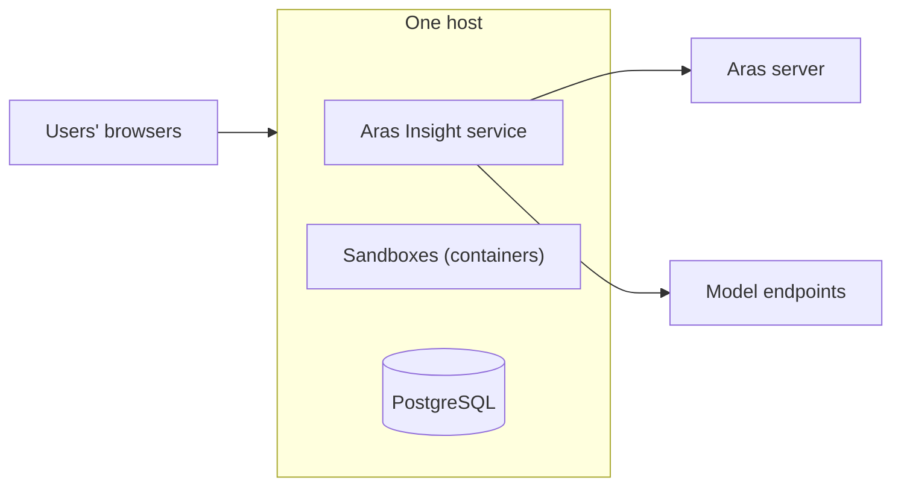
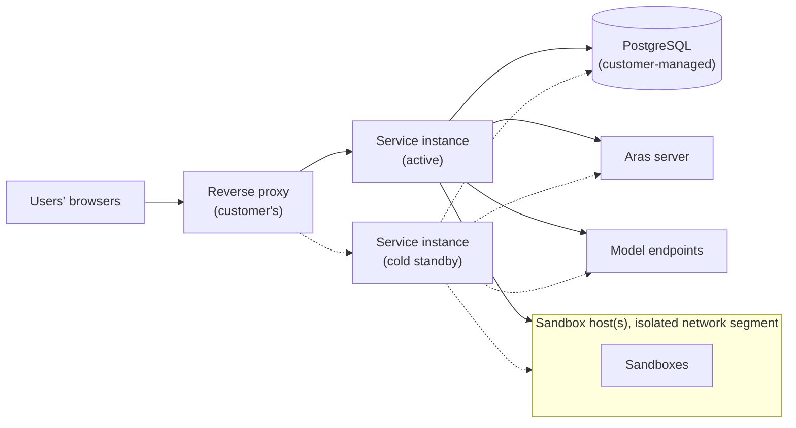

# Deployment and operations

This document describes what a customer deploys to run Aras Insight, how it can be laid out inside their network, what must be configured, how to size it, how to upgrade it and keep it working across Aras upgrades, and what to monitor, back up, and retain. It is written for the customer's infrastructure and Aras administration teams.

Aras Insight is self-hosted: it runs inside the customer's own network, next to their Aras installation ([ADR 0002](../decisions/0002-self-hosted.md)). The makers of the product do not operate it, and it sends them no telemetry or other data ([ADR 0041](../decisions/0041-no-telemetry-to-the-makers.md)).

Related: [architecture overview](overview.md), [security and permissions](security-and-permissions.md), [model-configuration.md](../specs/model-configuration.md), [persistence.md](../specs/persistence.md), [audit-and-progress.md](../specs/audit-and-progress.md).

## What is deployed

| Unit | Contents | Stateful | Notes |
| --- | --- | --- | --- |
| Aras Insight service | Chat App (served to browsers), Main Agent, Analysis Worker loops, Tool Gateway (AML Executor, Query Analyzer, Throttle, File Service, Citation Registry), Discovery, Knowledge Service, Learner, Background Jobs, Model Router. | No (state is in the Database) | One active instance in the MVP; a second can be installed as a cold standby (see [option 2](#option-2-separated-sandbox-host-production-default)). The Tool Gateway is a module of the service by default and can optionally run as its own process. Holds user tokens in memory only while a call needs them (they are stored encrypted in the Database). |
| Sandbox host | Runs one Sandbox per active conversation: a hardened container by default, or a full virtual machine. The same container runtime runs a short-lived extraction container for each file the File Service extracts. | Ephemeral | Must allow the service to create, write files into, run code in, and destroy Sandboxes and extraction containers. Sandboxes and extraction containers have no network. The Sandbox image carries a fixed, pinned set of analysis libraries that changes only with product releases; nothing is installed at run time. |
| Database | One PostgreSQL instance. | Yes | Sessions and transcripts, knowledge, extracted file text, job state, encrypted user and job credentials, audit and usage records. The customer provisions the database roles described in [Database roles](#database-roles). |
| Product Skills | Shipped with the service and versioned with it. | Read-only | Loaded into the Knowledge Service at start-up. See [docs/skills/README.md](../skills/README.md). |

What is not deployed: no agent framework runtime, no vector database, no search engine, no cache, no message broker is required by the architecture. Background Jobs use the Database for job state and coordination, so no separate queue is needed; this is specified in [background-jobs.md](../specs/background-jobs.md) ([ADR 0037](../decisions/0037-single-instance-mvp-and-optional-gateway-process.md)).

Nothing is installed on the Aras server. The product needs only a client registration in the Aras installation's authorization server (see [Configuration surface](#configuration-surface)) and network reachability to the Aras server.

**Prerequisite: the Aras authorization server.** Users sign in to Aras Insight only through the installation's own Aras authorization server, so that the product never sees a password ([ADR 0033](../decisions/0033-sign-in-through-the-aras-authorization-server.md)). There is no login-name-and-password form in the product. An installation without an authorization server is not supported in the MVP; the sign-in check in [Aras version compatibility to verify](#aras-version-compatibility-to-verify) confirms the prerequisite before deployment.

### Database roles

The customer provisions the database roles the product runs under ([ADR 0039](../decisions/0039-audit-and-usage-records.md), [ADR 0037](../decisions/0037-single-instance-mvp-and-optional-gateway-process.md)):

- **Service role.** Used by the service for everything it reads and writes. On the audit tables it can insert but not update or delete, so the audit trail is append-only because the database enforces it, not only the application.
- **Purge role.** Used only by the retention purge of audit records. It can delete audit records only past their retention period.
- **Gateway role (optional).** When the Tool Gateway runs as its own process (see [option 2](#option-2-separated-sandbox-host-production-default)), it uses a separate role that is the only one able to read the credential tables.

## Self-hosted topology options

### Option 1: single host (pilot)

Everything on one machine. Suitable for a pilot with a small group of users. Simple to operate; no high availability.

### Option 2: separated Sandbox host (production default)

One service instance is active at a time in the MVP. The service holds no state of its own (state is in the Database), so a second instance installed as a cold standby can be started if the active one fails or is being replaced, and interrupted questions resume from the saved session; the resume granularity is defined in [persistence.md](../specs/persistence.md). Several instances running at once, with ownership of running questions and jobs by lease and takeover of expired leases, is not part of the MVP; it is specified when a customer needs high availability ([ADR 0037](../decisions/0037-single-instance-mvp-and-optional-gateway-process.md)). Throttle leases are therefore kept in memory, with per-question budgets always stored in the Database; they move to the Database if several instances ever run at once.

Sandboxes run on separate hosts in a network segment with no outbound routes, so that the no-network property is also enforced by the network. The Tool Gateway puts files into a Sandbox only by a host-side write into that Sandbox's own data directory, which code inside the Sandbox can read but not write, next to a separate writable work directory. This is the reference design; the rule is that this host-side write is the only inbound path into a Sandbox, and any mechanism that gives the Sandbox no network path is acceptable. PostgreSQL can be the customer's managed or existing database platform.

**Optional hardening: the Tool Gateway as its own process.** In production the Tool Gateway can run as a separate process with its own database role, the only role that can read the stored credentials, so that a compromise of an agent process cannot read them. This is not an MVP requirement: by default the Tool Gateway is a module of the service, the credentials are stored encrypted, and they are read only through the gateway's interface.

### Option 3: VM-isolated Sandboxes

As option 2, but each Sandbox is a full virtual machine on a virtualisation platform. For customers whose policy requires a hardware-virtualised boundary for untrusted code. Start-up time per conversation is higher.

### Network requirements (all options)

| From | To | Purpose |
| --- | --- | --- |
| Users' browsers | Aras Insight service (HTTPS) | Chat App. |
| Users' browsers | Aras authorization server | Sign-in redirect. |
| Service | Aras server (HTTPS) | AML and file downloads, as the user; token exchange with the authorization server. |
| Service | Model endpoints (HTTPS) | Model calls for the three slots. |
| Service | PostgreSQL | Persistence. |
| Service | Sandbox host | Create, write files, run, destroy; run extraction containers. |
| Sandboxes and extraction containers | Nothing | No outbound or inbound network beyond the control channel the Sandbox host uses. |

The service supports an egress allow-list, so that the rule that nothing else is contacted can be enforced at the network level. The destinations the service contacts are exactly the Aras server (including its authorization server and vault download path), the configured model endpoints, the Database and the Sandbox host; none belongs to the makers of the product. The customer decides how to enforce the list.

## Configuration surface

All configuration is deployment-level. There is no per-customer schema configuration: everything about the Aras installation's data model is discovered ([ADR 0004](../decisions/0004-discovery-only-schema.md)).

| Area | Setting | Required | Notes |
| --- | --- | --- | --- |
| Aras | Aras server URL | Yes | The base URL of the installation. Also the base for the links that open a record or file in Aras. |
| Aras | Database name | Yes | The Aras database the users sign in to. |
| Aras | Authorization server client | Yes | Client registration for Aras Insight in the installation's Aras authorization server (client id, redirect URI, secret if the client type requires one). Registered once by the Aras administrator. The authorization server is the only sign-in path; there is no setting for another one. |
| Aras | Renewable grant for background jobs | Optional | Whether to request a separate renewable grant for each background job. Where the installation does not issue one, jobs use the user's session credential and pause when that session ends; the compatibility check settles which applies. |
| Aras | Job credential hard lifetime | Yes | `gateway.job_credential_max_hours`, default 24 hours: after this a job credential is never renewed again, whatever the job's progress, and the job pauses. |
| Aras | Maximum pause for a background job | Yes | `jobs.max_pause_hours`, default 72 hours: a paused job (renewal failed, or the hard lifetime was reached) is cancelled after this unless the user signs in again and it resumes. |
| Models | Main slot | Yes | Endpoint URL, client type (OpenAI-compatible; no native client ships in the MVP), model name, credential, context and output limits. The model must support tool calling with structured arguments, structured JSON output and streaming, with a context window of at least 128,000 tokens. |
| Models | Worker slot | Yes | As above, except that streaming is optional. May point to the same endpoint as main. |
| Models | Background slot | Yes | As above, except that tool calling and streaming are not required and the context window must be at least 32,000 tokens. Often a cheaper or internal model. |
| Sandbox | Isolation mode | Yes | Container (default) or VM. The default container uses the runtime's standard hardening profile plus a system-call filter (see [security and permissions](security-and-permissions.md#sandbox-isolation)); the VM option is for customers whose policy requires a hardware-virtualised boundary. The concrete container runtime is not decided here. |
| Sandbox | Resource limits | Yes | CPU, memory, disk, processes, wall-clock per run. Defaults: 2 cores, 4 GB memory, 10 GB disk, 120 seconds per run by default, at most 600 seconds. |
| Sandbox | Maximum concurrent Sandboxes | Yes | `sandbox.max_active`, default 20. Decides the size of the Sandbox host. |
| Sandbox | Inactivity expiry | Yes | How long a conversation can be inactive before its Sandbox is destroyed (default 24 hours). The conversation itself stays; a returning user gets a new Sandbox on demand. |
| Limits | Per-user concurrent queries | Yes | Throttle; default 2. |
| Limits | System-wide concurrent queries | Yes | Throttle; protects the Aras server; default 8. |
| Limits | Row budget per question | Yes | Throttle; default 50,000 rows. |
| Limits | Files per question | Yes | Maximum number of files a question may extract. No default: tuned once the system runs. |
| Limits | Query timeout | Yes | Throttle; default 60 seconds. |
| Limits | Parallel Analysis Workers per question | Yes | Setting it to one gives sequential behaviour. |
| Limits | Background job batch size and rate | Yes | Throttle for scans. |
| Learning | Inactivity threshold for batched learning | Yes | When a quiet conversation is handed to the Learner. |
| Learning | Single-user deployment | Optional | When on, the teacher's word is enough to confirm a learned entry. |
| Discovery | Minimum interval between change checks | Yes | Modification stamps are checked at conversation start and after sign-in, never more often than this; there is no periodic check. |
| Discovery | Query template set | Optional | `discovery.template_set`: the shipped set of configuration queries to use. Defaults to the set matching the detected Aras version; setting it overrides detection. |
| Discovery | Read method content | Optional | `discovery.read_method_content`, default off: Discovery reads only method names, event bindings and modification stamps. When on, it also reads method source, records a hash for change detection and passes a bounded excerpt to the inference model. |
| Files | Extractable formats | Fixed in MVP | PDFs with a text layer, Word, Excel, PowerPoint, txt, csv, html, xml. |
| Files | Maximum file size for extraction | Yes | |
| Files | Downloaded file bytes | Fixed in MVP | Held only while text is extracted, then deleted; never stored. A later re-extraction downloads the file from Aras again. |
| Audit | AML text in audit events | Optional | `audit.store_aml_text`: `redacted` (default; literal criteria values replaced by placeholders, query shape and fingerprint kept), `full`, or `none` (fingerprint only). |
| Retention | Transcripts, extracted text, job state, progress events, model-call records, audit | Yes | Defaults: conversations 180 days after last activity (`retention.conversation_days`); extracted text 90 days after last use (`file_service.retention_days_unused`, 0 deletes it after each use); progress events 7 days (`progress.retention_days`); model-call records 365 days (`retention.model_call_days`); audit events 365 days (`audit.retention_days`). See [security and permissions](security-and-permissions.md#data-at-rest). |
| Database | Connection settings | Yes | |
| Secrets | Token encryption key, model credentials, database credentials | Yes | Supplied as environment variables or as files mounted at run time; the configuration holds a reference name for each, such as `gateway.credential_encryption_key_ref`. The token encryption key is one deployment-supplied key; the service refuses to start if it is unavailable and has no plaintext fallback. Integration with a customer's secret manager can be added on customer request without changing these references. |

Every default number in this document and in the specifications (limits, budgets, timeouts, retention periods) is a provisional default, tuned in a pilot. The full model configuration, including switching models without code changes, is in [model-configuration.md](../specs/model-configuration.md). Limits and their semantics are in [tool-gateway.md](../specs/tool-gateway.md).

## Sizing considerations

The dominant costs are not in Aras Insight itself; they are model calls and load on the Aras server. Sizing therefore starts from the expected number of concurrent heavy questions.

| Resource | Driven by | Starting point (validated in a pilot) |
| --- | --- | --- |
| Service CPU and memory | Concurrent conversations; text extraction. | 4 vCPU, 8 GB for a pilot of up to 25 active users. |
| Sandbox capacity | Concurrent conversations with active Analysis Workers. | 2 vCPU and 4 GB per active Sandbox (the per-Sandbox limits in [analysis-worker-and-sandbox.md](../specs/analysis-worker-and-sandbox.md)), with a maximum of 20 concurrent Sandboxes by default (`sandbox.max_active`). Size the Sandbox host from the pilot hardware and the maximum you set. |
| Database storage | Extracted file text (largest), transcripts, audit. | Start at 50 GB for a pilot with up to 25 active users (the pilot plan expects ten to twenty). The scale [persistence.md](../specs/persistence.md) assumes is an assumption to validate, not a measurement. Extracted text is typically a small fraction of the original file sizes. Monitor growth. |
| Aras server load | System-wide Throttle limits. | Start from the default of 8 concurrent queries system-wide and 2 per user (see [tool-gateway.md](../specs/tool-gateway.md)), record the limits agreed with the Aras owners for the pilot, and adjust them while watching Aras response times, lowering them first if interactive users are affected. A pilot on a production Aras server starts from the defaults and lowers them as needed. |
| Model throughput | Questions per hour; workers per question. | Depends on the chosen endpoints and their rate limits; size with the endpoint provider. |

All numbers above are starting points for a first pilot. They are not measured; replace them with measurements from a real installation. Whether a pilot runs against a production-mirroring test environment or against production with conservative throttling is the customer's choice, made in pilot preparation (see [pilot-plan.md](../business/pilot-plan.md)).

## Upgrades

### Upgrading Aras Insight

- Product Skills, prompts, and the service are versioned together; an upgrade replaces all of them at once.
- Database schema changes are applied by versioned migrations at upgrade. Migrations are forward-only (there are no down-migrations) and the upgrade procedure takes a database backup first; a downgrade means restoring that backup.
- Discovered knowledge is regenerated by Discovery if the new version changes how it is represented. Learned knowledge is preserved and migrated.
- Sessions in progress at upgrade time can be resumed from the saved session after restart; a question that was mid-analysis resumes from its saved transcript, and the interrupted analysis is started again, reusing data already fetched if the Sandbox survived. The exact resume granularity is defined in [persistence.md](../specs/persistence.md).

### Upgrading Aras, or deploying Aras configuration changes

Aras Insight has no deployment hook in the MVP ([ADR 0019](../decisions/0019-invalidation-by-provenance-and-contradiction.md)). Instead:

1. Discovery checks configuration modification stamps when a conversation starts or a user signs in (no more often than the minimum interval between checks) and when a query result contradicts the stored schema.
2. When it sees a change, it re-reads the changed configuration as the user and regenerates the discovered layer.
3. Discovered entries that were model-inferred from changed configuration are re-derived; those derived from deleted configuration are retired; Learned entries mapped to renamed or removed elements become uncertain.
4. The Query Analyzer validates against the refreshed schema, so a query built on outdated knowledge fails analysis and is retried, and the knowledge it came from becomes uncertain.

There is no manual trigger for a discovery check in the MVP. The check at the next conversation start or sign-in already covers an Aras upgrade or a configuration deployment, limited only by the minimum interval between checks, and it needs no administrator identity: Discovery always runs with a signed-in user's credential.

For an Aras version upgrade, re-run the compatibility checks below before returning the product to users.

## Monitoring

| Signal | Why it matters | Source |
| --- | --- | --- |
| Aras response time and error rate for product queries | The product must not degrade Aras for interactive users. | Tool Gateway metrics; compare with Aras's own monitoring. |
| Throttle refusals and queue depth | Limits too tight (users get partial coverage) or load too high. | Throttle. |
| Query Analyzer rejection rate, by reason | Model quality and stale knowledge. | Query Analyzer. |
| Questions answered, time to answer, abandoned questions | Service health and user experience. | Audit and usage records. |
| Model latency, errors, token usage per slot | Cost and endpoint health. | Model Router. |
| Sandbox start time, run failures, resource-limit hits | Capacity and isolation health. | Sandbox host. |
| Background job progress and failures, credential renewal failures | Long scans completing. | Background Jobs. |
| Extraction failures by format, unreadable file counts | Coverage quality; demand for OCR. | File Service. |
| Knowledge entry counts by state (confirmed, uncertain, contested, retired) | Health of learning. | Knowledge Service. |
| Database size and growth | Storage planning. | PostgreSQL. |
| Alert: an audit write failed | No data may be read from Aras without an audit record. | Audit and progress raises the alert. |
| Alert: the retention purge has not run for 2 days | Retention periods are honoured. | Audit and progress raises the alert. |

The service exposes metrics through a standard text endpoint that common monitoring tools can scrape, and writes structured JSON logs; the precise metric names and log fields are an implementation detail. Errors that the browser reports from the Chat App, without message content, are written to the service log. A usage and ROI dashboard for buyers is deferred (see [roadmap](../product/roadmap.md)), but the underlying usage records are collected from the start so that the metrics in [value-and-roi.md](../business/value-and-roi.md) can be computed.

## Operations tooling

The tools in this document are deployment and operations tooling for the customer's infrastructure staff: the compatibility check, the audit and usage views and export, and the monitoring above. They need no Aras administrator account and are not features for Aras administrators or developers, which are not supported in the MVP ([ADR 0003](../decisions/0003-business-end-users-first.md)).

- **Reading audit and usage data.** The customer's operators read audit events and usage records through documented database views, which produce the metrics defined in [value-and-roi.md](../business/value-and-roi.md), and through an export operation specified in [audit-and-progress.md](../specs/audit-and-progress.md). Access is through the Database, under the customer's own database access controls. The product has no administrator identity and no administrator endpoints: everyone who signs in to the product is an Aras user ([ADR 0040](../decisions/0040-operator-reports-without-administrator-endpoints.md)).
- **Background jobs.** Only the requesting user can see, confirm, cancel or reauthorise a job. To protect the Aras server, operators lower the Throttle limits or pause the whole job runner; there is no administrator view of other users' jobs.
- **Discovery.** There is no manual trigger; see [Upgrading Aras](#upgrading-aras-or-deploying-aras-configuration-changes).

## Backup and retention

| Data | Back up | Why |
| --- | --- | --- |
| Knowledge (learned and user preferences) | Yes, regularly | Learned knowledge is accumulated over time and cannot be regenerated from Aras alone. |
| Knowledge (discovered) | Yes, with knowledge | Discovery can regenerate it, but entry ids are referenced by citations and contradictions, and regeneration issues new content rather than the same entry ids. |
| Discovered configuration (`config_items`, `discovery_runs`) | Yes, with knowledge | Learned entries depend on these rows and discovered entries are derived from them. |
| Transcripts and job state | Per customer policy | Lets users return to conversations after a restore. |
| Credentials (user sessions and background jobs) | Not needed | They expire, so users sign in again after a restore. If the Database is backed up they are in the backup, encrypted with the deployment's key; the key is not stored in the Database, so a restore without it leaves them unreadable and users sign in again. |
| Extracted file text | Optional, the customer's choice | Can be regenerated from Aras by re-extraction, at the cost of Aras load. |
| Downloaded file bytes | Never kept | Held only while text is extracted, then deleted, so there is nothing to back up. |
| Audit and usage records | Per customer audit policy | |
| Sandboxes | Never | Ephemeral by design. |

A backup without extracted file text is smaller and holds fewer copies of vault content; a restore without it re-reads files through Aras, throttled. The text is already inside the one Database the customer controls, and the MVP uses no separate encryption key for it.

Retention is configured per data class, with the defaults listed in [Configuration surface](#configuration-surface) ([security and permissions](security-and-permissions.md#data-at-rest)). Restoring a backup never restores access: every read after restore still goes through Aras as the user, and stored file text is still re-checked before use.

### Removing a teacher from learned entries

On request (for example when the person who taught entries leaves the organisation), an operator can remove who taught a learned entry. The documented procedure replaces the teacher's user id in the entry's provenance and confirmation rows with a stable placeholder id and keeps the entry, so the rule that someone other than the teacher must confirm an entry still works. Backups taken before the procedure still hold the original ids until they age out under the customer's backup policy.

## Aras version compatibility to verify

The product discovers everything about an installation, but it relies on a small number of Aras platform behaviours. Each must be verified against the target Aras version before a deployment. The items below are typical of recent Aras versions and are listed as checks, not guarantees.

Some behaviour that differs between Aras versions is carried in tables that ship with each product release: Discovery's configuration query templates, the Query Analyzer's rule table and the mapping of Aras faults to product error codes. A release ships these for a defined list of supported Aras versions, which is named in the [pilot plan](../business/pilot-plan.md) once the compatibility check exists. A version outside the list is not supported until a release adds its tables. The result of the vault-download check below is recorded with that list.

| Area | What to verify |
| --- | --- |
| Sign-in | The installation runs the Aras authorization server, and it supports registering an external client with an authorization-code style flow; which grants are available; whether renewable tokens are issued, and their lifetimes. The authorization server is the only sign-in path, so an installation without one is not supported in the MVP. Whether renewable tokens are issued decides how background jobs run: with a separate renewable grant per job, or, where none is issued, on the user's session credential, pausing when that session ends. |
| AML endpoint | AML requests can be sent with a user token; paging attributes and row-limit behaviour work as expected; maximum response sizes. |
| Read-only enforcement | The Query Analyzer admits only the plain read action `get` and rejects every other action. Verify that `get` behaves as a pure read on the target version, and that server methods that may write are not callable through the product. A further read action is added only by a product release, after it has been verified on a named Aras version; operators cannot edit the list. |
| Permissions on read | Item-level permissions and any server events that run on read (for example an onBeforeGet or onAfterGet event) apply to AML requests made with the user's token. |
| Configuration metadata | Item types, properties, relationship types, lists, workflow maps, lifecycle maps, methods, and forms are readable by ordinary users, and carry modification stamps usable for change detection. |
| Vault access | Files can be downloaded through the Aras server with the user's token (typically through the vault server address), and download respects file permissions; the File item properties used for the access check (name, size, checksum) are present; whether vault replicas or transfer servers change the download path. Where this fails on a version, file reading is unavailable there and the product says so. |
| File identity | File items are immutable once checked in (new content means a new file id), as the extracted-text store assumes. |
| Workflow and lifecycle runs | Workflow process, activity, assignment, sign-off comment, and lifecycle state-change history is available through AML with timestamps. Typical item types are Workflow Process, Activity, and Activity Assignment; verify names and availability. |
| Change records | Typical change item types (for example Express ECO, Express ECR, Problem Report) and their affected-item relationships exist and are named as expected, if the installation uses them. Discovery does not depend on these names, and the walk-throughs use them only as illustrations. |
| Record and file links | The link form that opens a record or file in Aras, built from the configured base address, the item type and the id (a file link through its parent item), works on the target version. A link that lands on a page inside a file depends on the viewer Aras offers and is not guaranteed. |
| Full-text search features | Whether the installation has its own search engine is irrelevant to the MVP (not reused), but worth noting for the roadmap. |

The product ships a compatibility check ([ADR 0040](../decisions/0040-operator-reports-without-administrator-endpoints.md)). An administrator runs it once against a target installation with an ordinary user account; no administrator account is needed. It exercises five things: sign-in through the authorization server, a paged AML read, a configuration read, a file download, and a workflow-history read, and it reports what works. The behaviours it does not exercise (the read-time server events, file immutability, change-record names, link forms and the like) are documented manual checks that the customer's Aras owners confirm before the pilot starts.
