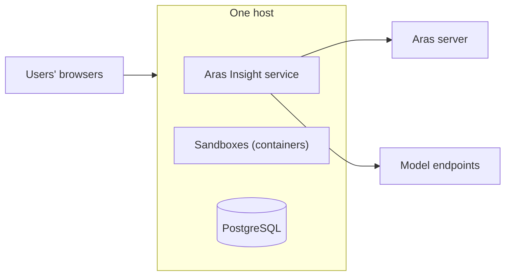
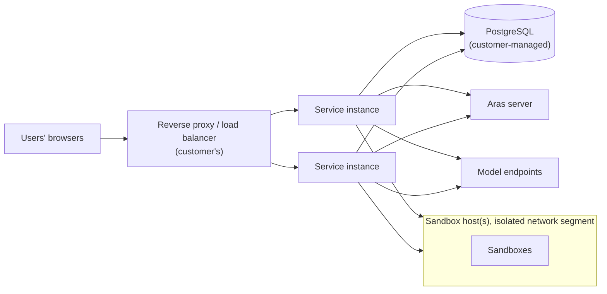

# Deployment and operations

This document describes what a customer deploys to run Aras Insight, how it can be laid out inside their network, what must be configured, how to size it, how to upgrade it and keep it working across Aras upgrades, and what to monitor, back up, and retain. It is written for the customer's infrastructure and Aras administration teams.

Aras Insight is self-hosted: it runs inside the customer's own network, next to their Aras installation ([ADR 0002](../decisions/0002-self-hosted.md)). The makers of the product do not operate it and receive no data from it.

Related: [architecture overview](overview.md), [security and permissions](security-and-permissions.md), [model-configuration.md](../specs/model-configuration.md), [persistence.md](../specs/persistence.md), [audit-and-progress.md](../specs/audit-and-progress.md).

## What is deployed

| Unit | Contents | Stateful | Notes |
| --- | --- | --- | --- |
| Aras Insight service | Chat App (served to browsers), Main Agent, Analysis Worker loops, Tool Gateway (AML Executor, Query Analyzer, Throttle, File Service, Citation Registry), Discovery, Knowledge Service, Learner, Background Jobs, Model Router. | No (state is in the Database) | Can run as one or more instances. Holds user tokens in memory only while a call needs them (they are stored encrypted in the Database). |
| Sandbox host | Runs one Sandbox per active conversation: a hardened container by default, or a full virtual machine. | Ephemeral | Must allow the service to create, write files into, run code in, and destroy Sandboxes. Sandboxes have no network. |
| Database | One PostgreSQL instance. | Yes | Sessions and transcripts, knowledge, extracted file text, job state, encrypted user and job credentials, audit and usage records. |
| Product Skills | Shipped with the service and versioned with it. | Read-only | Loaded into the Knowledge Service at start-up. See [docs/skills/README.md](../skills/README.md). |

What is not deployed: no agent framework runtime, no vector database, no search engine, no cache, no message broker is required by the architecture. **Proposed:** Background Jobs use the Database for job state and coordination, so no separate queue is needed in the MVP; this choice is specified in [background-jobs.md](../specs/background-jobs.md).

Nothing is installed on the Aras server. The product needs only a sign-in client registration in the Aras installation (see [Configuration surface](#configuration-surface)) and network reachability to the Aras server.

## Self-hosted topology options

### Option 1: single host (pilot)

Everything on one machine. Suitable for a pilot with a small group of users. Simple to operate; no high availability.

### Option 2: separated Sandbox host (production default)

Service instances are stateless and can be scaled out behind the customer's reverse proxy. Sandboxes run on separate hosts in a network segment with no outbound routes, so that the no-network property is also enforced by the network. PostgreSQL can be the customer's managed or existing database platform.

**Proposed:** a running question's agent loops are bound to one service instance for its duration, and resume from the saved session on another instance if that instance fails. The resume mechanism must match [persistence.md](../specs/persistence.md).

### Option 3: VM-isolated Sandboxes

As option 2, but each Sandbox is a full virtual machine on a virtualisation platform. For customers whose policy requires a hardware-virtualised boundary for untrusted code. Start-up time per conversation is higher.

### Network requirements (all options)

| From | To | Purpose |
| --- | --- | --- |
| Users' browsers | Aras Insight service (HTTPS) | Chat App. |
| Users' browsers | Aras sign-in | Sign-in redirect. |
| Service | Aras server (HTTPS) | AML and file downloads, as the user; token exchange. |
| Service | Model endpoints (HTTPS) | Model calls for the three slots. |
| Service | PostgreSQL | Persistence. |
| Service | Sandbox host | Create, write files, run, destroy. |
| Sandboxes | Nothing | No outbound or inbound network beyond the control channel the Sandbox host uses. |

**Proposed:** an egress allow-list on the service limited to the Aras server and the configured model endpoints.

## Configuration surface

All configuration is deployment-level. There is no per-customer schema configuration: everything about the Aras installation's data model is discovered ([ADR 0004](../decisions/0004-discovery-only-schema.md)).

| Area | Setting | Required | Notes |
| --- | --- | --- | --- |
| Aras | Aras server URL | Yes | The base URL of the installation. |
| Aras | Database name | Yes | The Aras database the users sign in to. |
| Aras | Sign-in client | Yes | Client registration for Aras Insight in the installation's sign-in (client id, redirect URI, secret if the client type requires one). Registered once by the Aras administrator. |
| Aras | Renewable tokens for background jobs | Optional | Whether to request renewable credentials for job use; depends on what the installation allows. |
| Models | Main slot | Yes | Endpoint URL, client type (OpenAI-compatible or native), model name, credential, context and output limits. |
| Models | Worker slot | Yes | As above. May point to the same endpoint as main. |
| Models | Background slot | Yes | As above. Often a cheaper or internal model. |
| Sandbox | Isolation mode | Yes | Container (default) or VM. |
| Sandbox | Resource limits | Yes | CPU, memory, disk, processes, wall-clock per run. |
| Sandbox | Inactivity expiry | Yes | How long a conversation can be inactive before its Sandbox is destroyed (default 24 hours). The conversation itself stays; a returning user gets a new Sandbox on demand. |
| Limits | Per-user concurrent queries | Yes | Throttle. |
| Limits | System-wide concurrent queries | Yes | Throttle; protects the Aras server. |
| Limits | Row budget per question | Yes | Throttle. |
| Limits | Query timeout | Yes | Throttle. |
| Limits | Parallel Analysis Workers per question | Yes | |
| Limits | Background job batch size and rate | Yes | Throttle for scans. |
| Learning | Inactivity threshold for batched learning | Yes | When a quiet conversation is handed to the Learner. |
| Learning | Single-user deployment | Optional | When on, the teacher's word is enough to confirm a learned entry. |
| Discovery | Minimum interval between change checks | Yes | Modification stamps are checked at conversation start and after sign-in, never more often than this; there is no periodic check when nobody is using the product. |
| Files | Extractable formats | Fixed in MVP | PDFs with a text layer, Word, Excel, PowerPoint, txt, csv, html, xml. |
| Files | Maximum file size for extraction | Yes | |
| Retention | Transcripts, extracted text, job state, progress events, model-call records, audit | Yes | See [security and permissions](security-and-permissions.md#data-at-rest). |
| Database | Connection settings | Yes | |
| Secrets | Token encryption key, model credentials, database credentials | Yes | Supplied through the customer's secret store; the mechanism is not decided. |

The full model configuration, including switching models without code changes, is in [model-configuration.md](../specs/model-configuration.md). Limits and their semantics are in [tool-gateway.md](../specs/tool-gateway.md).

## Sizing considerations

The dominant costs are not in Aras Insight itself; they are model calls and load on the Aras server. Sizing therefore starts from the expected number of concurrent heavy questions.

| Resource | Driven by | Proposed starting point (to be validated in a pilot) |
| --- | --- | --- |
| Service CPU and memory | Concurrent conversations; text extraction. | **Proposed:** 4 vCPU, 8 GB for a pilot of up to 25 active users (the service scale). |
| Sandbox capacity | Concurrent conversations with active Analysis Workers. | **Proposed:** 2 vCPU and 4 GB per active Sandbox (the proposed per-Sandbox limits in [analysis-worker-and-sandbox.md](../specs/analysis-worker-and-sandbox.md)), with a configured maximum number of concurrent Sandboxes. |
| Database storage | Extracted file text (largest), transcripts, audit. | **Proposed:** start at 50 GB for a pilot of hundreds of users in total (the scale [persistence.md](../specs/persistence.md) assumes; at most 25 of them active, as above); extracted text is typically a small fraction of the original file sizes. Monitor growth. |
| Aras server load | System-wide Throttle limits. | **Proposed:** start from the proposed default of 8 concurrent queries system-wide (see [tool-gateway.md](../specs/tool-gateway.md)) and adjust it while watching Aras response times, lowering it first if interactive users are affected. |
| Model throughput | Questions per hour; workers per question. | Depends on the chosen endpoints and their rate limits; size with the endpoint provider. |

All numbers above are proposals for a first pilot. They are not measured, and must be replaced with measurements from a real installation.

## Upgrades

### Upgrading Aras Insight

- Product Skills, prompts, and the service are versioned together; an upgrade replaces all of them at once.
- Database schema changes are applied by versioned migrations at upgrade. **Proposed:** migrations are forward-only and the upgrade procedure takes a database backup first.
- Discovered knowledge is regenerated by Discovery if the new version changes how it is represented. Learned knowledge is preserved and migrated.
- Sessions in progress at upgrade time can be resumed from the saved session after restart; a question that was mid-analysis resumes from its saved transcript, and the interrupted analysis is started again, reusing data already fetched if the Sandbox survived. **Proposed:** the exact resume granularity must match [persistence.md](../specs/persistence.md).

### Upgrading Aras, or deploying Aras configuration changes

Aras Insight has no deployment hook in the MVP ([ADR 0019](../decisions/0019-invalidation-by-provenance-and-contradiction.md)). Instead:

1. Discovery checks configuration modification stamps when a conversation starts or a user signs in (no more often than the minimum interval between checks) and when a query result contradicts the stored schema.
2. When it sees a change, it re-reads the changed configuration as the user and regenerates the discovered layer.
3. Discovered entries that were model-inferred from changed configuration are re-derived; those derived from deleted configuration are retired; Learned entries mapped to renamed or removed elements become uncertain.
4. The Query Analyzer validates against the refreshed schema, so a query built on outdated knowledge fails analysis and is retried, and the knowledge it came from becomes uncertain.

**Proposed:** an administrator can trigger an immediate discovery check from the product after an Aras upgrade or a configuration deployment, without waiting for the next conversation start or sign-in. This is a manual action, distinct from the deferred automated deployment hook.

For an Aras version upgrade, re-run the compatibility checks below before returning the product to users.

## Monitoring

| Signal | Why it matters | Source |
| --- | --- | --- |
| Aras response time and error rate for product queries | The product must not degrade Aras for interactive users. | Tool Gateway metrics; compare with Aras's own monitoring. |
| Throttle refusals and queue depth | Limits too tight (users get partial coverage) or load too high. | Throttle. |
| Query Analyzer rejection rate, by reason | Model quality and stale knowledge. | Query Analyzer. |
| Questions answered, time to answer, abandoned questions | Service health and user experience. | Audit and usage records. |
| Model latency, errors, token usage per slot | Cost and endpoint health. | Model Router. |
| Sandbox start time, run failures, resource-limit hits | Capacity and isolation health. | Sandbox host. |
| Background job progress and failures, credential renewal failures | Long scans completing. | Background Jobs. |
| Extraction failures by format, unreadable file counts | Coverage quality; demand for OCR. | File Service. |
| Knowledge entry counts by state (confirmed, uncertain, contested, retired) | Health of learning. | Knowledge Service. |
| Database size and growth | Storage planning. | PostgreSQL. |

**Proposed:** the service exposes metrics in a standard scrapeable format and writes structured logs; the specific format is not decided. A usage and ROI dashboard for buyers is deferred (see [roadmap](../product/roadmap.md)), but the underlying usage records are collected from the start so that the metrics in [value-and-roi.md](../business/value-and-roi.md) can be computed.

## Backup and retention

| Data | Back up | Why |
| --- | --- | --- |
| Knowledge (learned and user preferences) | Yes, regularly | Learned knowledge is accumulated over time and cannot be regenerated from Aras alone. |
| Knowledge (discovered) | Yes, with knowledge | Discovery can regenerate it, but entry ids are referenced by citations and contradictions, and regeneration issues new content rather than the same entry ids. |
| Discovered configuration (`config_items`, `discovery_runs`) | Yes, with knowledge | Learned entries depend on these rows and discovered entries are derived from them. |
| Transcripts and job state | Per customer policy | Lets users return to conversations after a restore. |
| Credentials (user sessions and background jobs) | Not needed | They expire, so users sign in again after a restore. If the Database is backed up they are in the backup, encrypted with the deployment's key. |
| Extracted file text | Optional | Can be regenerated from Aras by re-extraction, at the cost of Aras load. |
| Audit and usage records | Per customer audit policy | |
| Sandboxes | Never | Ephemeral by design. |

Retention is configured per data class ([security and permissions](security-and-permissions.md#data-at-rest)). Restoring a backup never restores access: every read after restore still goes through Aras as the user, and stored file text is still re-checked before use.

## Aras version compatibility to verify

The product discovers everything about an installation, but it relies on a small number of Aras platform behaviours. Each must be verified against the target Aras version before a deployment. The items below are typical of recent Aras versions and are listed as checks, not guarantees.

| Area | What to verify |
| --- | --- |
| Sign-in | The installation's sign-in supports registering an external client with an authorization-code style flow; which grants are available; whether renewable tokens are issued, and their lifetimes. |
| AML endpoint | AML requests can be sent with a user token; paging attributes and row-limit behaviour work as expected; maximum response sizes. |
| Read-only enforcement | The set of AML actions the Query Analyzer treats as reads matches the version (for example `get`), and server methods that may write are not callable through the product. |
| Permissions on read | Item-level permissions and any server events that run on read (for example an onBeforeGet or onAfterGet event) apply to AML requests made with the user's token. |
| Configuration metadata | Item types, properties, relationship types, lists, workflow maps, lifecycle maps, methods, and forms are readable by ordinary users, and carry modification stamps usable for change detection. |
| Vault access | Files can be downloaded through the Aras server with the user's token, and download respects file permissions; whether vault replicas or transfer servers change the download path. |
| File identity | File items are immutable once checked in (new content means a new file id), as the extracted-text store assumes. |
| Workflow and lifecycle runs | Workflow process, activity, assignment, sign-off comment, and lifecycle state-change history is available through AML with timestamps. Typical item types are Workflow Process, Activity, and Activity Assignment; verify names and availability. |
| Change records | Typical change item types (for example Express ECO, Express ECR, Problem Report) and their affected-item relationships exist and are named as expected, if the installation uses them. Discovery does not depend on these names, and the walk-throughs use them only as illustrations. |
| Full-text search features | Whether the installation has its own search engine is irrelevant to the MVP (not reused), but worth noting for the roadmap. |

**Proposed:** the product ships a compatibility check that an administrator runs once against a target installation with an ordinary user account, which exercises sign-in, a paged AML read, a configuration read, a file download, and a workflow-history read, and reports what works.

## Open questions

- **Proposed:** sizing numbers in [Sizing considerations](#sizing-considerations) are placeholders for a first pilot and must be measured.
- **Proposed:** job coordination through the Database without a separate queue.
- **Proposed:** an administrator-triggered discovery check after Aras upgrades or configuration deployments (manual; the automated deployment hook stays deferred).
- **Proposed:** a shipped compatibility check against a target installation.
- **Proposed:** forward-only database migrations with a backup taken before upgrade.
- **Proposed:** metrics in a standard scrapeable format; the format is not decided.
- How secrets are supplied (the customer's secret store integration) is not decided.
