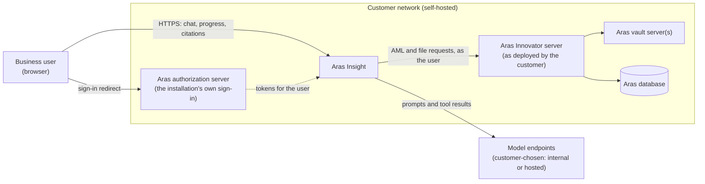
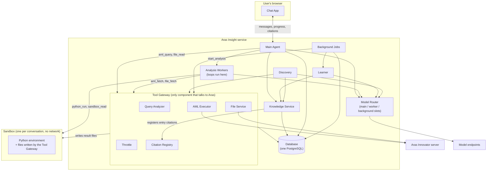
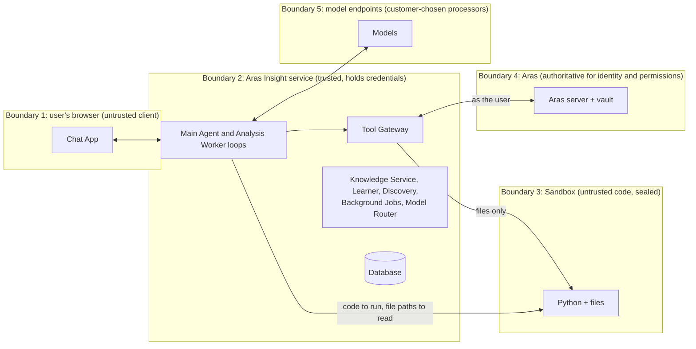

# Architecture overview

This document describes how Aras Insight is put together: the system it lives in, the components it is built from, where the trust boundaries sit, how data moves, and the principles every component obeys. It is written for two readers at once: decision-makers who need to know what the system will and will not do to their Aras installation, and engineers who need an unambiguous map before reading the module specifications in [docs/specs/](../specs/README.md).

Related documents:

- [Question lifecycle](question-lifecycle.md) - end-to-end walk-throughs of representative questions.
- [Security and permissions](security-and-permissions.md) - identity, isolation, data at rest, threat model.
- [Deployment and operations](deployment-and-operations.md) - what is deployed, configuration, upgrades, monitoring.
- [Decision records](../decisions/README.md) - why each architectural choice was made and what was rejected.
- [Glossary](../glossary.md) - shared vocabulary.

## In one paragraph

Aras Insight is a self-hosted, read-only assistant that lets business users ask questions of their Aras Innovator installation in plain language and get answers that are computed, cited, and honest about their coverage. It never connects to the Aras database directly and has no privileged account: every read goes through the Aras server, as the signed-in user, through a single component (the Tool Gateway) that checks each query for validity and cost before it runs. Heavy analysis is done by worker agents that write and run Python inside a sealed, network-less Sandbox, against data the Tool Gateway has fetched for them. The product learns how a given Aras installation is configured and what its terms mean, and it keeps that learned knowledge free of business data.

## System context

What the context diagram commits to:

- Aras Insight talks to exactly two kinds of external system: the customer's Aras server (including files it serves from its vaults) and the model endpoints the customer configures. It has no other sources in the MVP; see [scope](../product/scope.md) and [roadmap](../product/roadmap.md).
- There is no arrow from Aras Insight to the Aras database. Access to data is only ever through the Aras server, so Aras permissions, server-side methods, and any read-time logic the customer has configured apply to every read.
- The model endpoints are the only place data leaves the Aras Insight deployment. Which endpoints are used, and therefore where data goes, is the customer's choice. See [data exposure to model endpoints](security-and-permissions.md#data-exposure-to-the-configured-model-endpoints).

## Components

Each component's responsibility, in one place. Full behaviour, inputs, outputs, and limits are in the module specification linked from each name.

| Component | Responsibility | Does not | Specification |
| --- | --- | --- | --- |
| Chat App | Web interface for end users, running in the browser and served by the service over HTTPS, with streaming for progress; it is not a separate deployable. Sends the user to the Aras authorization server to sign in (the only sign-in path; the service's sign-in handler completes the exchange), shows answers with clickable citations, assumptions, and coverage, streams live progress, lets the user leave and return to a running question, and asks for confirmation of background jobs. | Hold or receive Aras tokens (the browser holds only an Aras Insight session identifier); handle the user's password; talk to Aras for data. | [chat-app.md](../specs/chat-app.md) |
| Main Agent | The conversational agent loop. Interprets the question, loads relevant knowledge, answers simple lookups directly through the Tool Gateway, asks for missing definitions before expensive work, starts Analysis Workers for heavy work, and composes the final answer from their reports. | Run code; read raw bulk data; claim causation. | [main-agent.md](../specs/main-agent.md) |
| Tool Gateway | The only component that talks to Aras. Holds each user's Aras credentials, runs AML as that user, writes results into the Sandbox as files, and records everything an answer may cite. Contains the five sub-components below. A module of the service by default; for production hardening it can run as its own process with its own database role. | Run with any identity other than the requesting user's. | [tool-gateway.md](../specs/tool-gateway.md) |
| AML Executor | Sends an analysed and admitted AML request to the Aras server with the user's credentials and returns the response. Handles paging. | Decide whether a query is allowed (that is the Query Analyzer and Throttle). | [tool-gateway.md](../specs/tool-gateway.md) |
| Query Analyzer | Static analysis of every AML query against the discovered schema: validity (unknown item types, properties, relationships, list or state values, value types; fields Aras would silently ignore) and cost (select-all, no row limit or paging, deep nesting, broad wildcards). Diagnostics go back to the model for a retry. | Execute anything. | [query-analyzer.md](../specs/query-analyzer.md) |
| Throttle | Per-user and system-wide limits on concurrent and total queries, row budgets per question, and timeouts. Uses Query Analyzer cost estimates to admit, queue, or refuse a query. | Silently truncate results: a refusal or budget stop is reported back, and ends up in coverage. | [tool-gateway.md](../specs/tool-gateway.md) |
| File Service | Fetches vault files through Aras as the user, extracts text (MVP formats: PDFs with a text layer, Word, Excel, PowerPoint, txt, csv, html, xml), each file in a separate isolated container with no network and no credentials, stores extracted text keyed by file id (Aras files are immutable), and re-checks access through Aras on every use. | Serve stored text to a user without that re-check; OCR scanned documents (deferred). | [file-service.md](../specs/file-service.md) |
| Citation Registry | Records every Aras record, file passage, and knowledge entry an answer may cite, and issues the citation ids the agents use. The Knowledge Service registers its own entries through it. An answer may cite only registered ids. | Accept citations the gateway did not register. | [tool-gateway.md](../specs/tool-gateway.md) |
| Analysis Worker | A worker agent whose loop runs in the Aras Insight service. Receives a bounded job, fetches data into its Sandbox through the Tool Gateway, computes with Python, and returns a report with findings, computed numbers, citations, assumptions, and coverage. Several can run in parallel; they share the conversation's Sandbox and draw on the turn's question budget (each has a share). | Hold model or Aras credentials inside the Sandbox; talk to Aras except through the Tool Gateway. | [analysis-worker-and-sandbox.md](../specs/analysis-worker-and-sandbox.md) |
| Sandbox | One hardened container per user conversation (a full virtual machine is an option), with a Python environment and no network. Data arrives only as files written by the Tool Gateway. Destroyed when the conversation has been inactive for a configured period (default 24 hours) or is deleted; a returning user's follow-up fetches the data again as that user. | Hold model or Aras credentials; reach any network. | [analysis-worker-and-sandbox.md](../specs/analysis-worker-and-sandbox.md) |
| Discovery | Reads the Aras configuration as the user (item types, properties, relationships, lists, workflow maps, lifecycle maps, methods, forms), detects changes cheaply via modification stamps, regenerates the discovered knowledge layer, and keeps the stored configuration that `schema_describe` reads (served through the Knowledge Service). | Read business data; require hand configuration per customer. | [discovery.md](../specs/discovery.md) |
| Knowledge Service | Stores and serves the three knowledge layers: Product Skills (shipped, versioned with the product), Instance Knowledge (Discovered and Learned), and User Preferences. Loads by index and description, not by vector search. A learned entry has a state (confirmed, uncertain, contested, retired) and, separately, whether anyone other than its teacher has confirmed it; until someone has, the agent states it as an assumption. Readers see neutral provenance; the teacher's name is shown only if the deployment enables it. | Store business data values in shared knowledge. | [knowledge-and-learning.md](../specs/knowledge-and-learning.md) |
| Learner | Writes and maintains Learned knowledge, live during a conversation or over a transcript after an inactivity threshold. Learns only from conversations carrying a signal (correction, retried question, empty result, explicit teaching). Merges into existing entries rather than appending. | Learn from conversations with no signal; record business data values. | [knowledge-and-learning.md](../specs/knowledge-and-learning.md) |
| Background Jobs | Long-running work: user-confirmed full-text scans across file contents, batched and throttled as the requesting user with a job-scoped renewable credential where the installation issues one (otherwise on the user's session credential, pausing when that session ends); and batched learning over transcripts. | Start a scan the user has not confirmed; outlive the job's credential scope. | [background-jobs.md](../specs/background-jobs.md) |
| Model Router | Three configurable model slots (main, worker, background). OpenAI-compatible endpoints; the client interface allows a native client for a specific provider, added when a customer's provider needs one (none ships in the MVP). No embedding model in the MVP. The background slot serves the Learner (batched learning, evaluation of disclosed assumptions), Discovery (model-inferred entries) and, by default, the model-based final answer check. | Choose endpoints on its own; send data anywhere not configured. | [model-configuration.md](../specs/model-configuration.md) |
| Database | One PostgreSQL instance: sessions and transcripts, knowledge, extracted file text, job state, encrypted user and job credentials, audit and usage records. | Hold a copy or history of Aras business data beyond extracted file text, the record and file names and short snippets kept with citations and job results, and what appears in transcripts. | [persistence.md](../specs/persistence.md) |

Audit and progress reporting cut across these components and are specified in [audit-and-progress.md](../specs/audit-and-progress.md). Every agent tool is defined in [tool-catalog.md](../specs/tool-catalog.md).

### Which agent uses which tools

| Agent | Tools | What the tools reach |
| --- | --- | --- |
| Main Agent | `schema_describe`, `knowledge_index`, `knowledge_read`, `aml_query`, `file_read`, `start_analysis`, `start_background_job`, `record_learning` | Knowledge Service (`schema_describe`, from the configuration Discovery keeps; `knowledge_index`, `knowledge_read`); Tool Gateway (results come back into the model's context, so these are for small, bounded reads); Analysis Workers; Background Jobs; Learner. |
| Analysis Worker | `aml_fetch`, `file_fetch`, `python_run`, `sandbox_read`, `report_progress`, `submit_report` | Tool Gateway (results land as files in the Sandbox, not in the model's context); the Sandbox; the user's live progress view. |

Workers have no schema or knowledge tools in the MVP: the job brief carries the schema and knowledge a worker needs.

The split is deliberate. The Main Agent's reads return rows into the conversation and are therefore small and bounded. The worker's reads return a file path and a summary, so bulk data can be large without flooding a model context; the worker then computes over the files with code. See [ADR 0010](../decisions/0010-main-agent-plus-analysis-workers.md).

## Trust boundaries

| Boundary | What is trusted | What crosses it | Controls |
| --- | --- | --- | --- |
| 1. Browser to service | Nothing from the browser except an authenticated session. | Questions, confirmations, corrections; answers, progress, citations. | Session bound to an Aras sign-in; the service, not the browser, holds Aras credentials. |
| 2. Inside the service | Our code. Model output is not trusted: it is treated as a request that the Tool Gateway validates. | Tool calls from agent loops to the Tool Gateway and other services. | Every Aras access goes through the Tool Gateway, which runs as the user, analyses, throttles, and registers citations. |
| 3. Service to Sandbox | Nothing inside the Sandbox. Code there is model-written and may be wrong or manipulated by content it reads. | Into the Sandbox: files written by the Tool Gateway, and code to run. Out of it: stdout, stderr, files the worker loop chooses to read. | No network, no credentials, resource limits, one Sandbox per conversation, destroyed after the conversation has been inactive for a configured period or when it is deleted. |
| 4. Service to Aras | Aras is the authority on who the user is and what the user may read. | AML requests and file downloads, always with the user's own credentials. | No privileged account exists; Aras enforces its permissions on every read. |
| 5. Service to model endpoints | The endpoints the customer configures, under the customer's agreements with their provider. | Prompts, knowledge entries, tool results, extracted file text in context. | Endpoint choice is configuration; nothing is sent to an endpoint that is not configured; no embedding endpoint in MVP. |

In the optional hardened layout, the Tool Gateway runs as its own process with its own database role, the only one that can read the stored credentials, so that a compromise of an agent process cannot reach them ([ADR 0037](../decisions/0037-single-instance-mvp-and-optional-gateway-process.md)). The boundaries above do not change. By default the Tool Gateway is a module of the service.

Content read from Aras records and files crosses boundaries 4 and 5 as data. It is never treated as instructions, wherever it ends up. See [prompt injection](security-and-permissions.md#prompt-injection-through-records-and-files).

## Main data flows

### 1. Sign-in and session

The user opens the Chat App and signs in through the installation's Aras authorization server, the only sign-in path; the product never sees the password. The service's sign-in handler, not the browser, exchanges the authorization result for tokens for that user and keeps them in the Tool Gateway's credential store (held in memory while a call uses them, and stored encrypted); the browser keeps only an Aras Insight session ([ADR 0033](../decisions/0033-sign-in-through-the-aras-authorization-server.md)). From then on, every Aras call for this user is made with those tokens. Detail: [identity flow](security-and-permissions.md#identity-flow).

### 2. A question answered directly

The Main Agent reads the question, consults the knowledge index for relevant discovered and learned entries, and, when a small bounded read is enough, calls `aml_query`. The Tool Gateway analyses the query, admits it through the Throttle, runs it as the user, registers the returned records with the Citation Registry, and returns rows plus citation ids. The Main Agent answers, citing those ids, stating any assumption, and reporting coverage. Walk-through: [simple lookup](question-lifecycle.md#1-simple-lookup-answered-by-the-main-agent-alone).

### 3. A question needing analysis

The Main Agent turns the question into one or more bounded jobs (for example, "for change records closed last quarter, compute days late per record and the components most often affected") and calls `start_analysis`. Each Analysis Worker fetches data with `aml_fetch` and `file_fetch`; the Tool Gateway writes results into the conversation's Sandbox as files and registers citations. The worker computes with `python_run`, reports progress, and returns a report through `submit_report`. The Main Agent composes the answer from the reports. Numbers in the answer come from code the worker ran, not from the model's arithmetic. Walk-throughs: [top-N analysis](question-lifecycle.md#2-top-n-analysis-over-change-records-with-failure-modes-from-linked-reports), [why-question](question-lifecycle.md#3-why-question-correlating-revision-history-with-root-cause-documents-and-sign-off-comments), [process bottlenecks](question-lifecycle.md#4-process-bottleneck-question-comparing-workflow-definitions-with-actual-runs).

### 4. File reading

When a worker or the Main Agent needs a file's text, the File Service first checks through Aras, as the user, that the user can read that file. If extracted text for that file id is already stored, it is served from the Database; otherwise the file is downloaded through Aras, its text is extracted, and the text is stored under the file id. Because Aras files are immutable, a file id's text never goes stale. Files that cannot be read (scanned PDFs, unsupported formats) are reported, and end up in the answer's coverage.

### 5. A background full-text job

When a question has no item to anchor on and searching names, titles, descriptions, and file names is not enough, the Main Agent proposes a full-text scan across file contents with `start_background_job`. The Chat App shows the proposal (what will be scanned, how many candidate files and how many of them already have stored text, the expected duration and query load, and that it runs as the user); nothing runs until the user confirms. The job runs batched and throttled as the requesting user under a job-scoped renewable credential where the installation issues one, reuses any text already stored per file id, and, when it finishes, automatically starts a Main Agent turn in the same conversation that reads the matched passages and composes a cited answer with coverage. If the user is away, the answer waits in the conversation and a notification shows on return ([ADR 0050](../decisions/0050-background-job-flow.md)). Walk-through: [no item anchor](question-lifecycle.md#5-a-question-with-no-item-anchor-that-becomes-a-background-full-text-job).

### 6. Discovery

On first use, and whenever a cheap check of configuration modification stamps shows a change, Discovery reads the Aras configuration as the current user and regenerates the Discovered layer of Instance Knowledge. The check runs when a conversation starts or a user signs in (no more often than a minimum interval) and when a query result contradicts the stored schema; it does not run on a timer. Discovered knowledge is what the Query Analyzer validates against and what the agents consult through `schema_describe`. Discovered entries that were model-inferred from changed configuration items are re-derived, and retired if their source items are deleted; Learned entries that refer to a renamed or removed configuration element are marked uncertain. See [ADR 0016](../decisions/0016-discovery-as-each-user.md) and [ADR 0019](../decisions/0019-invalidation-by-provenance-and-contradiction.md).

### 7. Learning

When a conversation carries a signal (the user corrects an answer, retries a question, gets an empty result, or explicitly teaches a meaning), the Learner records or updates a Learned entry about configuration meaning: for example, which lifecycle state a team means by "released", or which workflow a process name refers to. This happens live through `record_learning` or in batch over the transcript after an inactivity threshold. Entries record their provenance and the configuration elements they map to, and never contain business data values. See [knowledge-and-learning.md](../specs/knowledge-and-learning.md).

## Design principles

These principles are not preferences. Each one is a constraint the components are built to enforce, and each traces to a decision record.

1. **Read-only.** Aras Insight never creates, edits, deletes, promotes, locks, or claims anything in Aras. The Tool Gateway admits only read actions. ([ADR 0001](../decisions/0001-read-only.md))
2. **User-level access only.** There is no service account, no administrator-granted organisation-wide view, and no analytical copy of the data. A user's answers are built only from what that user could open in Aras today; the one residual risk is a data value slipping into shared learned knowledge (see principle 5). Two users asking the same question may correctly get different answers. ([ADR 0005](../decisions/0005-user-level-access-through-aras-server.md))
3. **Every Aras access through the Tool Gateway, as the user.** Agents, Discovery, the File Service, and Background Jobs all reach Aras only through the Tool Gateway with the requesting user's credentials. This is the single place where validity, cost, throttling, and citation are enforced. ([ADR 0005](../decisions/0005-user-level-access-through-aras-server.md), [ADR 0007](../decisions/0007-static-analysis-for-validity-and-cost.md))
4. **The sealed Sandbox.** Model-written code runs only in a Sandbox with no network and no credentials. Data enters only as files the Tool Gateway writes; the worker loop that talks to the model stays outside. ([ADR 0009](../decisions/0009-worker-loop-outside-the-sandbox.md))
5. **How, never what.** Shared learned knowledge describes how the installation is configured and what terms mean, never business data values (no part numbers, no counts, no names of people, no findings). This keeps learned knowledge free of data a given user should not see, and means configuration changes are its only staleness trigger. In the MVP this rule is enforced by prompt, not by an automated check. ([ADR 0018](../decisions/0018-learned-knowledge-depends-only-on-configuration.md), [ADR 0022](../decisions/0022-prompt-based-how-never-what-enforcement.md))
6. **Numbers are computed in code.** Counts, durations, rankings, and statistics in an answer come from code run in the Sandbox (or from rows the Tool Gateway returned), not from the model doing arithmetic in its head. ([ADR 0008](../decisions/0008-sandboxed-python-analysis.md))
7. **Cite everything.** Every claim in an answer points to an Aras record (type, id, link), a file passage (file, page or section), or a knowledge entry (discovered or learned, with its confidence). Citation ids come only from the Citation Registry. ([ADR 0029](../decisions/0029-three-kinds-of-citation.md))
8. **Report coverage.** Every answer says how many records it was based on, out of those the user can access, what had no linked evidence, and what could not be read. An answer never hides a gap. ([ADR 0027](../decisions/0027-causal-honesty-and-coverage-reporting.md))
9. **Association, not causation.** The agent reports what the data shows ("appears most often on delayed change records"), never causation the data cannot show. ([ADR 0027](../decisions/0027-causal-honesty-and-coverage-reporting.md))
10. **Ask before expensive work; disclose assumptions on cheap work.** For expensive analysis (any analysis or background job, as opposed to a direct lookup) with an undefined term, the agent asks one quick question and offers a definition suggested from discovery. For a cheap lookup it proceeds and states the assumption. ([ADR 0028](../decisions/0028-ask-before-expensive-analysis.md))
11. **Discovered, not configured.** No per-customer schema mapping is written by hand. Everything about an installation is discovered from Aras and learned in use. ([ADR 0004](../decisions/0004-discovery-only-schema.md))
12. **Content is data, never instructions.** Text inside records and files can inform an answer but can never change what an agent is allowed to do. ([security-and-permissions.md](security-and-permissions.md#prompt-injection-through-records-and-files))

## What the architecture deliberately does not contain

Each absence is a decision, recorded with its reasoning and what would trigger revisiting it.

| Absent in MVP | Why | Record |
| --- | --- | --- |
| A direct database, replica, or SQL path | Would bypass Aras permissions and read-time server logic. | [ADR 0005](../decisions/0005-user-level-access-through-aras-server.md) |
| An aggregation or analytics engine | General Python over fetched files covers the question space without a bespoke query language. | [ADR 0008](../decisions/0008-sandboxed-python-analysis.md) |
| A vector index, embedding model, or reuse of the installation's search engine | The model is the semantic layer; the Aras item graph narrows what to read. | [ADR 0012](../decisions/0012-no-vector-index-graph-first-retrieval.md) |
| An answer or query cache | Correctness and permission scoping first; Aras load is controlled by cost analysis and throttling. | [ADR 0023](../decisions/0023-no-caching.md) |
| A history of Aras data | The product keeps no copy of business data over time. | [ADR 0024](../decisions/0024-no-data-history.md) |
| A deployment hook | Change detection by modification stamps is enough for MVP. | [ADR 0019](../decisions/0019-invalidation-by-provenance-and-contradiction.md) |
| OCR | Scanned files are reported as unreadable in coverage. | [ADR 0025](../decisions/0025-ocr-deferred.md) |
| An agent framework | A thin loop of our own keeps the tool boundary, credentials, and endpoints under our control. | [ADR 0011](../decisions/0011-own-thin-agent-loop.md) |
| Write actions | Read-only by design. | [ADR 0001](../decisions/0001-read-only.md) |
| A login-name-and-password sign-in of our own | Users sign in only through the Aras authorization server, so the product never sees a password. An installation without one is not supported. | [ADR 0033](../decisions/0033-sign-in-through-the-aras-authorization-server.md) |
| Several active service instances | One active instance, with a cold standby, needs no ownership or lease data; resume comes from the saved transcript. | [ADR 0037](../decisions/0037-single-instance-mvp-and-optional-gateway-process.md) |
| Administrator-only endpoints and an administrator sign-in | Audit and usage data are read through documented database views and an export; nothing in the product needs an administrator identity. | [ADR 0040](../decisions/0040-operator-reports-without-administrator-endpoints.md) |
| Telemetry to the makers | Self-hosted means the makers receive nothing automatically. | [ADR 0041](../decisions/0041-no-telemetry-to-the-makers.md) |

## Technology choices

Fixed by decision: PostgreSQL as the one Database; Python as the Sandbox's analysis environment; a hardened container per conversation (full VM optional); OpenAI-compatible model clients, with native clients added where a customer's provider needs one (none ships in the MVP); our own thin agent loop. Everything else (service implementation language, web framework, container runtime, text-extraction libraries) is not decided here; the build team records its choice in a new decision record. Module specifications stay technology-neutral; where they suggest a technology, it is worded plainly as a suggestion.
