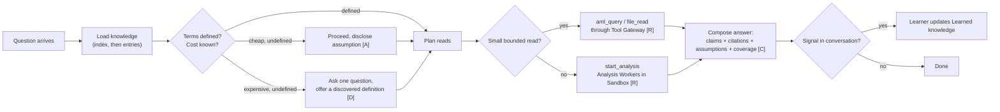
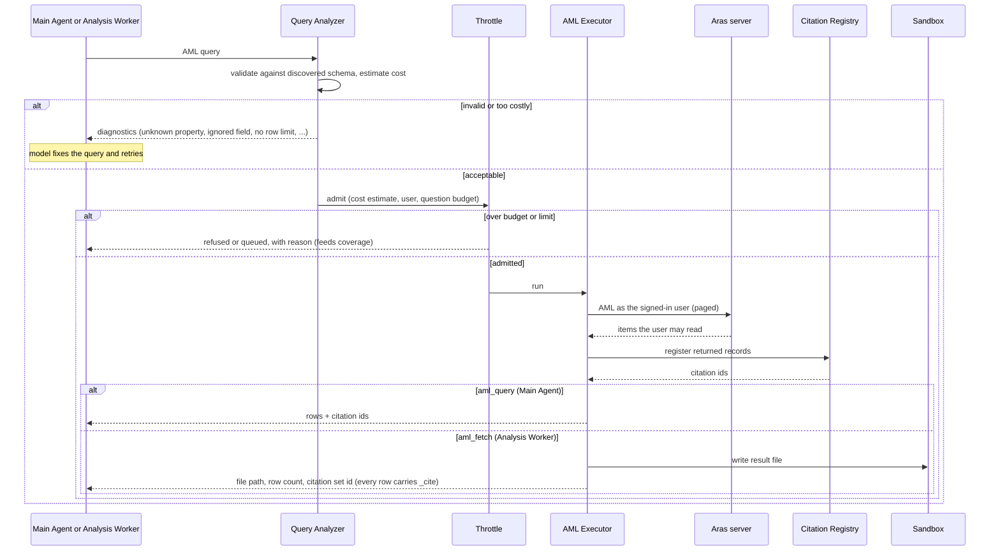
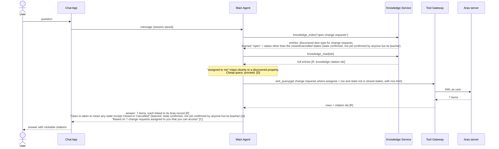
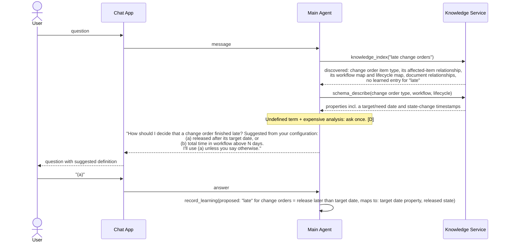
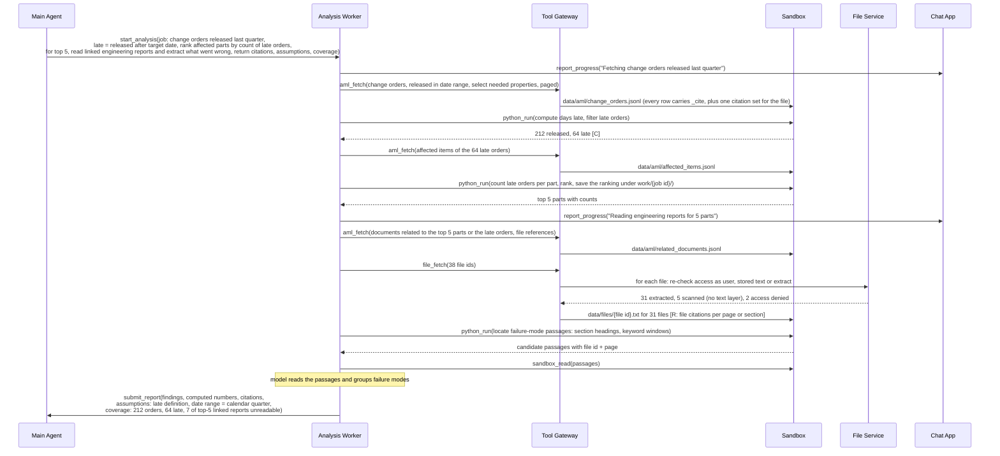
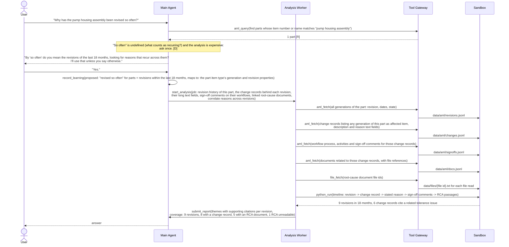
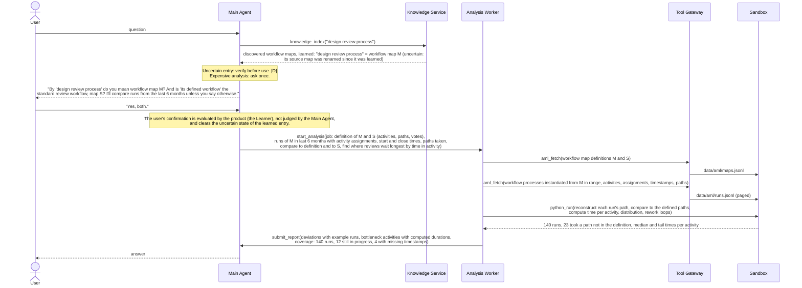
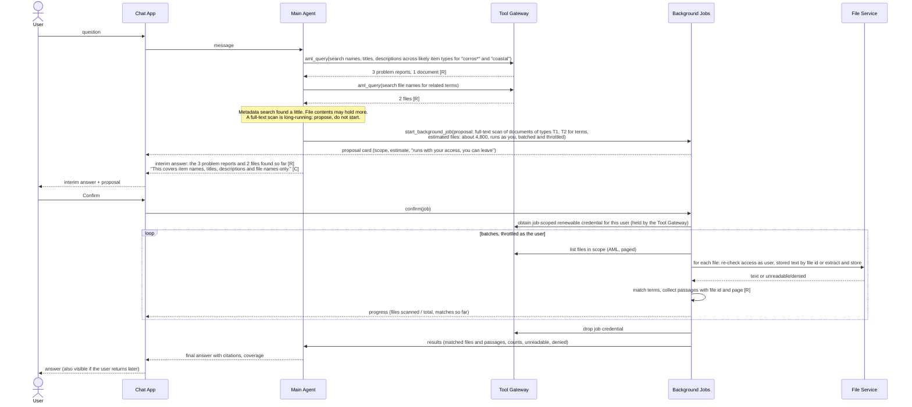

# Question lifecycle

This document follows five representative questions from the moment a user types them to the moment they read the answer. Together they cover every path through the system: a direct lookup, a multi-step analysis, a "why" question over unstructured evidence, process analysis, and a question with nothing to anchor on that becomes a background job.

Each walk-through marks four things the product always does, so they can be traced in the diagrams:

- **[D] Definitions** - where the agent asks for, or assumes, the meaning of a term.
- **[A] Assumptions** - where an assumption is disclosed to the user.
- **[C] Coverage** - where the size and gaps of the evidence are measured and reported.
- **[R] Citations** - where citation ids are issued by the Citation Registry and where they surface in the answer.

The item type, relationship, and property names used below (for example a change record type such as Express ECO, an Affected Item relationship, a Workflow Process with Activities) are typical of a standard Aras installation and are used only for illustration. In a real deployment every name comes from Discovery and must be verified against the target Aras version and the customer's configuration. Component names follow the [architecture overview](overview.md); tool names follow the [tool catalog](../specs/tool-catalog.md).

## Common stages

Every question passes through the same stages, though simple ones skip some.

What happens inside the Tool Gateway on every read is the same regardless of which agent asked:

Note that the user's Aras permissions are applied by Aras itself in the `Aras server` step. The Tool Gateway never filters results on its own authority, and never widens them.

## 1. Simple lookup answered by the Main Agent alone

> "Which change requests assigned to me are still open?"

This needs one bounded query. No Analysis Worker, no Sandbox.

Points to note:

- **[D] / [A]** If "open" had no learned meaning, the Main Agent would not stop to ask: the query is cheap. It would pick the states Discovery shows as non-terminal in the lifecycle map, run the query, and say so: "I took 'open' to mean any state except Closed and Cancelled; tell me if you mean something else." That sentence, if the user then corrects it, is a learning signal.
- **[R]** Every row in the answer carries a citation id that resolves to item type, id, and a link that opens the record in Aras. The learned definition of "open" is itself cited, with its state and confidence.
- **[C]** Coverage for a lookup is short: the count, and that it is limited to what the user can access. If the Throttle had stopped paging at a row budget, coverage would say "first N shown; more exist" instead of implying completeness.

## 2. Top-N analysis over change records with failure modes from linked reports

> "Which five parts appear most often on change orders that finished late last quarter, and what do the linked engineering reports say went wrong with them?"

This is the canonical heavy question: it needs a definition ("late"), aggregation over many records, traversal to affected items, and reading of linked documents.

### Stage 1: definition first, because the work is expensive

Property, state, and relationship names in the diagrams of these walk-throughs (a target date, a released state, affected items, generations of a part, votes, activity assignments) are illustrative; a real installation supplies its own through Discovery, to be verified against the target Aras version.

The suggested definitions are built from what Discovery found (a date property that looks like a target, a released state in the lifecycle map). The agent does not invent fields. The user's choice is a learning signal of the "explicit teaching" kind; the resulting Learned entry is organisation-wide immediately and will be stated as an assumption to other users until someone else confirms it ([ADR 0020](../decisions/0020-organisation-wide-learnings-with-disclosed-assumptions.md)). A learned entry has a state (confirmed, uncertain, contested, or retired) and, separately, whether anyone other than its teacher has confirmed it; until someone has, the agent states it as an assumption.

### Stage 2: bounded jobs to Analysis Workers

### Stage 3: answer

The Main Agent composes the answer from the report. It does not recompute numbers; it uses the ones the worker computed. The answer contains:

- The ranked list of five parts, each with the count of late change orders it appeared on, each linked to its record **[R]**, and each count traceable to the worker's computation.
- For each part, the failure mode(s) the reports describe, with a citation to file and page **[R]**.
- **Causal honesty:** "These parts appear most often on late change orders." Not "these parts made the change orders late."
- **[A]** "Late means released after its target date (defined by you just now). Last quarter means the previous calendar quarter."
- **[C]** "Based on 212 change orders released last quarter that you can access, of which 64 were late. 5 linked reports are scanned images and could not be read; 2 linked reports are not accessible to you. 3 of the late orders had no linked reports."

Failure modes drawn from the run:

| What goes wrong | What the system does | Where the user sees it |
| --- | --- | --- |
| The model writes AML with a property that does not exist on the change order type. | Query Analyzer returns a diagnostic naming the property and the closest discovered alternatives; the worker retries. | Not shown unless retries fail; then reported as a limitation. |
| The model writes a query with no row limit over all change orders. | Query Analyzer flags cost; Throttle requires paging. | Not shown. |
| The question budget for rows is reached before all affected items are fetched. | Throttle stops further fetches; the worker reports partial coverage. | Coverage: "Affected items fetched for 50 of 64 late orders (row budget reached)." |
| Scanned reports with no text layer. | File Service reports them unreadable (OCR deferred). | Coverage lists them by file name and counts them; an unreadable file has no text to cite. |
| A linked report the user cannot open. | Aras denies the download; File Service records denial. | Coverage counts them without naming their content. |
| A report contains text such as "ignore previous instructions". | Treated as data like any other text; it cannot change tools or permissions. | Not shown; at most quoted as content if relevant. |
| Two workers in parallel (for example one per quarter for a comparison). | Each gets its own bounded job; they share the conversation's Sandbox and draw on the turn's question budget (each worker has a share). | Progress lines from both. |

## 3. Why-question correlating revision history with root-cause documents and sign-off comments

> "Why has the pump housing assembly been revised so often?"

Here the evidence is mostly unstructured. The product guidance fixes the order in which "why" sources are tried: long text fields on items first, then workflow sign-off comments, then linked files read with code ([ADR 0012](../decisions/0012-no-vector-index-graph-first-retrieval.md)).

How the correlation works without a vector index or a search engine: the Aras item graph does the narrowing. The part leads to its revisions, the revisions lead to the change records that produced them, the change records lead to their workflow runs and their linked documents. Only the documents reached that way are read, so the set is small and every passage is tied to a specific revision. The model is the semantic layer: it reads the stated reasons, comments, and passages and groups them into themes.

The answer:

- Lays out a timeline of revisions, each with its change record and the reason given in that record **[R]**.
- Names recurring themes ("six of nine revisions reference a tolerance issue at the same interface"), each backed by citations to the change records, sign-off comments, and document passages that state it **[R]**.
- Stays associative: "the documented reasons point to", not "the root cause is", unless a cited document itself states a root cause, in which case the answer quotes and cites it.
- **[A]** "'So often' is taken to mean revisions in the last 18 months, as you confirmed; earlier history is available if you want it."
- **[C]** "9 revisions; 1 had no linked change record; 3 change records had no root-cause document; 1 document could not be read (scanned)."

## 4. Process-bottleneck question comparing workflow definitions with actual runs

> "Does our design review process follow its defined workflow, and where do reviews wait the longest?"

Process mining in this product means comparing the discovered workflow definition (the map) with the paths and timestamps of actual workflow and lifecycle runs. No separate process-mining engine is involved; it is Python over fetched run data.

The answer:

- States the comparison precisely: which steps of M are not in S, which runs left the defined paths and how often, and the activities with the longest time in activity, with the computed medians and tails **[R]** (every example run cited).
- Separates two different findings that are easy to conflate: deviation from the process definition (structural), and slowness within the definition (bottleneck).
- **[A]** "Time in an activity is measured from activation to closure; waiting for assignment is included."
- **[C]** "140 runs you can access; 12 still in progress are excluded from durations; 4 runs had missing timestamps."
- Causal honesty: "Activity A accounts for the largest share of elapsed time", not "A is why the process is slow".

## 5. A question with no item anchor that becomes a background full-text job

> "Have we ever had issues with corrosion on coastal installations?"

No part, document, or change record is named. The agent first tries the cheap anchors, and only proposes a scan of file contents if they are not enough.

Points to note:

- **Nothing runs without confirmation.** The proposal states what will be scanned, a rough size, that it runs with the user's own access, and that it may take a while. The user can decline and keep the interim answer.
- **Interim answer first.** The user gets what the cheap search found immediately, with coverage that says exactly what was and was not searched.
- **Job-scoped credential.** The job runs as the requesting user with a renewable credential that is scoped to this job, held by the Tool Gateway, and dropped when it ends. There is no privileged account. See [security-and-permissions.md](security-and-permissions.md#background-jobs-job-scoped-renewable-credentials).
- **Stored text makes later scans cheaper.** Extracted text is stored per immutable file id, so a later scan by anyone skips extraction for files already processed. Access is still re-checked through Aras, as that user, for every file on every use.
- **[C]** "Scanned 4,812 files you can access in document types T1 and T2. 640 had no text layer (scanned) and were not searched. 0 were denied. 14 files mention corrosion in a coastal context."
- **Leave and return.** Progress and results are attached to the session, which is saved in the Database; the user can close the browser and find the answer when they come back.

## Where each product rule shows up

| Rule | Walk-through 1 | 2 | 3 | 4 | 5 |
| --- | --- | --- | --- | --- | --- |
| Ask before expensive work [D] | not needed (cheap) | asks for "late" | asks what "so often" covers | asks which maps | proposal before scan |
| Disclose assumptions [A] | meaning of "open" | quarter, late | "so often" window | time-in-activity | search scope |
| Report coverage [C] | count, access-limited | records, unreadable, denied, unlinked | revisions without evidence | in-progress, missing timestamps | searched vs not searched |
| Cite everything [R] | records, knowledge entry | records, file pages | records, comments, file pages | runs, maps | records, file pages |
| Numbers computed in code | count from rows | Sandbox | Sandbox | Sandbox | job counts |
| Association, not causation | n/a | "appear most often on" | "documented reasons point to" | "largest share of time" | n/a |
| Learning signal | correction if any | explicit teaching | explicit teaching | none (the user's confirmation of the uncertain entry is evaluated by the Learner) | none |

## Open questions

- **Proposed:** the interim answer in walk-through 5 is shown before the background job is confirmed, so the user always has something. The exact wording and layout of the proposal card are specified in [chat-app.md](../specs/chat-app.md) and [background-jobs.md](../specs/background-jobs.md).
- **Proposed:** when a background job finishes, its results are composed into an answer by the Main Agent in the same conversation (rather than shown as raw matches). This keeps citation, coverage, and causal-honesty rules in one place.
- Per-question file budgets and relevance ordering of which files to read first are deliberately not tuned yet; they will be set once the system runs against real installations.
