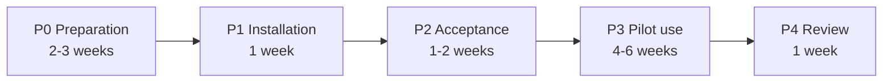

# Pilot plan

This plan describes how a company would evaluate Aras Insight before adopting it: the phases, what IT and security need to provide, the Aras version compatibility checks, the acceptance questions, the success criteria, the exit criteria, and the commercial terms. Phase lengths and user counts are defaults. The acceptance set and the success thresholds are the same for every pilot.

## Goals

A pilot answers three questions for the company:

1. **Does it answer our questions correctly**, on our installation, with our models, at each user's access level?
2. **Is it safe to run** against our Aras server and inside our environment?
3. **Is it worth it**, measured by the metrics in [value and ROI](value-and-roi.md)?

## Phases

| Phase | Activities | Output |
|---|---|---|
| P0 Preparation | Security review of the architecture and data flow; choice of environment, which is the company's choice (a production-mirroring test environment, or production with conservative throttling); model endpoint approval; sign-in client registration and the confirmations from the Aras owners listed under the compatibility checks; selection of pilot users; agreement on success criteria and on any questions the company adds to the acceptance set; recording of the throttling limits agreed with the Aras owners (see below); baseline timing of how long the acceptance questions take today, which also sets the minutes per answer type used for the estimated time saved metric. | Signed-off pilot charter. |
| P1 Installation | Deployment on company infrastructure ([deployment and operations](../architecture/deployment-and-operations.md)); model slot configuration; connection to Aras; the Aras version compatibility checks; first discovery run; smoke test as two users with different permissions. | Running system; discovery complete. |
| P2 Acceptance | The acceptance questions below, run one at a time with the pilot users and the evaluation team; load observation on the Aras server. | Acceptance results per question. |
| P3 Pilot use | Pilot users ask their own questions in daily work. Corrections feed learning. Weekly check-ins and a weekly report of the success measures; the first one or two weeks are a learning period for the answer correctness threshold. | Usage and quality records. |
| P4 Review | Metrics report from the product's usage views and export (usage summaries outlast the retention purge of the source records); user interviews; security and operations review; recording of the tuned limit values (the throttling limits and the files-per-question setting, which has no default); go or no-go decision. | Pilot report and recommendation. |

## Prerequisites from IT and security

| Area | Requirement |
|---|---|
| Aras environment | Access to a test environment that mirrors production configuration and representative data, or approval to use production with agreed throttling limits. The company chooses. Aras Insight reads only; it needs no Aras administrator account at run time. |
| Aras sign-in | The installation has an Aras authorization server. Users sign in only through it, and an installation without one is not supported in the MVP. An Aras administrator registers Aras Insight as a sign-in client once. The Aras owners also confirm whether the target Aras version's sign-in issues renewable grants for background jobs; where it does not, a full-text scan runs on the user's session credential and pauses when that session ends. |
| Users | Ten to twenty pilot users across at least four roles, each using their normal Aras account. |
| Infrastructure | A server or virtual machine able to run containers (or VMs, if the full-VM Sandbox option is required), with network access to the Aras server and vault, and to the model endpoints. |
| Database | A PostgreSQL instance. |
| Models | One or more approved OpenAI-compatible model endpoints for the three slots: main, worker, background. No embedding model is needed. |
| Security review | Review of authentication through Aras, credential handling in the Tool Gateway, Sandbox isolation, data storage, and audit records ([security and permissions](../architecture/security-and-permissions.md)). |
| Network | No outbound access is required from the Sandbox; it has none. Outbound access from the service only to Aras and to the configured model endpoints. |
| Monitoring | Access for the Aras owners to observe server load during P2 and P3. |
| Reporting | A person with read access to the product's documented database views, or who can run the export operation, to produce the metrics report. |

## Throttling limits for the pilot

P0 records the limits agreed between the company and the Aras owners. The product defaults are the starting point. A production pilot lowers them from the start, and any pilot lowers them first if interactive users on the Aras server are affected. The values are tuned against Aras response times during the pilot, and P4 records the values that worked.

| Limit | Default |
|---|---|
| Concurrent queries per user | 2 |
| Concurrent queries, system-wide | 8 |
| Heavy queries, system-wide | 2 |
| Share of system-wide slots that background jobs may use | At most half |
| Query timeout | 60 seconds |
| Queries per question | 200 |
| Rows per question | 50,000 |
| Data per question | 200 MB |
| Wall time per question | 1,800 seconds |

## Aras version compatibility checks

The design rests on Aras behaviours that differ between versions, so they are verified on the target installation in P0 and P1. They are checks, not guarantees.

- **Sign-in.** The installation has an authorization server that Aras Insight can be registered with, and the Aras owners confirm whether its sign-in issues renewable grants for background jobs.
- **Shipped check.** The product ships a one-time compatibility check. An administrator runs it once with an ordinary user account, and it exercises sign-in, a paged AML read, a configuration read, a file download, and a workflow-history read, and reports what works.
- **Manual checks.** The Aras owners confirm the behaviours a tool cannot exercise: renewable grants for background jobs, read-time server events and custom methods, immutability of file ids, the names of change records, and that reads take no item locks.
- **Version.** The product ships a query template set for Discovery, and a rule table for the Query Analyzer and the Tool Gateway, for each supported Aras version. Discovery selects the template set that matches the detected version, and an operator can override the choice. A version that is not supported is reported before pilot use starts. The supported versions are listed in [deployment and operations](../architecture/deployment-and-operations.md).
- **Skills.** The outlines of the Aras-specific skills mark facts to verify against real Aras versions. They are validated on the target version, and run-time discovery stays the rule for every name.

## Acceptance questions

The acceptance set is fixed by the product and is the same at product readiness (milestone M6 in the [roadmap](../product/roadmap.md)) and in every pilot. It has two parts. Part A is questions asked of Aras Insight; each is rephrased in the installation's own vocabulary. Part B is checks the evaluation team performs. Together they form the MVP acceptance test and are walked one at a time. A company may add questions of its own in P0; they do not replace those below. The same set is run before every release of the product, including releases that change skills or prompts.

At product readiness every item in Part A and Part B passes, and a failure is a product defect. In a customer pilot all of Part B and at least six of seven in Part A are required, because the customer's data may not support every question.

### Part A: questions asked of the product

| # | Question (generic form) | What a pass looks like |
|---|---|---|
| A1 | Which five parts appear most often on change orders that finished late last quarter, and what do the linked engineering reports say went wrong with them? | Asks for or states a definition of "late"; ranking with computed counts; failure modes with file citations; coverage including unreadable files; association, not causation. |
| A2 | Why was a given change, or a given kind of change, delayed? (where the reason is not in any structured field) | Reasons drawn from long text fields, sign-off comments, and files, each cited; says when no recorded reason exists. |
| A3 | What keeps driving new revisions of a given part or assembly? | Revision history correlated with linked change and problem records and with root-cause documents; record and file citations. |
| A4 | Find what our technical documents say about a given topic, together with the records they relate to. | Combined answer from records and file text; unanchored search through names and descriptions, and a proposed background full-text scan if needed, run only on confirmation. |
| A5 | Does a given review process follow its defined workflow, and where are the bottlenecks? | Defined workflow compared with actual runs; deviations with counts; waiting times per activity computed with code; example items cited. |
| A6 | A question that two pilot users with different permissions both ask. | Each answer reflects only what that user can access; coverage counts differ accordingly. |
| A7 | A question that depends on a local term, asked again by a second user after the first has explained the term. | The second answer uses the learned meaning and states it as an assumption with provenance. |

### Part B: evaluation checks

| # | Check | What a pass looks like |
|---|---|---|
| B1 | Point the product at a different approved model endpoint for one slot. | Works after a configuration change only; no code change. |
| B2 | Inspect the citations of the Part A answers. | Every cited record and passage exists and supports the claim it is attached to. |
| B3 | Ask a question that would need an unbounded or very expensive query. | The Query Analyzer flags cost; the agent narrows the query or asks; the Throttle holds limits. |
| B4 | Run several analytical questions concurrently during P2. | Aras server load stays within the limits recorded in P0. |
| B5 | Ask the same analytical question twice. | Both runs query Aras afresh (no caching in the MVP) and return consistent results when the underlying data has not changed. |
| B6 | Produce the ROI metrics for the pilot period from the product's records. | Metrics from [value and ROI](value-and-roi.md) produced from the usage views and database queries, without hand-collecting data apart from the customer's own baseline. |
| B7 | Review the audit records for a sample of answers, through the documented views or the export. | Every query is recorded against the user it ran for. |
| B8 | Try to make the Sandbox reach the network or Aras directly. | It cannot. |

## Success criteria

| Criterion | Threshold |
|---|---|
| Acceptance questions passed | All of Part B; at least six of seven in Part A. |
| Answer correctness | At least 90 percent of sampled answers judged correct by the user who asked, after checking citations. Reported weekly; the first one or two weeks of P3, set in the pilot charter, are a learning period and are left out of this threshold. |
| Citation accuracy | At least 95 percent of sampled citations support their claim. |
| Permission faithfulness | Zero cases of data shown that the user cannot see in Aras. |
| Production load | No incident attributed to the product; load within agreed limits. |
| Adoption | At least 60 percent of pilot users active in each of the last three weeks. |
| Time saved | Median time to answer on acceptance-type questions at least five times faster than the P0 baseline. |
| User judgement | A majority of pilot users would recommend continued use. |

## Exit criteria

The pilot ends early, with a no-go or a pause, if any of these occur:

- A confirmed case of data shown to a user who could not see it in Aras.
- A production incident on the Aras server attributed to the product that throttling limits did not prevent.
- A business data value found in shared learned knowledge that cannot be explained and fixed.
- The security review identifies a blocking issue that the design cannot address.

The pilot ends with a recommendation at P4 in all other cases: adopt, extend the pilot with changes, or stop.

## Commercial terms

The pilot is a fixed-fee, time-boxed engagement. If the company adopts the product at the end of the pilot, the pilot fee is credited against the first year's fee. See [pricing options](pricing-options.md).
