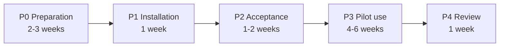

# Pilot plan

This plan describes how a company would evaluate Aras Insight before adopting it: the phases, what IT and security need to provide, the acceptance questions, the success criteria, and the exit criteria. Durations, user counts, and thresholds are **Proposed** starting points to agree with the company.

## Goals

A pilot answers three questions for the company:

1. **Does it answer our questions correctly**, on our installation, with our models, at each user's access level?
2. **Is it safe to run** against our Aras server and inside our environment?
3. **Is it worth it**, measured by the metrics in [value and ROI](value-and-roi.md)?

## Phases

| Phase | Activities | Output |
|---|---|---|
| P0 Preparation | Security review of the architecture and data flow; choice of environment (a production-mirroring test environment, or production with conservative throttling); model endpoint approval; selection of pilot users; agreement on acceptance questions, success criteria, and throttling limits; baseline timing of how long the acceptance questions take today. | Signed-off pilot charter. |
| P1 Installation | Deployment on company infrastructure ([deployment and operations](../architecture/deployment-and-operations.md)); model slot configuration; connection to Aras; first discovery run; smoke test as two users with different permissions. | Running system; discovery complete. |
| P2 Acceptance | The acceptance questions below, run one at a time with the people who proposed them; load observation on the Aras server. | Acceptance results per question. |
| P3 Pilot use | Pilot users ask their own questions in daily work. Corrections feed learning. Weekly check-ins. | Usage and quality records. |
| P4 Review | Metrics report from the product's records; user interviews; security and operations review; go or no-go decision. | Pilot report and recommendation. |

## Prerequisites from IT and security

| Area | Requirement |
|---|---|
| Aras environment | Access to a test environment that mirrors production configuration and representative data, or approval to use production with agreed throttling limits. Aras Insight reads only; it needs no Aras administrator account. |
| Users | Ten to twenty pilot users across at least four roles, each using their normal Aras account. |
| Infrastructure | A server or virtual machine able to run containers (or VMs, if the full-VM Sandbox option is required), with network access to the Aras server and vault, and to the model endpoints. |
| Database | A PostgreSQL instance. |
| Models | One or more approved model endpoints (OpenAI-compatible or a natively supported client) for the three slots: main, worker, background. No embedding model is needed. |
| Security review | Review of authentication through Aras, credential handling in the Tool Gateway, Sandbox isolation, data storage, and audit records ([security and permissions](../architecture/security-and-permissions.md)). |
| Network | No outbound access is required from the Sandbox; it has none. Outbound access from the service only to Aras and to the configured model endpoints. |
| Monitoring | Access for the Aras owners to observe server load during P2 and P3. |

## Acceptance questions

The acceptance set has two parts. Part A is questions asked of Aras Insight; each should be rephrased in the installation's own vocabulary. Part B is checks the evaluation team performs. Together they form the MVP acceptance test and are walked one at a time.

### Part A: questions asked of the product

| # | Question (generic form) | What a pass looks like |
|---|---|---|
| A1 | Which five components appear most often on change orders that ran late last quarter, and what failure modes do the reports linked to them describe? | Asks for or states a definition of "late"; ranking with computed counts; failure modes with file citations; coverage including unreadable files; association, not causation. |
| A2 | Why was a given change, or a given kind of change, delayed? (where the reason is not in any structured field) | Reasons drawn from long text fields, sign-off comments, and files, each cited; says when no recorded reason exists. |
| A3 | What keeps driving new revisions of a given part or assembly? | Revision history correlated with linked change and problem records and with root-cause documents; record and file citations. |
| A4 | Find what our technical documents say about a given topic, together with the records they relate to. | Combined answer from records and file text; unanchored search through names and descriptions, and a proposed background full-text scan if needed, run only on confirmation. |
| A5 | Does a given review process follow its defined workflow, and where are the bottlenecks? | Defined workflow compared with actual runs; deviations with counts; waiting times per activity computed with code; example items cited. |
| A6 | A question that two pilot users with different permissions both ask. | Each answer reflects only what that user can access; coverage counts differ accordingly. |
| A7 | A question that depends on a local term, asked again by a second user after the first has explained the term. | The second answer uses the learned meaning and states it as an assumption with provenance. |

### Part B: evaluation checks

| # | Check | What a pass looks like |
|---|---|---|
| B1 | Point the product at a different approved model endpoint for one slot. | Works after a configuration change only; no code change. |
| B2 | Inspect the citations of the Part A answers. | Every cited record and passage exists and supports the claim it is attached to. |
| B3 | Ask a question that would need an unbounded or very expensive query. | The Query Analyzer flags cost; the agent narrows the query or asks; the Throttle holds limits. |
| B4 | Run several analytical questions concurrently during P2. | Aras server load stays within the limits agreed in P0. |
| B5 | Ask the same analytical question twice. | Both runs query Aras afresh (no caching in the MVP) and return consistent results when the underlying data has not changed. |
| B6 | Produce the ROI metrics for the pilot period from the product's records. | Metrics from [value and ROI](value-and-roi.md) computed without manual data collection. |
| B7 | Review the audit records for a sample of answers. | Every query is recorded against the user it ran for. |
| B8 | Try to make the Sandbox reach the network or Aras directly. | It cannot. |

## Success criteria

| Criterion | Proposed threshold |
|---|---|
| Acceptance questions passed | All of Part B; at least six of seven in Part A. |
| Answer correctness | At least 90 percent of sampled answers judged correct by the user who asked, after checking citations. |
| Citation accuracy | At least 95 percent of sampled citations support their claim. |
| Permission faithfulness | Zero cases of data shown that the user cannot see in Aras. |
| Production load | No incident attributed to the product; load within agreed limits. |
| Adoption | At least 60 percent of pilot users active in each of the last three weeks. |
| Time saved | Median time to answer on acceptance-type questions at least five times faster than the P0 baseline. |
| User judgement | A majority of pilot users would recommend continued use. |

## Exit criteria

The pilot ends early, with a no-go or a pause, if any of these occur:

- A confirmed case of data shown to a user who could not see it in Aras.
- A production incident on the Aras server attributed to the product that throttling limits did not prevent.
- A business data value found in shared learned knowledge that cannot be explained and fixed.
- The security review identifies a blocking issue that the design cannot address.

The pilot ends with a recommendation at P4 in all other cases: adopt, extend the pilot with changes, or stop.

## Open questions

1. Phase durations, user counts, and thresholds are Proposed.
2. Whether a pilot runs against production or a test environment is a per-company choice made in P0.
