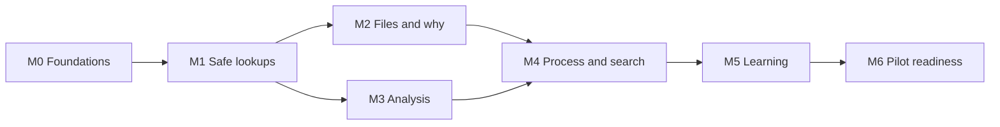

# Roadmap

This roadmap has two parts: a proposed sequence of milestones to reach the MVP, and the product-level items deliberately deferred from the MVP, with why each is deferred and what would trigger revisiting it. A few smaller deferrals recorded in the module specifications are listed at the end of Part 2. No dates are given; the project is at the specification stage.

## Part 1: MVP milestones (Proposed)

The sequence below is **Proposed**. It orders the work so that each milestone can be demonstrated against a real Aras installation and so that the protections for the Aras server exist before heavy analysis does.

| Milestone | Delivers | Demonstrated by |
|---|---|---|
| M0 Foundations | Database, Model Router with three slots, Chat App sign-in through Aras, Tool Gateway with the AML Executor, session storage, audit records. | A user signs in and the system runs a fixed AML query as that user, with an audit record. |
| M1 Safe lookups | Discovery, `schema_describe`, Knowledge Service core (Product Skills layer and Discovered layer, `knowledge_index`, `knowledge_read`), Query Analyzer (validity and cost), Throttle, Citation Registry, Main Agent with `aml_query`, shipped AML skill, record citations. | Lookups answered with record citations; invalid and unbounded queries caught and retried; two users with different permissions get different, correct answers. |
| M2 Files and why | File Service with the MVP formats and the extracted-text store, `file_read`, file citations, workflow sign-off comments as a source, coverage reporting including unreadable files. | "Why" questions answered from text fields, sign-off comments, and files, with passage citations. |
| M3 Analysis | Analysis Worker, Sandbox (hardened container, no network), worker tools, `start_analysis`, parallel workers, live progress, reports with assumptions and coverage, the clarifying-question rule. | Ranking, trend, and duration questions answered with computed numbers that match a manual check. |
| M4 Process and search | Process analysis over workflow and lifecycle history; unanchored search through AML; Background Jobs with job-scoped renewable credentials (where the Aras sign-in offers them); user-confirmed full-text scans. | Process deviation and bottleneck questions; an unanchored question resolved by a confirmed background scan. |
| M5 Learning | Learned knowledge and User Preferences in the Knowledge Service, Learner (live and batched), entry states for learned entries and invalidation by configuration change, provenance and assumption statements. | A term taught by one user is used, with an assumption statement, for a second user; a configuration change makes dependent entries uncertain. |
| M6 Pilot readiness | Deployment packaging, operations guide, full-VM Sandbox option, load testing against throttling limits, the acceptance question set from the [pilot plan](../business/pilot-plan.md). | All acceptance questions pass in a staging environment. |

Module detail for each milestone is in the [module specifications](../specs/README.md).

## Part 2: Deferred items

Every item in the tables below is out of the MVP. They are grouped by theme. "Trigger" is the condition under which the item should be reconsidered; triggers are **Proposed** unless stated otherwise in the row. Smaller deferrals that the module specifications record are listed after the tables.

### Data access and load

| Item | What it is | Why deferred | Trigger to revisit |
|---|---|---|---|
| Analytics path that does not load production | A read replica, reporting copy, or SQL path for heavy analytics, keeping user-level access faithful. | Reading through the Aras server as the user is the only way the MVP can guarantee Aras permissions and read-time server logic are applied. A direct path must reproduce them, which custom read-time server methods make hard. | Production load from the product approaches agreed limits despite throttling, or analytical questions regularly hit row budgets; and a way to preserve user-level access is demonstrated. |
| Answer and query result caching | A cache keyed by the normalised query and the user's permission scope, so cached results never cross access boundaries. | Correct cache keys under per-user permissions are subtle, and repeated questions are not yet known to be a load problem. | Usage records show the same analytical questions repeated often enough to matter for load or response time. |
| Product-kept history of Aras data | Recording data change history from install day, for trends Aras itself does not retain. | Keeping copies of business data raises storage, access-control, and privacy questions, and conflicts with the "how, never what" posture. | Users regularly ask for trends over data that Aras overwrites or does not keep, and a permission-faithful storage design exists. |
| Multiple Aras instances | One deployment spanning several Aras installations. | Discovery, knowledge, and identity are per installation; spanning them multiplies complexity. | A customer with several production installations needs combined answers. |
| Sources outside Aras | ERP, MES, supplier systems, and other enterprise sources. | Scope is Aras and its connected things. Each new source brings its own access model to respect. | Pilot users repeatedly need data that only lives outside Aras, and that source offers user-level access. |

### Files and content

| Item | What it is | Why deferred | Trigger to revisit |
|---|---|---|---|
| OCR for scanned documents | Text extraction from scanned PDFs and images. | Adds an extraction pipeline and accuracy concerns. Unreadable files are reported in coverage in the meantime, so the gap is visible. | Coverage reports show a significant share of relevant files are scanned; engineering reports and root-cause analyses are a common case. |
| Email, image, and other formats | Reading .msg and .eml files, images, and other formats, alongside OCR. | Each format adds extraction work; the MVP formats cover most text-bearing documents. | Coverage reports show these formats are common among relevant files. |
| CAD geometry understanding | Reading or reasoning over CAD geometry. | A separate and large problem from text and records. | Clear demand for geometric questions that metadata and documents cannot answer. |

### Knowledge maintenance

| Item | What it is | Why deferred | Trigger to revisit |
|---|---|---|---|
| Deployment hook | On Aras configuration deployment, trigger re-discovery and update, retire, or mark uncertain the dependent learned knowledge. | Discovery already detects changes through modification stamps; a hook needs integration with each customer's deployment process. | Configuration changes are frequent enough that stamp-based detection lags noticeably, or a customer's deployment pipeline offers a simple hook point. |
| Age out unused knowledge | Learned entries unused for a long time lose confidence or are retired. | The knowledge base starts small; staleness is already driven by configuration changes. | The knowledge base grows large enough that unused entries slow loading or confuse the agent. |
| Vector index for knowledge | Vector search over learned and discovered knowledge. | Index-and-description loading is simpler, needs no embedding model, and is enough at expected sizes. It would also reverse the earlier decision that vector search, if ever used, is for files inside Aras only, so it needs a new decision record. | The knowledge base outgrows index-based loading, measured by context size or missed relevant entries. |
| Scheduled leak checks | Scheduled checks, possibly with small inexpensive models, that flag learned entries where data values slipped in. | The MVP relies on a strong initial prompt to keep data values out of shared knowledge. | Any data value is found in a learned entry, or a customer's security review requires automated checking. |

### Interfaces and outputs

| Item | What it is | Why deferred | Trigger to revisit |
|---|---|---|---|
| Teams and Slack integration | Asking the agent from Teams or Slack. | Sign-in through Aras and per-user credentials must carry over to each platform. | Pilot users ask for it, and the chat platform can carry Aras identity. |
| MCP interface | Exposing the tool layer over MCP so external agents can use it. | Outside agents would need the same permission, throttling, and citation guarantees; the MVP focuses on its own users. | Customers want their own agents or harnesses to use Aras through the product's protections. |
| Chart and result export | Exporting answers, tables, and charts. | Not required to prove the core value. | Users copy results out by hand regularly. |
| Saved questions and dashboards | Saving questions and pinning results as dashboards. | Depends on stable answering and, for efficiency, on caching. | The same users ask the same questions repeatedly. |
| Scheduled reports | Running saved questions on a schedule and delivering the results. | Depends on saved questions and on long-lived per-user credentials. | Saved questions exist and users ask for regular delivery. |
| Suggested questions | Suggesting useful questions per role or context. | Needs usage data to suggest well. | Enough usage history exists to know which questions each role finds useful. |
| ROI and usage dashboard | Usage and ROI metrics for buyers: questions answered, time saved, citation follow-through. | The MVP records the underlying audit and usage data; a dashboard is presentation on top. The metrics themselves are defined in [value and ROI](../business/value-and-roi.md). | A pilot or customer needs to report ROI regularly to its leadership. |

### Users, writes, and models

| Item | What it is | Why deferred | Trigger to revisit |
|---|---|---|---|
| Developer and admin features | Features aimed at Aras developers and administrators. | The MVP targets business end users. | Administrators and developers become a significant share of users or ask for specific features. |
| Write actions in Aras | Creating or editing items, with the approval and audit implications. | Read-only removes the largest category of risk. Writing may never be added. | A strong, specific customer need, together with an approval and audit design acceptable to the customer's Aras owners. |
| Model fine-tuning | Fine-tuning models on customer data. | Discovery, learned knowledge, and shipped skills adapt the product to an installation without training; fine-tuning adds data-governance burden. | Measured answer quality plateaus on installation-specific questions that knowledge and skills do not fix. |

### Smaller deferrals recorded in module specifications

The module specifications also record a few smaller deferrals that are not product-level items. None is part of the MVP, and each is described in the specification named, without a revisit trigger of its own.

- Notifications outside the app, such as email or chat messages when a long answer is ready ([Chat App](../specs/chat-app.md), [Audit and progress](../specs/audit-and-progress.md)).
- Forwarding audit events to a customer's own systems, a Proposed future item ([Audit and progress](../specs/audit-and-progress.md)).
- Cost estimates based on data volume, such as approximate counts per item type ([Query Analyzer](../specs/query-analyzer.md)).
- Operator-facing editing of the query analysis rules ([Query Analyzer](../specs/query-analyzer.md)).
- A search index over file contents. The vector index above covers knowledge only ([File Service](../specs/file-service.md)).

## Open questions

1. The milestone order in Part 1 is Proposed and needs confirmation.
2. All revisit triggers in Part 2 are Proposed.
