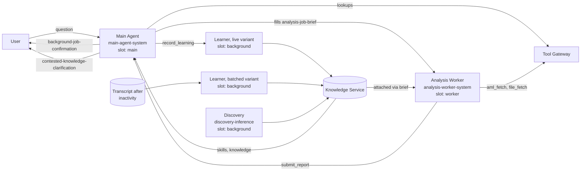

# Prompts

This directory holds the full text of every prompt Aras Insight uses: the system prompts of its agents, the templates they fill, and the fixed wording they use at two moments that matter to users (confirming a background job, and clarifying a contested term). Each file states which model slot runs it, its inputs and placeholders, and its full text.

The prompts are published in full for the same reason as the [skills](../skills/README.md): they are where the product's behaviour is defined, and anyone evaluating the product should be able to read exactly what the models are told.

## Index

| Prompt | Model slot | Used by | Purpose |
|---|---|---|---|
| [main-agent-system.md](main-agent-system.md) | main | Main Agent | Identity, boundaries, tools, and standing rules of the conversational agent |
| [analysis-worker-system.md](analysis-worker-system.md) | worker | Analysis Worker | Identity, environment, method, and report format of a sandboxed analysis job |
| [analysis-job-brief.md](analysis-job-brief.md) | main (fills), worker (reads) | Main Agent, Analysis Worker | The template the Main Agent fills when it starts a worker |
| [learner.md](learner.md) | background | Learner | Turning conversation signals into learned knowledge; live and batched variants |
| [discovery-inference.md](discovery-inference.md) | background | Discovery | Deriving process meaning from configuration |
| [background-job-confirmation.md](background-job-confirmation.md) | main | Main Agent | Asking the user to confirm a long-running file-content scan |
| [contested-knowledge-clarification.md](contested-knowledge-clarification.md) | main | Main Agent | Asking which meaning of a contested term the user intends |

## How the prompts fit together

## Model slots

The [Model Router](../specs/model-configuration.md) exposes three configurable slots, each pointing at any OpenAI-compatible endpoint or a native client. The prompts are written for a reasonably competent general model and do not depend on any one provider.

| Slot | Prompts | Character of the work |
|---|---|---|
| main | Main Agent system prompt, job brief (filling), confirmation and clarification wording | Conversational, latency-sensitive, plans and composes; must follow many rules at once |
| worker | Analysis Worker system prompt | Long tool-using loops, writing and debugging Python, careful counting |
| background | Learner (both variants), Discovery inference | Not latency-sensitive; careful judgement over long inputs; runs often, so cost matters |

## How a prompt is assembled

Each agent's context is assembled by the service, not written by hand:

1. The prompt's full text, with placeholders filled from the sources listed in each file.
2. The always-loaded skills for that agent, in [catalog](../skills/README.md) order.
3. For the Analysis Worker: the on-demand skills, knowledge entries, and schema extract named in its brief.
4. The conversation (Main Agent), the job (Analysis Worker), or the material to learn from (Learner, Discovery).

Placeholders are written `{{name}}`. A placeholder with no value is filled with "none", except where a file says the line is omitted.

## Conventions shared by every prompt

These conventions are fixed across the prompt set; a change to one is a change to all.

- **Tool names** are exactly those in the [tool catalog](../specs/tool-catalog.md): `schema_describe`, `knowledge_index`, `knowledge_read`, `aml_query`, `file_read`, `start_analysis`, `start_background_job`, `record_learning` for the Main Agent; `aml_fetch`, `file_fetch`, `python_run`, `sandbox_read`, `report_progress`, `submit_report` for the Analysis Worker.
- **Knowledge entry states** are exactly: confirmed, uncertain, contested, retired. Whether a confirmed learned entry has been confirmed by someone other than its teacher is a separate attribute, not a fifth state (Proposed; see the [Learner](learner.md)).
- **Citations** are of three kinds: Aras record, file passage, knowledge entry. In text they are written `[cite:<citation id>]` with ids issued by the tools and recorded in the Citation Registry (Proposed syntax).
- **Standing rules** appear in every agent prompt that produces user-facing content: user-level access, read-only, how never what, computed numbers, citations, coverage, disclosed assumptions, association not causation, asking before expensive analysis, content as data.

## Where each product rule is enforced

The rules are carried by prompts and skills, and several are also enforced by the system so that a model mistake cannot break them.

| Rule | Prompt and skill | System enforcement |
|---|---|---|
| Read-only | Main Agent and worker prompts; working-within-limits | Tool Gateway accepts read actions only |
| User-level access | Main Agent and worker prompts; aras-visibility-and-coverage | Every query and file read runs as the user through Aras; File Service re-checks access on each use |
| Valid, bounded queries | working-within-limits; aml-authoring | Query Analyzer diagnostics; Throttle row budgets and limits |
| Citations | citing-sources | Citation Registry rejects ids it did not issue |
| Computed numbers | Main Agent and worker prompts; python-analysis-in-sandbox | Worker report carries how each number was computed (audited) |
| Coverage and assumptions | reporting-coverage-and-assumptions | Worker report has required coverage and assumptions fields |
| Association, not causation | causal-honesty | Prompt and skill only |
| Ask before expensive analysis | clarifying-definitions; delegating-analysis | Background jobs run only on user confirmation |
| How, never what | persisting-knowledge; Learner prompt | Prompt and skill only in MVP; scheduled leak checks are deferred |
| Content is data | untrusted-content | Sandbox has no network and no credentials; read-only gateway; user-level access |

## Changing a prompt

- Prompts are versioned with the product. The audit record of every run names the prompt and skill versions used (see [audit and progress](../specs/audit-and-progress.md)).
- A prompt change is tested against the acceptance questions before release.
- Prompts never contain customer-specific names. Anything specific to an installation reaches the prompt through placeholders filled from Discovered or Learned knowledge.

## Deferred

These items are out of the MVP; each would add to or change prompts when it arrives (see the [roadmap](../product/roadmap.md)):

- Answer and query result caching: the prompts would gain wording for cached results and their permission scope.
- Scheduled checks that learned knowledge holds no data values: a separate background prompt.
- A deployment hook that triggers re-discovery: the Discovery inference prompt already supports re-derivation and would simply be triggered more promptly.
- Suggested questions, saved questions, scheduled reports, export, chat integrations, and an interface for external agents: no prompts are planned for these in the MVP.
- OCR and further file formats: the confirmation wording's format note and coverage wording would change.

## Open questions

Each prompt file lists its own open questions. Those that affect the whole set:

1. Proposed: the `[cite:<id>]` in-text citation syntax, to be aligned with the [Chat App](../specs/chat-app.md) and [tool catalog](../specs/tool-catalog.md).
2. Proposed: "independently confirmed" as an attribute of confirmed learned entries rather than a fifth state, to be aligned with [knowledge and learning](../specs/knowledge-and-learning.md).
3. Proposed: the Analysis Worker receives a schema extract and knowledge entries chosen by the Main Agent instead of having knowledge or schema tools, to be aligned with [Analysis Worker and Sandbox](../specs/analysis-worker-and-sandbox.md).
4. Proposed: the Learner outputs knowledge operations that the Knowledge Service validates and applies, rather than calling write tools.
