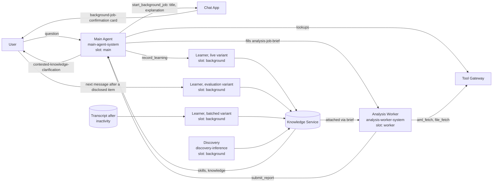

# Prompts

This directory holds the full text of every prompt Aras Insight uses: the system prompts of its agents, the templates they fill, and the fixed wording used at two moments that matter to users: the card that asks the user to confirm a background job (rendered by the Chat App from the job proposal) and the question that clarifies a contested term (written by the Main Agent from a template). Each file states which model slot runs it, its inputs and placeholders, and its full text.

The prompts are published in full for the same reason as the [skills](../skills/README.md): they are where the product's behaviour is defined, and anyone evaluating the product should be able to read exactly what the models are told.

## Index

| Prompt | Model slot | Used by | Purpose |
|---|---|---|---|
| [main-agent-system.md](main-agent-system.md) | main | Main Agent | Identity, boundaries, tools, and standing rules of the conversational agent |
| [analysis-worker-system.md](analysis-worker-system.md) | worker | Analysis Worker | Identity, environment, method, and report format of a sandboxed analysis job |
| [analysis-job-brief.md](analysis-job-brief.md) | main (fills), worker (reads) | Main Agent, Analysis Worker | The template the Main Agent fills when it starts a worker |
| [learner.md](learner.md) | background | Learner | Turning conversation signals into learned knowledge, and judging the user's replies to disclosed assumptions; live, evaluation, and batched variants |
| [discovery-inference.md](discovery-inference.md) | background | Discovery | Deriving process meaning from configuration |
| [background-job-confirmation.md](background-job-confirmation.md) | none for the card; main for its title, explanation and the interim answer | Chat App, Main Agent | Asking the user to confirm a long-running file-content scan |
| [contested-knowledge-clarification.md](contested-knowledge-clarification.md) | main | Main Agent | Asking which meaning of a contested term the user intends |

## How the prompts fit together

## Model slots

The [Model Router](../specs/model-configuration.md) exposes three configurable slots, each pointing at any OpenAI-compatible endpoint or a native client. The prompts are written for a reasonably competent general model and do not depend on any one provider.

| Slot | Prompts | Character of the work |
|---|---|---|
| main | Main Agent system prompt, job brief (filling), the title and explanation of a background job proposal, contested-clarification wording | Conversational, latency-sensitive, plans and composes; must follow many rules at once |
| worker | Analysis Worker system prompt | Long tool-using loops, writing and debugging Python, careful counting |
| background | Learner (all three variants), Discovery inference, and by default the model-based final answer check | Not latency-sensitive; careful judgement over long inputs; runs often, so cost matters. Live Learner calls and answer checks take priority over batched work on the slot |

## How a prompt is assembled

Each agent's context is assembled by the service, not written by hand:

1. The prompt's full text, with placeholders filled from the sources listed in each file.
2. The always-loaded skills for that agent, in [catalog](../skills/README.md) order. For every agent they come after the prompt text, and in the Learner and Discovery prompts they are the last section.
3. For the Analysis Worker: the schema extract and knowledge entries named in its brief, the on-demand skills it names, and the uncertain-and-contested-knowledge skill, which the service adds whenever an attached entry is not independently confirmed, or is uncertain or contested. The worker has no schema or knowledge tools.
4. The conversation (Main Agent), the job (Analysis Worker), or the material to learn from (Learner, Discovery).

Placeholders are written `{{name}}`. A placeholder in internal text (a brief section, a list given to a model) with no value is filled with "none". A placeholder in text the user reads is never filled with "none": the line or sentence that holds it is left out, and each file says which lines.

The domain skills the prompts name (aml-authoring and the others in the [catalog](../skills/README.md)) are specified there by name, purpose, and outline; their full texts are written during implementation and validated against real Aras versions. The domain skills that an agent always loads must be written and validated before the MVP acceptance walk-through, because no query can be written reliably without them.

## Conventions shared by every prompt

These conventions are fixed across the prompt set; a change to one is a change to all.

- **Tool names** are exactly those in the [tool catalog](../specs/tool-catalog.md): `schema_describe`, `knowledge_index`, `knowledge_read`, `aml_query`, `file_read`, `start_analysis`, `start_background_job`, `record_learning` for the Main Agent; `aml_fetch`, `file_fetch`, `python_run`, `sandbox_read`, `report_progress`, `submit_report` for the Analysis Worker.
- **Knowledge entry states** are exactly: confirmed, uncertain, contested, retired. Whether a confirmed learned entry has been confirmed by someone other than its teacher is a separate attribute, `confirmation_status`, with two values (unconfirmed or independently_confirmed), not a fifth state (see the [Learner](learner.md)).
- **Citations** are of three kinds: Aras record, file passage, knowledge entry. In text they are written `[cite:<citation id>]`, right after the statement they support, with ids issued by the tools and recorded in the Citation Registry. A citation set (id prefix `cst_`) groups the record citations behind a figure and is cited the same way; it is a grouping, not a fourth kind. In structured worker report fields the ids are written bare.
- **Standing rules** appear in every agent prompt that produces user-facing content: user-level access, read-only, how never what, computed numbers, citations, coverage, disclosed assumptions, association not causation, asking before expensive analysis, content as data.

## Where each product rule is enforced

The rules are carried by prompts and skills, and several are also enforced by the system so that a model mistake cannot break them.

| Rule | Prompt and skill | System enforcement |
|---|---|---|
| Read-only | Main Agent and worker prompts; working-within-limits | Tool Gateway accepts read actions only |
| User-level access | Main Agent and worker prompts; aras-visibility-and-coverage | Every query and file read runs as the user through Aras; File Service re-checks access on each use |
| Valid, bounded queries | working-within-limits; aml-authoring | Query Analyzer diagnostics; Throttle row budgets and limits |
| Citations | citing-sources | Citation Registry rejects ids it did not issue; the final answer check removes or flags unregistered markers and uncited factual sentences |
| Computed numbers | Main Agent and worker prompts; python-analysis-in-sandbox. The Main Agent does no arithmetic; every number, percentage and rounded figure comes from a tool or a worker | Worker report carries how each number was computed (audited); the final answer check verifies that every number in an answer appears in a tool result or a worker report |
| Coverage and assumptions | reporting-coverage-and-assumptions | Worker report has required coverage and assumptions fields |
| Association, not causation | causal-honesty | A light wording check when a worker submits its report (advisory); the final answer check on every answer lists causal claims and is the enforced layer |
| Ask before expensive analysis | clarifying-definitions; delegating-analysis | Background jobs run only on user confirmation |
| How, never what | persisting-knowledge; Learner prompt (which strips every data value, and outputs no change when nothing remains) | Prompt and skill only in MVP; scheduled leak checks are deferred |
| Content is data | untrusted-content | Sandbox has no network and no credentials; read-only gateway; user-level access |
| Final answer check | Main Agent prompt (it states what the check looks for); composing-the-final-answer | Structural checks on every answer (markers registered, coverage block present, no number absent from tool results and reports) plus a model-based check on every answer, switchable off; it runs on the background slot by default, configurable to the main slot ([ADR 0047](../decisions/0047-final-answer-check.md)) |

## Changing a prompt

- Prompts and skills are versioned and released together with the product. The audit record of every turn, analysis, and job names the product release, which identifies the prompt and skill texts used, and each message records the version of the prompt set it used (see [audit and progress](../specs/audit-and-progress.md)).
- A change to a prompt or a skill is tested before release against one shared suite of acceptance conversations, the MVP acceptance questions (see the [pilot plan](../business/pilot-plan.md)). The suite runs before every release; it may be split into per-skill sets later if it becomes slow or unfocused.
- Prompts never contain customer-specific names. Anything specific to an installation reaches the prompt through placeholders filled from Discovered or Learned knowledge.

## Deferred

These items are out of the MVP; each would add to or change prompts when it arrives (see the [roadmap](../product/roadmap.md)):

- Answer and query result caching: the prompts would gain wording for cached results and their permission scope.
- Scheduled checks that learned knowledge holds no data values: a separate background prompt.
- A deployment hook that triggers re-discovery: the Discovery inference prompt already supports re-derivation and would simply be triggered more promptly.
- Suggested questions, saved questions, scheduled reports, export, chat integrations, and an interface for external agents: no prompts are planned for these in the MVP.
- OCR and further file formats: the confirmation wording's format note and coverage wording would change.
