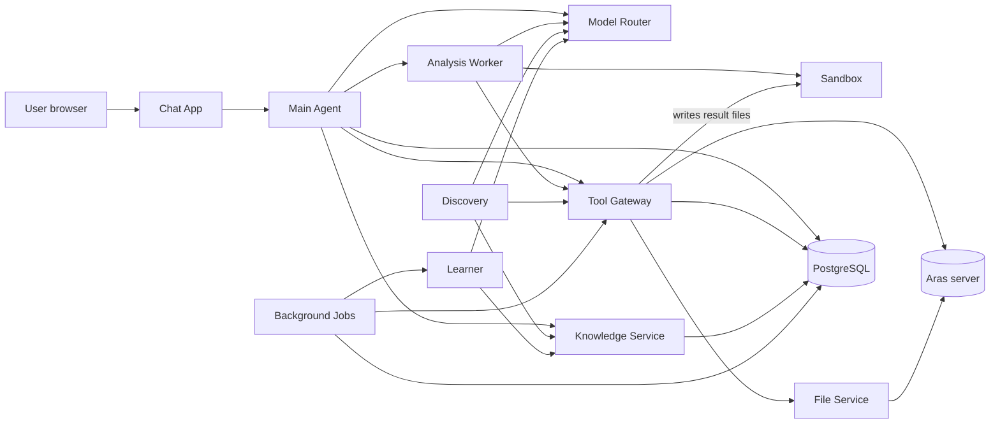

# Module specifications

This folder specifies every module of Aras Insight in enough detail to build it without a further design conversation. The specifications describe behaviour, interfaces, data, limits, and failure handling in prose and tables; they contain no code. They sit below the [architecture overview](../architecture/overview.md), which explains how the modules fit together, and the [decision records](../decisions/README.md), which explain why.

## How to read these documents

- **Decision-makers** can read section 1 (Purpose) and section 11 (MVP versus deferred) of each specification to see what will be built and what will not. The questions that remain open are collected in [docs/open-questions.md](../open-questions.md).
- **Engineers** should start with the [architecture overview](../architecture/overview.md) and the [question lifecycle](../architecture/question-lifecycle.md), then read [tool-catalog.md](tool-catalog.md) and [persistence.md](persistence.md), which every other specification refers to.

Every module specification uses the same sections: purpose; responsibilities and non-responsibilities; interfaces; data owned; behaviour; configuration; limits; failure modes and recovery; security considerations; observability; MVP versus deferred.

## Conventions used throughout

- **Open questions.** The specifications state their choices as decided. The questions that remain open are collected in [docs/open-questions.md](../open-questions.md).
- **Defaults.** Every limit, budget, timeout, and retention period in these specifications is a default: a starting value that an operator can change and that is tuned during a pilot (see the [pilot plan](../business/pilot-plan.md)). Per-question file budgets and the relevance order of files are tuned once the system runs; the files-per-question setting has no default value.
- **Aras names are examples.** Everything about a customer's Aras installation is discovered at run time. Where a specification names standard Aras concepts (for example ItemType, Life Cycle Map, Workflow Process, Activity, Express ECO, Affected Item, the `maxRecords` and `select` AML attributes, or server events such as onBeforeGet), it does so as typical examples from standard Aras releases that must be verified against the target Aras version, never as guaranteed facts.
- **Technology neutrality.** The decided technology is: one PostgreSQL database, Python inside the Sandbox, one hardened container per conversation (a full VM optional), OpenAI-compatible model clients plus native clients, and our own thin agent loop. The implementation language, web framework, container runtime, and text-extraction libraries are not decided here; the build team records its choice in a new decision record. Any other language, framework, or product named in these documents is a suggestion.
- **Shared shapes.** The tool result envelope, diagnostic shape, error codes, and citation marker are defined once in [tool-catalog.md](tool-catalog.md). The inline marker `[cite:<id>]` (for citations `cit_` and citation sets `cst_`) is the one the [prompts](../prompts/README.md) use. Identifier prefixes and every table are defined once in [persistence.md](persistence.md).

## Index

| Specification | Component | What it covers |
|---|---|---|
| [chat-app.md](chat-app.md) | Chat App | Sign-in through Aras, conversation view, live progress, citations that open the source in Aras, background job confirmation, corrections and feedback, contested-knowledge clarification, returning to a long-running answer. |
| [main-agent.md](main-agent.md) | Main Agent | The conversational agent loop: context assembly, direct lookups, when and how to start Analysis Workers, clarifying questions, assumptions, coverage, citation validation, resumption. |
| [tool-gateway.md](tool-gateway.md) | Tool Gateway | The only component that talks to Aras: credentials, AML Executor, Query Analyzer, Throttle, File Service, Citation Registry, and writing results into the Sandbox. |
| [query-analyzer.md](query-analyzer.md) | Query Analyzer | Every validity and cost rule applied to AML before it runs, with severity, diagnostic, and expected model reaction; the read-only allowlist (`get` only). |
| [file-service.md](file-service.md) | File Service | Fetching vault files through Aras as the user, text extraction for MVP formats, the extracted-text store keyed by file id, access re-checks, locators. |
| [analysis-worker-and-sandbox.md](analysis-worker-and-sandbox.md) | Analysis Worker, Sandbox | The job contract with the Main Agent, Sandbox lifecycle and isolation, how data arrives in the Sandbox, the report format. |
| [discovery.md](discovery.md) | Discovery | Reading the Aras configuration as the user, change detection through modification stamps, regenerating the discovered layer (one copy shared by all users), triggering knowledge invalidation. |
| [knowledge-and-learning.md](knowledge-and-learning.md) | Knowledge Service, Learner | Knowledge layers, the entry schema, the state machine, re-derivation, confirmation and contested handling, merging, signal detection, live and batched learning. |
| [background-jobs.md](background-jobs.md) | Background Jobs | User-confirmed full-text scans, batched learning, the job-scoped renewable credential (where the installation's sign-in issues one; otherwise the job borrows the user's session credential and pauses when the session ends). |
| [model-configuration.md](model-configuration.md) | Model Router | The three model slots, endpoint configuration, capability requirements, retries and failover, usage records. |
| [persistence.md](persistence.md) | Database | The complete logical schema of the one PostgreSQL database, by owning module, with retention. |
| [audit-and-progress.md](audit-and-progress.md) | Audit and progress | Audit events, the live progress stream, usage metrics, retention. |
| [tool-catalog.md](tool-catalog.md) | All agent tools | Every Main Agent and Analysis Worker tool: purpose, inputs, outputs, errors, limits, citations. |

## Module map

The Tool Gateway is the only path to Aras. The Sandbox has no network and holds no credentials; it receives data only as files written by the Tool Gateway.

## Related documents

- Product context: [vision](../product/vision.md), [personas and use cases](../product/personas-and-use-cases.md), [scope](../product/scope.md), [roadmap](../product/roadmap.md).
- Architecture: [overview](../architecture/overview.md), [question lifecycle](../architecture/question-lifecycle.md), [security and permissions](../architecture/security-and-permissions.md), [deployment and operations](../architecture/deployment-and-operations.md).
- Agent behaviour: [skills catalog](../skills/README.md), [prompts](../prompts/README.md).
- Terms: [glossary](../glossary.md).
