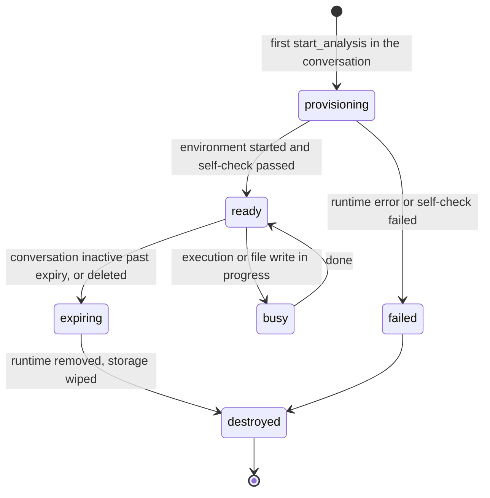
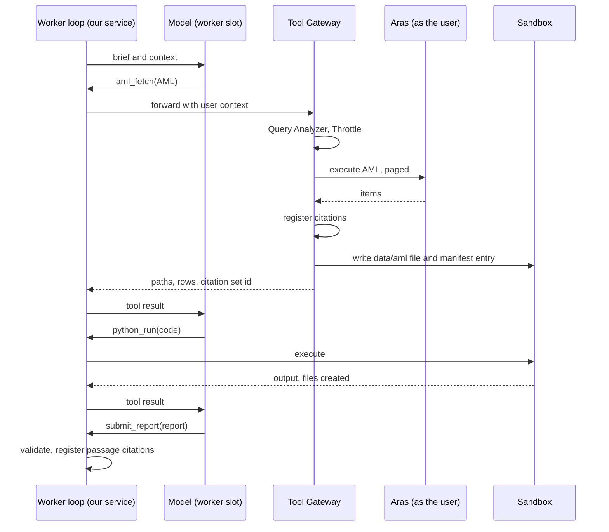

# Analysis Worker and Sandbox specification

Status: MVP specification. Related: [Main Agent](main-agent.md), [Tool Gateway](tool-gateway.md), [Tool catalog](tool-catalog.md), [File Service](file-service.md), [Model configuration](model-configuration.md), [Audit and progress](audit-and-progress.md), [Persistence](persistence.md), [Question lifecycle](../architecture/question-lifecycle.md), [Security and permissions](../architecture/security-and-permissions.md)

## 1. Purpose

Analytical questions such as "Which five parts appear most often on change orders that finished late last quarter, and what do the linked engineering reports say went wrong with them?" cannot be answered from a single query result. They need many paged queries, joins across item types, date arithmetic, counting, and reading many documents. The product does not build a bespoke aggregation engine for this. Instead, an **Analysis Worker**, an agent with instructions and a Python environment, fetches the data it needs into a sealed **Sandbox**, analyses it with code, and returns a report with citations, assumptions, and coverage.

This split was chosen because:

| Choice | Reason |
|---|---|
| Code over a bespoke engine | A competent model writing analysis code covers aggregations, trends, process mining, and text search without the product anticipating every question shape. |
| Worker loop in our service, execution in the Sandbox | The Sandbox never holds model credentials or Aras credentials and needs no network route. Only code execution and file reads happen inside it. |
| Sandbox has no network | Code written by a model, operating on data that may contain injected instructions, cannot reach Aras, the model endpoint, or anything else. Its only way out is the tool connection mediated by our service. |
| Data enters only as files written by the Tool Gateway | Every byte in the Sandbox passed through the Query Analyzer, the Throttle, and Aras permissions as the user. |
| One Sandbox per user conversation, expiring with it | Follow-up questions reuse fetched data within the conversation; nothing persists beyond it, consistent with keeping no history of Aras data. |
| A bounded job with a structured report | The Main Agent keeps control of the conversation and of the final answer; workers can run in parallel for multi-part questions. |

## 2. Responsibilities and non-responsibilities

Analysis Worker responsibilities:

1. Accept a bounded job brief from the Main Agent through `start_analysis`.
2. Plan and run the analysis: fetch data with `aml_fetch` and `file_fetch`, analyse with `python_run`, inspect with `sandbox_read`.
3. Publish progress lines with `report_progress`.
4. Stay inside the job's budget share, step limit, and deadline.
5. Return one structured report with `submit_report`: findings, computed numbers, citations, assumptions, coverage, limitations.
6. Follow the standing product rules carried in its prompt: cite every claim, report association rather than causation, report coverage honestly.

Sandbox responsibilities:

1. Provide an isolated Python environment for one user conversation.
2. Hold files written by the Tool Gateway and files produced by the worker's code.
3. Execute code submitted by the worker loop within resource limits, and return its output.
4. Be destroyed when the conversation expires or is deleted.

Non-responsibilities:

- The worker does not talk to the user directly except through progress lines. It never asks the user questions; open definitions are resolved by the Main Agent before the job starts, or recorded as assumptions in the report.
- The worker does not write the final answer. The Main Agent composes the answer from one or more reports.
- The worker does not write knowledge. It may note candidate learnings in its report; the Main Agent decides whether to call `record_learning`.
- The worker does not start background jobs or other workers.
- The Sandbox does not call Aras, the model, the Database, or any network service. It holds no secrets.
- Neither keeps data beyond the conversation.

## 3. Interfaces

### 3.1 Job contract: the brief

The Main Agent starts a worker by calling `start_analysis`; its agent-facing schema is in the [tool catalog](tool-catalog.md#start_analysis). The tool handler turns the call into a job brief with the fields below. The brief is the worker's entire context apart from its system prompt (see [Prompts](../prompts/README.md)) and the shipped skills loaded with it; the worker does not see the conversation transcript.

| Field | Required | Meaning |
|---|---|---|
| Job id | yes | `anj_` identifier issued by the handler |
| Conversation id, turn id, parent tool call id | yes | Links the job to the question it serves |
| Objective | yes | The question or sub-question to answer, in plain language |
| Definitions | yes (may be empty) | Agreed meanings for terms in the objective, for example what "delayed" means. Each is marked with its source: confirmed by the user in this conversation, taken from a knowledge entry (with its citation id), or a default the Main Agent proposed and stated as an assumption |
| Scope | yes | Item types, time window, filters, and population the analysis covers, as the Main Agent understands them |
| Schema context | yes | The discovered schema excerpts the worker needs (item types, properties, relationships, lists, workflow and lifecycle maps), taken by the Main Agent from its own `schema_describe` results; the worker has no `schema_describe` tool |
| Knowledge context | no | Knowledge entries relevant to the job, with their citation ids, states, and whether each must be disclosed as an assumption |
| Prior data | no | Sandbox paths of data already fetched in this conversation that the worker may reuse, with their manifest entries |
| Expected output | yes | What the Main Agent needs back: for example a ranked table of the top N, a time series by month, a list of process deviations with counts, or passages answering "why" |
| Budget share | yes | The share of the question budget this job may use: maximum queries, rows, bytes, and wall time |
| Step limit | yes | Maximum model steps (`analysis.worker_max_steps`) |
| Deadline | yes | Wall-clock time after which the worker must submit what it has |

The brief must not contain the user's Aras credential, model credentials, or any instruction to bypass the Query Analyzer or Throttle. The handler rejects a `start_analysis` call whose brief lacks a required field with INVALID_INPUT and a message naming the field.

### 3.2 Job contract: the report

The worker ends its job by calling `submit_report`; its agent-facing schema is in the [tool catalog](tool-catalog.md#submit_report). The report returned to the Main Agent as the result of `start_analysis` contains:

| Section | Contents |
|---|---|
| Status | `complete`, `partial` (budget, step limit, or deadline reached, or some data could not be read), or `failed` (with reason) |
| Summary | A short plain-language answer to the objective, written for the Main Agent, with citation markers |
| Findings | A list of statements. Each has: the statement; its support (citation ids, or a citation set id for statements over many records); a strength label (`counted`, `observed_in_text`, `association`, `weak_signal`); and the names of the computed numbers it relies on. Statements about causes are phrased as association unless a source states the cause, in which case that source is cited. |
| Computed numbers | A list of named values. Each has: name; value; unit; a one-sentence description of how it was computed (population, filters, definitions applied); the Sandbox paths it was computed from; and its basis (a citation set id covering the records counted, plus up to `analysis.sample_citations_per_number` representative citation ids). |
| Tables | Optional small result tables (at most `analysis.report_max_table_rows` rows each) with a citation id or citation set id per row |
| Citations | Every citation id used anywhere in the report, including passage citations requested by locator (see 5.5). The worker does not submit this list: the handler derives it from the ids used in the report |
| Assumptions | Every assumption made: the assumption, why it was needed, its source (user, knowledge entry with citation id, discovery-suggested default, worker default), and whether the Main Agent should disclose it in the answer |
| Coverage | Records: how many matched the scope among those the user can access, how many were analysed, how many lacked linked evidence. Files: requested, read, partially read, unreadable (with reasons), unsupported (with formats), `too_large`, `denied` (refused by the access re-check, or not found in Aras). Queries: run, truncated by limits, rejected by the Query Analyzer and not recovered |
| Limitations | What the analysis could not establish and why, for example "time spent in each workflow activity cannot be computed for processes whose activity timestamps are empty" |
| Candidate learnings | Optional notes on how-to knowledge found during the job, for example "delay is best measured from the release date property, not the modified date"; never data values |
| Artifacts | Sandbox paths of result files the Main Agent or a follow-up job may reuse |
| Usage | What the job consumed in total (queries, rows, bytes, wall time), added by the handler, with the model steps used reported as `steps_used`; this is the job's own total, distinct from the per-call `usage` of the tool result envelope |

### 3.3 Worker tools

| Tool | Purpose | Schema |
|---|---|---|
| `aml_fetch` | Run AML through the Tool Gateway as the user and write the results into the Sandbox | [tool-catalog.md#aml_fetch](tool-catalog.md#aml_fetch) |
| `file_fetch` | Write files' extracted text into the Sandbox | [tool-catalog.md#file_fetch](tool-catalog.md#file_fetch) |
| `python_run` | Run Python in the Sandbox | [tool-catalog.md#python_run](tool-catalog.md#python_run) |
| `sandbox_read` | Read a file in the Sandbox | [tool-catalog.md#sandbox_read](tool-catalog.md#sandbox_read) |
| `report_progress` | Publish a progress line to the user's live view | [tool-catalog.md#report_progress](tool-catalog.md#report_progress) |
| `submit_report` | Return the final report | [tool-catalog.md#submit_report](tool-catalog.md#submit_report) |

The worker has no `knowledge_*` or `schema_describe` tools in MVP; the brief carries the schema and knowledge it needs (see Open questions).

### 3.4 Sandbox control interface (internal)

The Sandbox controller is part of our service. It is the only component that operates Sandboxes, and the Sandbox never initiates a connection to it.

| Operation | Caller | Inputs | Outputs | Errors |
|---|---|---|---|---|
| Ensure Sandbox | `start_analysis` handler | Conversation id, user id | Sandbox id in state `ready` | SANDBOX_UNAVAILABLE (capacity or runtime failure) |
| Write file | Tool Gateway write channel | Sandbox id, path under the data area, content, manifest entry | Bytes written | SANDBOX_UNAVAILABLE, PATH_INVALID, RESULT_TOO_LARGE (disk quota) |
| Execute | `python_run` handler | Sandbox id, job id, code, timeout | Exit status, standard output and error (together truncated to `analysis.python_output_max_chars`), files created or changed, duration, peak memory | SANDBOX_UNAVAILABLE, TIMEOUT (time limit reached), SANDBOX_EXEC_FAILED (exception, or killed for memory or disk limits) |
| Read file | `sandbox_read` handler | Sandbox id, path, optional range | Content (truncated), size, type | PATH_INVALID, NOT_FOUND |
| Cancel | Main Agent (turn cancelled) | Sandbox id, job id | Running executions for the job stopped | none |
| Destroy | Expiry task, conversation deletion | Sandbox id | Sandbox state `destroyed` | none (retried until success) |

## 4. Data owned

| Table | Contents | Schema |
|---|---|---|
| `analysis_jobs` | One row per job: id, turn, conversation, Sandbox, the `start_analysis` tool call, brief, status (`queued`, `running`, `completed`, `failed`, `cancelled`, `budget_exhausted`), report, steps used, budget reference (its share in `question_budgets`), error code, timestamps | [persistence.md#analysis_jobs](persistence.md#analysis_jobs) |
| `sandboxes` | One row per Sandbox: id, conversation, isolation (`container` or `vm`), runtime reference, status (`provisioning`, `ready`, `busy`, `expiring`, `destroyed`, `failed`), image version, disk used, created, last used, expires, destroyed timestamps | [persistence.md#sandboxes](persistence.md#sandboxes) |
| `sandbox_files` | One row per file written into a Sandbox: Sandbox id, path, origin (`aml`, `file_text`, `python_output`), originating tool call, analysis job, format, bytes, rows, citation set id (AML files), truncated flag, manifest entry, created timestamp | [persistence.md#sandbox_files](persistence.md#sandbox_files) |

File contents live only inside the Sandbox. The `sandbox_files` rows are metadata and are deleted when the Sandbox is destroyed; the `analysis_jobs` report is kept with the transcript. The worker loop writes the worker's model messages and tool calls to `messages` and `tool_calls`, each linked to the job (`analysis_job_id`; see [persistence.md](persistence.md#messages) and [Main Agent](main-agent.md)).

## 5. Behaviour

### 5.1 Sandbox lifecycle

1. A Sandbox is created lazily, the first time a worker is started in a conversation. Conversations answered entirely by direct lookups never get one.
2. Provisioning starts the hardened runtime from the product's pinned Python environment image, creates the data area and per-job working areas, and runs a self-check that the environment has no network interface beyond loopback and no credentials in its environment or file system. A failed self-check destroys the Sandbox and returns SANDBOX_UNAVAILABLE.
3. The Sandbox is shared by every worker of the same conversation, so a follow-up question can reuse data already fetched. It has two areas: `data/`, written only by the Tool Gateway's write channel and read-only to code, readable by all jobs in the conversation; and `work/<job id>/`, the job's own writable area. Paths in tools are relative to the Sandbox root, so `sandbox_read` can read either area, while `python_run` code can write only in its job's working area.
4. The Sandbox stays alive while the conversation is active. When the conversation has been inactive for `sandbox.expiry_hours`, or is deleted, the expiry task stops it, wipes its storage, and marks it `destroyed`.
5. If a user returns to an expired conversation, a new Sandbox is created on the next `start_analysis` and data is fetched again as the user. Reports stored with the transcript remain readable, and their citations still open the sources in Aras.
6. On service restart, jobs found running are marked `failed` with reason `interrupted`. When the Main Agent resumes the turn from the saved transcript, it may start the analysis again with a new `start_analysis` call, reusing data already in the Sandbox if the Sandbox survived the restart (its manifest is listed as prior data); a Sandbox that did not survive is recreated on demand and data is fetched again as the user.

### 5.2 Isolation

The default runtime is a hardened container, one per conversation. A full virtual machine per conversation is a configuration option (`sandbox.runtime = vm`) for customers who require it; the contract is identical. Required properties, whichever runtime is used:

| Property | Requirement |
|---|---|
| Network | No network interface other than loopback. No DNS. No route to Aras, the model endpoints, the Database, or the host. |
| Credentials | No Aras credential, model credential, database credential, or service token in the environment, file system, or mounted volumes. |
| Inbound channel | Files are placed into the data area only by the Sandbox controller acting for the Tool Gateway. The Sandbox cannot request data; it can only be given data. |
| Code execution | Code arrives only from the worker loop through the controller's execute operation and runs as an unprivileged user. |
| File system | Read-only system image; writable data and working areas with a disk quota (`sandbox.disk_limit_gb`). The data area is writable only by the host side. |
| Resources | CPU (`sandbox.cpu_limit`), memory (`sandbox.memory_limit_gb`), process count, and per-execution time limits (a default of `sandbox.python_default_timeout_seconds`, which a `python_run` call may override up to a maximum of `tools.python_run.max_timeout_seconds`). |
| Kernel surface | Restricted system calls and no privilege escalation (**Proposed:** the runtime's standard hardening profile plus a system-call filter). |
| Packages | A fixed, pinned set of analysis libraries in the image; no package installation at run time. **Proposed** set: tabular data handling, numerics, date handling, regular expressions, and text utilities. |
| Tenancy | One Sandbox serves one user's one conversation; Sandboxes never share writable storage. |

### 5.3 How the Tool Gateway writes into the Sandbox

1. The worker calls `aml_fetch` or `file_fetch`. The tool handler in our service forwards the request to the Tool Gateway with the user context.
2. The Tool Gateway runs the request exactly as it would for the Main Agent: Query Analyzer, Throttle, execution as the user, paging, citation registration. See [Tool Gateway](tool-gateway.md) and [File Service](file-service.md).
3. The Gateway hands the results to the Sandbox write channel, which writes files into the data area and appends an entry to the manifest. **Proposed:** the channel uses the container runtime's file-copy facility or a host-side volume that only the host can write, so that no network path into the Sandbox exists.
4. The tool result returned to the worker lists the paths written, row counts, truncation, the citation set id (for AML results), and any analyzer warnings; it includes no rows beyond a small sample (see [`aml_fetch`](tool-catalog.md#aml_fetch)).

Layout of the data area (**Proposed** names):

| Path | Contents |
|---|---|
| `data/manifest.json` | One entry per file written: path, source kind, tool call id, job id, the AML (for AML results) or file id (for file text), item type, row count, pages fetched, whether results were truncated by a limit, citation set id (AML results), analyzer warnings, written timestamp |
| `data/aml/<name>.jsonl` or `data/aml/<name>.csv` | AML results. `name` is the optional `aml_fetch` input and defaults to the tool call id. JSON Lines (the default) holds one top-level item per line; CSV flattens to one row per top-level item and omits relationship data |
| `data/files/<file id>.txt` | Extracted text of one file, as stored by the File Service |
| `data/files/<file id>.segments.json` | The segment map: segment number, kind, label, start and end character offsets, no-text flag, and the `file` citation id registered for that segment |
| `work/<job id>/` | The job's working area for its own intermediate and result files |

Format of AML result files (**Proposed**):

1. JSON Lines by default (CSV when the worker asks for it), one top-level item per line, preserving the item's structure so that nested relationships stay attached to their source item.
2. Every item object, top-level or nested, carries reserved fields that begin with an underscore: `_cite` (the citation id registered for that record), `_type` (item type name), `_id` (Aras id), and `_keyed_name` where Aras returns it. Property values keep their Aras property names as discovered.
3. Values are written as Aras returns them, with dates additionally provided in a normalised form in a parallel field (`<property>__iso`) so code does not need to parse locale formats. Item-typed properties that Aras returns as nested items keep that structure; otherwise their id is kept.
4. Paged results for one `aml_fetch` call are concatenated into one file. If a limit stopped paging early, the manifest entry is marked truncated and the tool result says so, so the worker reports it in coverage.
5. Each `aml_fetch` call also registers one citation set covering all records in the file; its id is in the manifest entry, so a computed number over the whole file can cite the set.

Because each row carries its citation id, any record the worker's code selects (for example the top five components) is cited by reading the `_cite` field of the matching rows.

### 5.4 Worker loop

The worker loop runs in our service using the `worker` model slot (see [Model configuration](model-configuration.md)).

1. The `start_analysis` handler validates the brief, creates the `analysis_jobs` row, ensures the Sandbox, and allocates the job's budget share from the question budget.
2. The loop builds the worker's context: the worker system prompt; the always-loaded shipped skills for the worker, among them `aml-authoring`, `python-analysis-in-sandbox` (which carries the Sandbox data layout and the citation fields), `citing-sources`, and `progress-reporting`; any on-demand skills the brief names, such as `workflow-and-lifecycle-analysis`; and the brief, with the manifest entries of any prior data it names (the full list of skills per agent is in the [skills catalog](../skills/README.md)).
3. Each step, the loop calls the model; the model either calls one or more worker tools or calls `submit_report`. Plain text without a tool call is answered with a reminder that the job ends only with `submit_report`.
4. Tool calls are executed and their results appended. Every tool call and result is stored in `tool_calls` and audited.
5. The loop enforces the step limit, the budget share (through the Throttle), and the deadline. When `analysis.wrapup_steps` steps or `analysis.wrapup_seconds` remain, the loop tells the model to stop fetching and submit what it has. If the hard limit is reached without a report, the loop builds a report from the manifest: `partial` when anything was fetched (listing what was fetched, with coverage and no findings beyond what the files show), otherwise `failed`.
6. On `submit_report`, the loop validates the report (5.5). A report that fails validation is returned to the worker with the problems listed, up to `analysis.report_fix_attempts` times; after that it is accepted with status `partial` and the validation problems recorded as limitations.
7. The accepted report is stored in `analysis_jobs` and returned to the Main Agent as the result of `start_analysis`.

Parallel jobs: when the Main Agent issues several `start_analysis` calls in one step (a multi-part question), their workers run concurrently, up to `analysis.max_parallel_workers` per turn, in the same Sandbox with separate working areas. They share the turn's question budget; each has its own share. Calls beyond the limit are not refused: their jobs wait in `queued` and start when a worker slot frees.

Cancellation: when the user cancels a turn, the loop stops each job's model calls, cancels running executions, and marks the jobs `cancelled`. When the turn's wall-time budget expires, it does the same but marks the jobs `budget_exhausted`, after building a report from the manifest as in step 5.

### 5.5 Report validation and citation registration

Before a report is accepted:

1. Every citation id in the report must exist in the Citation Registry for this conversation. Unknown ids are listed as problems.
2. Every finding must have support, and every computed number must name its Sandbox source paths and a basis.
3. Coverage must be present, and its file and query counts must be consistent with the manifest (for example a truncated fetch must appear in coverage).
4. Passage citations: `file_fetch` registers one `file` citation per segment (page, sheet, slide, section, or range) and writes its id into the segment map, so a finding can cite a segment directly. For a finer passage, the report names a segment citation id plus a character range within it (`passages` in [`submit_report`](tool-catalog.md#submit_report)). The handler resolves the range against the file's segment map and registers a passage-level file citation, returning its id into the report. A range outside the file is a problem.
5. Statements phrased as causal claims without a cited source stating the cause are flagged so the worker rephrases them as association. **Proposed:** this check relies on the worker prompt plus a light wording check in the handler; it is advisory, not a guarantee.

### 5.6 What the user sees

The user never sees the raw report. The Main Agent composes the answer from it, keeping citations, disclosing the assumptions the report marks for disclosure, and including the coverage summary. The full report is kept with the turn, so the Chat App can offer "show how this was computed" with the computed numbers, their descriptions, and their citation sets (see [Chat App](chat-app.md)).

## 6. Configuration

| Key | Type | Default | Meaning |
|---|---|---|---|
| `sandbox.runtime` | `container` or `vm` | `container` | Isolation runtime; VM is an option for customers who require it |
| `sandbox.image` | reference | product release image | Pinned Python environment image |
| `sandbox.cpu_limit` | number | 2 (Proposed default) | CPU cores per Sandbox |
| `sandbox.memory_limit_gb` | number | 4 (Proposed default) | Memory per Sandbox |
| `sandbox.disk_limit_gb` | number | 10 (Proposed default) | Disk quota per Sandbox |
| `sandbox.python_default_timeout_seconds` | integer | 120 (Proposed default) | Default time limit for one `python_run`, used when the call gives no `timeout_seconds` |
| `tools.python_run.max_timeout_seconds` | integer | 600 (Proposed default) | Maximum `timeout_seconds` a `python_run` call may request (also listed in the [tool catalog](tool-catalog.md)) |
| `sandbox.expiry_hours` | integer | 24 (Proposed default) | Conversation inactivity after which the Sandbox is destroyed |
| `sandbox.max_active` | integer | 20 (Proposed default; size per deployment) | Maximum live Sandboxes; beyond this, provisioning waits briefly then fails with SANDBOX_UNAVAILABLE |
| `analysis.max_parallel_workers` | integer | 4 (Proposed default) | Concurrent workers per turn |
| `analysis.worker_max_steps` | integer | 60 (Proposed default) | Model steps per job |
| `analysis.wrapup_steps` | integer | 5 (Proposed default) | Steps before the limit at which the worker is told to submit |
| `analysis.wrapup_seconds` | integer | 120 (Proposed default) | Time before the deadline at which the worker is told to submit |
| `analysis.report_fix_attempts` | integer | 2 (Proposed default) | Times an invalid report is returned for correction |
| `analysis.report_max_table_rows` | integer | 50 (Proposed default) | Rows per table in a report |
| `analysis.sample_citations_per_number` | integer | 10 (Proposed default) | Representative citations per computed number |
| `analysis.python_output_max_chars` | integer | 20,000 (Proposed default) | Standard output and error together returned to the model per execution |
| `analysis.sandbox_read_max_chars` | integer | 20,000 (Proposed default) | Characters returned per `sandbox_read` |

## 7. Limits

- At most `analysis.max_parallel_workers` workers per turn, each within its share of the question budget (Proposed default question budget: 200 queries, 50,000 rows, 200 MB fetched, 30 minutes wall time for the turn including workers).
- At most `analysis.worker_max_steps` model steps per job.
- Data volume is bounded by the question budget, not by the Sandbox: the Sandbox disk quota is set above the byte budget so that the budget is reached first.
- The question budget has no files dimension: it counts queries, rows, bytes, and wall time. The only file-count cap is per call, `file_service.fetch_max_files` for one `file_fetch` (Proposed default 50); per-question file budgets are left to be tuned once the system runs. A cap on the number of files that a brief states is an instruction to the worker, not a system limit.
- A Sandbox cannot obtain data outside the user's Aras permissions, because every byte arrives through the Tool Gateway as the user.
- Analyses requiring more data than the budget allows end as `partial`; the Main Agent tells the user what was covered and may propose narrowing the question or, for full-text search across file contents, a [background job](background-jobs.md).

## 8. Failure modes and recovery

| Failure | Detection | Effect on user | Recovery |
|---|---|---|---|
| Sandbox cannot be provisioned | Runtime error or failed self-check | `start_analysis` returns SANDBOX_UNAVAILABLE; the Main Agent answers what it can directly and says the analysis could not run | Retry on the next question; operators alerted when the failure rate rises |
| Code fails | Non-zero exit with error output | None directly; the worker sees the error | Worker fixes the code within its step limit |
| Code exceeds time or memory | Runtime stops the execution | None directly | TIMEOUT or SANDBOX_EXEC_FAILED returned to the worker, which narrows the computation |
| Budget exhausted mid-job | Throttle returns BUDGET_EXHAUSTED | Answer marked partial with coverage | Worker submits a partial report |
| Analyzer rejects a fetch | ANALYZER_REJECTED with diagnostics | None directly | Worker corrects the AML and retries |
| Worker never submits | Step limit or deadline reached | Answer marked partial or failed | Loop builds a `partial` report from the manifest if anything was fetched, otherwise `failed`; wall-time expiry sets job status `budget_exhausted` |
| Report invalid | Validation problems | None directly | Returned for correction, then accepted as partial |
| Model endpoint unavailable | Model Router error | Progress shows the delay; the answer may fail | Model Router retry policy; job fails after retries (see [Model configuration](model-configuration.md)) |
| Service restart during a job | Job found running at startup | Short delay while the turn resumes | Job marked `failed` (`interrupted`); the resumed Main Agent turn may start the analysis again, reusing Sandbox data if the Sandbox survived |
| Sandbox expired between questions | Sandbox state `destroyed` | Slight delay | New Sandbox; data fetched again as the user |

## 9. Security considerations

- **Sealed execution.** Model-written code and possibly hostile document text meet only inside the Sandbox, which has no network and no secrets. The worst a compromised execution can do is corrupt its own conversation's Sandbox.
- **Permission fidelity.** The Sandbox receives only what the Tool Gateway fetched as the user; it never widens access. Sandboxes are never shared across users.
- **Prompt injection.** File text and record values in the Sandbox may contain instructions. The worker prompt treats Sandbox content as data. Even a misled worker can only run more read-only queries as the same user, within the same budget, and its report passes through the Main Agent before anything reaches the user.
- **Output size.** Standard output and file reads returned to the model are truncated, preventing a runaway script from flooding the model context or logs.
- **Data lifetime.** Fetched data exists only for the conversation's life and is wiped on destruction. Reports stored with the transcript contain computed numbers and citations, not raw result files.
- **Host protection.** The Sandbox controller validates every path (relative to the data or working area, no parent-directory traversal, no links leading outside) and returns PATH_INVALID otherwise.

See [Security and permissions](../architecture/security-and-permissions.md) for the system-wide model.

## 10. Observability

- Audit events: `analysis.started` (job id, brief summary, budget share), `analysis.finished` (status, report validation problems, usage); `sandbox.created`, `sandbox.destroyed`, `sandbox.exec` (job id, duration, exit status, peak memory; not the output); every Aras request a worker makes is recorded as `aras.query` and every file written into the Sandbox as `sandbox.write` by the Tool Gateway. Worker tool calls themselves are recorded in `tool_calls`, not as audit events. See [Audit and progress](audit-and-progress.md#51-audit-event-catalogue).
- Progress: worker `report_progress` lines are published to the user's live view with the job id, so parallel workers appear as separate progress threads. The loop also publishes automatic lines for long fetches.
- Metrics: jobs per turn, job duration, steps per job, share of partial and failed reports by reason, Sandbox provisioning time and failure rate, live Sandbox count, execution time and stop rate.
- The executed code of each `python_run` is stored with its tool call, so an engineer can reproduce how a number was computed.

## 11. MVP versus deferred

| Capability | MVP | Roadmap item |
|---|---|---|
| Container per conversation, VM option | Yes | |
| Parallel workers for multi-part questions | Yes | |
| Code-based analytics and process mining from workflow and lifecycle runs | Yes | |
| Chart and result export | No | [Chart and result export](../product/roadmap.md) |
| Result caching across questions or users | No | [Answer and query result caching](../product/roadmap.md) |
| Analytics without loading the production Aras server | No | [Analytics path that does not load production](../product/roadmap.md) |
| Saved questions and scheduled reports | No | [Saved questions and dashboards](../product/roadmap.md), [Scheduled reports](../product/roadmap.md) |

See the [Roadmap](../product/roadmap.md).

## 12. Open questions

1. **Proposed:** workers receive schema and knowledge context in the brief instead of having `schema_describe` and `knowledge_read` tools. If briefs prove too large, or workers often need schema they were not given, add read-only versions of those tools to the worker.
2. **Proposed:** the Sandbox data layout, JSON Lines format, reserved underscore fields, and normalised date fields.
3. **Proposed:** citation sets, so a computed number over many records can be cited without listing every record. Sets are stored in [citation_sets](persistence.md#citation_sets) and opened by the Chat App as a list of their member records.
4. **Proposed:** the file-copy or host-only volume mechanism for the write channel; any mechanism is acceptable if it gives the Sandbox no network path.
5. **Proposed:** the analysis library set in the Sandbox image and its update policy.
6. **Proposed:** all numeric defaults in Configuration, in particular Sandbox sizing and `sandbox.max_active`, which depend on deployment hardware.
7. **Proposed:** the wording check for causal claims is advisory.
8. Whether an analysis that exceeds the interactive wall-time budget can be converted into a background job is not decided; in MVP it ends as a partial report.
