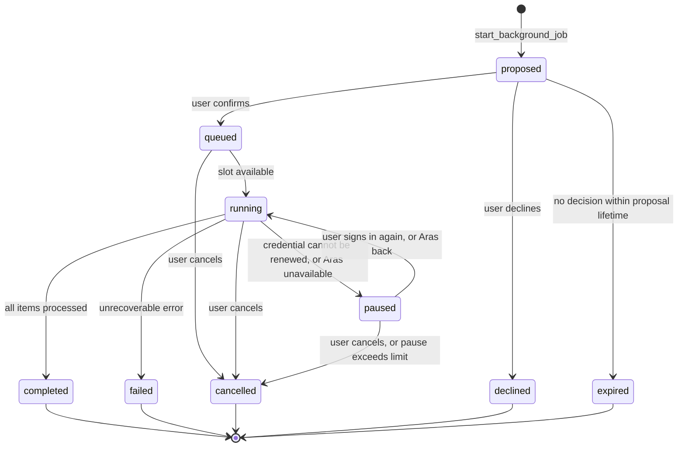
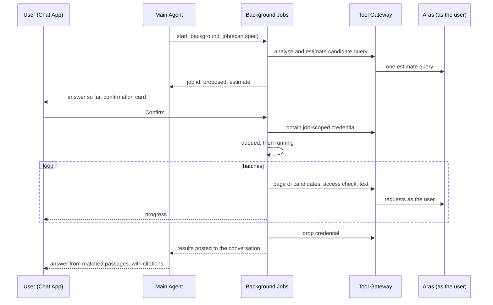

# Background Jobs specification

Status: MVP specification. Owner slice: module specifications. Related: [Main Agent](main-agent.md), [Tool Gateway](tool-gateway.md), [File Service](file-service.md), [Knowledge and learning](knowledge-and-learning.md), [Chat App](chat-app.md), [Tool catalog](tool-catalog.md), [Audit and progress](audit-and-progress.md), [Persistence](persistence.md), [Security and permissions](../architecture/security-and-permissions.md)

## 1. Purpose

Some work is too long for an interactive answer. The clearest case is a question with no item anchor whose answer lies inside file contents, for example "which test reports mention a particular failure mode", when the files cannot be narrowed through the Aras item graph. Reading every candidate file takes far longer than a conversational turn and puts sustained load on Aras. The second case is learning over a finished conversation's transcript.

Background Jobs runs such work outside the conversational turn, under three rules taken from the product decisions:

1. **User-confirmed.** A full-text scan across file contents runs only after the requesting user sees what it will do and confirms it.
2. **As the requesting user, throttled.** Every Aras request is made as that user, in small batches, within a job budget, at lower priority than interactive questions. There is no privileged account.
3. **Job-scoped renewable credential.** Because a job may outlive the user's interactive session, the Tool Gateway holds a credential for that user scoped to the job, renews it while the job runs, and drops it when the job ends.

Each scan also fills the File Service's extracted-text store, so later searches over the same files are cheaper without any privileged access.

## 2. Responsibilities and non-responsibilities

Responsibilities:

1. Accept job proposals from the Main Agent (`start_background_job`) and record them as `proposed`.
2. Present each proposal to the user through the Chat App and accept a confirmation or a decline.
3. Obtain a job-scoped renewable credential through the Tool Gateway at confirmation, and drop it when the job ends.
4. Queue, run, pause, resume, and cancel jobs; checkpoint progress per item so jobs survive restarts.
5. Run full-text scans: enumerate candidate files as the user, read them through the File Service, match the search terms, and record matches with locators.
6. Run batched learning jobs over transcripts of inactive conversations that carry a learning signal, by invoking the Learner.
7. Publish progress to the user's live view and post results back to the originating conversation.
8. Enforce job budgets and concurrency limits together with the Throttle.

Non-responsibilities:

- It does not decide that a scan is needed; the Main Agent proposes it.
- It does not interpret scan results for the user; the Main Agent continues the conversation with the results.
- It does not write learned knowledge itself; the Learner does (see [Knowledge and learning](knowledge-and-learning.md)).
- It does not run Discovery; Discovery runs as the user at conversation start and on its change-check schedule (see [Discovery](discovery.md)).
- It does not run scheduled reports or saved questions (deferred).
- It never uses a shared or administrative Aras account.

## 3. Interfaces

### 3.1 Agent-facing

| Tool | Caller | Schema |
|---|---|---|
| `start_background_job` | Main Agent | [tool-catalog.md#start_background_job](tool-catalog.md#start_background_job) |

The tool call returns as soon as the proposal is recorded, with the job id, status `proposed`, and the estimate. It does not wait for confirmation. The Main Agent tells the user that confirmation is needed and ends the turn or continues with what it can answer now.

### 3.2 Chat App and internal operations

| Operation | Caller | Inputs | Outputs | Errors |
|---|---|---|---|---|
| Propose job | `start_background_job` handler | Kind, conversation id, turn id, user id, job specification (see 3.3) | Job id, estimate, status `proposed` | INVALID_INPUT; THROTTLED (user already has `jobs.max_proposed_per_user` open proposals) |
| Confirm job | Chat App, on the user's action | Job id, user id (must be the requester) | Status `queued`, position in queue. Confirm is never refused for load: a confirmed job beyond the running limits waits in `queued` | NOT_FOUND; PERMISSION_DENIED (not the requester); JOB_NOT_CONFIRMED (proposal expired, declined, or already decided; the message says which); ARAS_AUTH_EXPIRED (credential could not be obtained; the user signs in again) |
| Decline job | Chat App | Job id, user id | Status `declined` | NOT_FOUND, PERMISSION_DENIED |
| Cancel job | Chat App | Job id, user id | Status `cancelled`; credential dropped | NOT_FOUND, PERMISSION_DENIED |
| Get job | Chat App, Main Agent | Job id, user id | Status, progress, estimate, partial or final result summary | NOT_FOUND, PERMISSION_DENIED |
| List jobs | Chat App | User id | The user's jobs with status and progress | none |
| Reauthorise job | Chat App, after the user signs in again | Job id, user id | Status `running` or `queued` | PERMISSION_DENIED, ARAS_AUTH_EXPIRED |
| Schedule batched learning | Inactivity task in our service | Conversation id | Job id of kind `batched_learning`, or nothing if no signal | none |

Only the requesting user can see, confirm, cancel, or reauthorise a job. No administrator action can confirm a job on a user's behalf.

### 3.3 Job specification: full-text scan

| Field | Required | Meaning |
|---|---|---|
| Purpose | yes | One sentence shown to the user, for example "Find test reports that mention seal leakage" |
| Candidate query | yes | Read-only AML that enumerates candidate files or the items that carry them, as the user; it passes the Query Analyzer like any query and is paged |
| File selection | yes | How to reach files from the candidate items (for example through a document-to-file relationship as discovered), or that the candidates are files themselves |
| Search terms | yes | One or more literal terms or phrases, each with case-sensitivity and whole-word options; optional "all of" or "any of" combination; optional proximity window in characters |
| Context window | no | Characters of surrounding text kept with each match (default `jobs.scan_snippet_chars`) |
| Maximum files | no | Upper bound requested by the Main Agent, never above `jobs.scan_max_files` |

**Proposed:** search terms are literal strings, not regular expressions, to keep matching predictable and safe from pathological patterns. Semantic judgement about matches is left to the Main Agent or an Analysis Worker reading the matched passages afterwards.

### 3.4 Estimate shown to the user

The estimate is computed before the proposal is shown. It runs a count-style or first-page query of the candidate query as the user (one query, within the current question budget) and combines it with the extracted-text store:

| Estimate field | Meaning |
|---|---|
| Candidate files | Number of files found, or a lower bound if the count was capped |
| Already extracted | How many of them already have stored text (no download needed) |
| Estimated download volume | Sum of sizes of files without stored text, where Aras reports sizes |
| Estimated duration | From the job throughput settings and current queue |
| Load statement | Plain-language statement that the scan runs as the user, in small batches, at low priority |

## 4. Data owned

| Table | Contents | Schema |
|---|---|---|
| `background_jobs` | One row per job: id, kind (`full_text_scan`, `batched_learning`), requesting user, conversation, turn, specification, estimate, status, confirmed and decided timestamps, progress counters, budget and usage, result summary, failure reason, timestamps | [persistence.md#background_jobs](persistence.md#background_jobs) |
| `background_job_items` | One row per unit of work: job id, item key (Aras file id for scans), status (`pending`, `matched`, `done`, `skipped`, `denied`, `unreadable`, `failed`), attempts, per-item outcome (match count and locators, or read status), timestamps | [persistence.md#background_job_items](persistence.md#background_job_items) |

Related tables owned by other modules: `job_credentials` (Tool Gateway; the job-scoped credential, see [Tool Gateway](tool-gateway.md) and [persistence.md#job_credentials](persistence.md#job_credentials)), `learning_runs` and `learning_signals` (Learner), `progress_events` (Audit and progress), `citations` (Citation Registry).

## 5. Behaviour

### 5.1 Job states

Batched learning jobs skip `proposed`: they are created directly in `queued` because they are automatic by decision and make no Aras requests.

### 5.2 Full-text scan: proposal and confirmation

1. The Main Agent determines that the answer lies in file contents that cannot be narrowed through the item graph, and calls `start_background_job` with a scan specification.
2. The handler validates the specification and runs the candidate query through the Query Analyzer. Rejections are returned to the model as diagnostics, as for any query.
3. The handler computes the estimate (3.4) and stores the job as `proposed` with a proposal lifetime of `jobs.proposal_ttl_hours`.
4. The Chat App shows a confirmation card in the conversation: purpose, search terms, candidate count, estimate, and the statement that the scan runs as the user. Buttons: Confirm, Decline. See [Chat App](chat-app.md).
5. On Confirm, Background Jobs asks the Tool Gateway for a job-scoped credential (5.3). If it cannot be obtained, the user is asked to sign in again and the job stays `proposed`. On success the job becomes `queued`.

### 5.3 Job-scoped renewable credential

1. At confirmation, the Tool Gateway derives a credential for the requesting user, scoped to the job id. **Proposed:** where the target Aras version offers an OAuth server with refresh capability (typical in recent releases; verify), the Gateway obtains a separate refresh grant for the job from the user's sign-in session, so the job's credential can be revoked without ending the user's interactive session. Where it does not, the job uses the user's session credential and pauses when that session ends.
2. The credential is stored encrypted in `job_credentials`, readable only by the Tool Gateway, with its job id, user id, created, renewed, expiry, and dropped timestamps.
3. While the job runs, the Gateway renews the credential every `gateway.job_credential_renew_seconds`. The credential never lives beyond `gateway.job_credential_max_hours`; a job still running at that point pauses and asks the user to reauthorise.
4. The credential is used only for requests made by that job, and every request still goes through the Query Analyzer and the Throttle.
5. When the job reaches any final state (completed, failed, cancelled), the Gateway revokes the credential with Aras where possible and deletes the secret material from `job_credentials`, keeping only the timestamps for audit.
6. If renewal fails (the user's access was revoked, the password changed, or the grant expired), the job pauses and the user is notified. Nothing is retried with any other identity.

### 5.4 Full-text scan: execution

1. A runner picks up `queued` jobs when fewer than `jobs.max_running_per_user` jobs are running for the user and fewer than `jobs.max_running_system` system-wide.
2. Enumerate candidates: run the candidate query page by page (page size within the Gateway maximum) as the user, and insert one `background_job_items` row per file id, until all pages are read or `jobs.scan_max_files` is reached. Hitting the cap is recorded and reported in coverage.
3. Process items in batches of `jobs.scan_batch_size`:
   1. Run one batched access check for the batch through the File Service, as the user.
   2. For each visible file, obtain its text from the File Service (stored text where available; otherwise download and extract as the user).
   3. Match the search terms in the stored extracted text, in the service; no database text index or vector index is used, so each scan reads the text it searches. Record match count and, for each match up to `jobs.scan_max_matches_per_file`, its locator (segment label and character range) and a snippet of `jobs.scan_snippet_chars` characters.
   4. Mark the item `matched`, `done` (read, no match), `denied` (the access check refused it), `unreadable` (no usable text, with the reason), `skipped` (unsupported format or too large, with the read status), or `failed` (after `jobs.item_max_attempts` attempts).
   5. Commit the batch's item rows and progress counters together, so a restart resumes at the next unprocessed item.
4. Between batches, the runner yields to interactive work: it requests query slots from the Throttle at background priority and waits when the system is busy or the job's rate (`jobs.scan_max_queries_per_minute`) is reached.
5. Progress is published every batch: files processed of total, matches so far, files not readable so far.
6. When all items are processed, the job is `completed` and the credential is dropped.

### 5.5 Results returned to the conversation

1. On completion, Background Jobs registers file citations for the matched passages (file id, file name, locator, the parent item the file was reached through) in the originating conversation through the Citation Registry. Snippets are not shown to anyone until access is re-checked: the citations point to the File Service, which re-checks access on every use.
2. It writes a job result summary into the conversation as a system message: purpose, files scanned, files matched, top matches with citation ids, and coverage (files not readable by reason, cap reached).
3. It starts a new turn of the Main Agent on that conversation with the job result as input (**Proposed**), so the agent can read the matched passages with `file_read` or start an Analysis Worker, and give the user a proper answer with citations. If the user is not connected, the answer waits in the conversation and the Chat App shows a notification on return.
4. If a scan returned more matches than can usefully be shown, the summary says so and the Main Agent proposes narrowing.

### 5.6 Batched learning

1. A periodic task in our service finds conversations whose last activity is older than `learning.inactivity_minutes` and which have unprocessed learning signals (corrections, retried questions, empty results, explicit teaching; see [Knowledge and learning](knowledge-and-learning.md)).
2. For each, it creates a `batched_learning` job in `queued` state. Conversations without signals get no job.
3. The runner invokes the Learner on the transcript with the `background` model slot (see [Model configuration](model-configuration.md)). The Learner records its work in `learning_runs` and writes or merges knowledge entries.
4. **Proposed:** batched learning makes no Aras requests and needs no credential; it works from the transcript, the stored configuration snapshot (`config_items`), and existing knowledge. Entries are created, merged, and checked exactly as for live learning (see [Knowledge and learning](knowledge-and-learning.md)).
5. If the conversation becomes active again while its learning job is queued, the job is deferred until the next inactivity period, so live and batched learning do not overlap.
6. Batched learning jobs do not post anything into the conversation and are not shown in the user's job list.

## 6. Configuration

| Key | Type | Default | Meaning |
|---|---|---|---|
| `jobs.max_running_per_user` | integer | 1 (Proposed default) | Running jobs per user; further confirmed jobs queue |
| `jobs.max_running_system` | integer | 3 (Proposed default) | Running full-text scans system-wide |
| `jobs.max_proposed_per_user` | integer | 3 (Proposed default) | Open proposals per user |
| `jobs.proposal_ttl_hours` | integer | 24 (Proposed default) | Time a proposal stays open before it expires |
| `jobs.max_pause_hours` | integer | 72 (Proposed default) | A paused job not resumed within this time is cancelled |
| `jobs.scan_max_files` | integer | 5,000 (Proposed default) | Maximum candidate files per scan |
| `jobs.scan_batch_size` | integer | 20 (Proposed default) | Files per batch |
| `jobs.scan_max_queries_per_minute` | integer | 30 (Proposed default) | Aras requests per minute for one job |
| `jobs.scan_max_matches_per_file` | integer | 20 (Proposed default) | Match locators kept per file |
| `jobs.scan_snippet_chars` | integer | 300 (Proposed default) | Characters of context kept around a match |
| `jobs.item_max_attempts` | integer | 3 (Proposed default) | Attempts per item before it is marked failed |
| `jobs.max_concurrent_learning` | integer | 2 (Proposed default) | Batched learning jobs running at once |
| `learning.inactivity_minutes` | integer | 30 (Proposed default) | Inactivity after which a conversation's transcript is learned from (shared with the Learner) |

Job credential renewal and lifetime are configured in the [Tool Gateway](tool-gateway.md) (`gateway.job_credential_renew_seconds`, `gateway.job_credential_max_hours`), which owns job credentials.

## 7. Limits

- At most one running job per user and three system-wide (defaults); scans run at background priority and never take more than one query slot at a time.
- At most `jobs.scan_max_files` files per scan; larger scopes must be narrowed.
- Literal term matching only; no regular expressions, no semantic ranking inside the job.
- A job runs only as long as its credential can be renewed, and never beyond `gateway.job_credential_max_hours` without the user reauthorising.
- Only MVP file formats are searched; scanned documents and other formats are reported as not readable.

## 8. Failure modes and recovery

| Failure | Detection | Effect on user | Recovery |
|---|---|---|---|
| Credential cannot be obtained at confirmation | Gateway error | Asked to sign in again | Job stays proposed until it expires |
| Credential renewal fails | Gateway reports ARAS_AUTH_EXPIRED | Job shown as paused with "sign in to continue" | Reauthorise resumes from the checkpoint; otherwise cancelled after `jobs.max_pause_hours` |
| Aras unavailable | ARAS_UNAVAILABLE on requests | Job shown as paused | Runner retries with backoff and resumes automatically |
| Service restart | Jobs found running at startup | Brief delay | Resumed from the last committed batch; credentials remain valid if renewal is still possible |
| A file cannot be read | File Service status | Counted in coverage | Item marked `unreadable` (or `skipped` for unsupported or too large) with the reason |
| Repeated item failure | Attempts exceed limit | Counted in coverage as failed | Item marked failed; job continues |
| User loses access to some files mid-job | Access check returns not visible | Those files are counted as not available | Items marked `denied`; no disclosure of their content |
| Originating conversation deleted | Conversation not found when posting results | None | Job cancelled and credential dropped as soon as the deletion is seen |
| Proposal ignored | TTL passes | Card shows "expired" | User can ask again |

## 9. Security considerations

- **No privileged account.** Every request is made as the requesting user with that user's permissions, enforced by Aras, including custom read-time server events.
- **Consent.** A full-text scan cannot start without the user's explicit confirmation of a proposal that states its purpose and size. The Main Agent cannot confirm on the user's behalf, and the confirmation endpoint accepts only the requesting user.
- **Credential scope and lifetime.** Job credentials are separate per job where Aras allows, encrypted at rest, held only by the Tool Gateway, renewed in short intervals, capped in lifetime, and dropped at the end of the job. They never enter the Sandbox, the model context, logs, or progress events.
- **Result exposure.** Matches are stored as locators and snippets in job items tied to the requesting user and conversation. Snippets are shown only to the requester and only after an access re-check through the File Service.
- **Load protection.** Background priority, per-job rate limits, batch sizes, and system-wide concurrency keep scans from saturating the Aras server.

## 10. Observability

- Audit events: `job.proposed`, `job.confirmed`, `job.declined`, `job.expired`, `job.started`, `job.paused` (reason), `job.resumed`, `job.finished` (status `completed` or `failed`, with reason), `job.cancelled`; `credential.issued`, `credential.refreshed`, and `credential.dropped` with credential kind `job`. Every Aras request a job makes is audited like any other query, with the job id. See [Audit and progress](audit-and-progress.md).
- Progress: per-batch progress events carrying the job id, shown in the conversation and in the user's job list, and retained for the progress retention period.
- Metrics: proposals per day, confirmation rate, queue time, job duration, files per minute, share of files served from stored text, items not read by status and reason, pauses by reason, credential renewal failures; for batched learning: jobs per day, signals processed, entries written or merged.

## 11. MVP versus deferred

| Capability | MVP | Deferred item |
|---|---|---|
| User-confirmed full-text scans as the user | Yes | |
| Batched learning over transcripts | Yes | |
| Scheduled reports and saved questions | No | aras-defer-scheduled-reports, aras-defer-saved-questions |
| Re-discovery triggered by a deployment hook | No | aras-defer-deploy-hook |
| Scheduled checks that learned knowledge holds no data values | No | aras-defer-leak-audit |
| Ageing out unused knowledge | No | aras-defer-knowledge-decay |
| Reading scanned files in scans | No | aras-defer-ocr |

See the [Roadmap](../product/roadmap.md).

## 12. Open questions

1. **Proposed:** a separate refresh grant per job where the Aras OAuth server supports it, falling back to the user's session credential. The exact credential mechanism must be verified per Aras version.
2. **Proposed:** literal-term matching only; regular expressions and proximity beyond a simple window are excluded.
3. **Proposed:** on completion the job starts a new Main Agent turn automatically. The alternative is to wait until the user returns and asks; this changes cost and the user experience.
4. **Proposed:** batched learning makes no Aras requests.
5. **Proposed:** all numeric defaults in Configuration, in particular scan size and rate limits, to be tuned in a pilot against the customer's Aras capacity.
6. Whether an administrator should be able to see or cancel other users' running jobs (for load emergencies) is not decided; in MVP only the requester can, and operators can pause the whole job runner.
