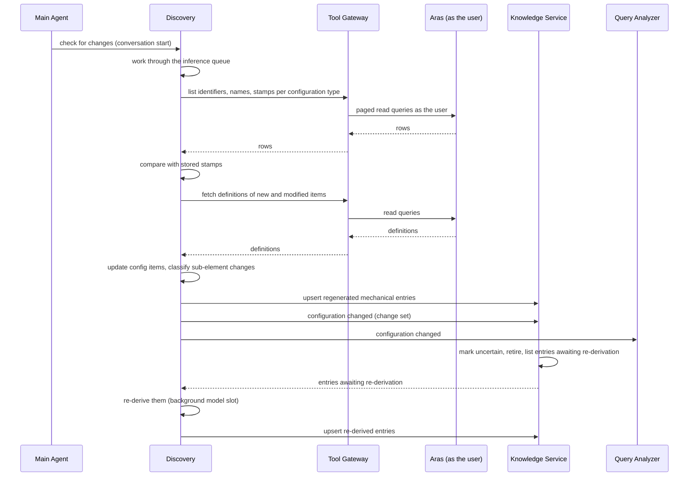

# Discovery specification

Status: MVP specification. Related: [Knowledge Service and Learner](knowledge-and-learning.md), [Tool Gateway](tool-gateway.md), [Query Analyzer](query-analyzer.md), [Tool catalog](tool-catalog.md), [Persistence](persistence.md), [Architecture overview](../architecture/overview.md), [ADR 0036](../decisions/0036-one-shared-discovered-configuration.md), [ADR 0049](../decisions/0049-discovery-operation.md).

## 1. Purpose

No schema or data-model mapping is configured by hand for a customer. Everything Aras Insight knows about an installation's structure comes from Discovery: it reads the Aras configuration as a signed-in user, keeps a current copy of that configuration in the database, detects changes cheaply through modification stamps, and regenerates the discovered knowledge layer whenever the configuration changes.

Three consumers depend on it:

- the **Query Analyzer**, which validates every AML query against the discovered schema (item types, properties, relationships, list values, lifecycle states, value types);
- the **agents**, which read the schema through `schema_describe` and read discovered knowledge entries through the knowledge tools;
- the **Knowledge Service**, which invalidates or re-derives knowledge when the configuration it depends on changes.

For decision-makers: this is the component that makes the product work on a customised installation on day one, and keeps working after the configuration changes, without a services project to map the schema.

## 2. Responsibilities and non-responsibilities

### Responsibilities

1. Read the Aras configuration through the Tool Gateway as a signed-in user. Every Aras user already has configuration read access, so no privileged account is needed.
2. Store one current record per configuration item with its definition and modification stamp ([config_items](persistence.md#config_items)).
3. Detect new, modified, renamed, and deleted configuration items by comparing stamps, fetching full definitions only for what changed.
4. Supply the discovered schema to `schema_describe` (served by the Knowledge Service) and to the Query Analyzer.
5. Generate the discovered knowledge layer: mechanical entries directly, model-inferred entries through the background model slot, and hand them to the Knowledge Service with their derivation sources and stamps. Discovery is the only component that calls the model for discovered entries, including their re-derivation.
6. Emit a change set after every run that finds a change so the Knowledge Service can mark dependent entries uncertain, queue their re-derivation, or retire them.
7. Resolve configuration references (by name or Aras id) for the Learner.
8. Record each run ([discovery_runs](persistence.md#discovery_runs)).
9. At the start of every run, work through the queue of model inference that failed or was deferred (section 5.5).

### Non-responsibilities

- Discovery reads configuration only, never business data. It does not count items, sample records, or read files.
- It does not hold credentials; it uses the credential of the user whose activity triggered the run, through the Tool Gateway.
- It does not write to Aras (the product is read-only).
- No deployment hook in MVP: Discovery does not receive notifications from Aras deployments; it detects changes by comparing stamps at defined moments when the product is in use (section 5.3). The hook is deferred. There is also no manual refresh and no periodic check: a check always follows a user's activity.
- It does not decide what learned knowledge means; it only reports which configuration changed.
- It does not keep a history of configuration definitions beyond the current one (the product keeps no history of Aras data; configuration history is likewise not kept in MVP).

## 3. Interfaces

### 3.1 Agent tool served

| Tool | Caller | Notes |
|---|---|---|
| [`schema_describe`](tool-catalog.md#schema_describe) | Main Agent | Served through the Knowledge Service ([knowledge-and-learning.md](knowledge-and-learning.md)) from config_items, which Discovery reads and keeps current (Get schema, section 3.2). Input and output schemas are defined in the tool catalog. Includes for each item type its properties (name, label, data type, list or item reference, required flag), relationship types with related item types, lifecycle states and transitions, and workflow maps with activities and paths. It does not return discovered knowledge entries: the model finds them with `knowledge_index`, filtered by configuration element. A knowledge citation is registered for a described element only where a discovered entry exists for it (or for its parent item); for the rest no citation is registered, and the answer rests on the schema result. |

### 3.2 Internal operations

| Operation | Caller | Inputs | Outputs | Errors |
|---|---|---|---|---|
| Check for changes | Main Agent at conversation start; Chat App after sign-in; Tool Gateway (early check, section 5.3) | user id (whose credential the Tool Gateway uses), reason | discovery run id; returns without running when the last successful check is within the minimum interval (the early check bypasses the interval, at most once in a short window); a check in progress returns the running run's id | ARAS_UNAVAILABLE, ARAS_AUTH_EXPIRED, THROTTLED (run is skipped, not failed, and retried at the next trigger) |
| Full discovery | Check for changes when no previous successful run exists | user id | discovery run id | as above |
| Get schema | `schema_describe` handler, Query Analyzer | item type names (or all), detail level | structured schema | NOT_FOUND (unknown item type; includes closest names) |
| Get configuration item | Knowledge Service, Learner | config item id or Aras id | current definition, stamp, name, deleted flag | NOT_FOUND |
| Resolve reference | Learner | configuration type, name or label, optional parent item type | matching config item and element identifiers, or candidates | NOT_FOUND with candidates |
| Discovery status | Chat App, operations | none | last successful run time, run in progress, item counts, staleness | none |

### 3.3 Events emitted

| Event | Consumer | Content |
|---|---|---|
| Configuration changed | Knowledge Service, Query Analyzer | run id; per changed configuration item: config item id, Aras id, type, change type (new, modified, renamed, deleted), old and new name, old and new stamp; per changed sub-element (list value, lifecycle state, workflow activity, property): parent id, element id, change type, old and new name |
| Schema ready | Main Agent, Chat App | run id; signals that the core schema of an initial discovery (item types, properties, relationship types, lists) is loaded and questions may begin |

## 4. Data owned

- [config_items](persistence.md#config_items): one row per configuration item, that is, per item type, relationship type, list, life cycle map, workflow map, method, or form (the types read in section 5.1). Fields: id; config_type; aras_id; name; label; modified_on stamp as read from Aras; definition (structured, includes sub-elements such as properties, list values, states, activities, each with its own Aras id and name; sub-elements are not rows of their own); definition_hash; first_seen_at; last_seen_at; deleted_at; last_run_id.
- [discovery_runs](persistence.md#discovery_runs): one row per run. Fields: id; triggered_by_user_id; reason (initial, conversation_start, sign_in, inconsistency_check); status (running, completed, failed, skipped); started_at; finished_at; items_listed; items_new; items_modified; items_renamed; items_deleted; items_not_visible (items listed as missing that failed to fetch with a permission error rather than not-found, see section 9); error.
- The inference queue: one entry per unit of model inference that is waiting (the configuration items it covers, why it waits, attempts so far). Inference deferred by the per-run cap, and so without an entry yet, is kept here; entries whose re-derivation failed are listed by the Knowledge Service (they are uncertain and awaiting re-derivation). Both are worked through at the start of every run (section 5.5).

Discovered knowledge entries themselves are stored by the Knowledge Service ([knowledge_entries](persistence.md#knowledge_entries) with kind discovered and derived_from dependencies).

## 5. Behaviour

### 5.1 What is read

Discovery reads configuration item types. The names below are typical in standard Aras releases; the actual meta-model must be verified against the target Aras version. The read set is defined as a list of query templates shipped with the product, one template set per supported Aras version (the supported versions are named in the [pilot plan](../business/pilot-plan.md)). At the start of a run Discovery detects the Aras version from what the server reports, read through the Tool Gateway as the user, and uses the template set for that version; `discovery.template_set`, when set to a set name, overrides the detection.

| Configuration (typical Aras name) | Read for | Used by |
|---|---|---|
| ItemType, with its Property definitions | Item types, property names, labels, data types, list and item references, required and unique flags, versionable flag, relationship flag | Query Analyzer validity rules; `schema_describe`; vocabulary (labels are often what users say) |
| RelationshipType | Which relationship connects which source and related item types | Query Analyzer relationship rules; graph narrowing |
| List and Filter List, with values | Allowed values and their labels | Query Analyzer list value rules; meaning of codes |
| Life Cycle Map, with states and transitions | State names, transitions, which item types use the map | State value validation; lifecycle analysis |
| Workflow Map, with activities, paths, and assignment templates | Process definitions; expected paths and durations if configured | Process questions (comparing actual runs with the definition), "why" evidence through sign-off comments |
| Method, and server event bindings (for example onBeforeGet) | Which server methods are attached to which item types and events; method names and event bindings only by default; change detection relies on the method's modification stamp. When `discovery.read_method_content` is enabled, Discovery also reads the method source, records a content hash, and passes a bounded excerpt (at most `discovery.method_excerpt_max_chars`) to the inference model as untrusted data | Warnings that read-time server logic may alter query results; model-inferred meaning |
| Form, with field-to-property mapping | Labels as shown to users, grouping of fields | Vocabulary mapping; model-inferred process meaning ("the request form fills fields A, B, C") |

Discovery does not read Identities, permissions definitions, or user data. Aras applies permissions when a query runs, so visibility of data is enforced by Aras at query time.

### 5.2 Initial discovery

1. Triggered by the first sign-in after installation (no successful run exists), using that user's credential through the Tool Gateway.
2. Discovery lists every configuration item of each type with only its identifier, name, and modification stamp, in pages.
3. It fetches full definitions in batches, in this order: item types with properties, relationship types, lists, lifecycle maps, workflow maps, forms, methods and event bindings.
4. When item types, properties, relationship types, and lists are stored, it emits **Schema ready**: the Query Analyzer can validate and questions can begin. The Chat App shows that the remaining configuration is still loading. Rules that need types not yet loaded (lifecycle state values, read-time method warnings) are skipped until they are, and the coverage of an answer says so. Until Schema ready, the Chat App holds questions back and shows that the product is preparing; a question that reaches the Tool Gateway before then fails at once with a dedicated error code (see the error codes in the [tool catalog](tool-catalog.md)) and not with ARAS_UNAVAILABLE, which tells the agent to retry.
5. When all definitions are stored, Discovery generates the discovered knowledge layer (section 5.5) and completes the run.
6. Discovery queries are fixed, product-authored templates. They run through the Tool Gateway's AML Executor and Throttle like any query and are marked as system-origin in the audit record. The Query Analyzer skips validity analysis for them (the discovered schema does not exist yet during the first run); read-only enforcement still applies to them, and the templates are verified for each supported Aras version before release.

### 5.3 Change detection by modification stamps

Change checks run at these moments (no deployment hook in MVP):

- at the start of a conversation, if the last successful check is older than the minimum interval (default 10 minutes);
- after sign-in, under the same rule;
- when Aras or the Query Analyzer reports something the schema cannot explain (for example Aras returns an error naming an unknown property that the schema contains, or rejects an item type the schema lists), the Tool Gateway raises an early check with run reason `inconsistency_check`. It bypasses the minimum interval but runs at most once in `discovery.inconsistency_check_window_minutes`, so one bad query cannot cause a storm of checks.

The interval is measured from the last successful check, so after a failed or skipped run the next trigger checks again. Because access is user-level only, a check always runs with a signed-in user's credential. There is no periodic check and no manual refresh: when nobody uses the product, no checks run, and the first conversation after a quiet period triggers one.

The check:

1. Work through the inference queue (section 5.5), whether or not anything changed.
2. For each configuration type, list all items with identifier, name, and modification stamp only, paged, through the Tool Gateway. This is cheap: a few thousand short rows on a typical installation.
3. Compare with config_items:
   - identifier not stored: **new**;
   - stored, stamp differs: **modified** (and **renamed** if the name differs);
   - stored, not listed: **deleted** (confirmed by fetching that identifier directly; an item that is merely not visible to this user is not treated as deleted, see section 9);
   - stamp equal: unchanged; last_seen_at is updated.
4. Fetch full definitions only for new and modified items, compute the definition hash, and update config_items. For modified items, compare sub-elements (properties, list values, states, activities) by their Aras ids to classify sub-element changes as new, modified, renamed, or removed.
5. If no change was found, the run completes with counts only.
6. Otherwise Discovery regenerates the affected discovered entries (section 5.5) and emits **Configuration changed**.

Concurrent triggers are collapsed: only one run executes at a time per deployment; a trigger during a run returns the running run's id.

### 5.4 Interaction with in-flight work

- Conversations in progress continue against the schema they started with until the run commits. A change run writes into config_items in one transaction, so a query is never validated against a half-updated schema and `schema_describe` never shows a partly updated one; the Query Analyzer reloads on **Configuration changed**. The first run commits per configuration type instead: no earlier schema exists to be inconsistent with, and staged availability (section 5.2) needs the early types to become visible first.
- An analysis job running during a change may see analyzer diagnostics it did not expect; it treats them like any diagnostic and retries.

### 5.5 Regenerating the discovered layer

1. **Mechanical entries.** For each workflow map, each lifecycle map, and each list used by a property, Discovery generates a summary entry deterministically from the definition, for example the activities and paths of a workflow map in plain language, including loops such as a path back to an earlier activity. Item-type structure is not summarised: `schema_describe` serves it. Each entry records derived_from dependencies on its sources with their stamps.
2. **Model-inferred entries.** For process-level meaning that needs interpretation across several configuration items (for example how a process starts, which forms fill which properties, which item types a workflow governs, what a server event binding implies for query results), Discovery asks the background model slot to infer entries from the definitions, using the discovery inference prompt (see [docs/prompts/](../prompts/README.md)). The prompt receives configuration definitions only, never data; only with `discovery.read_method_content` on does it also receive a bounded excerpt of method source. Each inference is an entry of its own, including the ambiguities (points where the configuration allows several readings, stated as questions that learning could settle), so each can be re-derived independently; ambiguity entries are surfaced to the user only when the ask-first rule fires. Each inferred entry records all the configuration items it was derived from, with their stamps. Model-inferred entries are suggestions whatever their state (see [knowledge-and-learning.md](knowledge-and-learning.md), section 5.2). These calls are batched work on the background slot: live calls take priority over them. At most `discovery.max_inference_calls_per_run` calls are made per run (default 200), on an initial run too; the remainder is queued, and its entries do not exist until generated.
3. On an initial run all entries are generated, within the cap of step 2. On a change run only entries whose sources changed are regenerated: the Knowledge Service decides which entries are affected and Discovery regenerates them (see [knowledge-and-learning.md](knowledge-and-learning.md), section 5.3).
4. Entries are handed to the Knowledge Service through Upsert discovered. Unchanged content produces no new version.
5. Learned knowledge is not regenerated by Discovery. The change set tells the Knowledge Service which referenced elements were renamed or removed, and it marks those learned entries uncertain.
6. **Inference queue.** Every run, including a run that finds no change, starts by working through the queue: re-derivations that failed (the entries the Knowledge Service lists as awaiting re-derivation, up to its attempt limit) and inference deferred by the cap. This needs no scheduler and no credential of its own, because runs already happen at conversation start and after sign-in.

### 5.6 Sequence of a change run

## 6. Configuration

| Key | Type | Default | Meaning |
|---|---|---|---|
| discovery.min_check_interval_minutes | integer | 10 | Minimum time between change checks, measured from the last successful check. |
| discovery.inconsistency_check_window_minutes | integer | 5 | Minimum time between early checks raised for an inconsistency; such a check bypasses the minimum check interval but not this window. |
| discovery.page_size | integer | 500 (equal to gateway.max_page_size) | Page size of listing queries. |
| discovery.definition_batch_size | integer | 50 | Configuration items fetched per definition query. |
| discovery.read_method_content | boolean | false | Whether method source is read (for content hashing and a bounded excerpt for inference) or only names, event bindings, and modification stamps. |
| discovery.method_excerpt_max_chars | integer | 2,000 | With `discovery.read_method_content` on, the most characters of one method's source passed to the inference model. |
| discovery.model_inference_enabled | boolean | true | Whether model-inferred entries are generated. When false only mechanical entries exist. |
| discovery.max_inference_calls_per_run | integer | 200 | Cap on model-inference calls per run, also on an initial run; the remainder is queued. |
| discovery.template_set | text | the set matching the detected Aras version | Which shipped query template set to use; a set name overrides version detection. |
| discovery.run_timeout_minutes | integer | 60 | Maximum duration of a run before it is marked failed. |

## 7. Limits

- Discovery queries count against the triggering user's query slots and against the system-wide Throttle (see [Tool Gateway](tool-gateway.md)). They do not count against the user's question budget, so a change check never consumes the budget of the question that triggered it.
- One run at a time per deployment.
- At most one early inconsistency check per `discovery.inconsistency_check_window_minutes`.
- Model-inferred entry generation is bounded per run: at most `discovery.max_inference_calls_per_run` (default 200) inference calls, on the first run too. The remaining work is queued and drained by later runs (section 5.5); its entries do not exist until generated.

## 8. Failure modes and recovery

| Failure | Detection | Effect on user | Recovery |
|---|---|---|---|
| Aras unavailable or credential expired during a run | Gateway error | None for the current answer; the schema from the last successful run is used | Run marked failed; the next trigger retries |
| Initial discovery fails | Run failed with no previous success | Chat App shows that the product is preparing and cannot answer yet, with the reason | Retried on the next sign-in or conversation start |
| Question reaches the Tool Gateway before the schema exists | Gateway has no schema | The question fails at once with a dedicated error code; the Chat App already shows that the product is preparing | Questions begin when Schema ready is emitted |
| Template query rejected by Aras (meta-model differs from the expected version) | Aras error on a template | Missing configuration type in the schema; affected questions may fail validation | Run completes partially with the error recorded; operations must select or update the template set |
| Detected Aras version has no shipped template set | Version detection | Initial discovery cannot complete; the Chat App shows that the product is preparing, with the reason | Operations set `discovery.template_set` to a set verified for that installation, or upgrade to a release that ships a matching set |
| Background model unavailable | Model Router error | Model-inferred entries missing or stale (uncertain) | Mechanical entries and schema still update; the failed inference is queued and retried at the start of the next run |
| Crash between config update and invalidation | Start-up reconciliation finds recorded dependency names or stamps that differ from config_items | Some knowledge may be used as confirmed though its source changed | On restart the Knowledge Service compares every entry's recorded dependencies with the current configuration and applies what the lost change set would have done |
| Item invisible to the triggering user but visible to others | Direct fetch of a listed-missing item fails with permission rather than not-found | None | Not treated as deleted; counted on the run as `items_not_visible` (section 9) |

## 9. Security considerations

- **Runs as the user.** Discovery uses the signed-in user's credential through the Tool Gateway, never a service or administrator account, consistent with user-level access only.
- **Shared schema.** The discovered configuration is stored once per deployment and served to every user; the product does not filter it per user or keep a copy per user ([ADR 0036](../decisions/0036-one-shared-discovered-configuration.md)). This relies on every Aras user having configuration read access. If an installation restricts some configuration to certain identities, a user could see in `schema_describe` the existence of an item type they cannot query. Querying it still fails in Aras as that user, so no data is exposed, only the existence of the configuration.
- **Not visible is not deleted.** An item that the listing no longer shows and that then fails to fetch with a permission error, rather than not-found, is not marked deleted: its stored row and the knowledge that depends on it stay as they are, and the item is counted on the run as `items_not_visible`. Only an item that fails with not-found is marked deleted.
- **No data.** Discovery templates select configuration item types only; the Query Analyzer's read-only enforcement applies to them like to any query.
- **Method content.** Server method source can contain sensitive logic or embedded constants; by default only names, event bindings, and modification stamps are read, and the content is neither read nor hashed. Only with `discovery.read_method_content` on is the source read and hashed, and then only a bounded excerpt reaches the background model, as untrusted data.
- **Model inference sees configuration only.** The inference prompt receives definitions (and, only when method content reading is on, a bounded excerpt of method source), never data rows or files.

## 10. Observability

- A `discovery.run` audit event per run (counts, triggering user, reason) and an `aras.query` event per Aras query, marked as discovery-originated (see [Audit and progress](audit-and-progress.md#51-audit-event-catalogue)).
- Metrics: run duration by reason; items listed per type; changes per run by kind; runs skipped because of the interval or throttling; time since last successful run; inference calls and failures per run; entries regenerated per run.
- A staleness indicator in operations status: time since the last successful run, and the number of entries awaiting re-derivation.

## 11. MVP versus deferred

In MVP: everything in this document, with change detection by stamps at conversation start and sign-in, and the early check when Aras reports an inconsistency.

Deferred (see [roadmap](../product/roadmap.md)):

- deployment hook that triggers re-discovery and knowledge invalidation when configuration is deployed;
- multiple Aras instances in one deployment;
- developer and administrator features such as a configuration browser.
