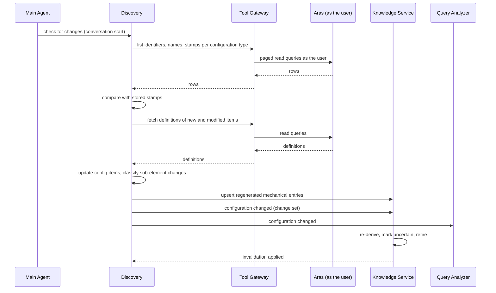

# Discovery specification

Status: MVP specification. Owner slice: module specifications. Related: [Knowledge Service and Learner](knowledge-and-learning.md), [Tool Gateway](tool-gateway.md), [Query Analyzer](query-analyzer.md), [Tool catalog](tool-catalog.md), [Persistence](persistence.md), [Architecture overview](../architecture/overview.md).

## 1. Purpose

Aras Insight is never configured by hand for a customer. Everything it knows about an installation's structure comes from Discovery: it reads the Aras configuration as a signed-in user, keeps a current copy of that configuration in the database, detects changes cheaply through modification stamps, and regenerates the discovered knowledge layer whenever the configuration changes.

Three consumers depend on it:

- the **Query Analyzer**, which validates every AML query against the discovered schema (item types, properties, relationships, list values, lifecycle states, value types);
- the **agents**, which read the schema through `schema_describe` and read discovered knowledge entries through the knowledge tools;
- the **Knowledge Service**, which invalidates or re-derives knowledge when the configuration it depends on changes.

For decision-makers: this is the component that makes the product work on a customised installation on day one, and keeps working after the configuration changes, without a services project to map the schema.

## 2. Responsibilities and non-responsibilities

### Responsibilities

1. Read the Aras configuration through the Tool Gateway as a signed-in user. Every Aras user already has configuration read access, so no privileged account is needed.
2. Store one current record per configuration item with its definition and modification stamp ([config_items](persistence.md#config_items)).
3. Detect new, modified, renamed, and deleted configuration items by comparing stamps, fetching full definitions only for what changed.
4. Serve the discovered schema to `schema_describe` and to the Query Analyzer.
5. Generate the discovered knowledge layer: mechanical entries directly, model-inferred entries through the background model slot, and hand them to the Knowledge Service with their derivation sources and stamps.
6. Emit a change set after every run so the Knowledge Service can re-derive, mark uncertain, or retire dependent entries.
7. Resolve configuration references (by name or Aras id) for the Learner.
8. Record each run ([discovery_runs](persistence.md#discovery_runs)).

### Non-responsibilities

- Discovery reads configuration only, never business data. It does not count items, sample records, or read files.
- It does not hold credentials; it uses the credential of the user whose activity triggered the run, through the Tool Gateway.
- It does not write to Aras (the product is read-only).
- No deployment hook in MVP: Discovery does not receive notifications from Aras deployments; it detects changes by polling stamps at defined moments (section 5.3). The hook is deferred.
- It does not decide what learned knowledge means; it only reports which configuration changed.
- It does not keep a history of configuration definitions beyond the current one (the product keeps no history of Aras data; configuration history is likewise not kept in MVP).

## 3. Interfaces

### 3.1 Agent tool served

| Tool | Caller | Notes |
|---|---|---|
| [`schema_describe`](tool-catalog.md#schema_describe) | Main Agent | Served from config_items. Input and output schemas are defined in the tool catalog. Includes for each item type its properties (name, label, data type, list or item reference, required flag), relationship types with related item types, lifecycle states and transitions, workflow maps with activities and paths, and the discovered entries attached to the item type, by id and description. |

### 3.2 Internal operations

| Operation | Caller | Inputs | Outputs | Errors |
|---|---|---|---|---|
| Check for changes | Main Agent at conversation start; Chat App after sign-in | user id (whose credential the Tool Gateway uses), reason | discovery run id; immediately returns if a check ran within the minimum interval | ARAS_UNAVAILABLE, ARAS_AUTH_EXPIRED, THROTTLED (run is skipped, not failed, and retried at the next trigger) |
| Full discovery | Check for changes when no previous successful run exists | user id | discovery run id | as above |
| Get schema | `schema_describe` handler, Query Analyzer | item type names (or all), detail level | structured schema | NOT_FOUND (unknown item type; includes closest names) |
| Get configuration item | Knowledge Service, Learner | config item id or Aras id | current definition, stamp, name, deleted flag | NOT_FOUND |
| Resolve reference | Learner | configuration type, name or label, optional parent item type | matching config item and element identifiers, or candidates | NOT_FOUND with candidates |
| Discovery status | Chat App, operations | none | last successful run time, run in progress, item counts, staleness | none |

### 3.3 Events emitted

| Event | Consumer | Content |
|---|---|---|
| Configuration changed | Knowledge Service, Query Analyzer | run id; per changed configuration item: config item id, Aras id, type, change type (new, modified, renamed, deleted), old and new name, old and new stamp; per changed sub-element (list value, lifecycle state, workflow activity, property): parent id, element id, change type, old and new name |
| Schema ready | Main Agent, Chat App | run id; signals that the core schema of an initial discovery is loaded and questions may begin |

## 4. Data owned

- [config_items](persistence.md#config_items): one row per configuration item. Fields: id; config_type; aras_id; parent_config_id (for configuration items that belong to another, Proposed); name; label; modified_on stamp as read from Aras; definition (structured, includes sub-elements such as properties, list values, states, activities, each with its own Aras id and name); definition_hash; first_seen_at; last_seen_at; deleted_at; last_run_id.
- [discovery_runs](persistence.md#discovery_runs): one row per run. Fields: id; triggered_by_user_id; reason (initial, conversation_start, sign_in, inconsistency_check, manual_refresh); status (running, completed, failed, skipped); started_at; finished_at; items_listed; items_new; items_modified; items_renamed; items_deleted; invalidation_applied (whether the Knowledge Service has applied this run's change set); error.

Discovered knowledge entries themselves are stored by the Knowledge Service ([knowledge_entries](persistence.md#knowledge_entries) with kind discovered and derived_from dependencies).

## 5. Behaviour

### 5.1 What is read

Discovery reads configuration item types. The names below are typical in standard Aras releases; the actual meta-model must be verified against the target Aras version, and the read set is defined as a list of query templates shipped with the product (Proposed) so it can be adjusted per supported Aras version.

| Configuration (typical Aras name) | Read for | Used by |
|---|---|---|
| ItemType, with its Property definitions | Item types, property names, labels, data types, list and item references, required and unique flags, versionable flag, relationship flag | Query Analyzer validity rules; `schema_describe`; vocabulary (labels are often what users say) |
| RelationshipType | Which relationship connects which source and related item types | Query Analyzer relationship rules; graph narrowing |
| List and Filter List, with values | Allowed values and their labels | Query Analyzer list value rules; meaning of codes |
| Life Cycle Map, with states and transitions | State names, transitions, which item types use the map | State value validation; lifecycle analysis |
| Workflow Map, with activities, paths, and assignment templates | Process definitions; expected paths and durations if configured | Process questions (comparing actual runs with the definition), "why" evidence through sign-off comments |
| Method, and server event bindings (for example onBeforeGet) | Which server methods are attached to which item types and events; method names and event bindings only by default; change detection relies on the method's modification stamp, and a content hash is recorded only when `discovery.read_method_content` is enabled (Proposed) | Warnings that read-time server logic may alter query results; model-inferred meaning |
| Form, with field-to-property mapping | Labels as shown to users, grouping of fields | Vocabulary mapping; model-inferred process meaning ("the request form fills fields A, B, C") |

Discovery does not read Identities, permissions definitions, or user data. Visibility of data is enforced by Aras at query time.

### 5.2 Initial discovery

1. Triggered by the first sign-in after installation (no successful run exists), using that user's credential through the Tool Gateway.
2. Discovery lists every configuration item of each type with only its identifier, name, and modification stamp, in pages.
3. It fetches full definitions in batches, in this order (Proposed): item types with properties, relationship types, lists, lifecycle maps, workflow maps, forms, methods and event bindings.
4. When item types, properties, relationship types, and lists are stored, it emits **Schema ready**: the Query Analyzer can validate and questions can begin. The Chat App shows that the remaining configuration is still loading (Proposed staged availability).
5. When all definitions are stored, Discovery generates the discovered knowledge layer (section 5.5) and completes the run.
6. Discovery queries are fixed, product-authored templates. They run through the Tool Gateway's AML Executor and Throttle like any query, are marked as system-origin in the audit record, and are checked by the Query Analyzer against the Aras meta-model rather than the discovered schema (Proposed, because the discovered schema does not exist yet during the first run).

### 5.3 Change detection by modification stamps

Change checks run at these moments (no deployment hook in MVP):

- at the start of a conversation, if the last successful check is older than the minimum interval (Proposed default 10 minutes);
- after sign-in, under the same rule;
- when the Query Analyzer or Aras reports something the schema cannot explain (for example Aras returns an error naming an unknown property that the schema contains, or rejects an item type the schema lists), as an early check with run reason `inconsistency_check` (Proposed);
- on manual refresh from operations (Proposed).

Because access is user-level only, a check always runs with a signed-in user's credential. When nobody uses the product, no checks run; the first conversation after a quiet period triggers one.

The check:

1. For each configuration type, list all items with identifier, name, and modification stamp only, paged, through the Tool Gateway. This is cheap: a few thousand short rows on a typical installation.
2. Compare with config_items:
   - identifier not stored: **new**;
   - stored, stamp differs: **modified** (and **renamed** if the name differs);
   - stored, not listed: **deleted** (confirmed by fetching that identifier directly; an item that is merely not visible to this user is not treated as deleted, see section 9);
   - stamp equal: unchanged; last_seen_at is updated.
3. Fetch full definitions only for new and modified items, compute the definition hash, and update config_items. For modified items, compare sub-elements (properties, list values, states, activities) by their Aras ids to classify sub-element changes as new, modified, renamed, or removed.
4. If no change was found, the run completes with counts only.
5. Otherwise Discovery regenerates the affected discovered entries (section 5.5) and emits **Configuration changed**.

Concurrent triggers are collapsed: only one run executes at a time per deployment; a trigger during a run returns the running run's id.

### 5.4 Interaction with in-flight work

- Conversations in progress continue against the schema they started with until the run commits; the commit is atomic per run so a query is never validated against a half-updated schema (Proposed: the run writes into config_items in one transaction at the end of each configuration type, and the Query Analyzer reloads on **Configuration changed**).
- An analysis job running during a change may see analyzer diagnostics it did not expect; it treats them like any diagnostic and retries.

### 5.5 Regenerating the discovered layer

1. **Mechanical entries.** For each configuration item that carries meaning beyond its raw definition (Proposed set: each workflow map, each lifecycle map, each list used by a property, each relationship-rich item type), Discovery generates a summary entry deterministically from the definition, for example the activities and paths of a workflow map in plain language, including loops such as a path back to an earlier activity. Each entry records derived_from dependencies on its sources with their stamps.
2. **Model-inferred entries.** For process-level meaning that needs interpretation across several configuration items (for example how a process starts, which forms fill which properties, which item types a workflow governs, what a server event binding implies for query results), Discovery asks the background model slot to infer entries from the definitions, using the discovery inference prompt (see [docs/prompts/](../prompts/README.md)). The prompt receives configuration definitions only, never data. Each inferred entry records all the configuration items it was derived from, with their stamps.
3. On an initial run all entries are generated. On a change run only entries whose sources changed are regenerated; the Knowledge Service drives this through its re-derivation flow (see [knowledge-and-learning.md](knowledge-and-learning.md), section 5.3).
4. Entries are handed to the Knowledge Service through Upsert discovered. Unchanged content produces no new version.
5. Learned knowledge is not regenerated by Discovery. The change set tells the Knowledge Service which referenced elements were renamed or removed, and it marks those learned entries uncertain.

### 5.6 Sequence of a change run

## 6. Configuration

| Key | Type | Default | Meaning |
|---|---|---|---|
| discovery.min_check_interval_minutes | integer | 10 (Proposed default) | Minimum time between change checks. |
| discovery.page_size | integer | 500 (Proposed default, equal to gateway.max_page_size) | Page size of listing queries. |
| discovery.definition_batch_size | integer | 50 (Proposed default) | Configuration items fetched per definition query. |
| discovery.read_method_content | boolean | false (Proposed default) | Whether method source is read (for content hashing and inference) or only names, event bindings, and modification stamps. |
| discovery.model_inference_enabled | boolean | true (Proposed default) | Whether model-inferred entries are generated. When false only mechanical entries exist. |
| discovery.template_set | text | the set matching the detected Aras version (Proposed) | Which shipped query template set to use. |
| discovery.run_timeout_minutes | integer | 60 (Proposed default) | Maximum duration of a run before it is marked failed. |

## 7. Limits

- Discovery queries count against the triggering user's query slots and against the system-wide Throttle (see [Tool Gateway](tool-gateway.md)). They do not count against the user's question budget (Proposed), so a change check never consumes the budget of the question that triggered it.
- One run at a time per deployment.
- Model-inferred entry generation is bounded per run (Proposed: at most 200 inference calls per run; remaining items are queued for the next run and their entries stay uncertain or absent until then).

## 8. Failure modes and recovery

| Failure | Detection | Effect on user | Recovery |
|---|---|---|---|
| Aras unavailable or credential expired during a run | Gateway error | None for the current answer; the schema from the last successful run is used | Run marked failed; the next trigger retries |
| Initial discovery fails | Run failed with no previous success | Chat App shows that the product is preparing and cannot answer yet, with the reason | Retried on the next sign-in or conversation start; operations can trigger a manual refresh |
| Template query rejected by Aras (meta-model differs from the expected version) | Aras error on a template | Missing configuration type in the schema; affected questions may fail validation | Run completes partially with the error recorded; operations must select or update the template set |
| Background model unavailable | Model Router error | Model-inferred entries missing or stale (uncertain) | Mechanical entries and schema still update; inference retried next run |
| Crash between config update and invalidation | invalidation_applied not set on a completed run | Some knowledge may be used as confirmed though its source changed | On restart the Knowledge Service re-applies unapplied change sets |
| Item invisible to the triggering user but visible to others | Direct fetch of a listed-missing item fails with permission rather than not-found | None | Not treated as deleted; recorded on the run (section 9) |

## 9. Security considerations

- **Runs as the user.** Discovery uses the signed-in user's credential through the Tool Gateway, never a service or administrator account, consistent with user-level access only.
- **Shared schema.** The discovered configuration is stored once per deployment and served to every user. This relies on every Aras user having configuration read access. If an installation restricts some configuration to certain identities, a user could see in `schema_describe` the existence of an item type they cannot query. Querying it still fails in Aras as that user, so no data is exposed, but the existence of the configuration is (see open questions).
- **No data.** Discovery templates select configuration item types only; the Query Analyzer's read-only enforcement applies to them like to any query.
- **Method content.** Server method source can contain sensitive logic or embedded constants; by default only names, event bindings, and modification stamps are read; the content is neither read nor hashed (Proposed).
- **Model inference sees configuration only.** The inference prompt receives definitions, never data rows or files.

## 10. Observability

- A `discovery.run` audit event per run (counts, triggering user, reason) and an `aras.query` event per Aras query, marked as discovery-originated (see [Audit and progress](audit-and-progress.md#51-audit-event-catalogue)).
- Metrics (Proposed): run duration by reason; items listed per type; changes per run by kind; runs skipped because of the interval or throttling; time since last successful run; inference calls and failures per run; entries regenerated per run.
- A staleness indicator in operations status: time since the last successful run, and whether any change set is waiting for invalidation.

## 11. MVP versus deferred

In MVP: everything in this document, with change detection by stamps at conversation start and sign-in.

Deferred (see [roadmap](../product/roadmap.md)):

- deployment hook that triggers re-discovery and knowledge invalidation when configuration is deployed;
- multiple Aras instances in one deployment;
- developer and administrator features such as a configuration browser.

## 12. Open questions

1. Proposed: the discovered configuration is one shared copy per deployment. If an installation restricts configuration read access by identity, should Discovery record which users have seen each item and filter `schema_describe` accordingly?
2. Proposed: the read set (section 5.1) is a shipped template list per supported Aras version; which Aras versions does MVP support?
3. Proposed: method content is not read by default; only names, event bindings, and modification stamps. A content hash is recorded only when content reading is enabled.
4. Proposed: staged availability after initial discovery (questions allowed once core schema is loaded).
5. Proposed: an early change check when Aras reports an inconsistency with the stored schema.
6. Proposed: discovery queries do not count against the triggering question's budget.
7. Proposed: the set of configuration items that get mechanical summary entries, and the cap of 200 inference calls per run.
8. Proposed: the analyzer checks discovery templates against the Aras meta-model during the first run.
9. Proposed: the minimum check interval of 10 minutes; is a separate periodic check, run only while users are active, also wanted?
