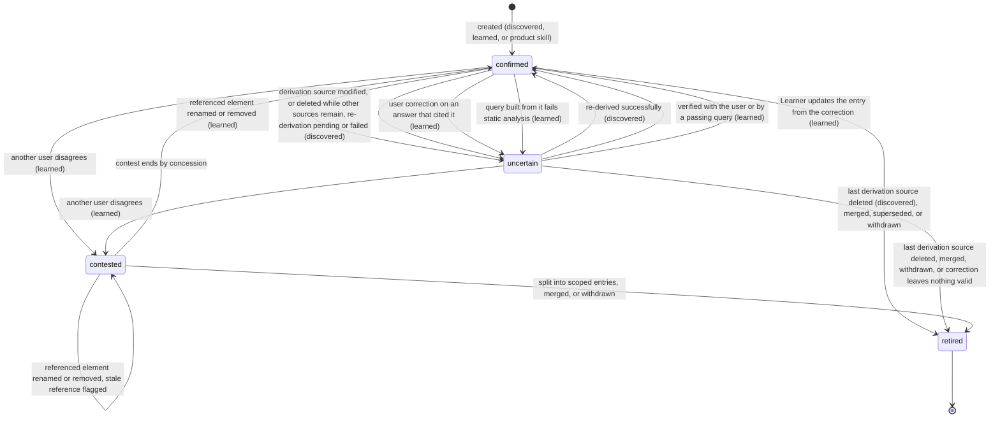
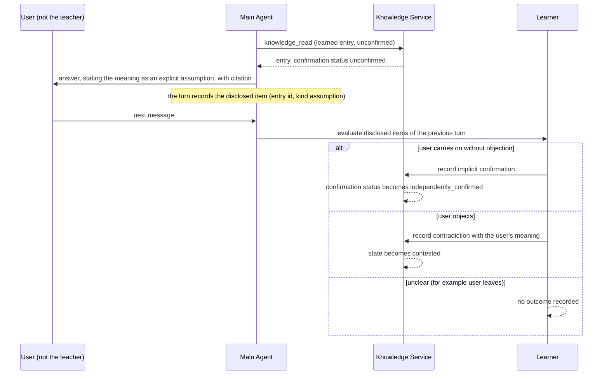
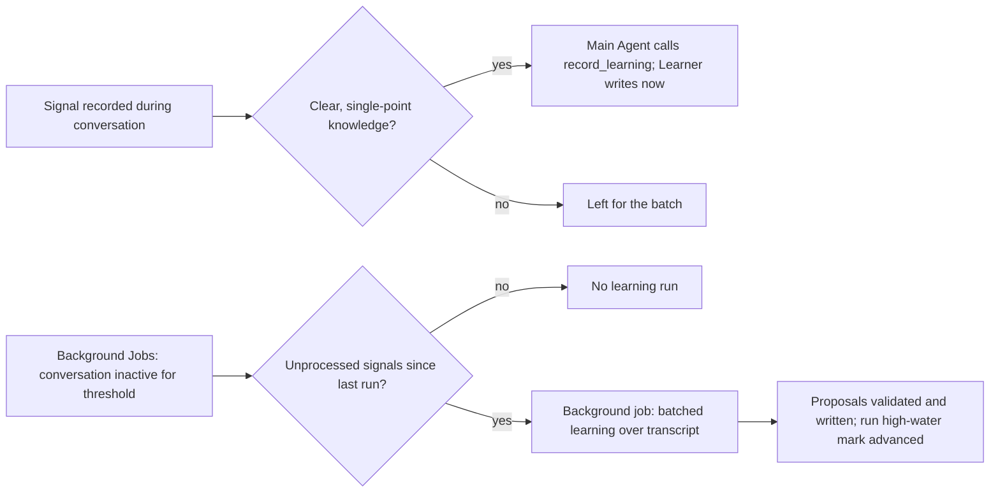

# Knowledge Service and Learner specification

Status: MVP specification. Related: [Discovery](discovery.md), [Main Agent](main-agent.md), [Tool catalog](tool-catalog.md), [Background Jobs](background-jobs.md), [Persistence](persistence.md), [Architecture overview](../architecture/overview.md), [Skills catalog](../skills/README.md).

This document specifies two cooperating components:

- **Knowledge Service**: stores and serves every knowledge layer (Product Skills, Instance Knowledge, User Preferences), maintains entry states, and applies invalidation when the Aras configuration changes.
- **Learner**: writes and maintains Learned knowledge, either live during a conversation or in a batch over a transcript after an inactivity threshold.

They are specified together because the Learner has no storage of its own beyond its run bookkeeping; every entry it creates or changes goes through the Knowledge Service.

## 1. Purpose

Aras installations differ. Item types, properties, lists, workflows, and lifecycles are customised, and the words people use ("a delayed change", "a released part", "the design review process") map onto that configuration in ways no product can ship in advance. The knowledge layers give the agents what they need to write correct queries and interpret results without per-customer hand configuration:

- what the product knows about Aras in general (Product Skills, shipped with the product);
- what this installation's configuration is and means (Discovered knowledge, generated from the configuration);
- what people in this organisation mean by their terms and processes (Learned knowledge, formed in conversations);
- how an individual user prefers answers (User Preferences, private to that user).

Every discovered or learned knowledge entry an answer relies on is citable. Every entry carries a state that tells the agent how far to trust it, and is kept current automatically when the configuration it depends on changes.

The governing rule for shared knowledge is **"how, never what"**: entries describe how the configuration is used and what terms mean, never business data values. Because of that rule, shared learned knowledge depends only on the Aras configuration, so configuration changes are the only staleness trigger.

## 2. Responsibilities and non-responsibilities

### Knowledge Service responsibilities

1. Store entries of all three layers with their full schema (section 4.1) and version history.
2. Load Product Skills from the files shipped with the product at startup, read-only, and supply their text to the agents as skill instructions (section 5.10).
3. Serve the knowledge index (identifier, one-line description, state, confidence) for the instance and user-preference layers, filtered by topic and by the caller's visibility, and serve full entries by identifier. Product skills are not part of the index (section 5.10).
4. Enforce visibility: instance entries are visible to every user of the deployment; preference entries only to their owner.
5. Maintain the state machine (section 5.2) and record every transition with its reason and evidence.
6. Record confirmations and contradictions, and compute each learned entry's confirmation status.
7. Receive configuration change sets from Discovery and apply invalidation: uncertainty and queued re-derivation for discovered entries whose sources changed, uncertainty for learned entries whose references were renamed or removed, retirement of a discovered entry when its last derivation source is deleted.
8. Accept discovered entries from Discovery (create, new version, retire).
9. Provide citation summaries for discovered and learned entries to the Citation Registry when an entry is read for use in an answer.
10. Serve the discovered schema to the Main Agent through `schema_describe`, from the configuration that [Discovery](discovery.md) keeps in `config_items`.
11. At startup, reconcile every entry's recorded dependencies with the current configuration, so that a change set lost in a crash is applied after all (section 8).

### Learner responsibilities

1. Detect learning signals in conversations: correction, retried question, empty result, explicit teaching (section 5.7).
2. Process live learning proposals made by the Main Agent through `record_learning`.
3. Run batched learning over a transcript when Background Jobs starts a batched learning job for a conversation that has been inactive past the threshold and carries at least one unprocessed signal.
4. Apply the "how, never what" rule to proposals through its prompt, and resolve their configuration references.
5. Merge into existing entries about the same term or configuration element rather than append duplicates.
6. Evaluate disclosed items from the user's next message: whether a disclosed assumption was accepted (implicit confirmation), objected to (contradiction), or neither; whether a verification question verified an uncertain entry; which meaning the user chose when asked about a contested entry (section 5.6).
7. Write User Preferences into the owner's personal layer.
8. Retire entries it merged, superseded, found corrected, or whose teacher withdrew them, and end a contest by concession or split (sections 5.6 and 5.8).

### Non-responsibilities

- Neither component talks to Aras. Configuration reads are Discovery's job and all Aras access goes through the [Tool Gateway](tool-gateway.md).
- Neither component stores business data values from Aras in shared knowledge. Extracted file text belongs to the [File Service](file-service.md); query results are never persisted as knowledge.
- No vector search. Knowledge is loaded by index and description (vector indexing of knowledge is deferred, see section 11).
- No mandatory human approval gate. Learning is automatic; trust is managed by state and confirmation status instead.
- No age-based decay of unused entries in MVP (deferred).
- No programmatic data-value check and no scheduled leak audit in MVP (the audit is deferred); the MVP relies on a strong Learner prompt and the shipped skills (section 5.5, [ADR 0022](../decisions/0022-prompt-based-how-never-what-enforcement.md)).
- No administrator curation interface in MVP (developer and admin features are deferred), and no administrator view of who taught an entry.
- The Learner never writes to Discovered entries or Product Skills (section 5.2).

## 3. Interfaces

### 3.1 Agent tools served

The agent-facing schemas are defined once in the [tool catalog](tool-catalog.md); this section states how this module serves them.

| Tool | Caller | Served by | Notes |
|---|---|---|---|
| [`knowledge_index`](tool-catalog.md#knowledge_index) | Main Agent | Knowledge Service | Topic-filtered index lines for instance entries and the user's own preferences; product skills are not listed (section 5.10). See section 5.1 for matching and ranking. |
| [`knowledge_read`](tool-catalog.md#knowledge_read) | Main Agent | Knowledge Service | Full entries, returned as data; registers a knowledge citation for each discovered or learned entry returned (none for product skills or the user's own preferences). When the ids include an on-demand product skill, the service attaches the skill's text as skill instructions instead of returning it (section 5.10). The usage note is computed for the reading user: the assumption note is left out when the reader is a teacher of the entry. A retired entry is returned with state retired and, where it was merged, a pointer to the entry it was merged into. |
| [`schema_describe`](tool-catalog.md#schema_describe) | Main Agent | Knowledge Service, from the configuration Discovery stores | The discovered schema (item types, properties, relationship types, lists, workflow and lifecycle maps). The Knowledge Service serves the tool; the data is the `config_items` that Discovery reads and keeps current (see [discovery.md](discovery.md)). A knowledge citation is registered only for a described element that has a discovered entry (or whose parent item has one). |
| [`record_learning`](tool-catalog.md#record_learning) | Main Agent | Learner, then Knowledge Service | Live learning proposal; returns the outcome (created, merged, contradiction recorded, preference saved, or rejected with reason). |

Analysis Workers call neither the knowledge tools nor `schema_describe`. The Main Agent places the schema excerpts and knowledge excerpts a job needs, with their citation identifiers, in the job brief (see [Analysis Worker and Sandbox](analysis-worker-and-sandbox.md)).

### 3.2 Internal operations of the Knowledge Service

| Operation | Caller | Inputs | Outputs | Errors |
|---|---|---|---|---|
| Index | `knowledge_index` handler | user id, topic text (optional), layers (optional: instance, user_preference), configuration element names (optional), include retired (default no), limit | ordered list of index lines: id, layer, kind, title, one-line description, state, confidence label (none for preferences or retired entries), confirmation status | INVALID_INPUT (topic too long, unknown layer) |
| Read | `knowledge_read` handler, Learner | user id, list of entry ids, conversation id and turn id (for citation) | full entries (section 4.1) visible to the user, including retired entries (state retired, with the merged-into pointer where there is one); per-entry citation id for discovered and learned entries | NOT_FOUND (unknown or not visible id; reported per id, others still returned) |
| Upsert discovered | Discovery | list of discovered entries with derivation sources and stamps, discovery run id | per entry: created, new version, unchanged | INVALID_INPUT (missing dependency stamps) |
| Apply configuration changes | Discovery | change set: per configuration item, change type (new, modified, renamed, deleted), old and new name, old and new stamp; per changed sub-element (list value, lifecycle state, workflow activity, property): parent item, element id, change type, old and new name | list of affected entries with action taken; the entries awaiting re-derivation | none (failures per entry are recorded and picked up by the dependency reconciliation) |
| Reconcile dependencies | service startup | none | every entry's recorded dependency names and stamps compared with the current `config_items`; per entry the action a change set would have caused | none |
| Write learned | Learner | validated operation: create, merge, or update (section 3.4) | outcome: created, merged into id, new version of id (an uncertain entry rewritten from a correction returns to confirmed) | KNOWLEDGE_CONFLICT (concurrent update; Learner retries once) |
| Write preference | Learner | owner user id, preference content | created or updated preference id | INVALID_INPUT |
| Record confirmation | Learner | entry id, user id, conversation id, turn id, kind (explicit, implicit), contradiction id and the meaning chosen (only when the confirmation records a user's choice between competing meanings of a contested entry) | updated confirmation status | NOT_FOUND, INVALID_INPUT (not a learned entry) |
| Verify | Learner | entry id, basis (verified_by_user, verified_by_query), conversation id, turn id | state confirmed (from uncertain) | NOT_FOUND, INVALID_INPUT (entry is not uncertain, or not a learned entry) |
| Record contradiction | Learner | entry id, user id, conversation id, turn id, the meaning the user asserts | contradiction id; entry state becomes contested (a contested entry gains a further open contradiction) | NOT_FOUND, INVALID_INPUT (not a learned entry) |
| Mark uncertain | Main Agent (correction on a cited learned entry), Tool Gateway (analyzer failure on a query built from a learned entry), Learner | entry id, reason code, evidence references, replacement (optional) | new state | NOT_FOUND |
| Resolve | Learner | entry id, resolution: concession with the agreed content, or split with the two scoped entries (section 5.6) | new state, new or split entries | KNOWLEDGE_CONFLICT |
| Retire | Learner (reasons merged, superseded, corrected, withdrawn), Apply configuration changes (source_deleted), startup (product_upgrade) | entry id, reason, merged-into id (required for merged) | retired entry | NOT_FOUND |
| Load product skills | service startup | the shipped skill files and product version | count loaded; a changed skill gets a new version of its entry; entries for skills no longer shipped are retired with reason product_upgrade | startup fails if a shipped skill file is malformed |
| Replace teacher identity | operator procedure (see [deployment and operations](../architecture/deployment-and-operations.md)) | user id of the person to remove | the person's user id in provenance and confirmation rows replaced by one stable placeholder id; entries are kept | NOT_FOUND |

### 3.3 Internal operations of the Learner

| Operation | Caller | Inputs | Outputs |
|---|---|---|---|
| Process live proposal | `record_learning` handler | proposal from the Main Agent, conversation id, turn id, user id | outcome returned to the model through the tool envelope |
| Record signal | Main Agent, Tool Gateway, Chat App | conversation id, turn id, signal kind, evidence (message ids, tool call ids, feedback id) | signal id |
| Evaluate disclosed items | Main Agent, on receipt of a user message | conversation id, the previous turn's disclosed items (entry id and kind: assumption, verification, or clarification), the new user message | per item: for an assumption, implicit confirmation, objection, or no outcome; for a verification, verified, no longer applies, or no outcome; for a clarification, the meaning chosen, a third meaning, or no outcome |
| Run batched learning | Background Jobs (job kind batched learning) | conversation id, transcript range from the last processed turn | learning run record with outcomes |

### 3.4 Operations the Learner outputs

The Learner has no tools. For a live proposal, an evaluation of disclosed items, or a batched run it outputs a list of operations against entries it was shown, and the Knowledge Service validates and applies them through the operations of section 3.2 ([ADR 0044](../decisions/0044-learner-operations-and-signals.md)). The service checks that the target entry exists and is a learned entry or the user's own preference, that the configuration elements exist, and that the required fields are present; a failing operation is rejected with its reason and the others are still applied. The service, not the Learner, computes confidence and applies the single-user rule, so neither appears in the Learner's output.

| Operation | Use | Applied as |
|---|---|---|
| `create` | A new learned entry; only when no candidate entry concerns the same term or configuration element | Write learned |
| `merge` | Fold new wording, configuration elements, or provenance into an existing entry with the same meaning | Write learned |
| `update` | Change an entry's body when its own teacher corrects it | Write learned (new version) |
| `mark_uncertain` | A correction on an answer that cited the entry, a failed query built from it, or a mapped element that no longer matches | Mark uncertain |
| `mark_contested` | A different user's meaning conflicts with the entry, or a user describes a third meaning of a contested entry; both meanings are kept with provenance | Record contradiction |
| `record_confirmation` | A user other than the teacher carried on after a disclosed assumption, or confirmed it in words; an uncertain entry was verified; a user chose one of the competing meanings of a contested entry | Record confirmation, or Verify for an uncertain entry |
| `set_preference` | A personal preference for the current user | Write preference |
| `retire` | An entry that is a duplicate (merged), replaced (superseded), no longer applies after a correction or failed verification (corrected), or was withdrawn by its teacher while nobody else had confirmed it (withdrawn) | Retire |
| `resolve` | A contest ends by concession or split (section 5.6) | Resolve |
| `no_change` | Nothing to persist, with a one-line reason | none |

Fields. Every operation other than `no_change` carries `operation`, its provenance (conversation id, turn reference, and the pseudonymous id of the current user; the service adds the signal kind), and a one-sentence `rationale` (kept as the change reason). The other fields apply as follows.

| Field | Carried by | Meaning |
|---|---|---|
| `target_id` | all except `create` (and `set_preference` when no preference exists yet) | The entry the operation acts on. |
| `title`, `description`, `body` | `create`, `merge`, `update`, `set_preference`, `resolve` | The entry text, within the limits of section 6. For a split, one set per replacement entry. |
| `aliases` | `create`, `merge`, `update`, `set_preference`, `resolve` | Other words users use for the same thing, derived by the Learner from the wording of the proposal or conversation. |
| `config_refs` | `create`, `merge`, `update`, `resolve`, `set_preference` | The configuration elements the entry maps to, each with its stable id and modification stamp from the schema extract the Learner was shown (section 5.4); the service checks that each exists. Required for organisation scope, optional for a preference. |
| `reason` | `mark_uncertain` (optional), `retire` (required) | For `mark_uncertain`, why the entry is uncertain; for `retire`, one of merged, superseded, corrected, withdrawn. |
| `replacement` | `mark_uncertain` (optional) | The wording the Learner proposes as a replacement. |
| `basis` | `record_confirmation` | explicit, implicit, verified_by_user, verified_by_query, or chosen_meaning. |
| `contradiction_id`, `chosen_meaning` | `record_confirmation` with basis chosen_meaning | The contradiction the user's choice answers, and which meaning was chosen (the entry's or the contradiction's). |
| `asserted_meaning` | `mark_contested` | The meaning the other user intends, written without data values. |
| `merged_into_id` | `retire` with reason merged | The entry that was kept. |
| `resolution` | `resolve` | concession (with the agreed content in `title`, `description`, `body`) or split. |

Discovered entries and Product Skills are read-only for the Learner: an operation that targets one is rejected. The batched variant does not output `record_confirmation` (section 5.7).

## 4. Data owned

Tables owned by the Knowledge Service: [knowledge_entries](persistence.md#knowledge_entries), [knowledge_entry_versions](persistence.md#knowledge_entry_versions), [knowledge_dependencies](persistence.md#knowledge_dependencies), [knowledge_provenance](persistence.md#knowledge_provenance), [knowledge_confirmations](persistence.md#knowledge_confirmations), [knowledge_contradictions](persistence.md#knowledge_contradictions), [knowledge_state_events](persistence.md#knowledge_state_events).

Tables owned by the Learner: [learning_signals](persistence.md#learning_signals), [learning_runs](persistence.md#learning_runs).

Tables read but not owned: [config_items](persistence.md#config_items) (Discovery), [conversations](persistence.md#conversations), [turns](persistence.md#turns), [messages](persistence.md#messages), [tool_calls](persistence.md#tool_calls) (Main Agent), [feedback](persistence.md#feedback) (Chat App), [citations](persistence.md#citations) (Citation Registry).

### 4.1 Knowledge entry schema

The logical schema of one entry. Persistence details (keys, indexes, retention) are in [persistence.md](persistence.md#knowledge_entries).

| Field | Type | Applies to | Meaning |
|---|---|---|---|
| id | identifier (`kn_` prefix) | all | Stable identifier. Never reused. Survives new versions. |
| layer | enumeration: product_skill, instance, user_preference | all | Which knowledge layer the entry belongs to. |
| kind | enumeration: discovered, learned | instance only | discovered: derived from configuration by Discovery. learned: formed in conversation by the Learner. Empty for other layers. |
| derivation_method | enumeration: mechanical, model_inferred | discovered only | mechanical: generated deterministically from configuration (for example a summary of a workflow map's activities and paths). model_inferred: produced by the background model from configuration (for example "this process starts from a request item whose form fills fields A, B, C"). Each inference the model produces is an entry of its own, including the ambiguities (points where the configuration allows several readings, stated as questions that learning could settle), so each can be re-derived independently. |
| owner_user_id | user id | user_preference only | The only user who can see and use the entry. |
| title | text, up to 120 characters | all | Short name, usually the term or configuration element the entry is about. |
| aliases | list of text | instance, user_preference | Other words users use for the same thing. Used for topic matching and merging. The Learner derives them from the wording of a proposal; the Main Agent does not supply them. |
| description | text, up to 200 characters | all | The one-line description shown in the index. Must let the model decide whether to load the entry. |
| body | text (Markdown), up to 4,000 characters | all | The knowledge itself: meaning, mapping to configuration elements, how to query it, caveats. The Learner writes a learned entry in one to five sentences and the discovery inference writes one to six (process outlines need more room); the difference is intentional. |
| subject_refs | list of configuration references | instance, user_preference | The configuration elements the entry is about (see dependencies below); used for merging and topic matching. |
| state | enumeration: confirmed, uncertain, contested, retired | all | Trust state; see section 5.2. Product skills are always confirmed. |
| uncertain_reason | text | uncertain or contested entries | Why the entry is uncertain (for example "referenced lifecycle state renamed"); for a contested entry, the stale reference flagged after a configuration change (section 5.2). |
| confirmation_status | enumeration: unconfirmed, independently_confirmed | learned only | unconfirmed: only the teacher (or teachers of its versions) has vouched for it; the agent discloses it as an assumption when using it. independently_confirmed: at least one other user confirmed it (in a single-user deployment, `knowledge.single_user_deployment`, the teacher's word is enough). |
| confidence | derived label: high, medium, low | product_skill and instance entries, computed on read | high: product skill; mechanical discovered entry in confirmed state; learned entry confirmed and independently confirmed. medium: model-inferred discovered entry in confirmed state; learned entry confirmed but unconfirmed. low: uncertain or contested. A user preference carries no confidence label. A retired entry carries none either; it is shown as retired. |
| version | integer | all | Incremented on every content change; prior content kept in knowledge_entry_versions. |
| product_version | text | product_skill only | The product release the skill shipped with. |
| provenance | list of provenance records | all | Who and what created or changed the entry: discovery run id, or conversation id, turn id, user id, and the signal kind; merges list the source entry. Stored in knowledge_provenance. Other users see the teacher's name only when `knowledge.show_teacher_names` is true; otherwise they see a neutral description. |
| dependencies | list of configuration dependencies | instance; optional for preferences | Each: configuration item id (from config_items; for a sub-element, the parent item), Aras id (of the item or sub-element), configuration type (for example ItemType, Property, List value, Life Cycle state, Workflow activity, typical in standard Aras releases; verify against the target version), name at the time of recording, modification stamp at the time of recording, dependency type (derived_from for discovered entries, refers_to for learned entries). Stored in knowledge_dependencies. |
| confirmations | list | learned | Each: user id (none for a confirmation supplied by the single-user rule), conversation id, turn id, kind (explicit, implicit, single_user_rule), the contradiction id and the meaning chosen when the confirmation records a user's choice between competing meanings, timestamp. Stored in knowledge_confirmations. |
| contradictions | list | learned | Each: contradiction id, user id, conversation id, turn id, the asserted alternative meaning, status (open, resolved), resolution, timestamps. Stored in knowledge_contradictions. A discovered entry has none. |
| merged_into_id | entry id | retired entries | Set when the entry was merged into another. |
| retired_reason | enumeration: source_deleted, merged, superseded, corrected, withdrawn, product_upgrade | retired entries | Why the entry left use. |
| created_at, updated_at | timestamp | all | Creation and last content change. |
| state_changed_at | timestamp | all | Last state transition. |
| last_used_at | timestamp | all | Last time it was read for an answer (supports the deferred decay feature and observability). |

### 4.2 What belongs in each layer

| Layer | Examples | Written by | Visible to |
|---|---|---|---|
| product_skill | How to write AML safely; how to use the tools and the Sandbox; where "why" evidence lives (long text fields, workflow sign-off comments, linked files); what knowledge to persist and where. Full texts are in [docs/skills/](../skills/README.md). | Shipped with the product | Everyone |
| instance, discovered | "The change process is configured as workflow map W with activities A to F; the path from B back to A is the rework loop." "Property P on item type T is a list of values V1 to V5 with labels L1 to L5." | Discovery | Everyone |
| instance, learned | "When people say a change is delayed they mean its workflow took longer than the target duration recorded on the item." "The 'design review process' refers to workflow map M." | Learner | Everyone, immediately, with provenance |
| user_preference | "Prefers results as a table with at most 10 rows." "Means the last full calendar quarter by 'last quarter'." | Learner | Owner only |

## 5. Behaviour

### 5.1 Loading by index and description

1. On each turn the Main Agent's context contains the always-loaded product skills, the index of on-demand skills (titles and descriptions), a short orientation summary of the installation (Aras version, main item types by label with one-line descriptions, when Discovery last ran; see [Main Agent](main-agent.md)), and, per the product guidance, the instruction to call `knowledge_index` for the terms and configuration elements in the user's question. The service does not preload knowledge entries into the context; the model fetches them itself.
2. `knowledge_index` matches the topic text against each visible entry's title, aliases, description, and the names of its subject references: case-insensitive term matching with simple normalisation of plurals and punctuation; no vectors.
3. Results are ranked: exact title or alias match first, then subject-reference name match, then description match; within a rank, confirmed before uncertain before contested; learned before discovered when both describe the same term (learned entries carry organisational meaning); then most recently used. Retired entries are excluded unless requested.
4. The index returns at most the configured number of lines. Each line has the identifier, one-line description, state, and confidence label, so the model can choose which entries to load.
5. The model calls `knowledge_read` with the chosen identifiers. Each returned discovered or learned entry is registered with the Citation Registry, producing a knowledge citation (entry id, layer, kind, state, confirmation status, and confidence label at the time of reading). The user's own preferences are returned without a citation. An entry is cited once for a given version, state, and confirmation status; when any of them has changed since it was last cited in the conversation, a new citation is issued. The model cites the entry when the answer depends on it. Only discovered and learned entries are citable.
6. The entry's last_used_at is updated.

### 5.2 State machine

Transition rules, with triggers and who reports them. Every transition is applied by the Knowledge Service; other components only report the trigger through its operations (section 3.2).

| From | To | Trigger | Reported by | Evidence recorded |
|---|---|---|---|---|
| (new) | confirmed | Discovered entry generated; learned entry created from a validated proposal; product skill loaded | Discovery, Learner, startup | discovery run id or conversation, turn, user |
| confirmed | uncertain | A configuration element a learned entry refers to is renamed or removed (including a value or state that disappeared from a modified List or Life Cycle Map, section 5.3) | Discovery, through Apply configuration changes | change set, old and new names |
| confirmed | uncertain | A derivation source of a discovered entry is modified, or deleted while other sources remain; the entry stays uncertain until re-derivation completes | Discovery, through Apply configuration changes | change set, stamps |
| confirmed | uncertain | A user corrects an answer that cited the learned entry | Main Agent through Mark uncertain (the correction arrives as a user message that starts a new turn, from the Chat App's Correct this form or typed in the conversation); signal recorded as correction | feedback id or message id, citation id |
| confirmed | uncertain | A query the model built from the learned entry is rejected by the Query Analyzer's validity rules for a configuration element the entry refers to (on the first such rejection; the hint to the model after repeated rejections is a separate rule) | Tool Gateway through Mark uncertain | tool call id, analyzer rule ids |
| uncertain | confirmed | Re-derivation produced a valid entry (same or new content) | Discovery, through Upsert discovered | discovery run id, new version |
| uncertain | confirmed | The learned entry was verified: a user confirmed it in conversation, or a query built from it passed analysis and returned a plausible result that the user accepted (section 5.6) | Learner through Verify | conversation, turn, user |
| uncertain | confirmed | The Learner rewrote the learned entry from a correction (new version) | Learner | signal id |
| confirmed or uncertain | contested | A user other than the teacher objects to the learned entry, or teaches a conflicting meaning | Learner (assumption evaluation, or a live or batched proposal that conflicts) | contradiction record |
| contested | confirmed | The contest ends by concession (section 5.6) | Learner through Resolve | resolution record |
| contested | contested | A configuration element the entry refers to is renamed or removed; the entry stays contested and its reason flags the stale reference | Discovery, through Apply configuration changes | change set |
| any non-retired | retired | The last derivation source of a discovered entry is deleted (reason source_deleted) | Discovery, through Apply configuration changes | change set |
| any non-retired | retired | A learned entry is merged into another (reason merged), or replaced by a newer entry that covers it (reason superseded) | Learner through Retire | merged-into or replacing entry |
| contested | retired | A split replaces the entry with two scoped entries (reason superseded) | Learner through Resolve | resolution record, new entries |
| any non-retired | retired | The teacher withdrew a learned entry that no other user had confirmed (reason withdrawn) | Learner through Retire | conversation, turn, user |
| uncertain | retired | A correction or failed verification leaves nothing valid: the user says the learned entry no longer applies (reason corrected) | Learner through Retire | conversation, turn, user |
| any non-retired | retired | A product skill is no longer shipped after an upgrade (reason product_upgrade) | startup (product upgrade) | product version |

Rules that hold in every state:

- **Uncertain entries stay usable but are verified first.** When the model reads an uncertain entry, the read result marks it uncertain with the reason; the product guidance tells the model to verify it before relying on it (re-check against the current schema with `schema_describe`, or confirm with the user), and to say so in the answer. When the agent verifies with the user, the question is a disclosed item on the turn and the Learner evaluates the reply (section 5.6).
- **Contested entries are not used silently.** The agent asks which meaning the user intends (section 5.6).
- **Retired is terminal.** A retired entry is never reactivated; if the knowledge becomes valid again a new entry is created, with provenance pointing to the retired one. A retired entry stays readable by id (state retired, with its pointer to the entry it was merged into where there is one) so that earlier citations still open; the index leaves it out unless asked, and the agent does not rely on it.
- **The teacher correcting themselves is not a contradiction.** If the user who taught an entry (or a later version) changes it, the Learner writes a new version; state stays or returns to confirmed.
- **Confirmation status is separate from state.** A learned entry can be confirmed (valid against configuration, nobody disagrees) and still unconfirmed (only its teacher has vouched for it).
- **Discovered entries are read-only for the Learner.** Only Discovery writes them. A user's correction on an answer that cited a discovered entry is recorded as a signal, and the Learner writes a learned entry that refines it; for the same term the learned entry ranks first in the index (section 5.1). No contradiction attaches to a discovered entry, so a discovered entry is never contested.
- **Discovered inferences are suggestions whatever their state.** State says whether the entry still matches the configuration; confidence says how far to rely on it. A model-inferred entry offers a suggested definition and never replaces a definition taught by users.

### 5.3 Re-derivation of discovery-inferred entries

Only discovered entries are re-derived. Learned entries are never re-derived: when the configuration they refer to changes they become uncertain (section 5.2) and are corrected through the Learner (section 5.4).

1. Discovery detects changed configuration items by modification stamp (see [Discovery](discovery.md)) and sends a change set.
2. The Knowledge Service finds every discovered entry with a derived_from dependency on a changed item.
3. For a **deleted** source: if it was the entry's last remaining source, the entry is retired with reason source_deleted. If the entry has other sources still present, it is instead marked uncertain and queued for re-derivation from the remaining sources.
4. For a **modified or renamed** source: the entry is marked uncertain and queued for re-derivation.
5. Re-derivation is carried out by Discovery, the only component that calls the model for discovered entries; the Knowledge Service lists the entries awaiting it:
   - mechanical entries are regenerated deterministically by Discovery from the current configuration;
   - model-inferred entries are regenerated by Discovery on the background model slot (see [Model configuration](model-configuration.md)) from the current definitions of all its sources, using the derivation prompt listed in [docs/prompts/](../prompts/README.md).
6. If the regenerated content equals the current content, the entry returns to confirmed with its dependency stamps updated and no new version. Otherwise a new version is written, dependencies and stamps are replaced, and the entry returns to confirmed.
7. If re-derivation fails (model error, source unreadable), the entry stays uncertain. Every later Discovery run, including a run that finds no change, first works through the queue of entries awaiting re-derivation, up to `knowledge.rederive_max_attempts` attempts (default 3); after that the entry stays uncertain until the next change to its sources.

Learned entries that depend on a modified (not renamed or removed) element are not marked uncertain merely because a stamp changed: learned entries record which element they map to, and rename or removal is the trigger. A list or life cycle map is one configuration item whose values or states are sub-elements, and Discovery classifies sub-element changes by their own Aras ids; a modified List or Life Cycle Map in which a referenced value or state disappeared therefore counts as removal of that element. Other modifications of a referenced item do not make learned entries uncertain.

### 5.4 Configuration references for conversation-formed entries

1. Every learned entry records refers_to dependencies for the configuration elements its meaning maps to, for example the lifecycle state a definition of "released" refers to, the property that holds a target date, or the workflow map a process name denotes.
2. References are resolved by the Learner against config_items at write time. A reference is stored with the element's Aras id, its configuration type, its name as seen at the time, and its modification stamp.
3. Elements below the level of a configuration item (a list value, a lifecycle state, a workflow activity, a property) are referenced as the parent configuration item plus the element's own identifier and name. `config_items` holds one row per configuration item, with its sub-elements inside the stored definition and not as rows of their own ([discovery.md](discovery.md), section 4), so the reference stores the parent item's `config_items` id and the element's Aras id.
4. An organisation-scope proposal needs at least one configuration reference; a personal preference may have none. A proposal whose references cannot be resolved, or an organisation-scope proposal without any, is not written as a shared entry. The Learner returns a rejected outcome with the unresolved names, so the model can check the schema and try again.
5. On a change set, a learned entry whose referenced element was renamed or removed becomes uncertain; it is not retired merely because the element was deleted (retirement on source deletion applies to discovered entries only). When the agent next uses it, it checks the current schema and either the Learner updates the reference (new version, back to confirmed, if the user confirms the renamed element still carries the meaning) or, if the user says the entry no longer applies, the Learner retires it with reason corrected.

### 5.5 Validating and writing a learning proposal

A proposal comes either live from the Main Agent (`record_learning`) or from a batched learning run. Every proposal carries the fields of the `record_learning` input ([tool catalog](tool-catalog.md#record_learning)): the `signal` that motivated it, `scope` (`organisation` writes to the instance layer, `personal` to the user_preference layer), `title`, `description`, `body`, the configuration elements it maps to (`config_refs`, each by element kind, name, and parent; at least one for organisation scope, optional for personal), the evidence message ids (`evidence_message_ids`), and optionally the entry it corrects (`supersedes`). The Learner resolves the references to ids and stamps (section 5.4) and derives the entry's aliases from the proposal's wording when it writes the entry; the Main Agent does not supply aliases.

The Learner runs on the background model slot for every step, and its live steps take priority over batched work on that slot ([ADR 0051](../decisions/0051-model-slot-requirements-and-budgets.md)). For a live proposal it is shown the proposing turn and the turns before it (`learner.live_context_turns`) and up to `learner.candidate_max_entries` candidate entries, ranked as `knowledge_index` ranks them.

1. **Signal check.** The conversation must carry a signal (section 5.7). Live proposals with explicit teaching or correction count as their own signal. Proposals without a signal are rejected.
2. **"How, never what" check.** Shared entries must describe meaning, configuration mapping, or query method, never business data values (no item numbers, names of specific items, counts, dates of particular records, file contents, people's names). Enforcement in MVP is by prompt and shipped skill only ([ADR 0022](../decisions/0022-prompt-based-how-never-what-enforcement.md)):
   - the Learner prompt states the rule, gives examples of allowed and disallowed content, and tells the Learner to strip every data value and to output no change when nothing useful remains (see [docs/prompts/](../prompts/README.md));
   - the shipped skills carry the same rule (see the [skills catalog](../skills/README.md));
   - there is no programmatic data-value check, and scheduled leak audits are deferred.
   User Preferences are private to their owner and hold style, format, level of detail, default periods, units, and personal working definitions. They follow the same rule: no business data values, no facts about the user's own cases, customers, suppliers or projects, and never copied query results.
3. **Reference resolution.** Resolve every configuration reference against config_items (section 5.4).
4. **Merge search.** Look for a non-retired entry in the same layer (learned entries only, for the instance layer; and, for preferences, the same owner) with the same title or alias, or the same primary subject reference. If found, merge (section 5.8). If not, create.
5. **Conflict check.** If the proposal contradicts an existing entry's meaning, and the proposer is not a teacher of that entry, record a contradiction instead of overwriting (section 5.6). If the proposer is a teacher of the entry, write a new version.
6. **Write.** Create the entry (state confirmed; confirmation status unconfirmed, or independently_confirmed when `knowledge.single_user_deployment` is set), or the new version; write provenance (conversation, turn, user, signal kind), dependencies with stamps, and a state event.
7. **Outcome.** Return the outcome to the caller: created (id), merged (id, what changed), contradiction recorded (id), preference saved (id), or rejected (reason: no signal, unresolved references, malformed). Live outcomes reach the model through the `record_learning` result envelope.

### 5.6 Disclosed assumptions, independent confirmation, and contested handling

The turn record holds the items the answer disclosed (the `assumptions` field of [turns](persistence.md#turns)), each with an entry id and a kind: an **assumption** (an unconfirmed learned entry used in the answer), a **verification** (an uncertain entry the agent verified or asked the user to verify), or a **clarification** (a contested entry for which the agent asked which meaning the user intends). One mechanism serves all three: the Learner evaluates the user's next message against the previous turn's disclosed items, so the Main Agent makes no state-changing calls ([ADR 0042](../decisions/0042-assumption-disclosure-and-independent-confirmation.md), [ADR 0043](../decisions/0043-contested-knowledge.md)).

**Disclosed assumption.**

1. When the model uses a learned entry whose confirmation status is unconfirmed, and the current user is not a teacher of the entry, the answer states the meaning as an explicit assumption ("I am treating 'delayed' as ..., as recorded from an earlier conversation") and cites the entry. A teacher of the entry is not told; the disclosure exists so that other people can object.
2. The Main Agent records the disclosed assumption on the turn (the turn's `assumptions` field holds the entry ids and kinds).
3. When the same user sends the next message in the conversation, the Learner evaluates it against the disclosed items, using the background model slot (a small classification step with a fixed prompt). This evaluation is not a learning signal and does not depend on the conversation carrying one:
   - carrying on without objection (a follow-up, a new question, thanks) records an **implicit confirmation**;
   - an objection to the meaning records a **contradiction** (below) and a correction signal;
   - anything else (no further message, ambiguous reply) records nothing. Leaving the conversation is not confirmation.
4. Explicit confirmations come from the user agreeing in words in that message. There are no accept or reject buttons. The Chat App's "Correct this" on an answer that cited a learned entry is a correction, handled through the Main Agent (it marks the entry uncertain), not a confirmation or a contradiction.
5. **Independent confirmation**: a confirmation from any user who is not a teacher of any version of the entry. After one independent confirmation, the confirmation status becomes independently_confirmed and the agent stops announcing the entry as an assumption. There are no user-count thresholds; behaviour is the same at any scale.
6. **Single-user deployment**: when the deployment is configured as single-user (`knowledge.single_user_deployment`; the product never infers it from user counts), the teacher's word is enough and new learned entries start as independently_confirmed. The service records that confirmation as one of kind single_user_rule, with no user, so it can be told apart from a person's confirmation. When the flag is later switched off, every entry whose only independent confirmation is of that kind goes back to unconfirmed (its state is unchanged), so other users are told again that it is an assumption; entries that a person independently confirmed stay independently_confirmed.
7. Learned entries are organisation-wide immediately on creation; the assumption disclosure is what protects other users until independent confirmation.

**Verification of an uncertain entry.**

1. When the agent relies on an uncertain learned entry after checking it (against the current schema, by a query built from it that passed analysis, or by asking the user), the answer says so and the turn records a disclosed item of kind verification.
2. The Learner evaluates the user's next message. A reply that confirms the meaning, or acceptance of the result, returns the entry to confirmed (`record_confirmation` with basis verified_by_user or verified_by_query, applied as Verify). A reply saying the entry no longer applies retires it with reason corrected, or, when the user gives the right meaning, the Learner rewrites it (`update` by a teacher) or records the conflicting meaning (`mark_contested` by another user). Anything else changes nothing.

**Contested handling.**

1. A contradiction is recorded when a user other than a teacher objects to an entry, or teaches a conflicting meaning, in the conversation or in reply to a clarification. The entry becomes contested. Only learned entries can be contested. A third meaning the user describes when asked about a contested entry is recorded as a further open contradiction on it.
2. When the model reads a contested entry, the result includes the competing meanings (the current body and each open contradiction's asserted meaning) with provenance described neutrally ("taught in an earlier conversation", "asserted by another user"); user names are shown to other users only when `knowledge.show_teacher_names` is true.
3. The product guidance requires the agent to ask the user which meaning they intend before relying on the entry, offering the competing meanings as choices (in the Chat App one button per meaning plus free text), whatever the cost of the work. The agent asks once per conversation: the reply stays in the transcript and the agent relies on it for the rest of that conversation. Nothing is stored as a User Preference, so a later conversation asks again. The question is a disclosed item of kind clarification; when the entry's reason flags a stale reference, the question mentions it.
4. The Learner evaluates the user's next message. The user's choice is recorded as a confirmation that carries the contradiction id and the meaning chosen. The user's own choice does not end the contest: the entry stays contested for every user.
5. A contest ends in only two ways, both judged by the Learner in a later conversation (the `resolve` operation):
   - **concession**: one side corrects itself (the teacher accepts the other meaning, or the objector withdraws); the entry gets the agreed content and returns to confirmed;
   - **split**: the Learner concludes that both meanings are legitimate in different contexts (for example two workflow maps both called "review" by different teams); the entry is retired as superseded and replaced by two entries with distinct titles and scopes, each confirmed and each recording the contradiction as provenance.
   Otherwise the entry stays contested and the agent keeps asking in each conversation. A configuration change does not end a contest: if an element the entry refers to is renamed or removed, the entry stays contested with the stale reference flagged in its reason.
6. Contested entries are never retired automatically for being contested.

### 5.7 Signal detection

Learning runs only from conversations that carry at least one signal. Signals are recorded in [learning_signals](persistence.md#learning_signals) as they occur.

| Signal | What detects it | Detection rule | Evidence recorded |
|---|---|---|---|
| Correction | Main Agent (model judgement as instructed by product guidance); Chat App feedback; assumption evaluation | The user says an answer, an assumption, or a mapping is wrong, or submits correction feedback on an answer | message id or feedback id, cited entries of the corrected answer |
| Retried question | Main Agent (model judgement) | The user asks substantially the same question again after an unsatisfying result (rephrased, narrowed, or with a hint) | both message ids |
| Empty result | Tool Gateway (mechanical) | The Gateway records every `aml_query` or `aml_fetch` that returned zero rows in a turn. The Main Agent proposes learning (`record_learning`, signal `empty_result`) only when a later query in the same conversation succeeded for the same intent through a different mapping | tool call ids |
| Explicit teaching | Main Agent (model judgement) | The user states how something works or what a term means ("by released we mean ...", "that process is called ...") | message id |

An entry that results from a signal records it as a provenance event ([knowledge_provenance](persistence.md#knowledge_provenance)): explicit teaching as `taught`, correction as `inferred_from_correction`, retried question as `inferred_from_retry`, empty result as `inferred_from_empty_result`.

These four are the only signals. A query rejected by the Query Analyzer and then corrected is evidence attached to them, not a signal by itself. Confirmations, objections, verification replies, and clarification choices are not signals either: they are evaluated live from the user's next message (section 5.6), whether or not the conversation carries a signal, and the batched learning run does not record them.

Corrections on an answer that cited a learned entry also mark that entry uncertain immediately (section 5.2), independently of any later learning.

### 5.8 Merging

1. Merge targets are found by title, alias, or primary subject reference within the same layer (learned entries only, for the instance layer; and the same owner for preferences).
2. A merge writes a new version of the target. The body is rewritten by the Learner to integrate the new knowledge (not appended as a separate paragraph); aliases are unioned; references are unioned and re-stamped; provenance gains the new conversation.
3. If the new content conflicts with the target and the proposer is not a teacher of the target, this is a contradiction (section 5.6), not a merge.
4. Duplicate entries discovered later (for example two entries created concurrently, or found during a batched run) are merged by the Learner with the `retire` operation: the older or more confirmed entry is kept, the other is retired with reason merged and merged_into_id set, and its provenance, confirmations, open contradictions, and dependencies are carried over.
5. Citations already issued for a merged entry stay valid: the citation keeps the original entry id and version; opening it shows the retired entry with a pointer to the entry it was merged into.
6. The Learner also retires an entry with reason corrected when a correction or failed verification leaves nothing valid, and with reason withdrawn when its teacher withdraws it while no other user has confirmed it.

### 5.9 Live versus batched learning

**Live learning.**

1. The product guidance tells the Main Agent to call `record_learning` immediately when a user explicitly teaches something or clearly corrects a mapping, so the knowledge is available to everyone at once.
2. The Learner processes the proposal synchronously (section 5.5) on the background model slot, where live calls take priority over batched work, and returns the outcome within the tool call.
3. Live learning never blocks the answer on failure: a rejected or failed proposal is reported to the model, which carries on answering; the signal remains for the batch.

**Batched learning.**

1. A periodic task of [Background Jobs](background-jobs.md) finds conversations that have been inactive for the configured threshold (default 30 minutes) and have signals recorded after the conversation's learning high-water mark, and creates a batched learning job for each. The Learner does not schedule jobs. Conversations without signals get no job.
2. Batched learning needs no Aras access and no user credential: it reads the stored transcript, the stored configuration snapshot (`config_items`), and the existing knowledge.
3. The job uses the background model slot with the batched learning prompt (see [docs/prompts/](../prompts/README.md)) over the transcript range since the high-water mark, together with the index lines of entries already cited or matched in that range, and produces zero or more proposals. A range is processed in chunks of at most `learner.batch_max_transcript_tokens` and at most half of the background slot's configured context window, whichever is smaller.
4. Each proposal goes through section 5.5. Outcomes are recorded on the learning run. The batched variant does not record implicit confirmations or objections (section 5.7).
5. On success the conversation's high-water mark (`conversations.learned_through_turn_seq`, see [conversations](persistence.md#conversations)) advances to the last processed turn. If the user returns and the conversation gets new signals, a later run covers only the new range.
6. A failed run is retried by Background Jobs (up to `learner.batch_max_attempts`, default 3, with backoff); the high-water mark is not advanced until a run succeeds, so no signal is lost and no range is processed twice to completion.
7. Live outcomes already written in the range are visible to the batch (as existing entries), so the batch merges rather than duplicates them.

### 5.10 Product skills

1. Product skills ship as files with the product release (catalogue: [docs/skills/README.md](../skills/README.md)).
2. At startup the Knowledge Service loads every skill as a product_skill entry, with title, description, body, and the product version. A skill whose text changed gets a new version of its existing entry (the entry id is kept, so earlier references stay valid); entries for skills no longer shipped are retired with reason product_upgrade.
3. Product skills cannot be changed by learning. A correction that concerns a product skill is recorded as a signal and surfaces in observability (it indicates a product defect), and the Learner may write an instance entry that refines the behaviour for this installation.
4. Product skills are served as instructions, not as data. `knowledge_index` does not list them. Always-loaded skills are attached to an agent's context at the start of every run; the Main Agent finds on-demand skills in the skill index in its prompt, and when the model asks for one by id (through `knowledge_read`) the service attaches the skill text to the context as skill instructions, the same way as the always-loaded skills, instead of returning it as a tool result. Skills thus keep the trust of product-shipped instructions while knowledge entries stay data. The Learner, Discovery, and Analysis Workers receive the skills their run type requires.

### 5.11 User preferences

1. Preferences are written through the same proposal path with scope `personal` (target layer user_preference), owned by the current user. A preference holds style, format, level of detail, default periods, units, and personal working definitions; it holds no business data values and no facts about the user's own cases, customers, suppliers or projects (a private fact can still be stated in the conversation). It may have no configuration reference.
2. They are visible only to the owner, are never shown to or used for other users, and are never promoted into shared knowledge automatically. Preferences are per user only; role-level preferences are not part of the MVP ([ADR 0045](../decisions/0045-personal-preferences-layer.md)).
3. Preferences need no confirmation flow and are never contested; a new preference about the same subject replaces the old one as a new version. The Learner does not store a user's choice between contested meanings as a preference (section 5.6).
4. A preference may reference configuration elements (for example "my default lifecycle state filter"); a rename or removal of the element makes it uncertain like a learned entry.
5. Users can view and delete their own preferences in the Chat App (see [Chat App](chat-app.md)); they cannot edit them there, and a preference is corrected by telling the agent again.

## 6. Configuration

| Key | Type | Default | Meaning |
|---|---|---|---|
| knowledge.index_max_lines | integer | 50 | Maximum lines returned by `knowledge_index`. |
| knowledge.read_max_entries | integer | 10 | Maximum entries per `knowledge_read` call. |
| knowledge.body_max_chars | integer | 4,000 | Maximum body length of an entry. |
| knowledge.description_max_chars | integer | 200 | Maximum one-line description length. |
| knowledge.single_user_deployment | boolean | false | When true, the teacher's word is enough: new learned entries start independently confirmed. Switching it off sets entries whose only independent confirmation came from this rule back to unconfirmed. |
| knowledge.show_teacher_names | boolean | false | Whether provenance shown to other users names the teacher. By default users see neutral provenance. |
| knowledge.rederive_max_attempts | integer | 3 | Re-derivation attempts for a model-inferred discovered entry before it waits for the next source change. |
| learner.live_enabled | boolean | true | Whether `record_learning` writes immediately. When false, proposals are kept as signals for the batch. |
| learner.live_context_turns | integer | 3 | Turns of the conversation shown to the Learner for a live proposal: the proposing turn and the turns before it. |
| learner.candidate_max_entries | integer | 8 | Candidate entries shown to the Learner, ranked as `knowledge_index` ranks them. |
| learning.inactivity_minutes | integer | 30 | Inactivity threshold before batched learning considers a conversation. |
| learner.batch_max_attempts | integer | 3 | Attempts of a batched learning run, with backoff. |
| learner.batch_max_transcript_tokens | integer | 100,000 | Upper bound of the transcript range per batched run. The chunk is also limited to half of the background slot's configured context window; longer ranges are processed in consecutive chunks. |
| learner.assumption_evaluation_enabled | boolean | true | Whether the disclosed items of the previous turn (assumptions, verification questions, contested clarifications) are evaluated from the next user message: implicit confirmation, objection, verification, and the user's choice of meaning. |

## 7. Limits

- Index and read sizes as configured above; requests beyond them return INVALID_INPUT with the limit in the message.
- Entry body and description lengths as configured; over-long proposals are rejected with reason malformed, so the model shortens them.
- At most one batched learning run per conversation at a time; at most one live proposal processed per conversation at a time (concurrent proposals queue).
- Batched learning jobs count against their own pool (`jobs.max_concurrent_learning` in [background-jobs.md](background-jobs.md)), not against the running-job limits for scans, and do not use the Aras throttle, because they do not query Aras. The conversation's user is recorded as the owner of a batched job for audit only.
- Live Learner calls take priority over batched work on the background model slot.
- No per-user cap on learning in MVP; volume is controlled by the signal requirement and merging.

## 8. Failure modes and recovery

| Failure | Detection | Effect on user | Recovery |
|---|---|---|---|
| Database unavailable | Write or read error | `knowledge_index` and `knowledge_read` fail with INTERNAL (retryable); the agent answers from schema and product skills alone and says knowledge was unavailable | Retried by the agent loop; service recovers when the database returns |
| Concurrent update of the same entry | Version check on write | None | Learner re-reads and retries once; on second conflict the proposal is left for the batch |
| Live proposal rejected | Validation outcome | None; the model is told why and may reformulate once | Signal stays for the batch |
| Learner operation rejected by the service (target missing or a discovered entry, element unknown, field missing) | Validation of the operation | None; the other operations of the run are still applied | The reason is recorded on the learning run; for a live proposal the model is told |
| Background model unavailable during batch or re-derivation | Model Router error | None immediately; entries waiting for re-derivation stay uncertain and are verified before use | A batch is retried by Background Jobs; re-derivation is retried from the start of the next Discovery run |
| Change set lost (process crash between Discovery's configuration update and invalidation) | The dependency reconciliation at startup finds recorded names or stamps that differ from the current configuration | Stale entries may be used as confirmed until recovery | On restart, the Knowledge Service compares every entry's recorded dependency names and stamps with `config_items` and applies what the lost change set would have done |
| Malformed shipped skill file | Startup validation | Service does not start | Fix the release; this is a build-time defect |
| Data value slipped into a shared entry | Not detected automatically in MVP | Shared entry contains a value | Correction by a user marks it uncertain and the Learner rewrites it; scheduled leak audit is deferred |
| Implicit confirmation misjudged | Not automatically detectable | An entry may stop being announced too early | Any later correction or objection marks it uncertain or contested |

## 9. Security considerations

- **Shared knowledge must not carry data values.** Learned instance knowledge is visible to every user, while Aras data visibility differs by user. A value in a shared entry could expose data to a user who cannot see it in Aras. This is why the "how, never what" rule exists, why the Learner prompt and the shipped skills enforce it, and why the leak audit is on the roadmap.
- **Preferences are private.** Every read path filters preference entries by owner; the index never lists another user's preferences, even by count.
- **Provenance is minimal.** Provenance records user ids for audit, but other users see only neutral descriptions unless `knowledge.show_teacher_names` is true. On request (for example when the teacher leaves the organisation) an operator can replace the teacher's user id in provenance and confirmation rows with one stable placeholder id per person; the entry is kept and "someone other than the teacher confirmed it" still works (see [deployment and operations](../architecture/deployment-and-operations.md)).
- **Knowledge never grants access.** Knowledge describes how to query; every actual data access still runs as the signed-in user through the Tool Gateway, so wrong or malicious knowledge cannot bypass Aras permissions. At worst it produces wrong queries, which the Query Analyzer and the state machine contain.
- **Poisoning.** A user can teach a false meaning. Mitigations: provenance, disclosed assumptions until independent confirmation, contested handling, and corrections marking entries uncertain. There is no approval gate by decision.
- **Transcripts.** Batched learning reads stored transcripts, which are private conversation records; the Learner writes only entries that pass the checks above and never copies transcripts into knowledge.

## 10. Observability

Audit events (see [Audit and progress](audit-and-progress.md#51-audit-event-catalogue)), each with entry id, actor (component and user), conversation and turn, and reason: `knowledge.created`, `knowledge.updated` (new version), `knowledge.merged`, `knowledge.state_changed` (every transition, including retirement), `knowledge.confirmed`, `knowledge.objected`, `knowledge.contradiction_recorded`, `knowledge.contradiction_resolved`, and `preference.written`.

Metrics:

- entries by layer, kind, state, and confirmation status;
- learning signals per day by kind; proportion of conversations with signals;
- live proposals by outcome; batched runs by outcome and duration;
- time from creation to independent confirmation for learned entries;
- contested entries open, and age of the oldest;
- uncertain entries waiting for re-derivation, and re-derivation failures;
- index and read latency; entries read per turn; corrections that concern product skills.

Logs never include entry bodies at info level (they may be long and are already in the database); they include ids, states, and reasons.

## 11. MVP versus deferred

In MVP: everything in this document. Preferences are per user only; role-level preferences are not part of the MVP.

Deferred (see [roadmap](../product/roadmap.md)):

- vector index for learned and discovered knowledge, if the knowledge base outgrows index-based loading; the trigger is, in the pilot, the share of questions where a needed entry lay outside the first 50 index lines, or index lines for common terms no longer fitting the context budget (a vector index for knowledge needs its own decision record, see [ADR 0012](../decisions/0012-no-vector-index-graph-first-retrieval.md));
- age-based decay of learned knowledge nobody uses (last_used_at is recorded now to support it);
- scheduled checks that learned knowledge holds no data values, possibly with small models;
- deployment hook that triggers re-discovery and invalidation on configuration deployment (MVP relies on change detection in [Discovery](discovery.md));
- administrator-facing curation of knowledge (part of developer and admin features).
