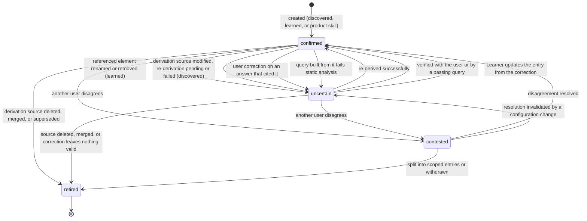
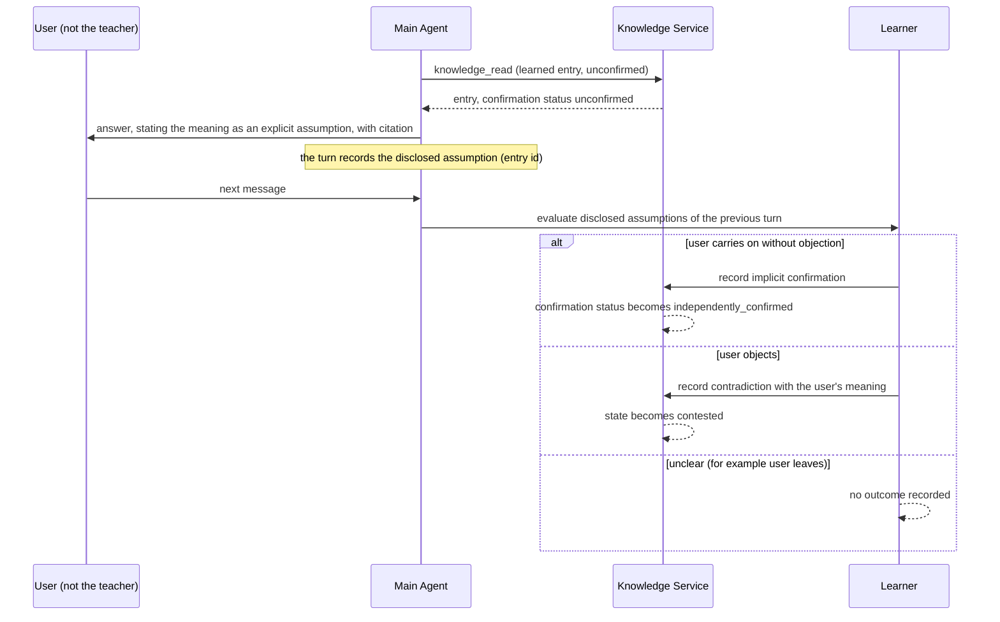
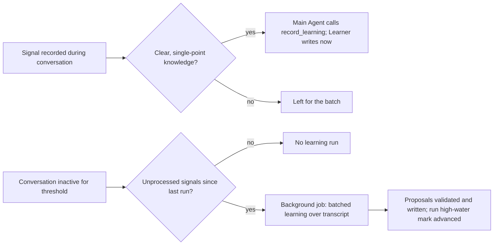

# Knowledge Service and Learner specification

Status: MVP specification. Owner slice: module specifications. Related: [Discovery](discovery.md), [Main Agent](main-agent.md), [Tool catalog](tool-catalog.md), [Background Jobs](background-jobs.md), [Persistence](persistence.md), [Architecture overview](../architecture/overview.md), [Skills catalog](../skills/README.md).

This document specifies two cooperating components:

- **Knowledge Service**: stores and serves every knowledge layer (Product Skills, Instance Knowledge, User Preferences), maintains entry states, and applies invalidation when the Aras configuration changes.
- **Learner**: writes and maintains Learned knowledge, either live during a conversation or in a batch over a transcript after an inactivity threshold.

They are specified together because the Learner has no storage of its own beyond its run bookkeeping; every entry it creates or changes goes through the Knowledge Service.

## 1. Purpose

Aras installations differ. Item types, properties, lists, workflows, and lifecycles are customised, and the words people use ("a delayed change", "a released part", "the markup process") map onto that configuration in ways no product can ship in advance. The knowledge layers give the agents what they need to write correct queries and interpret results without per-customer hand configuration:

- what the product knows about Aras in general (Product Skills, shipped with the product);
- what this installation's configuration is and means (Discovered knowledge, generated from the configuration);
- what people in this organisation mean by their terms and processes (Learned knowledge, formed in conversations);
- how an individual user prefers answers (User Preferences, private to that user).

Every knowledge entry an answer relies on is citable, carries a state that tells the agent how far to trust it, and is kept current automatically when the configuration it depends on changes.

The governing rule for shared knowledge is **"how, never what"**: entries describe how the configuration is used and what terms mean, never business data values. Because of that rule, shared learned knowledge depends only on the Aras configuration, so configuration changes are the only staleness trigger.

## 2. Responsibilities and non-responsibilities

### Knowledge Service responsibilities

1. Store entries of all three layers with their full schema (section 4.1) and version history.
2. Load Product Skills from the files shipped with the product at startup, read-only.
3. Serve the knowledge index (identifier, one-line description, state, confidence) filtered by topic and by the caller's visibility, and serve full entries by identifier.
4. Enforce visibility: instance entries are visible to every user of the deployment; preference entries only to their owner.
5. Maintain the state machine (section 5.2) and record every transition with its reason and evidence.
6. Record confirmations and contradictions, and compute each learned entry's confirmation status.
7. Receive configuration change sets from Discovery and apply invalidation: re-derivation of discovered entries, uncertainty for learned entries whose references were renamed or removed, retirement when a derivation source is deleted.
8. Accept discovered entries from Discovery (create, new version, retire).
9. Provide citation summaries for knowledge entries to the Citation Registry when an entry is read for use in an answer.

### Learner responsibilities

1. Detect learning signals in conversations: correction, retried question, empty result, explicit teaching (section 5.7).
2. Process live learning proposals made by the Main Agent through `record_learning`.
3. Run batched learning over a transcript after the inactivity threshold, only for conversations that carry at least one signal.
4. Validate proposals against the "how, never what" rule and resolve their configuration references.
5. Merge into existing entries about the same term or configuration element rather than append duplicates.
6. Evaluate disclosed assumptions: decide, from the user's next message, whether a disclosed assumption was accepted (implicit confirmation), objected to (contradiction), or neither.
7. Write User Preferences into the owner's personal layer.

### Non-responsibilities

- Neither component talks to Aras. Configuration reads are Discovery's job and all Aras access goes through the [Tool Gateway](tool-gateway.md).
- Neither component stores business data values from Aras in shared knowledge. Extracted file text belongs to the [File Service](file-service.md); query results are never persisted as knowledge.
- No vector search. Knowledge is loaded by index and description (vector indexing of knowledge is deferred, see section 11).
- No mandatory human approval gate. Learning is automatic; trust is managed by state and confirmation status instead.
- No age-based decay of unused entries in MVP (deferred).
- No scheduled leak audit in MVP (deferred); the MVP relies on a strong Learner prompt plus a lightweight guard (section 5.5).
- No administrator curation interface in MVP (developer and admin features are deferred).

## 3. Interfaces

### 3.1 Agent tools served

The agent-facing schemas are defined once in the [tool catalog](tool-catalog.md); this section states how this module serves them.

| Tool | Caller | Served by | Notes |
|---|---|---|---|
| [`knowledge_index`](tool-catalog.md#knowledge_index) | Main Agent | Knowledge Service | Topic-filtered index lines; see section 5.1 for matching and ranking. |
| [`knowledge_read`](tool-catalog.md#knowledge_read) | Main Agent | Knowledge Service | Full entries; registers a knowledge citation per entry returned. |
| [`record_learning`](tool-catalog.md#record_learning) | Main Agent | Learner, then Knowledge Service | Live learning proposal; returns the outcome (created, merged, contradiction recorded, preference saved, or rejected with reason). |

Analysis Workers do not call knowledge tools. The Main Agent places the knowledge excerpts a job needs, with their citation identifiers, in the job brief (see [Analysis Worker and Sandbox](analysis-worker-and-sandbox.md)).

### 3.2 Internal operations of the Knowledge Service

| Operation | Caller | Inputs | Outputs | Errors |
|---|---|---|---|---|
| Index | `knowledge_index` handler, Main Agent context builder | user id, topic text (optional), layers (optional), include retired (default no), limit | ordered list of index lines: id, layer, kind, title, one-line description, state, confidence label, confirmation status | INVALID_INPUT (topic too long, unknown layer) |
| Read | `knowledge_read` handler, Learner | user id, list of entry ids, conversation id and turn id (for citation) | full entries (section 4.1) visible to the user; per-entry citation id | NOT_FOUND (unknown or not visible id; reported per id, others still returned) |
| Upsert discovered | Discovery | list of discovered entries with derivation sources and stamps, discovery run id | per entry: created, new version, unchanged | INVALID_INPUT (missing dependency stamps) |
| Apply configuration changes | Discovery | change set: per configuration item, change type (new, modified, renamed, deleted), old and new name, old and new stamp | list of affected entries with action taken | none (failures per entry are recorded and retried) |
| Write learned | Learner | validated proposal (section 5.5) | outcome: created, merged into id, new version of id, contradiction recorded on id | KNOWLEDGE_CONFLICT (concurrent update; Learner retries once) |
| Write preference | Learner | owner user id, preference content | created or updated preference id | INVALID_INPUT |
| Record confirmation | Learner, Chat App feedback handler | entry id, user id, conversation id, turn id, kind (explicit, implicit) | updated confirmation status | NOT_FOUND |
| Record contradiction | Learner, Chat App feedback handler | entry id, user id, conversation id, turn id, the meaning the user asserts | contradiction id; entry state becomes contested | NOT_FOUND |
| Mark uncertain | Main Agent (correction on a cited entry), Tool Gateway (analyzer failure on a query built from an entry), Discovery change handling | entry id, reason code, evidence references | new state | NOT_FOUND |
| Resolve | Learner | entry id, resolution (section 5.6) | new state, new or split entries | KNOWLEDGE_CONFLICT |
| Retire | Learner, Discovery change handling, merge | entry id, reason, merged-into id (optional) | retired entry | NOT_FOUND |
| Load product skills | service startup | the shipped skill files and product version | count loaded; previous product version's skill entries retired | startup fails if a shipped skill file is malformed |

### 3.3 Internal operations of the Learner

| Operation | Caller | Inputs | Outputs |
|---|---|---|---|
| Process live proposal | `record_learning` handler | proposal from the Main Agent, conversation id, turn id, user id | outcome returned to the model through the tool envelope |
| Record signal | Main Agent, Tool Gateway, Chat App | conversation id, turn id, signal kind, evidence (message ids, tool call ids, feedback id) | signal id |
| Evaluate disclosed assumptions | Main Agent, on receipt of a user message | conversation id, the previous turn's disclosed assumptions (entry ids), the new user message | per entry: implicit confirmation, objection, or no outcome |
| Run batched learning | Background Jobs (job kind batched learning) | conversation id, transcript range from the last processed turn | learning run record with outcomes |

## 4. Data owned

Tables owned by the Knowledge Service: [knowledge_entries](persistence.md#knowledge_entries), [knowledge_entry_versions](persistence.md#knowledge_entry_versions), [knowledge_dependencies](persistence.md#knowledge_dependencies), [knowledge_provenance](persistence.md#knowledge_provenance), [knowledge_confirmations](persistence.md#knowledge_confirmations), [knowledge_contradictions](persistence.md#knowledge_contradictions), [knowledge_state_events](persistence.md#knowledge_state_events).

Tables owned by the Learner: [learning_signals](persistence.md#learning_signals), [learning_runs](persistence.md#learning_runs).

Tables read but not owned: [config_items](persistence.md#config_items) (Discovery), [conversations](persistence.md#conversations), [turns](persistence.md#turns), [messages](persistence.md#messages), [tool_calls](persistence.md#tool_calls) (Main Agent), [feedback](persistence.md#feedback) (Chat App), [citations](persistence.md#citations) (Citation Registry).

### 4.1 Knowledge entry schema

The logical schema of one entry. Persistence details (keys, indexes, retention) are in [persistence.md](persistence.md#knowledge_entries).

| Field | Type | Applies to | Meaning |
|---|---|---|---|
| id | identifier (`kn_` prefix) | all | Stable identifier. Never reused. Survives new versions. |
| layer | enumeration: product_skill, instance, user_preference | all | Which knowledge layer the entry belongs to. |
| kind | enumeration: discovered, learned | instance only | discovered: derived from configuration by Discovery. learned: formed in conversation by the Learner. Empty for other layers. |
| derivation_method | enumeration: mechanical, model_inferred | discovered only | mechanical: generated deterministically from configuration (for example a summary of a workflow map's activities and paths). model_inferred: produced by the background model from configuration (for example "this process starts from a request item whose form fills fields A, B, C"). |
| owner_user_id | user id | user_preference only | The only user who can see and use the entry. |
| title | text, up to 120 characters | all | Short name, usually the term or configuration element the entry is about. |
| aliases | list of text | instance, user_preference | Other words users use for the same thing. Used for topic matching and merging. |
| description | text, up to 200 characters | all | The one-line description shown in the index. Must let the model decide whether to load the entry. |
| body | text (Markdown), up to 4,000 characters (Proposed) | all | The knowledge itself: meaning, mapping to configuration elements, how to query it, caveats. |
| subject_refs | list of configuration references | instance, user_preference | The configuration elements the entry is about (see dependencies below); used for merging and topic matching. |
| state | enumeration: confirmed, uncertain, contested, retired | all | Trust state; see section 5.2. Product skills are always confirmed. |
| confirmation_status | enumeration: unconfirmed, independently_confirmed | learned only | unconfirmed: only the teacher (or teachers of its versions) has vouched for it; the agent discloses it as an assumption when using it. independently_confirmed: at least one other user confirmed it. |
| confidence | derived label: high, medium, low | all, computed on read | high: product skill; mechanical discovered entry in confirmed state; learned entry confirmed and independently confirmed. medium: model-inferred discovered entry in confirmed state; learned entry confirmed but unconfirmed. low: uncertain or contested. (Proposed mapping.) |
| version | integer | all | Incremented on every content change; prior content kept in knowledge_entry_versions. |
| product_version | text | product_skill only | The product release the skill shipped with. |
| provenance | list of provenance records | all | Who and what created or changed the entry: discovery run id, or conversation id, turn id, user id, and the signal kind; merges list the source entry. Stored in knowledge_provenance. |
| dependencies | list of configuration dependencies | instance; optional for preferences | Each: configuration item id (from config_items), Aras id, configuration type (for example ItemType, Property, List value, Life Cycle state, Workflow activity, typical in standard Aras releases; verify against the target version), name at the time of recording, modification stamp at the time of recording, dependency type (derived_from for discovered entries, refers_to for learned entries). Stored in knowledge_dependencies. |
| confirmations | list | learned | Each: user id, conversation id, turn id, kind (explicit, implicit), timestamp. Stored in knowledge_confirmations. |
| contradictions | list | learned, discovered model-inferred | Each: contradiction id, user id, conversation id, turn id, the asserted alternative meaning, status (open, resolved), resolution, timestamps. Stored in knowledge_contradictions. |
| merged_into_id | entry id | retired entries | Set when the entry was merged into another. |
| retired_reason | enumeration: source_deleted, merged, superseded, corrected, product_upgrade | retired entries | Why the entry left use. |
| created_at, updated_at | timestamp | all | Creation and last content change. |
| state_changed_at | timestamp | all | Last state transition. |
| last_used_at | timestamp | all | Last time it was read for an answer (supports the deferred decay feature and observability). |

### 4.2 What belongs in each layer

| Layer | Examples | Written by | Visible to |
|---|---|---|---|
| product_skill | How to write AML safely; how to use the tools and the Sandbox; where "why" evidence lives (long text fields, workflow sign-off comments, linked files); what knowledge to persist and where. Full texts are in [docs/skills/](../skills/README.md). | Shipped with the product | Everyone |
| instance, discovered | "The change process is configured as workflow map W with activities A to F; the path from B back to A is the rework loop." "Property P on item type T is a list of values V1 to V5 with labels L1 to L5." | Discovery | Everyone |
| instance, learned | "When people say a change is delayed they mean its workflow took longer than the target duration recorded on the item." "The 'markup process' refers to workflow map M." | Learner | Everyone, immediately, with provenance |
| user_preference | "Prefers results as a table with at most 10 rows." "Means the last full calendar quarter by 'last quarter'." "Works on product line X." | Learner | Owner only |

## 5. Behaviour

### 5.1 Loading by index and description

1. On each turn the Main Agent's context contains the Product Skills index (titles and descriptions) and, per the product guidance, the instruction to call `knowledge_index` for the terms and configuration elements in the user's question.
2. `knowledge_index` matches the topic text against each visible entry's title, aliases, description, and the names of its subject references (Proposed: case-insensitive term matching with simple normalisation of plurals and punctuation; no vectors).
3. Results are ranked (Proposed): exact title or alias match first, then subject-reference name match, then description match; within a rank, confirmed before uncertain before contested; learned before discovered when both describe the same term (learned entries carry organisational meaning); then most recently used. Retired entries are excluded unless requested.
4. The index returns at most the configured number of lines. Each line has the identifier, one-line description, state, and confidence label, so the model can choose which entries to load.
5. The model calls `knowledge_read` with the chosen identifiers. Each returned entry is registered with the Citation Registry, producing a knowledge citation (entry id, layer, kind, state, confirmation status at the time of reading). The model cites the entry when the answer depends on it.
6. The entry's last_used_at is updated.

### 5.2 State machine

Transition rules, with triggers and who reports them. Every transition is applied by the Knowledge Service; other components only report the trigger through its operations (section 3.2).

| From | To | Trigger | Reported by | Evidence recorded |
|---|---|---|---|---|
| (new) | confirmed | Discovered entry generated; learned entry created from a validated proposal; product skill loaded | Discovery, Learner, startup | discovery run id or conversation, turn, user |
| confirmed | uncertain | A configuration element a learned entry refers to is renamed or removed | Discovery, through Apply configuration changes | change set, old and new names |
| confirmed | uncertain | A derivation source of a discovered entry is modified; the entry stays uncertain until re-derivation completes | Discovery, through Apply configuration changes | change set, stamps |
| confirmed | uncertain | A user corrects an answer that cited the entry | Main Agent through Mark uncertain (the correction arrives through Chat App feedback or in the conversation); signal recorded as correction | feedback id or message id, citation id |
| confirmed | uncertain | A query the model built from the entry fails static analysis (the turn's citations link the entry and the rejected query) | Tool Gateway through Mark uncertain | tool call id, analyzer rule ids |
| uncertain | confirmed | Re-derivation produced a valid entry (same or new content) | Discovery, through Upsert discovered | discovery run id, new version |
| uncertain | confirmed | The agent verified the entry: a user confirmed it in conversation, or a query built from it passed analysis and returned a plausible result that the user accepted | Learner | conversation, turn, user |
| uncertain | confirmed | The Learner rewrote the entry from a correction (new version) | Learner | signal id |
| confirmed or uncertain | contested | A user other than the teacher objects to the entry, or teaches a conflicting meaning | Learner (assumption evaluation, live proposal, or batch) or Chat App feedback | contradiction record |
| contested | confirmed | Resolution (section 5.6) leaves one agreed meaning | Learner | resolution record |
| contested | uncertain | A configuration change invalidates the element the resolution relied on | Discovery, through Apply configuration changes | change set |
| any non-retired | retired | Derivation source deleted (discovered); merged into another entry; superseded by a split; withdrawn by its teacher with no other confirmations; product skill replaced on upgrade | Discovery, Learner, or startup (product upgrade) | reason and related entry |

Rules that hold in every state:

- **Uncertain entries stay usable but are verified first.** When the model reads an uncertain entry, the read result marks it uncertain with the reason; the product guidance tells the model to verify it before relying on it (re-check against the current schema with `schema_describe`, or confirm with the user), and to say so in the answer.
- **Contested entries are not used silently.** The agent asks which meaning the user intends (section 5.6).
- **Retired is terminal.** A retired entry is never reactivated; if the knowledge becomes valid again a new entry is created, with provenance pointing to the retired one.
- **The teacher correcting themselves is not a contradiction.** If the user who taught an entry (or a later version) changes it, the Learner writes a new version; state stays or returns to confirmed.
- **Confirmation status is separate from state.** A learned entry can be confirmed (valid against configuration, nobody disagrees) and still unconfirmed (only its teacher has vouched for it).

### 5.3 Re-derivation of discovery-inferred entries

1. Discovery detects changed configuration items by modification stamp (see [Discovery](discovery.md)) and sends a change set.
2. The Knowledge Service finds every discovered entry with a derived_from dependency on a changed item.
3. For a **deleted** source: the entry is retired with reason source_deleted. If the entry had other sources still present, it is instead marked uncertain and queued for re-derivation from the remaining sources.
4. For a **modified or renamed** source: the entry is marked uncertain and queued for re-derivation.
5. Re-derivation:
   - mechanical entries are regenerated deterministically by Discovery from the current configuration;
   - model-inferred entries are regenerated by the background model slot (see [Model configuration](model-configuration.md)) from the current definitions of all its sources, using the derivation prompt listed in [docs/prompts/](../prompts/README.md).
6. If the regenerated content equals the current content, the entry returns to confirmed with its dependency stamps updated and no new version. Otherwise a new version is written, dependencies and stamps are replaced, and the entry returns to confirmed.
7. If re-derivation fails (model error, source unreadable), the entry stays uncertain and re-derivation is retried with the next discovery run (Proposed: up to 3 attempts, then it stays uncertain until the next change to its sources).
8. Open contradictions on a model-inferred discovered entry survive re-derivation; the regenerated content is compared with the contradiction's asserted meaning by the Learner on its next run.

Learned entries that depend on a modified (not renamed or removed) element are not marked uncertain merely because a stamp changed: learned entries record which element they map to, and the decision makes rename or removal the trigger. (Proposed refinement, listed in open questions: a modified List or Life Cycle Map whose referenced value or state disappeared counts as removal of that element.)

### 5.4 Configuration references for conversation-formed entries

1. Every learned entry records refers_to dependencies for the configuration elements its meaning maps to, for example the lifecycle state a definition of "released" refers to, the property that holds a target date, or the workflow map a process name denotes.
2. References are resolved by the Learner against config_items at write time. A reference is stored with the element's Aras id, its configuration type, its name as seen at the time, and its modification stamp.
3. Elements below the level of a configuration item (a list value, a lifecycle state, a workflow activity, a property) are referenced as the parent configuration item plus the element's own identifier and name (Proposed; the exact granularity of config_items is defined in [discovery.md](discovery.md)).
4. A proposal whose references cannot be resolved is not written as a shared entry. The Learner returns a rejected outcome with the unresolved names, so the model can check the schema and try again. Pure vocabulary entries that genuinely map to no configuration element (rare) are allowed only with explicit justification in the proposal and are flagged in observability (Proposed).
5. On a change set, a learned entry whose referenced element was renamed or removed becomes uncertain. When the agent next uses it, it checks the current schema and either the Learner updates the reference (new version, back to confirmed, if the user confirms the renamed element still carries the meaning) or the entry is retired as corrected.

### 5.5 Validating and writing a learning proposal

A proposal comes either live from the Main Agent (`record_learning`) or from a batched learning run. Every proposal carries: target layer (instance or user_preference), title, aliases, description, body, configuration references, the signal kind that motivated it, and the evidence (message ids, tool call ids).

1. **Signal check.** The conversation must carry a signal (section 5.7). Live proposals with explicit teaching or correction count as their own signal. Proposals without a signal are rejected.
2. **"How, never what" check.** Shared entries must describe meaning, configuration mapping, or query method, never business data values (no item numbers, names of specific items, counts, dates of particular records, file contents, people's names). Enforcement in MVP:
   - the Learner prompt states the rule and gives examples of allowed and disallowed content (see [docs/prompts/](../prompts/README.md));
   - a lightweight guard in the Learner rejects proposals whose body contains strings shaped like Aras ids, or that quote values copied from the conversation's tool results (Proposed: exact-substring check of the proposal against the tool results of the cited evidence, ignoring configuration names); a live rejection reaches the model as a diagnostic with rule id `LRN-DATA-VALUE` naming the offending text, so the model can restate the learning without the value;
   - scheduled leak audits are deferred.
   User Preferences may hold what the user states about themselves (for example their product line), because the layer is private to them; they still never copy Aras query results (Proposed, see open questions).
3. **Reference resolution.** Resolve every configuration reference against config_items (section 5.4).
4. **Merge search.** Look for a non-retired entry in the same layer (and, for preferences, the same owner) with the same title or alias, or the same primary subject reference. If found, merge (section 5.8). If not, create.
5. **Conflict check.** If the proposal contradicts an existing entry's meaning, and the proposer is not a teacher of that entry, record a contradiction instead of overwriting (section 5.6). If the proposer is a teacher of the entry, write a new version.
6. **Write.** Create the entry (state confirmed; confirmation status unconfirmed, or independently_confirmed in a single-user deployment), or the new version; write provenance (conversation, turn, user, signal kind), dependencies with stamps, and a state event.
7. **Outcome.** Return the outcome to the caller: created (id), merged (id, what changed), contradiction recorded (id), preference saved (id), or rejected (reason: no signal, contains data values, unresolved references, malformed). Live outcomes reach the model through the `record_learning` result envelope.

### 5.6 Disclosed assumptions, independent confirmation, and contested handling

**Disclosed assumption.**

1. When the model uses a learned entry whose confirmation status is unconfirmed, and the current user is not a teacher of the entry, the answer states the meaning as an explicit assumption ("I am treating 'delayed' as ..., as recorded from an earlier conversation") and cites the entry.
2. The Main Agent records the disclosed assumption on the turn (the turn's disclosed assumptions list holds the entry ids, see [turns](persistence.md#turns)).
3. When the same user sends the next message in the conversation, the Learner evaluates it against the disclosed assumptions, using the background model slot (Proposed; a small classification step with a fixed prompt):
   - carrying on without objection (a follow-up, a new question, thanks) records an **implicit confirmation**;
   - an objection to the meaning records a **contradiction** (below) and a correction signal;
   - anything else (no further message, ambiguous reply) records nothing. Leaving the conversation is not confirmation (Proposed).
4. Explicit confirmations come from the user agreeing in words, or from the Chat App's feedback control on a cited knowledge entry (see [Chat App](chat-app.md)).
5. **Independent confirmation**: a confirmation from any user who is not a teacher of any version of the entry. After one independent confirmation, the confirmation status becomes independently_confirmed and the agent stops announcing the entry as an assumption. There are no user-count thresholds; behaviour is the same at any scale.
6. **Single-user deployment**: when the deployment is configured as single-user (`knowledge.single_user_deployment`, Proposed configuration flag, because the decision forbids inferring it from user counts), the teacher's word is enough and new learned entries start as independently_confirmed.
7. Learned entries are organisation-wide immediately on creation; the assumption disclosure is what protects other users until independent confirmation.

**Contested handling.**

1. A contradiction is recorded when a user other than a teacher objects to an entry, teaches a conflicting meaning, or marks a cited entry wrong through feedback. The entry becomes contested.
2. When the model reads a contested entry, the result includes the competing meanings (the current body and each open contradiction's asserted meaning) with provenance described neutrally ("taught in an earlier conversation", "asserted by another user"); user names are not shown to other users (Proposed).
3. The product guidance requires the agent to ask the user which meaning they intend before relying on the entry, offering the competing meanings as choices. For a cheap lookup the agent may proceed with the user's own preference if one exists (see 5 below).
4. The user's choice is recorded as a confirmation of that meaning in the context of the contradiction, and stored as a User Preference for that user, so the same user is not asked again.
5. Resolution (Proposed rules; see open questions):
   - **withdrawal**: one side corrects itself (the teacher accepts the other meaning, or the objector withdraws); the entry gets the agreed content and returns to confirmed;
   - **split**: the Learner concludes that both meanings are legitimate in different contexts (for example two workflow maps both called "review" by different teams); the entry is retired as superseded and replaced by two entries with distinct titles and scopes, each confirmed and each recording the contradiction as provenance;
   - otherwise the entry stays contested and the agent keeps asking each user, who is then served by their own preference.
6. Contested entries are never retired automatically for being contested.

### 5.7 Signal detection

Learning runs only from conversations that carry at least one signal. Signals are recorded in [learning_signals](persistence.md#learning_signals) as they occur.

| Signal | What detects it | Detection rule | Evidence recorded |
|---|---|---|---|
| Correction | Main Agent (model judgement as instructed by product guidance); Chat App feedback; assumption evaluation | The user says an answer, an assumption, or a mapping is wrong, or submits correction feedback on an answer | message id or feedback id, cited entries of the corrected answer |
| Retried question | Main Agent (model judgement) | The user asks substantially the same question again after an unsatisfying result (rephrased, narrowed, or with a hint) | both message ids |
| Empty result | Tool Gateway (mechanical) | An `aml_query` or `aml_fetch` returned zero rows in a turn; the signal is useful when a later query in the same conversation succeeded for the same intent | tool call ids |
| Explicit teaching | Main Agent (model judgement) | The user states how something works or what a term means ("by released we mean ...", "that process is called ...") | message id |

A query rejected by the Query Analyzer and then corrected is evidence attached to the signals above, not a signal by itself (Proposed, keeping to the four decided signals).

Corrections on an answer that cited a learned entry also mark that entry uncertain immediately (section 5.2), independently of any later learning.

### 5.8 Merging

1. Merge targets are found by title, alias, or primary subject reference within the same layer (and owner for preferences).
2. A merge writes a new version of the target. The body is rewritten by the Learner to integrate the new knowledge (not appended as a separate paragraph); aliases are unioned; references are unioned and re-stamped; provenance gains the new conversation.
3. If the new content conflicts with the target and the proposer is not a teacher of the target, this is a contradiction (section 5.6), not a merge.
4. Duplicate entries discovered later (for example two entries created concurrently, or found during a batched run) are merged: the older or more confirmed entry is kept, the other is retired with reason merged and merged_into_id set, and its provenance, confirmations, open contradictions, and dependencies are carried over.
5. Citations already issued for a merged entry stay valid: the citation keeps the original entry id and version; opening it shows the retired entry with a pointer to the entry it was merged into.

### 5.9 Live versus batched learning

**Live learning.**

1. The product guidance tells the Main Agent to call `record_learning` immediately when a user explicitly teaches something or clearly corrects a mapping, so the knowledge is available to everyone at once.
2. The Learner processes the proposal synchronously (section 5.5) and returns the outcome within the tool call.
3. Live learning never blocks the answer on failure: a rejected or failed proposal is reported to the model, which carries on answering; the signal remains for the batch.

**Batched learning.**

1. When a conversation has been inactive for the configured threshold (Proposed default 30 minutes), the Learner checks for signals recorded after the conversation's learning high-water mark.
2. If there are none, nothing runs. If there are, the Learner asks [Background Jobs](background-jobs.md) to run a batched learning job for the conversation. Batched learning needs no Aras access and no user credential: it reads the stored transcript and the knowledge tables only.
3. The job uses the background model slot with the batched learning prompt (see [docs/prompts/](../prompts/README.md)) over the transcript range since the high-water mark, together with the index lines of entries already cited or matched in that range, and produces zero or more proposals.
4. Each proposal goes through section 5.5. Outcomes are recorded on the learning run.
5. On success the conversation's high-water mark (`conversations.learned_through_turn_seq`, see [conversations](persistence.md#conversations)) advances to the last processed turn. If the user returns and the conversation gets new signals, a later run covers only the new range.
6. A failed run is retried by Background Jobs (Proposed: up to 3 attempts with backoff); the high-water mark is not advanced until a run succeeds, so no signal is lost and no range is processed twice to completion.
7. Live outcomes already written in the range are visible to the batch (as existing entries), so the batch merges rather than duplicates them.

### 5.10 Product skills

1. Product skills ship as files with the product release (catalogue: [docs/skills/README.md](../skills/README.md)).
2. At startup the Knowledge Service loads every skill as a product_skill entry, with title, description, body, and the product version. Entries for skills no longer shipped are retired with reason product_upgrade; changed skills get a new version.
3. Product skills cannot be changed by learning. A correction that concerns a product skill is recorded as a signal and surfaces in observability (it indicates a product defect), and the Learner may write an instance entry that refines the behaviour for this installation.

### 5.11 User preferences

1. Preferences are written through the same proposal path with target layer user_preference, owned by the current user.
2. They are visible only to the owner, are never shown to or used for other users, and are never promoted into shared knowledge automatically.
3. Preferences need no confirmation flow and are never contested; a new preference about the same subject replaces the old one as a new version.
4. A preference may reference configuration elements (for example "my default lifecycle state filter"); a rename or removal of the element makes it uncertain like a learned entry.
5. Users can view and delete their own preferences in the Chat App (see [Chat App](chat-app.md)).

## 6. Configuration

| Key | Type | Default | Meaning |
|---|---|---|---|
| knowledge.index_max_lines | integer | 50 (Proposed default) | Maximum lines returned by `knowledge_index`. |
| knowledge.read_max_entries | integer | 10 (Proposed default) | Maximum entries per `knowledge_read` call. |
| knowledge.body_max_chars | integer | 4,000 (Proposed default) | Maximum body length of an entry. |
| knowledge.description_max_chars | integer | 200 (Proposed default) | Maximum one-line description length. |
| knowledge.single_user_deployment | boolean | false (Proposed default) | When true, the teacher's word is enough: new learned entries start independently confirmed. |
| knowledge.show_teacher_names | boolean | false (Proposed default) | Whether provenance shown to other users names the teacher. |
| knowledge.rederive_max_attempts | integer | 3 (Proposed default) | Re-derivation attempts for a model-inferred discovered entry before waiting for the next source change. |
| learner.live_enabled | boolean | true (Proposed default) | Whether `record_learning` writes immediately. When false, proposals are kept as signals for the batch. |
| learning.inactivity_minutes | integer | 30 (Proposed default) | Inactivity threshold before batched learning considers a conversation. |
| learner.batch_max_attempts | integer | 3 (Proposed default) | Retries of a failed batched learning run. |
| learner.batch_max_transcript_tokens | integer | 100,000 (Proposed default) | Transcript range per batched run; longer ranges are processed in consecutive chunks. |
| learner.assumption_evaluation_enabled | boolean | true (Proposed default) | Whether implicit confirmation and objection are evaluated from the next user message. |
| learner.data_value_guard_enabled | boolean | true (Proposed default) | Whether the lightweight data-value guard runs on proposals. |

## 7. Limits

- Index and read sizes as configured above; requests beyond them return INVALID_INPUT with the limit in the message.
- Entry body and description lengths as configured; over-long proposals are rejected with reason malformed, so the model shortens them.
- At most one batched learning run per conversation at a time; at most one live proposal processed per conversation at a time (concurrent proposals queue).
- Batched learning jobs count against the background job limits in [background-jobs.md](background-jobs.md) but do not use the Aras throttle, because they do not query Aras.
- No per-user cap on learning in MVP; volume is controlled by the signal requirement and merging.

## 8. Failure modes and recovery

| Failure | Detection | Effect on user | Recovery |
|---|---|---|---|
| Database unavailable | Write or read error | `knowledge_index` and `knowledge_read` fail with INTERNAL (retryable); the agent answers from schema and product skills alone and says knowledge was unavailable | Retried by the agent loop; service recovers when the database returns |
| Concurrent update of the same entry | Version check on write | None | Learner re-reads and retries once; on second conflict the proposal is left for the batch |
| Live proposal rejected | Validation outcome | None; the model is told why and may reformulate once | Signal stays for the batch |
| Background model unavailable during batch or re-derivation | Model Router error | None immediately; entries waiting for re-derivation stay uncertain and are verified before use | Retried per configuration |
| Change set lost (process crash between Discovery and invalidation) | Discovery run left unfinished invalidation marker | Stale entries may be used as confirmed until recovery | On restart, the Knowledge Service re-applies the change set of any run whose invalidation is not marked complete (Proposed: discovery run carries an invalidation-applied flag) |
| Malformed shipped skill file | Startup validation | Service does not start | Fix the release; this is a build-time defect |
| Data value slipped into a shared entry | Not detected automatically in MVP beyond the guard | Shared entry contains a value | Correction by a user marks it uncertain and the Learner rewrites it; scheduled leak audit is deferred |
| Implicit confirmation misjudged | Not automatically detectable | An entry may stop being announced too early | Any later correction or objection marks it uncertain or contested |

## 9. Security considerations

- **Shared knowledge must not carry data values.** Learned instance knowledge is visible to every user, while Aras data visibility differs by user. A value in a shared entry could expose data to a user who cannot see it in Aras. This is why the "how, never what" rule exists, why the guard runs, and why the leak audit is on the roadmap.
- **Preferences are private.** Every read path filters preference entries by owner; the index never lists another user's preferences, even by count.
- **Provenance is minimal.** Provenance records user ids for audit, but other users see only neutral descriptions unless configured otherwise.
- **Knowledge never grants access.** Knowledge describes how to query; every actual data access still runs as the signed-in user through the Tool Gateway, so wrong or malicious knowledge cannot bypass Aras permissions. At worst it produces wrong queries, which the Query Analyzer and the state machine contain.
- **Poisoning.** A user can teach a false meaning. Mitigations: provenance, disclosed assumptions until independent confirmation, contested handling, and corrections marking entries uncertain. There is no approval gate by decision.
- **Transcripts.** Batched learning reads stored transcripts, which are private conversation records; the Learner writes only entries that pass the checks above and never copies transcripts into knowledge.

## 10. Observability

Audit events (see [Audit and progress](audit-and-progress.md#51-audit-event-catalogue)), each with entry id, actor (component and user), conversation and turn, and reason: `knowledge.created`, `knowledge.updated` (new version), `knowledge.merged`, `knowledge.state_changed` (every transition, including retirement), `knowledge.confirmed`, `knowledge.objected`, `knowledge.contradiction_recorded`, `knowledge.contradiction_resolved`, and `preference.written`.

Metrics (Proposed):

- entries by layer, kind, state, and confirmation status;
- learning signals per day by kind; proportion of conversations with signals;
- live proposals by outcome; batched runs by outcome and duration;
- proposals rejected by the data-value guard (a rising rate suggests prompt drift);
- time from creation to independent confirmation for learned entries;
- contested entries open, and age of the oldest;
- uncertain entries waiting for re-derivation, and re-derivation failures;
- index and read latency; entries read per turn; corrections that concern product skills.

Logs never include entry bodies at info level (they may be long and are already in the database); they include ids, states, and reasons.

## 11. MVP versus deferred

In MVP: everything in this document.

Deferred (see [roadmap](../product/roadmap.md)):

- vector index for learned and discovered knowledge, if the knowledge base outgrows index-based loading;
- age-based decay of learned knowledge nobody uses (last_used_at is recorded now to support it);
- scheduled checks that learned knowledge holds no data values, possibly with small models;
- deployment hook that triggers re-discovery and invalidation on configuration deployment (MVP relies on change detection in [Discovery](discovery.md));
- administrator-facing curation of knowledge (part of developer and admin features).

## 12. Open questions

1. Proposed: topic matching for `knowledge_index` is normalised term matching over title, aliases, description, and subject-reference names, with the ranking in section 5.1. Is this sufficient for the expected knowledge size, and what size triggers the deferred vector option?
2. Proposed: the confidence label mapping in section 4.1 (high, medium, low).
3. Proposed: a new learned entry starts in state confirmed with confirmation status unconfirmed, keeping the four decided states for validity and a separate status for confirmation. Confirm this reading of the decision.
4. Proposed: implicit confirmation is judged by the background model from the user's next message; leaving the conversation is not confirmation.
5. Proposed: single-user deployment is a configuration flag rather than inferred from user counts.
6. Proposed: resolution of contested entries by withdrawal or split; otherwise the entry stays contested and each user is served by their own preference. Is a further resolution path wanted in MVP?
7. Proposed: other users see neutral provenance, not teacher names.
8. Proposed: the lightweight data-value guard (id-shaped strings and exact substrings of cited tool results).
9. Proposed: User Preferences may hold facts the user states about themselves but never copied query results.
10. Proposed: a modified List or Life Cycle Map in which a referenced value or state disappeared counts as removal of that element for learned entries; other modifications of a referenced item do not make learned entries uncertain.
11. Proposed: entry size limits and retry counts in section 6.
12. Proposed: assumption evaluation and batched learning use the background slot; re-derivation of model-inferred entries also uses it.
13. Proposed: the change set carries an invalidation-applied marker on the discovery run so a crash between discovery and invalidation is recovered on restart.
