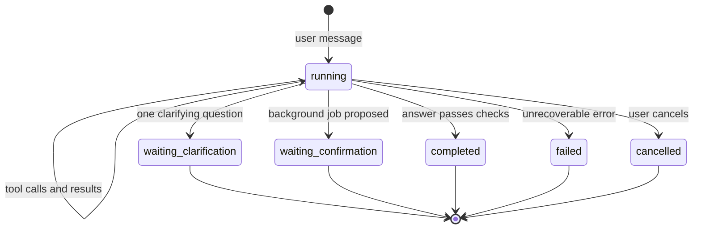

# Main Agent specification

Status: MVP specification. Related: [Tool catalog](tool-catalog.md), [Tool Gateway](tool-gateway.md), [Analysis Worker and Sandbox](analysis-worker-and-sandbox.md), [Knowledge and learning](knowledge-and-learning.md), [Model configuration](model-configuration.md), [Persistence](persistence.md), [Architecture overview](../architecture/overview.md), [Question lifecycle](../architecture/question-lifecycle.md), [Prompts](../prompts/README.md).

## 1. Purpose

The Main Agent is the conversational agent that answers a user's question. It runs in the Aras Insight service, holds the conversation with the user, decides how each question is answered, and produces the final answer with citations, stated assumptions, and coverage.

It answers simple lookups itself by calling the Tool Gateway. For heavy work (aggregation, trends, process questions, questions that need many files) it hands bounded jobs to one or more Analysis Workers, which run analysis code in a Sandbox and report back. It never talks to Aras directly and never runs code itself.

The loop is our own thin loop over a plain model-client library. No agent framework is used. This keeps behaviour inspectable, keeps model endpoints configurable through the [Model Router](model-configuration.md), and keeps every side effect behind a tool whose contract is written down in [tool-catalog.md](tool-catalog.md).

## 2. Responsibilities and non-responsibilities

### Responsibilities

| Area | Responsibility |
|---|---|
| Turn handling | Accept a user message, run the agent loop until a final answer, a clarifying question, or a job proposal is produced, and mark the turn finished. |
| Context assembly | Build the model input for each step: system prompt, product skills, knowledge index excerpt, user preferences, conversation history, tool results. |
| Routing | Decide, through the model guided by its prompt and the rules below, whether to answer directly or start Analysis Workers, and whether to propose a background job. |
| Tool dispatch | Validate the model's tool calls against the schemas in [tool-catalog.md](tool-catalog.md), dispatch them, and return the tool result envelope to the model. |
| Answer integrity | Validate every citation marker against the Citation Registry, require coverage and assumptions sections, enforce association-not-causation wording rules through the prompt and a final check. |
| Knowledge use | Surface disclosed assumptions for unconfirmed learned entries, ask the user to choose when an entry is contested, and pass the user's reply to disclosed assumptions to the Learner, which records implicit confirmation or objection. |
| Persistence | Write every message, tool call, and tool result to the database as it happens, so a turn survives a restart and the user can leave and return. |
| Learning hooks | Call `record_learning` when the user teaches something, and record learning signals (correction, retried question, empty result, explicit teaching) for the [Learner](knowledge-and-learning.md). |
| Progress | Publish progress lines for its own steps (for example "Looking up the change workflow") to the progress stream described in [audit-and-progress.md](audit-and-progress.md). |

### Non-responsibilities

| Not done here | Done by |
|---|---|
| Talking to Aras, holding Aras credentials, running AML | [Tool Gateway](tool-gateway.md) |
| Static analysis of queries, throttling | [Query Analyzer](query-analyzer.md), Throttle inside the [Tool Gateway](tool-gateway.md) |
| Extracting text from files | [File Service](file-service.md) |
| Running Python or reading Sandbox files | [Analysis Worker and Sandbox](analysis-worker-and-sandbox.md) |
| Long-running scans and batched learning | [Background Jobs](background-jobs.md) |
| Writing or merging learned entries, state transitions | [Knowledge Service and Learner](knowledge-and-learning.md) |
| Reading Aras configuration | [Discovery](discovery.md) |
| Choosing model endpoints | [Model Router](model-configuration.md) |
| Rendering, sign-in, feedback capture | [Chat App](chat-app.md) |
| Any write action in Aras | Not supported; the product is read-only |

## 3. Interfaces

### 3.1 Inbound (from the Chat App API)

The Chat App calls these service operations; the transport is defined in [chat-app.md](chat-app.md#3-interfaces).

| Operation | Inputs | Outputs | Errors |
|---|---|---|---|
| Start turn | conversation id (or none, to create a conversation), user message text, optional reply-to context (for example the clarification question being answered, the job proposal being confirmed, the contested entry choice) | turn id; the turn runs asynchronously | INVALID_INPUT (empty or over length), ARAS_AUTH_EXPIRED (no valid credential), THROTTLED (user already has a running turn in this conversation), NOT_FOUND (conversation not owned by user) |
| Cancel turn | turn id | final turn state `cancelled` | NOT_FOUND |
| Get turn | turn id | turn state, answer (if finished), citations, coverage, pending question or job proposal | NOT_FOUND |

A conversation has at most one running turn at a time (**Proposed**). A second message while a turn runs is rejected with THROTTLED and the Chat App tells the user to wait or cancel.

### 3.2 Outbound tools

The Main Agent exposes exactly these tools to its model. Full input and output schemas, error shapes, and limits are in [tool-catalog.md](tool-catalog.md).

| Tool | Used for |
|---|---|
| [`schema_describe`](tool-catalog.md#schema_describe) | Discovered schema for item types, relationships, lists, workflows, lifecycles. |
| [`knowledge_index`](tool-catalog.md#knowledge_index) | List knowledge entries relevant to a topic. |
| [`knowledge_read`](tool-catalog.md#knowledge_read) | Load full entries by id. |
| [`aml_query`](tool-catalog.md#aml_query) | Direct lookups as the user. |
| [`file_read`](tool-catalog.md#file_read) | Read a file's extracted text or a range of it. |
| [`start_analysis`](tool-catalog.md#start_analysis) | Hand a bounded job to an Analysis Worker. |
| [`start_background_job`](tool-catalog.md#start_background_job) | Propose a long-running job that runs only after user confirmation. |
| [`record_learning`](tool-catalog.md#record_learning) | Propose a learned entry during the conversation. |

### 3.3 Outbound service calls (not model tools)

| Call | Target | Purpose |
|---|---|---|
| Model completion | [Model Router](model-configuration.md), slot `main` | One model step. |
| Resolve citations | Citation Registry in the [Tool Gateway](tool-gateway.md) | Check that each `[cite:...]` marker exists for this conversation and fetch display data. |
| Record confirmation or objection | [Knowledge Service](knowledge-and-learning.md) | Implicit confirmation after a disclosed assumption, objection, or contested choice. |
| Record learning signal | [Learner](knowledge-and-learning.md) | Correction, retried question, empty result, explicit teaching. |
| Publish progress | [Audit and progress](audit-and-progress.md) | Progress lines and turn state changes for the live view. |
| Discovery freshness check | [Discovery](discovery.md) | Cheap change check at conversation start. |

### 3.4 Turn result

A finished turn produces one of four outcomes, stored on the turn (see [persistence.md#turns](persistence.md#turns)).

| Outcome | Content |
|---|---|
| `answer` | Answer text with inline `[cite:<id>]` markers, an assumptions list, a coverage block, and the resolved citations. |
| `clarification` | One question to the user, with a suggested definition taken from discovered or learned knowledge where one exists. |
| `job_proposal` | A background job proposal (from `start_background_job`) awaiting confirmation, plus any partial answer already possible. |
| `failed` | A user-readable reason and, where available, a partial answer with its coverage. |

## 4. Data owned

| Table | Content | Schema |
|---|---|---|
| `conversations` | One row per conversation: owner, title, status, last activity, learning status and the last turn included in batched learning. The conversation's Sandbox is found through `sandboxes.conversation_id`. | [persistence.md#conversations](persistence.md#conversations) |
| `turns` | One row per user question: sequence, status, outcome, reply-to context, user and answer message ids, coverage, assumptions, error code and failure reason, timings. The turn's budget is the `question_budgets` row with scope `turn`. | [persistence.md#turns](persistence.md#turns) |
| `messages` | Ordered transcript: user, assistant, tool, and system-note messages, with tool call id, prompt version, and model call id (slot and token counts are in `model_calls`). | [persistence.md#messages](persistence.md#messages) |
| `tool_calls` | One row per tool call: tool name, input, status, error code, result summary (usage, analyzer verdict, citation ids issued), query fingerprint, timings. The full result envelope is the matching tool message. | [persistence.md#tool_calls](persistence.md#tool_calls) |

The Main Agent reads but does not own `citations`, `knowledge_entries`, `analysis_jobs`, `background_jobs`, and `question_budgets`.

## 5. Behaviour

### 5.1 The loop

The loop is a bounded sequence of model steps. One step is: assemble context, call the model through the `main` slot, persist the model output, and either dispatch the tool calls it requested or finish.

1. Load the conversation, the turn, and the user's credential status from the Tool Gateway. If the credential is expired, end the turn with ARAS_AUTH_EXPIRED so the Chat App prompts a new sign-in.
2. Open a question budget for the turn with the Throttle (see [tool-gateway.md](tool-gateway.md)). All queries of this turn, including those of its Analysis Workers, draw on it.
3. Persist the user message, set the turn to `running`, and publish a "turn started" progress event.
4. Assemble context (5.2) and call the model.
5. Persist the assistant output before acting on it.
6. If the output contains tool calls: validate each call's input against the tool schema; reject malformed calls with INVALID_INPUT inside the result envelope; dispatch valid calls. Independent calls in one step run concurrently (for example several `start_analysis` jobs). Persist each tool call and its result as it completes, then return to step 4.
7. If the output is a final message: run the answer checks (5.8, 5.9, 5.10). If a check fails, return the findings to the model for one repair step, then go back to step 4. After one failed repair, finish with the answer as it stands and the visible notes the checks require.
8. Set the outcome, close the question budget, publish "turn finished", and record learning signals detected in this turn (5.13).

Step limits (**Proposed defaults**): at most 30 model steps per turn for the Main Agent, and the turn wall-time limit of the question budget (30 minutes including workers). When a limit is reached the Main Agent makes one final model call without tools, asking for the best answer from what it has, with coverage stating what was not completed.

A turn in `waiting_clarification` or `waiting_confirmation` is finished; the user's reply starts a new turn that carries the reply-to context.

### 5.2 Context assembly

Each model step receives, in this order:

1. The Main Agent system prompt (full text in [../prompts/README.md](../prompts/README.md)). It carries the standing product rules: read-only, cite every factual statement, report coverage, association not causation, state assumptions, ask one question before expensive analysis when a definition is missing, never place data values in learned knowledge.
2. The product skills marked for the Main Agent (catalog in [../skills/README.md](../skills/README.md)), for example how to write AML and how to use the tools. Product skills are loaded in full when they are short and by index (knowledge entry id and one-line description) when long, for the model to read with `knowledge_read`. The split is per skill and set by the skill's own metadata.
3. A knowledge index excerpt: the ids, one-line descriptions, states, and confirmation status of instance knowledge entries relevant to the question, obtained by calling the Knowledge Service the same way `knowledge_index` does, using the user message as the topic. Full bodies are not preloaded; the model loads them with `knowledge_read`.
4. The user's own preferences (layer `user_preference`, owner is the user), in full. Preferences never appear for other users.
5. A short discovered-schema overview: item type names and one-line descriptions most relevant to the question (**Proposed**: up to 40 entries), so the model knows what to ask `schema_describe` for.
6. The conversation history: prior turns' user messages, final answers, and their citations. Tool results from prior turns are replaced by short summaries once the history exceeds the context budget (5.12).
7. The current turn's tool calls and results in full.

Citation ids from earlier turns of the same conversation stay valid and may be reused in later answers.

### 5.3 Routing rules: direct answer or Analysis Worker

The model makes the routing choice; the prompt states these rules, the tools apply the hard limits, and the Main Agent validates its answer against them.

| Question shape | Route | Reason |
|---|---|---|
| Find, show, or describe one or a few items (for example the state of a given change, who owns a part) | Direct: `aml_query`, possibly `file_read` | Few rows, no computation. |
| Count, top-N, group, rank, average, duration, or any figure computed over many records | `start_analysis` | Numbers must be computed with code, not estimated by the model. |
| Trends over time | `start_analysis` | Requires grouping by period and computation. |
| Process questions: bottlenecks, deviations from the defined workflow, cycle times | `start_analysis` | Requires comparing discovered workflow or lifecycle definitions against many recorded runs and their timestamps. |
| Reading more than a few files, or searching inside files | `start_analysis` | File text is searched with code in the Sandbox. |
| Multi-part questions with independent parts | Several `start_analysis` calls in one step | Workers run in parallel and report separately. |
| Full-text search across file contents with no item anchor | `start_background_job` (proposal), after a name, title, description, and file-name search via `aml_query` | Potentially very large; runs only after confirmation. |

Hard limits applied by the tools regardless of the model's choice (the Tool Gateway for `aml_query`, the File Service for `file_read`, the `start_analysis` handler for workers). The Main Agent validates its answer against them:

1. `aml_query` returns at most 100 rows or 60,000 characters to the model (**Proposed default**, see [tool-catalog.md#aml_query](tool-catalog.md#aml_query)). When more rows match, the result is marked `truncated`, with `total_rows_reported` when the query reported it and a `truncation_hint` that the question needs a narrower filter or `start_analysis`; when the text alone exceeds the character cap at the row cap, the tool returns `RESULT_TOO_LARGE` instead of rows. The model must not compute aggregates from a truncated result; the answer check (5.9) flags numbers derived from a truncated result.
2. `file_read` returns at most 20,000 characters per call. More than 5 `file_read` calls in one turn (**Proposed**) produce a warning recommending `start_analysis`.
3. At most `analysis.max_parallel_workers` (4, **Proposed default**, defined in [analysis-worker-and-sandbox.md](analysis-worker-and-sandbox.md)) Analysis Workers run in parallel per turn. Further `start_analysis` calls queue and start when a worker slot frees; they are not refused.

### 5.4 Starting Analysis Workers

When the model calls `start_analysis`, the Main Agent:

1. Checks that the job brief is bounded: a stated objective, the item types and relationships involved (as found through `schema_describe`), the definitions and assumptions in force, the knowledge entries the worker may rely on (ids, with their citation ids), the time window, and the expected outputs. Missing required fields return INVALID_INPUT to the model.
2. Passes the brief to the Analysis Worker service (contract in [analysis-worker-and-sandbox.md](analysis-worker-and-sandbox.md)). The worker shares the conversation's Sandbox and draws on the turn's question budget.
3. Waits for the worker's report; meanwhile the worker's own progress lines appear in the live view.
4. Returns the report to the model as the tool result: findings, computed numbers, citations, assumptions, and coverage. Citation ids in the report are already registered.

Workers do not receive `schema_describe` or `knowledge_*` tools; whatever schema and knowledge they need travels in the brief. A worker that finds the brief insufficient says so in its report, and the Main Agent decides whether to look the missing part up and start a new job.

### 5.5 Missing definitions

Many questions depend on a term the data does not define directly (for example what counts as "delayed").

1. The model first looks for a definition: `knowledge_index` for learned definitions, `schema_describe` for discovered fields and states that could express it (for example a target date property, or a lifecycle state).
2. If a confirmed definition exists, the model uses it and cites it.
3. If none exists and the planned work is expensive (any `start_analysis` or `start_background_job`), the model asks one quick question before starting, offering a definition suggested from discovery (for example "Should 'delayed' mean released after the target date property, or more than 30 days in review?"). The turn ends with outcome `clarification`. One question only; it does not interview the user.
4. If none exists and the work is a cheap lookup, the model proceeds with the most reasonable definition and states it as an assumption in the answer.
5. A definition the user gives in reply is a teaching signal; the model calls `record_learning` with it (5.13).

"Expensive" is determined by the route: any analysis or background job is expensive, any direct lookup is cheap.

### 5.6 Disclosed assumptions and confirmation of learned knowledge

Learned entries that have not been confirmed by anyone other than the person who taught them carry the confirmation status `unconfirmed` (see [knowledge-and-learning.md](knowledge-and-learning.md)).

1. When the answer relies on an unconfirmed learned entry, the answer must state it as an explicit assumption, cite it, and name its provenance in plain words ("Using the definition taught in an earlier conversation: ...").
2. When the user's next message arrives, the Main Agent passes the previous turn's disclosed entry ids and the new message to the Learner. The Learner evaluates them with the background model slot (see [knowledge-and-learning.md](knowledge-and-learning.md)): carrying on without objecting records an implicit confirmation by this user; no further message or an ambiguous reply records nothing. A confirmation by the teacher themselves is not independent and does not count.
3. When the user objects ("that is not what we mean by X"), the Learner records an objection; the Knowledge Service marks the entry contested, and the user's own meaning is captured as a contradiction.
4. After one independent confirmation the entry is `independently_confirmed`, and the agent stops announcing it as an assumption; it is still cited.
5. In a single-user deployment the teacher's word is enough; the Knowledge Service reports such entries as confirmed and no assumption is disclosed.

The outcome for each disclosed assumption (accepted, objected, or no outcome) is written back to the previous turn's `assumptions` field. The Main Agent's own model does not judge acceptance; keeping the judgement in the Learner keeps one rule for live and batched learning.

### 5.7 Contested knowledge

When an entry the answer needs is `contested`:

1. The model does not choose silently. It asks the user which meaning they intend, listing the competing meanings recorded on the entry (its body and its open contradictions), each in one line. The turn ends with outcome `clarification`.
2. The Chat App shows the choices as buttons plus a free-text option ([chat-app.md](chat-app.md#55-contested-knowledge-clarification)).
3. The user's choice is passed as reply-to context on the next turn; the Main Agent records it with the Knowledge Service as that user's choice and proceeds with that meaning, stating it as an assumption.
4. Resolution of the contest itself (merging, splitting into two terms, retiring one meaning) belongs to the Knowledge Service and Learner.

Uncertain entries remain usable but are verified first: if the entry has configuration dependencies, the model checks them with `schema_describe`; otherwise it states the entry as an assumption and asks the user to confirm when the work is expensive.

### 5.8 Citation validation

1. The Main Agent extracts every `[cite:<id>]` marker from the final message.
2. It resolves each id with the Citation Registry, scoped to this conversation. Ids that are not registered for this conversation are invalid.
3. It checks that factual statements carry citations. The check is a prompt-level rule, verified by a lightweight structural test: every sentence containing a number, an item name returned by a tool, or a quoted passage must carry at least one marker (**Proposed**: implemented as a second, cheap model call through the `main` slot that lists uncited factual sentences; an open question is whether the check runs on every answer).
4. On findings, the model gets one repair step with the list of invalid markers and uncited sentences.
5. After repair, any remaining invalid marker is removed, and the affected sentence is shown with a visible "unverified statement" note. Remaining uncited factual sentences are flagged the same way.
6. The resolved citations, with their display data (kind, item type, keyed name, file name and locator, knowledge entry, state, and confidence), are stored with the turn so the Chat App can render them without further lookups.

### 5.9 Coverage

Every answer reports coverage in a fixed block. The Main Agent assembles it from tool usage records, not from the model's prose, and the model's text must agree with it.

| Coverage field | Source |
|---|---|
| Records considered | Sum of rows returned by `aml_query` calls and by worker reports, per item type, stated as "of the records you can access". |
| Records truncated or not fetched | Results marked `truncated`, results refused as `RESULT_TOO_LARGE`, budget exhaustion. |
| Records with no linked evidence | Reported by workers (for example changes with no linked document). |
| Files read / unreadable / unsupported | File Service results: unreadable (for example scanned PDFs without a text layer, since OCR is deferred), unsupported formats, permission denied. |
| Budget limits reached | Throttle and question budget. |
| Time window | From the brief or the query criteria. |

The coverage block is required for `answer` outcomes. Numbers in the text that were derived from a truncated direct result trigger the repair step (5.3).

### 5.10 Causal honesty

A standing product rule: the agent reports association, never causation the data cannot show ("appears most often on delayed changes", not "causes delays"). The prompt states it; the final check (5.8 step 3, same model call) also lists causal claims, which go through the same repair step. A causal claim may remain only when a cited source states the cause explicitly (for example a root-cause report), and then it is attributed to that source ("the linked root-cause report states ...").

### 5.11 Persistence during inference

1. Every message, tool call, and tool result is written to the database before the next step starts. Writes are append-only within a turn.
2. Model output is persisted before tool dispatch, so a crash after dispatch never loses the request that caused it.
3. Tool calls carry an idempotency key equal to the tool call id. All Main Agent tools are reads except `start_analysis`, `start_background_job`, and `record_learning`; these three check the key before acting, so a replay does not create a second job, proposal, or entry.
4. The user can close the browser at any time; the turn continues. On return, the Chat App reads the turn state and the progress events and shows the answer when ready.

### 5.12 Context budget

When the assembled context exceeds the main slot's configured context budget (**Proposed**: 75 percent of the model's context window, taken from [model configuration](model-configuration.md)):

1. Tool results of earlier turns are replaced by their stored summaries (row counts, the citation ids, the first rows).
2. Then earlier turns are summarised into one message per turn: question, answer, citations.
3. The current turn's tool results are never summarised; if they alone exceed the budget, the largest results are truncated with a note telling the model to use `start_analysis`.

### 5.13 Learning signals and live learning

The Main Agent records a learning signal on the turn when it sees:

| Signal | Detection |
|---|---|
| Correction | The user says a previous answer was wrong, or submits a correction through the Chat App. A correction on an answer that cited a learned entry is reported by the Main Agent to the Knowledge Service, which performs the transition to uncertain. |
| Retried question | The user rephrases or repeats a question after an answer (model-detected, recorded in final message metadata). |
| Empty result | A query that returned zero rows where the user expected results, or a worker report with no findings. |
| Explicit teaching | The user states a definition, a process meaning, or a rule ("an ECO is considered late when ..."). |

On explicit teaching, the model calls `record_learning` in the same turn (live learning); the tool carries only learning proposals, not confirmations, objections, or analyzer failures. Other signals mark the conversation for batched learning after the inactivity threshold. A query built from a learned entry that the Query Analyzer rejects is reported by the Tool Gateway to the Knowledge Service, which marks the entry uncertain. All knowledge state transitions are performed by the Knowledge Service. Learning rules are specified in [knowledge-and-learning.md](knowledge-and-learning.md).

### 5.14 Resumption

1. On service start, any turn in `running` state is found. If its conversation's last step completed (model output or tool result persisted), the loop resumes from the next step. Tool calls that were dispatched but have no stored result are re-dispatched with their idempotency key; read tools are simply re-run.
2. Analysis jobs that were running are marked `failed` with reason `interrupted` (see [analysis-worker-and-sandbox.md](analysis-worker-and-sandbox.md)). When the turn resumes, the model sees the interrupted result and may start the analysis again with a new `start_analysis` call, reusing Sandbox data already fetched if the Sandbox survived.
3. A turn that cannot resume (for example its credential expired while the service was down) ends as `failed` with a partial answer where one exists; for an expired credential the failure reason is `auth_expired` and the user can continue it after signing in (5.15).

### 5.15 Continuing after sign-in

When the Aras credential expires during a turn, the Tool Gateway returns ARAS_AUTH_EXPIRED. The turn ends `failed` with failure reason `auth_expired`; everything done so far stays in the transcript. After the user signs in again, the Chat App offers "Continue", which starts a new turn whose reply-to context names the failed turn. The Main Agent assembles context from the saved transcript, including the failed turn's tool results, and carries on from where it stopped rather than starting the question again.

## 6. Configuration

| Key | Type | Default | Meaning |
|---|---|---|---|
| `main_agent.max_steps_per_turn` | integer | 30 (Proposed default) | Model steps before the forced final answer. |
| `main_agent.direct_result_max_rows` | integer | 100 (Proposed default) | Rows of an `aml_query` result returned to the model. |
| `main_agent.direct_result_max_chars` | integer | 60,000 (Proposed default) | Characters of an `aml_query` result returned to the model. |
| `main_agent.file_read_warn_calls` | integer | 5 (Proposed default) | `file_read` calls per turn before recommending analysis. |
| `main_agent.context_budget_ratio` | number | 0.75 (Proposed default) | Share of the model context window used before summarising. |
| `main_agent.schema_overview_entries` | integer | 40 (Proposed default) | Item types listed in the schema overview. |
| `main_agent.answer_check_enabled` | boolean | true (Proposed default) | Run the citation, coverage, and causal-claim check. |
| `main_agent.repair_attempts` | integer | 1 | Repair steps after a failed answer check. |
| `main_agent.max_message_chars` | integer | 8,000 (Proposed default) | Longest accepted user message. |

Turn wall time and query budgets come from the Throttle configuration in [tool-gateway.md](tool-gateway.md).

## 7. Limits

| Limit | Value |
|---|---|
| Running turns per conversation | 1 |
| Model steps per turn | `main_agent.max_steps_per_turn` |
| Parallel workers per turn | `analysis.max_parallel_workers` |
| Turn wall time | Question budget wall time, 30 minutes (Proposed default) |
| Queries, rows, bytes per turn | Question budget: 200 queries, 50,000 rows, 200 MB (Proposed defaults), shared with workers |
| Clarifying questions before expensive work | One per question |

## 8. Failure modes and recovery

| Failure | Detection | Effect on user | Recovery |
|---|---|---|---|
| Model endpoint error or timeout | Model Router error | Progress shows "retrying"; after retries the turn fails | Router retries per [model-configuration.md](model-configuration.md); turn ends `failed` with partial answer if any. |
| Model returns malformed tool call | Schema validation | None visible | INVALID_INPUT returned to the model; counts as a step. |
| Repeated analyzer rejections | 3 consecutive rejected AML calls (`aml_query` or `aml_fetch`) in a row (Proposed) | Progress line "having trouble building the query" | The Main Agent's model is told to consult `schema_describe`, try a different approach, or ask the user (an Analysis Worker gets a different hint, see [tool-catalog.md](tool-catalog.md#52-retry-guidance)); learned entries used to build the query are reported for uncertainty. |
| Aras credential expires mid-turn | ARAS_AUTH_EXPIRED from the gateway | Chat App asks the user to sign in again | Turn ends `failed` with reason `auth_expired`; after signing in the user chooses "Continue" and a new turn resumes from the saved transcript (5.15). |
| Aras unavailable | ARAS_UNAVAILABLE | Answer explains Aras could not be reached | Turn ends `failed`; no automatic retry beyond the gateway's. |
| Budget exhausted | BUDGET_EXHAUSTED | Answer with partial results and coverage stating the limit | Forced final step without tools. |
| Worker failure | Worker report with status failed | Answer states which part could not be completed | Model may retry once with a narrower brief. |
| Service restart mid-turn | Running turn found at start | Short delay | Resume (5.14). |
| Step limit reached | Step counter | Partial answer with coverage | Forced final step. |
| Citation check fails after repair | Check result | Sentences shown with "unverified statement" note | None; logged for quality review. |

## 9. Security considerations

1. The Main Agent never holds Aras credentials or model credentials beyond the Model Router's client; it calls the Tool Gateway with the conversation's user identity, and the gateway uses that user's credential. A conversation cannot act as another user.
2. Every data access goes through Aras as the signed-in user, so Aras permissions apply to every row and file the agent sees.
3. Tool results and user messages are untrusted text. The prompt instructs the model to treat content of Aras records and files as data, never as instructions. Tool calls are validated against schemas; the agent cannot reach any capability outside its tool list.
4. Cross-conversation leakage: history, citations, and Sandbox content are scoped to one conversation of one user. Shared learned knowledge must not contain data values; the prompt enforces this in MVP and the Learner applies the same rule. Scheduled checks are deferred ([roadmap](../product/roadmap.md)).
5. User preferences are only loaded for their owner.
6. Conversations are private to their user. The product has no feature that shows a transcript to anyone but its user; administrators who operate the Database have the physical access described in [security-and-permissions.md](../architecture/security-and-permissions.md) (data at rest).

## 10. Observability

| Signal | Content |
|---|---|
| Audit events | `turn.started` and `turn.finished`; Aras access through the gateway's own `aras.query` and `file.access` events; knowledge confirmations and objections as `knowledge.confirmed` and `knowledge.objected` (written by the Knowledge Service). See [audit-and-progress.md](audit-and-progress.md#51-audit-event-catalogue). |
| Progress events | Turn state changes and the Main Agent's own progress lines. |
| Metrics | Turns by outcome; steps per turn; routing mix (direct, analysis, background proposal); clarification rate; answer check findings and repair rate; unverified statements shown; disclosed assumptions per answer; time to first progress and to answer. |
| Logs | Step-level log with turn id, step number, model slot, token counts, latency; tool call ids. No message content in operational logs (content lives only in the transcript tables). |

## 11. MVP versus deferred

| In MVP | Deferred |
|---|---|
| Direct lookups, parallel Analysis Workers, background job proposals | Answer and query caching (repeated questions re-run against Aras) |
| Citations, coverage, assumptions, causal honesty | Export of answers and charts |
| Disclosed assumptions, implicit confirmation, contested clarification | Suggested questions |
| Persistence and resumption | Saved questions, dashboards, scheduled reports |
| Live learning through `record_learning` | Teams and Slack access; MCP interface for external agents |

Deferred items and their triggers are listed in the [roadmap](../product/roadmap.md).

## 12. Open questions

1. **Proposed**: one running turn per conversation. Alternative: queue a second message.
2. **Proposed** default step, worker, and result limits in section 6; to be tuned once the system runs against the acceptance questions.
3. **Proposed**: acceptance or objection of a disclosed assumption is judged by the Learner on the background slot from the user's next message. An alternative is explicit accept or reject buttons in the Chat App; both could coexist.
4. **Proposed**: the answer check as a second cheap model call. Open whether it runs on every answer or only on answers with numbers or causal wording.
5. **Proposed**: 3 consecutive rejected AML calls as the threshold for changing approach.
6. **Proposed**: product skill loading split (in full when short, by index when long) driven by skill metadata; the metadata field is defined in [../skills/README.md](../skills/README.md).
7. Whether workers should receive read-only `schema_describe` and `knowledge_read` rather than relying on the brief; the tool list in the [tool catalog](tool-catalog.md) does not give them these tools, and this specification follows it.
8. **Proposed**: an expired credential ends the turn and "Continue" resumes it as a new turn, rather than holding the turn paused until sign-in.
