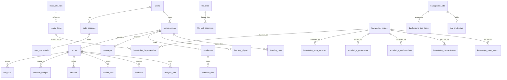

# Persistence specification

Status: MVP specification. Related: [Architecture overview](../architecture/overview.md), [Security and permissions](../architecture/security-and-permissions.md), [Deployment and operations](../architecture/deployment-and-operations.md), [Specification index](README.md).

## 1. Purpose

Aras Insight keeps all of its own state in one PostgreSQL database. This document is the complete logical schema of that database: every table, its columns, keys, relationships, owning module, and retention. Module specifications describe *behaviour*; this document is the single place that says *what is stored*.

The schema is logical. Column types are given as PostgreSQL types because the database is fixed by decision, but physical choices (index names, partitioning, exact JSON layouts beyond the fields listed) are left to the implementing engineers unless stated.

What the database deliberately does **not** hold:

- No copy or history of Aras business data beyond what a conversation transcript naturally contains and the extracted text of files that users have read. Aras-derived values also appear in four other places, each with its own retention: AML text in audit events (literal criteria values replaced by placeholders by default, 365 days, surviving conversation deletion), short passage snippets in background job items (with the conversation), progress lines that may summarise data (7 days), and record and file keyed names in citations (with the conversation); see section 12. The transcript also holds the AML text exactly as the model wrote it (`tool_calls.input` and assistant messages), under conversation retention. The product keeps no history of Aras data (see [roadmap](../product/roadmap.md), "Product-kept history of Aras data").
- No query-result cache. Every question re-reads Aras as the user (caching is deferred).
- No vector embeddings. Knowledge is loaded by index and description; files are searched by reading them.
- No model endpoint secrets. Model credentials are referenced from deployment configuration (see [model-configuration.md](model-configuration.md)).
- No Aras passwords. Users sign in at the Aras authorization server, so Aras Insight never sees a password; it stores only the tokens that sign-in issues, encrypted at rest with one deployment-supplied key (see [ADR 0033](../decisions/0033-sign-in-through-the-aras-authorization-server.md) and [ADR 0034](../decisions/0034-credentials-encrypted-at-rest.md)).

## 2. Responsibilities and non-responsibilities

The persistence layer is responsible for:

1. Providing one schema, versioned with the product, migrated forward on upgrade.
2. Enforcing ownership: each table has exactly one owning module, which is the only module that writes it. Other modules read through the owner's interface, or read directly only where this document says "readable by".
3. Enforcing referential integrity between tables of the same owner, and between tables of different owners where listed.
4. Applying retention rules through a daily scheduled purge, run by [Audit and progress](audit-and-progress.md#55-retention) against the rules here and recorded as `retention.purged` audit events.

It is not responsible for business rules (state transitions, budgets, confirmation logic), which live in the owning modules.

## 3. Conventions

| Convention | Rule |
|---|---|
| Primary keys | Opaque text identifiers with a readable prefix (for example `cnv_` for conversations, `kn_` for knowledge entries). The part after the prefix is random and URL-safe, with at least 96 bits of entropy, so ids are never sequential. Example ids in other specifications (such as `cit_0042`) are illustrative. |
| Aras identifiers | Stored exactly as Aras returns them in columns named `aras_id` (typically 32 hexadecimal characters in standard Aras releases; verify against the target version). They are opaque text: the only check is a length cap of 64 characters. Never used as our primary keys, except `file_texts.file_aras_id`, because Aras files are immutable. |
| Timestamps | `timestamptz`, UTC. Every table has `created_at`; mutable tables have `updated_at`. |
| Enumerations | Stored as `text` with a check constraint listing the allowed values given in this document. |
| Structured payloads | `jsonb` only where the structure is owned by one module and not queried relationally; the fields inside are listed. |
| Soft deletion | Not used generally. Knowledge entries are retired, not deleted. Retention purges hard-delete. |
| References | A column described as "References `x.id`" points at that row. Where retention could remove the referenced row while a reference remains (`config_items`, `learning_runs`, and `sandboxes`), the table says so: the purge keeps rows that are still referenced, and the referencing column is nullable, so these references are logical and not enforced as foreign keys. |
| Encryption at rest | Columns marked "encrypted" hold ciphertext produced with one key supplied by the deployment (`gateway.credential_encryption_key_ref`), never stored in the database. There is no envelope layer in the MVP; one can be added later without changing the schema. |
| Text search | There is no search index over file text, vector or otherwise. Files are narrowed through the Aras graph and their stored text is searched by reading it (in the Sandbox, or by the background scan in the service). |

### JSON layouts read by other modules

Three `jsonb` columns are written by one module and read by others, so their top-level fields are fixed here. Other `jsonb` columns are internal to their owner, and their fields are listed in the column description.

| Column | Fields |
|---|---|
| `turns.coverage` | `records_considered` (list of item type and count), `records_truncated` (list of item type, reason `truncated`, `not_fetched`, or `result_too_large`, and count where known), `records_without_evidence` (list of item type and count), `files` (counts of `read`, `partial`, `too_large`, and `denied` (also covers not found); lists of `unreadable` by reason and `unsupported` by format), `limits_reached` (names of the budget limits reached), `time_window` (from, to, and the description the answer gave). See [main-agent.md](main-agent.md#59-coverage). |
| `analysis_jobs.brief` | `objective`, `definitions` (each with term, meaning, and source: confirmed by the user, a knowledge entry with its citation id, or a default the Main Agent stated as an assumption), `scope`, `schema_context`, `knowledge_context`, `prior_data` (Sandbox paths and manifest entries), `expected_output`, `budget_share` (`max_queries`, `max_rows`, `max_bytes`, `max_wall_seconds`), `step_limit`, `deadline`. The job id, conversation, turn, and start tool call are columns of the row. See [analysis-worker-and-sandbox.md](analysis-worker-and-sandbox.md#31-job-contract-the-brief). |
| `citations.locator` | One of `page` (integer), `sheet` (text, with an optional `cell_range`), `slide` (integer), or `section` (heading text), plus `char_start` (inclusive) and `char_end` (exclusive) offsets into `file_texts.text`. |

## 4. Entity overview

## 5. Ownership summary

| Owner module | Tables |
|---|---|
| [Chat App](chat-app.md) | `users`, `auth_sessions`, `feedback` |
| [Tool Gateway](tool-gateway.md) (credentials) | `aras_credentials`, `job_credentials` |
| [Tool Gateway](tool-gateway.md) (Citation Registry) | `citations`, `citation_sets` |
| [Tool Gateway](tool-gateway.md) (Throttle) | `throttle_leases`, `question_budgets` |
| [Main Agent](main-agent.md) | `conversations`, `turns`, `messages`, `tool_calls` |
| [File Service](file-service.md) | `file_texts`, `file_text_segments` |
| [Analysis Worker and Sandbox](analysis-worker-and-sandbox.md) | `analysis_jobs`, `sandboxes`, `sandbox_files` |
| [Discovery](discovery.md) | `config_items`, `discovery_runs` |
| [Knowledge Service](knowledge-and-learning.md) | `knowledge_entries`, `knowledge_entry_versions`, `knowledge_dependencies`, `knowledge_provenance`, `knowledge_confirmations`, `knowledge_contradictions`, `knowledge_state_events` |
| [Learner](knowledge-and-learning.md) | `learning_signals`, `learning_runs` |
| [Background Jobs](background-jobs.md) | `background_jobs`, `background_job_items` |
| [Model Router](model-configuration.md) | `model_calls` |
| [Audit and progress](audit-and-progress.md) | `audit_events`, `progress_events`, `usage_summaries` |

Product skills are not stored as rows that can be edited: they ship with the product as files and are loaded into `knowledge_entries` with `layer = product_skill` at startup: each shipped skill is upserted by skill id (a new `version` if its text changed, `product_version` updated), and a skill that is no longer shipped is retired with `retired_reason = product_upgrade` (see [knowledge-and-learning.md](knowledge-and-learning.md)).

### Database roles

The service connects with a service role (`database.url`). Two further roles separate the duties that matter most for security: a purge role, and an optional gateway role. The customer provisions them (see [deployment and operations](../architecture/deployment-and-operations.md)).

| Role | Used by | Access |
|---|---|---|
| Service role | The Aras Insight service, all modules | Reads and writes every table, including the deletes of the retention purge, except that on `audit_events` it can insert and select but not update or delete. |
| Purge role (`database.purge_url`) | The retention purge of audit records only | Deletes rows from `audit_events` that are older than `audit.retention_days`. It is the only role that can delete from `audit_events`. |
| Gateway role (`database.gateway_url`), optional | A Tool Gateway running as its own process | In the optional hardened setup, `aras_credentials` and `job_credentials` are reachable only through this role, so a compromised agent process cannot read stored credentials. |

By default the Tool Gateway is a module of the one service, and the credential tables are reachable only through the gateway's interface; their token columns are encrypted either way (see [ADR 0037](../decisions/0037-single-instance-mvp-and-optional-gateway-process.md)). The append-only property of the audit record rests on these database permissions, not only on application behaviour (see [ADR 0039](../decisions/0039-audit-and-usage-records.md)).

## 6. Tables

### users

Owner: Chat App. A local record of each Aras user who has signed in. Identity is always Aras's; this table exists so that conversations, preferences, provenance, and audit can refer to a stable local id.

| Column | Type | Null | Meaning |
|---|---|---|---|
| `id` | text | no | Primary key, `usr_` prefix. |
| `aras_user_id` | text | no | The Aras user's id. Unique. |
| `aras_login_name` | text | no | Login name as reported by Aras at last sign-in. |
| `display_name` | text | yes | Display name as reported by Aras. |
| `first_seen_at` | timestamptz | no | First sign-in. |
| `last_seen_at` | timestamptz | no | Most recent sign-in or activity. |
| `created_at`, `updated_at` | timestamptz | no | |

Keys: unique (`aras_user_id`). Retention: kept while any row references the user; a user with no conversations, provenance, or audit within the audit retention period is purged. Usage is reported per user and in total; Aras identity groups are not read or stored. When a person who taught entries leaves the organisation or asks to be forgotten, an operator procedure (see [deployment and operations](../architecture/deployment-and-operations.md)) replaces that person's user id in `knowledge_provenance`, `knowledge_confirmations`, and `knowledge_contradictions` with a placeholder user: one `users` row per person, with an `aras_user_id` that matches no Aras user. The entries are kept, and the person's own row can then be purged.

### auth_sessions

Owner: Chat App. One row per signed-in browser session.

| Column | Type | Null | Meaning |
|---|---|---|---|
| `id` | text | no | Primary key, `ses_` prefix. Never sent to the browser. |
| `token_hash` | text | no | Hash of the opaque random value that the session cookie carries. The service looks the session up by this hash on every request; the cookie value itself is never stored, so a copy of the database cannot be used to take over a session. Unique. |
| `user_id` | text | no | References `users.id`. |
| `created_at` | timestamptz | no | Sign-in time. |
| `last_activity_at` | timestamptz | no | Updated at most once a minute by the user's requests, and kept current while one of the session's turns is running, so idle expiry (`chat_app.session_idle_minutes`, default 480) never cuts a running turn. |
| `expires_at` | timestamptz | no | Absolute expiry: `created_at` plus `chat_app.session_max_hours` (default 24 hours). |
| `revoked_at` | timestamptz | yes | Set on sign-out or when Aras rejects the user's token and refresh fails. |
| `client_info` | jsonb | yes | User agent and source address, for audit. |

Keys: unique (`token_hash`). Retention: deleted 30 days after expiry or revocation.

### aras_credentials

Owner: Tool Gateway. The Aras tokens obtained at sign-in, used to run every query as the user. Only the Tool Gateway reads this table.

| Column | Type | Null | Meaning |
|---|---|---|---|
| `auth_session_id` | text | no | Primary key; references `auth_sessions.id`. One credential per browser session. |
| `user_id` | text | no | References `users.id`. |
| `access_token` | bytea | no | Encrypted. |
| `refresh_token` | bytea | yes | Encrypted. Present when Aras sign-in issues one. |
| `access_expires_at` | timestamptz | no | When the access token expires; it is renewed `gateway.credential_renew_margin_seconds` (default 300) before this time. |
| `refresh_expires_at` | timestamptz | yes | |
| `last_refreshed_at` | timestamptz | yes | |
| `created_at`, `updated_at` | timestamptz | no | |

Retention: deleted immediately when the user signs out or the session is revoked or expires. The product only discards the tokens; it does not ask Aras to revoke them. The sign-out time stays in `auth_sessions.revoked_at`, and the deletion is audited as `credential.dropped`. Never copied into any other table, log, or the Sandbox.

### job_credentials

Owner: Tool Gateway. The job-scoped renewable credential used by a confirmed background job to keep acting as the requesting user after the user has left (see [background-jobs.md](background-jobs.md)).

| Column | Type | Null | Meaning |
|---|---|---|---|
| `job_id` | text | no | Primary key; references `background_jobs.id`. |
| `user_id` | text | no | References `users.id`; always the requesting user. |
| `access_token` | bytea | no | Encrypted. |
| `refresh_token` | bytea | yes | Encrypted. |
| `access_expires_at` | timestamptz | no | |
| `hard_expires_at` | timestamptz | no | Upper bound after which the credential is never renewed: the confirmation time plus `gateway.job_credential_max_hours` (default 24). When renewal fails or this time passes, the job pauses and can resume from its last completed item after the user signs in again (see [background-jobs.md](background-jobs.md) and [ADR 0035](../decisions/0035-job-credential-lifecycle.md)). |
| `last_renewed_at` | timestamptz | yes | Last renewal, attempted every `gateway.job_credential_renew_seconds` (default 900). |
| `dropped_at` | timestamptz | yes | Set when the job ends; token columns are overwritten at the same moment. |
| `created_at` | timestamptz | no | |

Retention: token columns cleared when the job ends; the row is deleted with its job.

### conversations

Owner: Main Agent. Readable by Chat App, Learner, Background Jobs.

| Column | Type | Null | Meaning |
|---|---|---|---|
| `id` | text | no | Primary key, `cnv_` prefix. |
| `user_id` | text | no | References `users.id`. Conversations are private to their owner. |
| `title` | text | yes | Short title generated after the first turn. |
| `status` | text | no | `active`, `idle` (no activity for `learning.inactivity_minutes`, default 30 minutes: the transcript becomes eligible for batched learning), `expired` (no activity for `sandbox.expiry_hours`, default 24 hours: the Sandbox has been destroyed, but the conversation stays open and a new Sandbox is created on the next `start_analysis`), `deleted` (user deleted; purged by retention). The two thresholds are independent. The Main Agent, as owner of this table, sets `idle` and `expired` when `last_activity_at` passes each threshold, and sets `active` again on the user's next message. |
| `last_activity_at` | timestamptz | no | Last user message or turn completion. |
| `learning_status` | text | no | `none`, `pending` (signals present, batched learning not yet run), `learned` (batched learning ran over all turns up to `learned_through_turn_seq`). |
| `learned_through_turn_seq` | integer | yes | Last turn sequence included in batched learning. |
| `created_at`, `updated_at` | timestamptz | no | |

Retention: default 180 days after `last_activity_at`, configurable (`retention.conversation_days`). A user can delete a conversation at any time: it is marked `deleted` at once, its Sandbox is destroyed, and the next daily purge removes it and every row kept with it. Deleting a conversation does not delete knowledge learned from it; the provenance row keeps the conversation id as a dangling reference marked "conversation deleted".

### turns

Owner: Main Agent. One user question and everything done to answer it.

| Column | Type | Null | Meaning |
|---|---|---|---|
| `id` | text | no | Primary key, `trn_` prefix. |
| `conversation_id` | text | no | References `conversations.id`. |
| `seq` | integer | no | 1-based order in the conversation. Unique with `conversation_id`. |
| `status` | text | no | `running`, `waiting_clarification` (the agent asked one clarifying question), `waiting_confirmation` (a background job was proposed), `completed`, `failed`, `cancelled`. A waiting turn is finished; the user's reply starts a new turn (see [main-agent.md](main-agent.md)). A conversation has at most one `running` turn. |
| `outcome` | text | yes | `answer`, `clarification`, `job_proposal`, `failed` (see [main-agent.md](main-agent.md#34-turn-result)). |
| `reply_to` | jsonb | yes | Context the user's message replies to: a clarification turn id, a contested entry id with the chosen meaning, or the turn of an answer being corrected. A user's decision on a background job proposal is not a reply: it changes the job's status only, and the Main Agent acts again when the job finishes (see [background-jobs.md](background-jobs.md) and [ADR 0050](../decisions/0050-background-job-flow.md)). |
| `user_message_id` | text | no | References `messages.id` of the message that started the turn: the user's message, or, for the turn started when a background job finishes, the `system_note` message that reports the result. |
| `answer_message_id` | text | yes | References `messages.id` of the final answer. |
| `coverage` | jsonb | yes | Coverage statement of the answer (see [main-agent.md](main-agent.md#59-coverage)): records considered, records truncated or not fetched, records with no linked evidence, files read, unreadable, unsupported, too large, and denied, budget limits reached, and the time window. The fields are listed in section 3. |
| `assumptions` | jsonb | yes | The items the answer disclosed or asked the user about. Each has a `kind`: `assumption` (a definition or scope choice stated in the answer), `verification` (a question asking the user to confirm an uncertain entry), or `clarification` (a question asking which meaning the user intends for a contested entry). Each also has the knowledge entry id it came from (if any) and, once the Learner has evaluated the user's next message, its outcome: for an assumption, accepted, objected to, or none; for a verification, verified or not; for a clarification, the meaning the user chose or a third meaning the user described. The Learner records the result in `knowledge_confirmations` and `knowledge_contradictions` (see [knowledge-and-learning.md](knowledge-and-learning.md)). |
| `time_zone` | text | no | IANA time zone name used to resolve relative dates such as "last quarter" in this turn: the time zone in the user's preferences if one is set, otherwise the browser's time zone sent with the message, otherwise the deployment's default time zone (see [chat-app.md](chat-app.md)). Saved so that a turn resumed after a restart interprets dates the same way. |
| `product_version` | text | no | Version of the product release that handled the turn. Prompts, skills, and the service ship together, so one version identifies the guidance that produced the answer. |
| `started_at` | timestamptz | no | |
| `finished_at` | timestamptz | yes | |
| `error_code` | text | yes | Shared error code when `status = failed`. |
| `failure_reason` | text | yes | User-readable reason, for example `auth_expired`, `budget_exhausted`, `step_limit`. |
| `created_at`, `updated_at` | timestamptz | no | |

Keys: unique (`conversation_id`, `seq`); unique (`conversation_id`) where `status = running`, which enforces one running turn per conversation. A second message while a turn is running is rejected with `TURN_IN_PROGRESS` and creates no row (see [main-agent.md](main-agent.md) and [ADR 0048](../decisions/0048-one-running-turn-per-conversation.md)). Retention: with its conversation.

### messages

Owner: Main Agent (rows for an Analysis Worker's own loop are written by the worker loop through the same interface, as for `tool_calls`). The transcript, saved as inference proceeds so that a long answer survives a restart and the user can return later.

| Column | Type | Null | Meaning |
|---|---|---|---|
| `id` | text | no | Primary key, `msg_` prefix. |
| `conversation_id` | text | no | References `conversations.id`. |
| `turn_id` | text | no | References `turns.id`. |
| `analysis_job_id` | text | yes | References `analysis_jobs.id`. Set on messages written by an Analysis Worker's loop (including the tool messages for the worker's tool calls); null on the Main Agent's own messages. A worker's transcript is read back by this column. |
| `seq` | integer | no | Order within the conversation. Unique with `conversation_id`. Worker messages count in the same sequence, so `seq` stays unique and ordered when several workers run in parallel. |
| `role` | text | no | `user`, `assistant`, `tool`, `system_note` (product-inserted notes such as "background job finished": the result of a finished job is posted as a `system_note`, so the Main Agent learns of it from the history and needs no separate resume note). The system prompt itself is not stored per message; `prompt_version` records which one was used. |
| `content` | text | yes | Message text. For tool messages, the tool result envelope as text. |
| `tool_call_id` | text | yes | For `tool` messages and assistant messages that request a tool: references `tool_calls.id`. |
| `prompt_version` | text | yes | Version of the prompt set in use for assistant messages. |
| `model_call_id` | text | yes | References `model_calls.id`. |
| `created_at` | timestamptz | no | |

Retention: with its conversation. Messages are private conversation content; they may contain Aras data values the user was permitted to see.

### tool_calls

Owner: Main Agent (rows for Analysis Worker tool calls are written by the Analysis Worker through the same interface). One row per tool invocation by any agent.

| Column | Type | Null | Meaning |
|---|---|---|---|
| `id` | text | no | Primary key, `tcl_` prefix. |
| `turn_id` | text | no | References `turns.id`. |
| `analysis_job_id` | text | yes | References `analysis_jobs.id` when a worker made the call. |
| `background_job_id` | text | yes | References `background_jobs.id` when a background job made the call. |
| `tool_name` | text | no | One of the names in [tool-catalog.md](tool-catalog.md). |
| `input` | jsonb | no | Tool input as sent by the model. For AML tools this is the AML text with its literal values, kept with the conversation whatever `audit.store_aml_text` says; that setting governs the audit record only. |
| `status` | text | no | `running`, `ok`, `error`. |
| `error_code` | text | yes | Shared error code. |
| `result_summary` | jsonb | yes | Usage (rows, bytes, duration), analyzer verdict, rule ids and cost class, the schema elements the query used, and the number and range of citation ids issued. The full result is in `messages.content` (Main Agent) or in a Sandbox file (worker). |
| `query_fingerprint` | text | yes | For AML tools: a hash of the AML with literal values removed, so repeated query shapes can be counted without storing values (see [tool-gateway.md](tool-gateway.md)). |
| `started_at` | timestamptz | no | |
| `finished_at` | timestamptz | yes | |

The tool call id doubles as the idempotency key: a retried call with the same id after a restart is not executed twice. The messages of a worker's loop carry the same `analysis_job_id` (see `messages`), so a worker's transcript can be read back. Retention: with its conversation.

### feedback

Owner: Chat App. Corrections, ratings, and answers to clarification prompts given on an answer.

| Column | Type | Null | Meaning |
|---|---|---|---|
| `id` | text | no | Primary key, `fbk_` prefix. |
| `turn_id` | text | no | References `turns.id`. |
| `user_id` | text | no | References `users.id`. |
| `rating` | text | yes | `helpful` or `not_helpful`. |
| `text` | text | yes | Free comment from the user. |
| `correction_text` | text | yes | What is wrong or what is right, when the user submitted a correction. |
| `flagged_citation_ids` | jsonb | yes | Citation ids the user flagged as wrong. |
| `created_at` | timestamptz | no | |

A correction also becomes a learning signal (`learning_signals`) and, when the answer cited learned entries, marks them uncertain (see [knowledge-and-learning.md](knowledge-and-learning.md)). Retention: with its conversation; aggregated counts survive in `usage_summaries`.

### citations

Owner: Tool Gateway (Citation Registry). Every record, file passage, and discovered or learned knowledge entry an answer may cite. Rows are created when a tool returns the source, before the model writes any text, so the model can only cite what was actually returned.

| Column | Type | Null | Meaning |
|---|---|---|---|
| `id` | text | no | Primary key, `cit_` prefix. Appears in answers as `[cite:<id>]`. |
| `conversation_id` | text | no | References `conversations.id`. Citation ids are valid only inside their conversation. |
| `turn_id` | text | yes | References `turns.id`. Null only for citations a background job registers when it completes. |
| `tool_call_id` | text | yes | References `tool_calls.id` that produced the source. Null only for citations a background job registers when it completes. |
| `background_job_id` | text | yes | References `background_jobs.id`. Set on the file citations a background job registers for its matched passages on completion, before the job's result turn starts; such rows have no turn or tool call. |
| `kind` | text | no | `record`, `file`, `knowledge`. |
| `item_type` | text | yes | Record: Aras item type name. File: the item type of the parent item the file was reached through. |
| `aras_id` | text | yes | Record: the item's Aras id. File: the file's Aras id. |
| `keyed_name` | text | yes | Human-readable name of the record or file as Aras reported it. |
| `parent_item_type` | text | yes | File: parent item type. |
| `parent_aras_id` | text | yes | File: parent item id. |
| `locator` | jsonb | yes | File: the position of the passage in the file (a page, a sheet and cell range, a slide, or a section) and its character offsets in the extracted text. The fields are listed in section 3. |
| `knowledge_entry_id` | text | yes | Knowledge: references `knowledge_entries.id` of a discovered or learned entry. Product skills and the user's own preferences are not cited. |
| `knowledge_version` | integer | yes | Knowledge: the entry version that was read. |
| `knowledge_state` | text | yes | Knowledge: state at time of reading. |
| `knowledge_confirmation` | text | yes | Knowledge: `unconfirmed` or `independently_confirmed` at time of reading. |
| `aras_link` | text | yes | Link that opens the source in the Aras client, built from the configured Aras base address (see [chat-app.md](chat-app.md)). |
| `set_ids` | jsonb | yes | Record citations: the citation sets the record belongs to. |
| `cited_in_answer` | boolean | no | Set when the final answer actually cites it. Default false. |
| `opened_count` | integer | no | How many times the user opened the citation in the Chat App. Default 0. It answers the citation follow-through metric without a record of what each person looked at and when. |
| `first_opened_at` | timestamptz | yes | When the citation was first opened. |
| `created_at` | timestamptz | no | |

Keys: index on (`conversation_id`), on (`knowledge_entry_id`) for finding answers that cited an entry. A file read or fetch registers one `file` citation for every segment it returns; finer passage citations are registered only when a worker's report asks for them. A knowledge entry read again after its version, state, or confirmation changed receives a new citation id, so each citation records what the answer relied on; the registry's dedupe key is the entry id with its version, state, and confirmation. The confidence shown with a knowledge citation is not stored: it is computed from the entry's layer, kind, and derivation method together with the `knowledge_state` and `knowledge_confirmation` kept on the citation row (see [knowledge-and-learning.md](knowledge-and-learning.md#41-knowledge-entry-schema)). Retention: with its conversation. Opening a citation re-checks access through Aras; the row is a pointer, not a permission.

### citation_sets

Owner: Tool Gateway (Citation Registry). A named grouping of record citations, so that a computed number over many records can be cited once (see [tool-catalog.md](tool-catalog.md#35-citation-summaries)). A set is not a fourth citation kind; it opens as a list of its member records.

| Column | Type | Null | Meaning |
|---|---|---|---|
| `id` | text | no | Primary key, `cst_` prefix. Cited in answers as `[cite:<id>]`. |
| `conversation_id` | text | no | References `conversations.id`. |
| `turn_id` | text | no | References `turns.id`. |
| `tool_call_id` | text | no | The `aml_fetch` call that wrote the records, or the `submit_report` call that registered a narrower set. |
| `label` | text | no | Plain-language description, for example "change records closed late, last quarter". |
| `member_count` | integer | no | |
| `members` | jsonb | no | Ordered list of member citation ids. |
| `cited_in_answer` | boolean | no | |
| `created_at` | timestamptz | no | |

Retention: with its conversation.

### throttle_leases

Owner: Tool Gateway (Throttle). Concurrency slots currently held, so that limits hold across several service instances.

| Column | Type | Null | Meaning |
|---|---|---|---|
| `id` | text | no | Primary key. |
| `user_id` | text | no | The user on whose behalf the query runs. |
| `scope` | text | no | `interactive` or `background`. Every lease counts against both its user's limit and the system-wide limit; background leases are also capped at a share of system slots (see [tool-gateway.md](tool-gateway.md)). |
| `cost_class` | text | no | `light`, `moderate`, or `heavy`, from the Query Analyzer. |
| `units` | integer | no | Concurrency units held; a heavy query holds more than one (see [tool-gateway.md](tool-gateway.md)). |
| `tool_call_id` | text | yes | References `tool_calls.id`. |
| `background_job_id` | text | yes | References `background_jobs.id`. |
| `acquired_at` | timestamptz | no | |
| `expires_at` | timestamptz | no | Acquired time plus the query timeout plus a grace period; an expired lease is free even if never released. |

Retention: deleted on release; expired rows swept every minute. The MVP runs one active service instance, so the Throttle may hold leases in memory; the table is required only when more than one instance is active, so that the limits hold across them. Per-turn and per-job budgets (`question_budgets`) are stored in the database either way, so a resumed turn keeps its accounting (see [ADR 0037](../decisions/0037-single-instance-mvp-and-optional-gateway-process.md)).

### question_budgets

Owner: Tool Gateway (Throttle). The budget consumed by one turn, and the sub-budgets handed from it to each Analysis Worker, plus the budget of each background job.

| Column | Type | Null | Meaning |
|---|---|---|---|
| `id` | text | no | Primary key. |
| `scope` | text | no | `turn`, `analysis_job`, or `background_job`. |
| `turn_id` | text | yes | References `turns.id` (scopes `turn` and `analysis_job`). |
| `analysis_job_id` | text | yes | References `analysis_jobs.id`. |
| `background_job_id` | text | yes | References `background_jobs.id`. |
| `parent_budget_id` | text | yes | References `question_budgets.id`: a worker's share draws on its turn's budget. |
| `limits` | jsonb | no | Limits in force when the budget was created (`max_queries`, `max_rows`, `max_bytes`, `max_wall_seconds`). For scope `background_job` the bytes cap and the total wall-time cap come from the Background Jobs configuration (see [background-jobs.md](background-jobs.md)). |
| `queries_used` | integer | no | |
| `rows_used` | integer | no | |
| `bytes_used` | bigint | no | Bytes of AML results and file text fetched. |
| `wall_seconds_used` | integer | no | Wall time used. For a turn, the time its analysis jobs spend `queued` counts. |
| `exhausted_reason` | text | yes | Which limit was reached, if any. |
| `created_at`, `updated_at` | timestamptz | no | |

Keys: unique (`turn_id`) where `scope = turn`. Usage recorded against a worker's budget is also counted against its parent. Retention: with its conversation or job.

### file_texts

Owner: File Service. The extracted text of vault files users have read, keyed by the Aras file id. Aras files are immutable, so a file id always means the same bytes and the extraction never goes stale. Holding the text does not grant access: every use re-checks access through Aras as the requesting user.

| Column | Type | Null | Meaning |
|---|---|---|---|
| `file_aras_id` | text | no | Primary key: the Aras file id. |
| `filename` | text | no | File name as reported by Aras. |
| `format` | text | no | `pdf`, `docx`, `xlsx`, `pptx`, `txt`, `csv`, `html`, `xml`, or `other`. Detected from content, not only the extension. |
| `byte_size` | bigint | yes | As reported by Aras or measured on download. |
| `checksum` | text | yes | Aras checksum where available; otherwise a hash computed on download. |
| `extraction_status` | text | no | `ok` (reported to callers as `read`), `partial` (some pages had no text, or the text was truncated at the extracted-size limit), `unreadable` (no usable text), `unsupported`, `too_large` (the file is over the size limit; stored with `byte_size` and no text), `failed` (a deterministic extraction failure; transient failures are not stored). A stored `unreadable`, `unsupported`, `too_large`, or `failed` row stops a repeat download until the extractor version changes. |
| `status_reason` | text | yes | `no_text_layer`, `encrypted`, `corrupt`, `extraction_timeout`, `extraction_failed`, `truncated` (status `partial`), `file_too_large` (status `too_large`) (see [file-service.md](file-service.md)). Shown in coverage. |
| `extractor_version` | text | no | Version of the extraction logic. A row whose version is older than `file_service.min_extractor_version` is re-extracted on its next use, whatever its status (see [file-service.md](file-service.md#56-retention-and-eviction)). |
| `page_count` | integer | yes | Pages, slides, or sheets, by format. |
| `char_count` | integer | yes | |
| `text` | text | yes | Full extracted text, with segment boundaries recorded in `file_text_segments`. |
| `extracted_at` | timestamptz | no | |
| `last_used_at` | timestamptz | no | Updated at most once an hour per file. |

Retention: evicted 90 days after `last_used_at` by default (`file_service.retention_days_unused`; 0 evicts the text after each use). Eviction only costs a re-fetch; it loses nothing.

### file_text_segments

Owner: File Service. Divisions of an extracted text used for locators and citations.

| Column | Type | Null | Meaning |
|---|---|---|---|
| `file_aras_id` | text | no | References `file_texts.file_aras_id`. Part of primary key. |
| `seq` | integer | no | Order. Part of primary key. |
| `kind` | text | no | `page`, `slide`, `sheet`, `section`, `range` (fixed-size ranges for text without natural divisions). |
| `label` | text | yes | For example "page 7", "sheet Results", "slide 3", or a section heading. |
| `char_start` | integer | no | Inclusive offset into `file_texts.text`. |
| `char_end` | integer | no | Exclusive offset. |
| `has_text` | boolean | no | False for pages without a text layer, so coverage can report them. |

Retention: with its file text.

### sandboxes

Owner: Analysis Worker and Sandbox. One Sandbox per conversation that needed heavy work.

| Column | Type | Null | Meaning |
|---|---|---|---|
| `id` | text | no | Primary key, `sbx_` prefix. |
| `conversation_id` | text | no | References `conversations.id`. Unique while `status` is not `destroyed`. |
| `isolation` | text | no | `container` (default) or `vm`. |
| `runtime_ref` | text | yes | Identifier of the container or VM in the runtime. |
| `status` | text | no | `provisioning`, `ready`, `busy`, `expiring`, `destroyed`, `failed` (see [analysis-worker-and-sandbox.md](analysis-worker-and-sandbox.md#51-sandbox-lifecycle)). |
| `last_used_at` | timestamptz | yes | |
| `image_version` | text | no | Version of the Sandbox image (Python environment and libraries). |
| `disk_bytes_used` | bigint | yes | Last measured. |
| `created_at` | timestamptz | no | |
| `expires_at` | timestamptz | no | Moves with conversation activity. |
| `destroyed_at` | timestamptz | yes | |

Retention: row kept 30 days after destruction for audit, then deleted unless an `analysis_jobs` row still references it, in which case it is kept while that job is kept. Sandbox contents are never kept after destruction.

### sandbox_files

Owner: Analysis Worker and Sandbox. The manifest of every file the Tool Gateway wrote into a Sandbox, and of files the worker's code produced that the report refers to.

| Column | Type | Null | Meaning |
|---|---|---|---|
| `sandbox_id` | text | no | References `sandboxes.id`. Part of primary key. |
| `path` | text | no | Path inside the Sandbox: in the read-only data area for files the Tool Gateway wrote (`origin` `aml` or `file_text`), and under the job's writable working area (`work/<job id>/`) for `python_output`. For `aml` files the file name is the worker-chosen `name` of the `aml_fetch` call (default: the tool call id; a name already in use is rejected with PATH_INVALID). Part of primary key. |
| `origin` | text | no | `aml`, `file_text`, `python_output`. |
| `tool_call_id` | text | yes | References `tool_calls.id` that wrote it. |
| `analysis_job_id` | text | yes | References `analysis_jobs.id`. |
| `format` | text | no | For example `jsonl`, `csv`, `txt`, `json`, `png`. AML results are written as `jsonl` or, when the worker asks for it, `csv` (one row per top-level item, without relationship data). |
| `rows` | integer | yes | Records written, for AML results. |
| `bytes` | bigint | no | |
| `citation_count` | integer | yes | Number of citations the rows or segments in the file carry. The citations themselves are not listed here: every row of an AML result file carries its own `_cite` field, and each file text has a segment map. |
| `citation_set_id` | text | yes | References `citation_sets.id` for AML result files. |
| `truncated` | boolean | no | True if a limit stopped the fetch early. |
| `manifest_entry` | jsonb | no | The entry written to `data/manifest.json` for this file, kept so the manifest can be rebuilt. |
| `created_at` | timestamptz | no | |

Retention: deleted with the Sandbox row.

### analysis_jobs

Owner: Analysis Worker and Sandbox. One bounded job handed by the Main Agent to an Analysis Worker.

| Column | Type | Null | Meaning |
|---|---|---|---|
| `id` | text | no | Primary key, `anj_` prefix. |
| `turn_id` | text | no | References `turns.id`. |
| `conversation_id` | text | no | References `conversations.id`. |
| `sandbox_id` | text | yes | References `sandboxes.id`. Cleared only if the Sandbox row is removed outside the retention purge, which keeps a Sandbox row while a job references it. |
| `start_tool_call_id` | text | no | References the Main Agent's `start_analysis` call in `tool_calls`. |
| `brief` | jsonb | no | The job brief as defined in [analysis-worker-and-sandbox.md](analysis-worker-and-sandbox.md); its top-level fields are listed in section 3. |
| `status` | text | no | `queued` (waiting for a free worker slot when the turn has started more analyses than the parallel limit; the waiting time counts against the turn's wall-time budget), `running`, `completed`, `failed` (including reason `interrupted` after a service restart), `cancelled` (by the user), `budget_exhausted` (budget share or wall time used up). |
| `report` | jsonb | yes | The submitted report. |
| `product_version` | text | no | Version of the product release (prompts, skills, and service) that ran the job. |
| `steps_used` | integer | no | Model steps consumed. |
| `budget_id` | text | no | References `question_budgets.id` for this job's share. |
| `started_at` | timestamptz | yes | |
| `finished_at` | timestamptz | yes | |
| `error_code` | text | yes | |
| `created_at`, `updated_at` | timestamptz | no | |

Retention: with its conversation.

### config_items

Owner: Discovery. The current discovered definition of every Aras configuration item the product reads: item types, relationship types, lists, life cycle maps, workflow maps, methods (metadata only, not executed), and forms. Properties, list values, life cycle states and transitions, and workflow activities and paths are not rows of their own: each sits inside the `definition` of its parent configuration item with its own Aras id and name (see [discovery.md](discovery.md)). Readable by Knowledge Service, Query Analyzer, and Discovery's `schema_describe` handler. The table holds one shared copy for the whole deployment, served to every user, and no per-user visibility data. A user can therefore learn through the schema that an item type exists that Aras hides from them, while a query against it is still refused by Aras as that user (see [ADR 0036](../decisions/0036-one-shared-discovered-configuration.md)).

| Column | Type | Null | Meaning |
|---|---|---|---|
| `id` | text | no | Primary key. |
| `config_type` | text | no | Item-level types only: `item_type`, `relationship_type`, `list`, `lifecycle_map`, `workflow_map`, `method`, `form`. |
| `aras_id` | text | no | The configuration item's Aras id. Unique with `config_type`. |
| `name` | text | no | Name as defined in Aras. |
| `label` | text | yes | Display label, if any. |
| `modified_on` | text | yes | Aras modification stamp exactly as reported. Compared for change detection. |
| `definition` | jsonb | no | Normalised definition: for a property, its data type, data source, length, whether required, and whether computed or federated where discoverable; for a relationship type, its source and related types; and so on (see [discovery.md](discovery.md)). |
| `definition_hash` | text | no | Hash of the normalised definition, so a changed stamp with an unchanged definition is not treated as a change. |
| `first_seen_at` | timestamptz | no | |
| `last_seen_at` | timestamptz | no | Last run that found the element. |
| `deleted_at` | timestamptz | yes | Set when the element is no longer found; kept so dependent knowledge can be retired with a reason. |
| `last_run_id` | text | no | References `discovery_runs.id`. |
| `created_at`, `updated_at` | timestamptz | no | |

There is no parent column: configuration below the item level is reached through the parent's `definition`, and knowledge refers to it through `knowledge_dependencies.sub_element_id` and `sub_element_kind`. Retention: current state only (the product keeps no history of Aras configuration). Rows with `deleted_at` older than 30 days that no `knowledge_dependencies` row references (including the rows of retired entries) are purged; a referenced row is kept.

### discovery_runs

Owner: Discovery.

| Column | Type | Null | Meaning |
|---|---|---|---|
| `id` | text | no | Primary key, `dsr_` prefix. |
| `triggered_by_user_id` | text | no | References `users.id`; Discovery runs as the user whose session triggered it. |
| `reason` | text | no | `initial`, `conversation_start`, `sign_in`, `inconsistency_check` (an early check that the Tool Gateway raises when Aras or the Query Analyzer reports something inconsistent with the stored schema; it bypasses the minimum interval but runs at most once in a short window) (see [discovery.md](discovery.md)). There is no manual trigger. |
| `status` | text | no | `running`, `completed`, `failed`, `skipped` (the last successful check is younger than the minimum interval, which is measured from the last successful run, so a failed or skipped run does not delay the next check). |
| `items_listed`, `items_new`, `items_modified`, `items_renamed`, `items_deleted`, `items_not_visible` | integer | yes | Counts for the run. `items_not_visible` counts items that failed with a permission error rather than not-found and were therefore not treated as deleted (see [discovery.md](discovery.md)). |
| `started_at` | timestamptz | no | |
| `finished_at` | timestamptz | yes | |
| `error` | text | yes | |

Retention: 90 days. A crash between a run's configuration update and the invalidation of dependent knowledge needs no marker on the run: on start the Knowledge Service compares the stamps and names stored on each dependency with the current `config_items` rows (see section 8).

### knowledge_entries

Owner: Knowledge Service. Every knowledge entry in every layer. The field semantics and the state machine are in [knowledge-and-learning.md](knowledge-and-learning.md#41-knowledge-entry-schema).

| Column | Type | Null | Meaning |
|---|---|---|---|
| `id` | text | no | Primary key, `kn_` prefix. Stable across versions; never reused. |
| `layer` | text | no | `product_skill`, `instance`, `user_preference`. |
| `kind` | text | yes | Instance layer only: `discovered` or `learned`. |
| `derivation_method` | text | yes | Discovered entries only: `mechanical` or `model_inferred`. |
| `owner_user_id` | text | yes | `user_preference` only: references `users.id`. A preference belongs to one user; role-level preferences are not part of the MVP. |
| `title` | text | no | Up to 120 characters; usually the term or configuration element the entry is about. |
| `aliases` | jsonb | yes | Other words users use for the same thing; used for topic matching and merging. |
| `description` | text | no | One line, up to 200 characters (`knowledge.description_max_chars`), shown by `knowledge_index`. |
| `body` | text | no | Up to 4,000 characters (`knowledge.body_max_chars`). Describes how, never what: no business data values. A `user_preference` body holds style, format, level of detail, default periods, units, and personal working definitions only; facts a user states about themselves or a specific case are not stored (see [ADR 0045](../decisions/0045-personal-preferences-layer.md)). |
| `subject_refs` | jsonb | yes | The configuration elements the entry is about (`config_items` ids), for merging and topic matching. |
| `state` | text | no | `confirmed`, `uncertain`, `contested`, `retired`. |
| `confirmation_status` | text | yes | Learned entries: `unconfirmed` or `independently_confirmed`. |
| `uncertain_reason` | text | yes | Why the entry is uncertain (for example "referenced lifecycle state renamed"). For a contested entry whose referenced configuration element was renamed or removed, it holds the stale-reference note: the entry stays contested. |
| `version` | integer | no | Incremented on every content change. |
| `product_version` | text | yes | `product_skill` only: the product release that shipped it. |
| `merged_into_id` | text | yes | References `knowledge_entries.id` when this entry was merged into another and retired. |
| `retired_reason` | text | yes | `source_deleted`, `merged`, `superseded`, `corrected` (a correction leaves nothing valid), `withdrawn` (withdrawn by its teacher with no other confirmations), `product_upgrade`. |
| `created_at`, `updated_at` | timestamptz | no | |
| `state_changed_at` | timestamptz | no | Last state transition. |
| `last_used_at` | timestamptz | yes | Last time it was read into a conversation. Recorded for a future decay policy; not acted on in MVP. |

Confidence (`high`, `medium`, `low`) is not stored; it is computed on read from layer, kind, derivation method, state, and confirmation status (see [knowledge-and-learning.md](knowledge-and-learning.md#41-knowledge-entry-schema)); for a citation, the state and confirmation inputs are the ones stored on the citation row. Keys: index on (`layer`, `state`), on (`owner_user_id`), and a text index over `title`, `aliases`, and `description` for index matching. Retention: entries are never deleted, only retired, except `user_preference` entries, which are deleted when their owner deletes them. `product_skill` entries are never deleted either: on upgrade each shipped skill is upserted by skill id (a new `version` if its text changed, `product_version` updated) and a skill no longer shipped is retired with `retired_reason = product_upgrade`.

### knowledge_entry_versions

Owner: Knowledge Service. Previous content of an entry, so merges and corrections can be reviewed.

| Column | Type | Null | Meaning |
|---|---|---|---|
| `entry_id` | text | no | References `knowledge_entries.id`. Part of primary key. |
| `version` | integer | no | Part of primary key. |
| `title`, `description`, `body` | text | no | Content as of that version. |
| `changed_by` | text | no | `learner`, `discovery`, `product_upgrade`. A user can list and delete personal preferences but not edit them, so no edit by a user creates a version. |
| `change_reason` | text | yes | For example "merged teaching from conversation", "re-derived after configuration change". |
| `created_at` | timestamptz | no | |

Retention: last 20 versions per entry.

### knowledge_dependencies

Owner: Knowledge Service. The configuration elements an entry depends on. This table is what makes configuration changes the staleness trigger.

| Column | Type | Null | Meaning |
|---|---|---|---|
| `id` | text | no | Primary key. |
| `entry_id` | text | no | References `knowledge_entries.id`. |
| `config_item_id` | text | yes | References `config_items.id`. Null only if the row was removed outside the retention purge, which keeps any `config_items` row that a dependency references; the copied `aras_id` and `name_at_link` below remain. |
| `sub_element_id` | text | yes | Aras id of a sub-element inside the configuration item's definition (for example one list value or lifecycle state), when the dependency is that narrow. |
| `sub_element_kind` | text | yes | Set when `sub_element_id` is set: `property`, `list_value`, `lifecycle_state`, `lifecycle_transition`, `workflow_activity`, or `workflow_path`. |
| `config_type` | text | no | The configuration item's type (an item-level `config_items.config_type`), copied for readability. |
| `dependency_type` | text | no | `derived_from` (discovered entries: the source configuration the entry was derived from) or `refers_to` (learned entries: the configuration element a term maps to). |
| `aras_id` | text | no | The configuration item's Aras id, copied for readability and for detecting deletion. |
| `name_at_link` | text | no | Name of the configuration item (or of the sub-element, when `sub_element_id` is set) when the link was made; a different current name means a rename. |
| `modified_on_at_link` | text | yes | Modification stamp when the link was made. |
| `definition_hash_at_link` | text | yes | |
| `created_at` | timestamptz | no | |

Keys: unique (`entry_id`, `aras_id`, `sub_element_id`), with a missing sub-element counted as one value, so an entry can depend on several sub-elements of the same configuration item; index on (`config_item_id`). Retention: with its entry.

### knowledge_provenance

Owner: Knowledge Service. Where each piece of an entry came from.

| Column | Type | Null | Meaning |
|---|---|---|---|
| `id` | text | no | Primary key. |
| `entry_id` | text | no | References `knowledge_entries.id`. |
| `event` | text | no | `derived` (Discovery), `taught` (explicit teaching), `inferred_from_correction`, `inferred_from_retry`, `inferred_from_empty_result`, `merged`, `product_shipped`. |
| `entry_version` | integer | no | Version that resulted. |
| `conversation_id` | text | yes | The conversation it was learned in. Kept even if the conversation is later deleted. |
| `turn_id` | text | yes | |
| `user_id` | text | yes | The person who taught it (the teacher). Other users see it only when `knowledge.show_teacher_names` is true (default false); otherwise provenance is described neutrally. An operator can replace it with a placeholder user on request (see `users`). |
| `discovery_run_id` | text | yes | |
| `learning_run_id` | text | yes | References `learning_runs.id`; null for events that no learning run made (for example `derived` and `product_shipped`). A `learning_runs` row that any provenance row references is kept. |
| `created_at` | timestamptz | no | |

Learning signals map to provenance events: `explicit_teaching` to `taught`, `correction` to `inferred_from_correction`, `retried_question` to `inferred_from_retry`, and `empty_result` to `inferred_from_empty_result`. Retention: with its entry.

### knowledge_confirmations

Owner: Knowledge Service.

| Column | Type | Null | Meaning |
|---|---|---|---|
| `id` | text | no | Primary key. |
| `entry_id` | text | no | References `knowledge_entries.id`. |
| `entry_version` | integer | no | Version that was confirmed. |
| `user_id` | text | yes | Confirming user; null for the confirmation that the single-user rule supplied (`knowledge.single_user_deployment`). |
| `independent` | boolean | no | True when the confirming user is not a teacher of the entry, and for a confirmation the single-user rule supplied. |
| `kind` | text | no | `explicit` (the user said it is right), `implicit` (the agent disclosed it as an assumption and the user carried on without objecting), or `single_user_rule` (the deployment is configured as single-user, so the teacher's word was enough; switching that setting off sets entries whose only independent confirmation was this one back to unconfirmed). The Learner judges explicit and implicit confirmations from the user's next message. |
| `contradiction_id` | text | yes | References `knowledge_contradictions.id`. Set when the confirmation records the user's choice between the competing meanings of a contested entry. |
| `chosen_meaning` | text | yes | With `contradiction_id`: `entry` (the entry's current meaning) or `asserted` (the meaning asserted in that contradiction). |
| `conversation_id` | text | no | |
| `turn_id` | text | no | |
| `created_at` | timestamptz | no | |

Retention: with its entry.

### knowledge_contradictions

Owner: Knowledge Service. Disagreements between users about an entry, which make it contested.

| Column | Type | Null | Meaning |
|---|---|---|---|
| `id` | text | no | Primary key. |
| `entry_id` | text | no | References `knowledge_entries.id`. |
| `entry_version` | integer | no | |
| `user_id` | text | no | User who objected. |
| `conversation_id`, `turn_id` | text | no | Where the objection happened. |
| `asserted_meaning` | text | no | The meaning the objecting user intends, written without data values. |
| `status` | text | no | `open` or `resolved`. |
| `resolution` | text | yes | How it was resolved, for example one side conceded or the entry was split into scoped entries (see [knowledge-and-learning.md](knowledge-and-learning.md)). |
| `created_at`, `resolved_at` | timestamptz | | `resolved_at` nullable. |

Retention: with its entry.

### knowledge_state_events

Owner: Knowledge Service. Every state change of every entry, for explanation and audit.

| Column | Type | Null | Meaning |
|---|---|---|---|
| `id` | text | no | Primary key. |
| `entry_id` | text | no | References `knowledge_entries.id`. |
| `from_state`, `to_state` | text | no | |
| `trigger` | text | no | For example `config_renamed`, `config_deleted`, `config_changed_rederived`, `user_correction`, `analyzer_failure`, `user_contradiction`, `verified`, `merged`, `clarified`. An independent confirmation changes `confirmation_status`, not the state, so it is recorded in `knowledge_confirmations` and not here. |
| `detail` | jsonb | yes | Ids of the configuration item, feedback, tool call, or contradiction involved. |
| `created_at` | timestamptz | no | |

Retention: kept for the life of the entry.

### learning_signals

Owner: Learner. Signals detected in conversations; only conversations with at least one signal are learned from.

| Column | Type | Null | Meaning |
|---|---|---|---|
| `id` | text | no | Primary key, `lsg_` prefix. |
| `conversation_id`, `turn_id` | text | no | |
| `kind` | text | no | `correction`, `retried_question`, `empty_result`, `explicit_teaching`. |
| `detected_by` | text | no | `main_agent` (the agent flagged it during the turn), `feedback` (Chat App feedback), `tool_result` (the Tool Gateway recorded an `aml_query` or `aml_fetch` result with zero rows as an `empty_result` signal), `batch_scan` (found while scanning the transcript). |
| `evidence` | jsonb | no | Message ids and tool call ids involved. |
| `processed_at` | timestamptz | yes | Set when a learning run consumed it. |
| `created_at` | timestamptz | no | |

Retention: with its conversation.

### learning_runs

Owner: Learner.

| Column | Type | Null | Meaning |
|---|---|---|---|
| `id` | text | no | Primary key. |
| `conversation_id` | text | no | |
| `mode` | text | no | `live` (during a turn, through `record_learning`) or `batched` (over the transcript after the inactivity threshold). |
| `background_job_id` | text | yes | References `background_jobs.id` for batched runs. |
| `status` | text | no | `running`, `completed`, `failed`, `skipped_no_signal`. |
| `entries_created`, `entries_merged`, `entries_rejected` | integer | yes | |
| `rejections` | jsonb | yes | Reasons proposals were refused (for example "no signal", "unresolved references", or "malformed"). There is no programmatic data-value check; keeping data values out of entries relies on the Learner prompt and the shipped skill. |
| `model_call_ids` | jsonb | yes | |
| `started_at`, `finished_at` | timestamptz | | `finished_at` nullable. |

Retention: 180 days, except that a run that any `knowledge_provenance` row references is kept.

### background_jobs

Owner: Background Jobs. Long-running work: user-confirmed full-text scans and batched learning.

| Column | Type | Null | Meaning |
|---|---|---|---|
| `id` | text | no | Primary key, `bgj_` prefix. |
| `kind` | text | no | `full_text_scan` or `batched_learning`. |
| `requested_by_user_id` | text | yes | References `users.id`. Required for `full_text_scan`; the job acts only as this user. |
| `conversation_id`, `turn_id` | text | yes | Where the job was proposed and where its result is delivered. |
| `proposal` | jsonb | yes | `full_text_scan`: what will be searched, the candidate file set description, and the plain-language summary shown to the user. |
| `status` | text | no | `proposed`, `queued`, `running`, `paused`, `completed`, `failed`, `cancelled`, `declined`, `expired` (see [background-jobs.md](background-jobs.md#51-job-states)). Batched learning jobs start in `queued`. |
| `confirmed_at` | timestamptz | yes | Required before a `full_text_scan` leaves `proposed`. |
| `decided_at` | timestamptz | yes | When the user confirmed or declined. |
| `proposal_expires_at` | timestamptz | yes | After this a proposal moves to `expired`. |
| `estimate` | jsonb | yes | The estimate shown in the proposal: `candidate_files`, `cached_files`, `expected_duration` (always present, as a range), and `query_load`, as returned by `start_background_job` (see [tool-catalog.md](tool-catalog.md#start_background_job)). It holds no download volume, because Aras does not reliably report file sizes. |
| `budget_id` | text | yes | References `question_budgets.id` (scope `background_job`). |
| `product_version` | text | no | Version of the product release (prompts, skills, and service) that ran the job. |
| `progress` | jsonb | yes | Items done, items total, current phase. |
| `result` | jsonb | yes | Summary, matched files and passages (as citation ids), coverage. |
| `attempts` | integer | no | |
| `next_run_at` | timestamptz | yes | For queued and paused jobs. |
| `error_code`, `error_detail` | text | yes | |
| `created_at`, `updated_at`, `finished_at` | timestamptz | | `finished_at` nullable. |

Retention: with their conversation.

### background_job_items

Owner: Background Jobs. Units of work inside a job (for full-text scans, one row per candidate file).

| Column | Type | Null | Meaning |
|---|---|---|---|
| `job_id` | text | no | References `background_jobs.id`. Part of primary key. |
| `item_key` | text | no | For example the file's Aras id. Part of primary key. |
| `status` | text | no | `pending`, `matched`, `done` (read, no match), `skipped`, `denied` (Aras refused access), `unreadable`, `failed`. |
| `attempts` | integer | no | |
| `outcome` | jsonb | yes | Match count, locators and short snippets of matching passages, or the read status. Citation ids do not exist at this point: the job registers its citations when it completes and lists them in `background_jobs.result`. |
| `updated_at` | timestamptz | no | |

Retention: with its job.

### model_calls

Owner: Model Router. One row per model request; the basis for usage and cost reporting.

| Column | Type | Null | Meaning |
|---|---|---|---|
| `id` | text | no | Primary key, `mdl_` prefix. |
| `slot` | text | no | `main`, `worker`, `background`. |
| `endpoint_name` | text | no | Configured endpoint name, never its secret. |
| `client_type` | text | no | `openai_compatible` or the name of a native client. |
| `model` | text | no | Model identifier sent to the endpoint. |
| `conversation_id`, `turn_id`, `analysis_job_id`, `background_job_id` | text | yes | Whichever applies. |
| `attempt` | integer | no | 1 for the first attempt of a request. |
| `is_fallback` | boolean | no | True when a fallback endpoint served the request. |
| `streaming` | boolean | no | |
| `input_tokens`, `output_tokens` | integer | yes | As reported by the endpoint. |
| `latency_ms` | integer | yes | |
| `finish_reason` | text | yes | As reported by the endpoint. |
| `status` | text | no | `succeeded` or an error category: `transient`, `rate_limited`, `context_overflow`, `invalid_request`, `auth_failed`, `refused`, `budget_exhausted` (see [model-configuration.md](model-configuration.md)). |
| `started_at` | timestamptz | no | |

This is the only place where model usage is recorded: a model call is not an audit event, and no content is stored here (prompt and completion content are in `messages`). A turn's token usage against `models.turn_token_budget` is the sum of `input_tokens` and `output_tokens` over the turn's rows, across the Main Agent and its Analysis Workers. No price is stored; the customer applies its own rates to the token counts. Retention: 365 days (`retention.model_call_days`), aggregated into `usage_summaries` beyond that.

### audit_events

Owner: Audit and progress. Append-only record of security-relevant and data-access actions. Deployment administrators read it through the documented database views and the export operation (see [audit-and-progress.md](audit-and-progress.md)); the product has no administrator endpoints and no administrator identity in the MVP (see [ADR 0040](../decisions/0040-operator-reports-without-administrator-endpoints.md)).

| Column | Type | Null | Meaning |
|---|---|---|---|
| `id` | text | no | Primary key, `aud_` prefix. |
| `occurred_at` | timestamptz | no | |
| `event_type` | text | no | One of the closed catalogue in [audit-and-progress.md](audit-and-progress.md#51-audit-event-catalogue), for example `auth.sign_in`, `aras.query`, `aras.query_rejected`, `file.access`, `sandbox.write`, `job.confirmed`, `credential.dropped`, `knowledge.state_changed`. |
| `user_id` | text | yes | Acting user. |
| `component` | text | no | Component name as listed in the [architecture overview](../architecture/overview.md). |
| `conversation_id`, `turn_id`, `tool_call_id`, `analysis_job_id`, `background_job_id` | text | yes | Correlation. |
| `outcome` | text | no | `ok`, `rejected`, `denied`, `failed`. |
| `query_fingerprint` | text | yes | For `aras.query` events: the AML hash with literal values removed. |
| `detail` | jsonb | yes | Event-specific fields as listed in the catalogue: for AML, the calling tool, item types touched, row count, bytes, duration, cost class, analyzer rule ids, and the AML text according to `audit.store_aml_text`: `redacted` (default: literal criteria values replaced by placeholders; the query shape and its fingerprint remain), `full`, or `none`. The setting applies to every event that carries AML text, including `aras.query_rejected`. Never tokens. |

Retention: default 365 days (`audit.retention_days`). Append-only: the service role can insert and read but not update or delete (see "Database roles" in section 5); only the retention purge, through the purge role, deletes rows, and only rows past retention.

### progress_events

Owner: Audit and progress. Short progress lines for the live view, stored so a returning user sees what happened while away.

| Column | Type | Null | Meaning |
|---|---|---|---|
| `id` | text | no | Primary key, `prg_` prefix. |
| `conversation_id` | text | no | |
| `turn_id` | text | yes | |
| `analysis_job_id`, `background_job_id` | text | yes | |
| `seq` | bigint | no | Monotonic per conversation, for resuming a stream. |
| `source` | text | no | `main_agent`, `analysis_worker`, `background_job`, `throttle`, `system`. |
| `kind` | text | no | `step`, `worker_step`, `job_step`, `budget`, `state` (see [audit-and-progress.md](audit-and-progress.md#32-progress-event-kinds)). |
| `text` | text | no | The progress line as shown to the user, at most `progress.max_text_chars` characters (default 300). At most one line per `progress.min_interval_ms` (default 1,000) is accepted from each publisher, and each Analysis Worker counts as its own publisher; extra lines in that window are coalesced, keeping the latest. |
| `created_at` | timestamptz | no | |

Publishers are the Main Agent, Analysis Workers (through `report_progress`), Background Jobs, the Throttle (through the Tool Gateway, as source `throttle`), and the service itself (source `system`). Retention: default 7 days.

### usage_summaries

Owner: Audit and progress. Aggregated usage figures, so that metrics survive the retention purge of the rows they are computed from (turns, feedback, tool calls, citations, analysis jobs, and model calls). The rows hold counts and sums only, never Aras data values. The metric definitions are in [audit-and-progress.md](audit-and-progress.md), and each is derived from tables kept here; no price or cost is stored.

| Column | Type | Null | Meaning |
|---|---|---|---|
| `id` | text | no | Primary key, `usm_` prefix. |
| `period_start` | timestamptz | no | Start of the UTC day the figure covers. |
| `metric` | text | no | Metric name from the catalogue in audit-and-progress.md (for example the number of answers, or input tokens). |
| `dimensions` | jsonb | no | The breakdown the figure is for, for example the user id or the answer mix class; `{}` for a total. Never Aras data values. |
| `value` | numeric | no | The count or sum. |
| `computed_at` | timestamptz | no | When the figure was last computed; the operator sees it next to the figure. |
| `created_at`, `updated_at` | timestamptz | no | |

Keys: unique (`period_start`, `metric`, `dimensions`). A periodic job refreshes the rows every `metrics.aggregation_interval_minutes` (default 60) by recomputing recent days from their source rows; a day whose source rows have been purged keeps the figures already stored. Retention: 1,095 days by default (`retention.usage_summary_days`), longer than any source table (see [ADR 0039](../decisions/0039-audit-and-usage-records.md)).

## 7. Retention summary

| Data | Default retention | Key |
|---|---|---|
| Browser sessions (`auth_sessions`) | 30 days after expiry or sign-out | none |
| Conversations, turns, messages, tool calls, citations, citation sets, feedback, analysis jobs, question budgets, background jobs and their items, learning signals | 180 days after last activity, or when the user deletes the conversation (removed by the next daily purge) | `retention.conversation_days` |
| Sandbox contents | Until the Sandbox expires after 24 hours of conversation inactivity (the conversation itself stays) | `sandbox.expiry_hours` |
| Sandbox rows | 30 days after destruction; kept while an analysis job references them | none |
| Extracted file text | 90 days after last use; 0 evicts after each use | `file_service.retention_days_unused` |
| Discovery runs | 90 days | none |
| Deleted configuration rows | 30 days after deletion, if no knowledge refers to them | none |
| Knowledge entries | Never deleted; retired. A user's own preferences are deleted when the user deletes them | none |
| Knowledge entry versions | Last 20 per entry | none |
| Learning runs | 180 days; kept while a provenance row refers to them | none |
| User rows | Purged when no conversation, provenance, or audit event within the audit retention period refers to them | none |
| Aras and job credentials | Session or job lifetime only | none |
| Throttle leases | Deleted on release; expired rows swept every minute | none |
| Audit events | 365 days | `audit.retention_days` |
| Progress events | 7 days | `progress.retention_days` |
| Model calls | 365 days, aggregated into usage summaries beyond that | `retention.model_call_days` |
| Usage summaries | 1,095 days | `retention.usage_summary_days` |

These are defaults. A customer sets its own periods, and a shorter conversation period is also how a customer holds less query text and fewer Aras-derived values in transcripts. The pilot checks the values against real use. "On user deletion" means the user deleting a conversation; removing a person's knowledge provenance is a separate operator procedure (see `users`).

## 8. Behaviour

1. **Migrations.** The schema has a version number. On start, the service applies pending forward migrations in one transaction per migration before accepting traffic. Downgrades are not supported; a rollback restores a backup.
2. **Retention purge.** A daily scheduled task (not a `background_jobs` row) deletes rows past retention, in dependency order (children first), in batches, and records counts in a `retention.purged` audit event. It deletes audit rows through the purge role and every other row through the service role. A row that another row still references is kept even past its retention, where the owning table says so (`config_items`, `learning_runs`, `sandboxes`).
3. **Product skill load.** On start, each shipped product skill is upserted into `knowledge_entries` (`layer = product_skill`) by skill id: if its text changed, the entry gets a new `version` (the previous content goes to `knowledge_entry_versions` with `changed_by = product_upgrade`) and `product_version` is updated. A `product_skill` entry whose skill is no longer shipped is retired with `retired_reason = product_upgrade`. Entry ids stay the same, so citations and references remain valid.
4. **Transactions.** Each tool call's bookkeeping (tool call row, citations, budget update, audit event) commits atomically. Transcript messages commit as each is produced, so that a crash loses at most the in-flight model step.
5. **One active service instance.** The MVP runs one active service instance; any others are cold standby. The schema therefore carries no owner, heartbeat, or lease columns on `turns`, `analysis_jobs`, or `background_jobs`. On start, a turn left in `running` state is found and resumed from the saved transcript, an analysis job left `running` is marked `failed` with reason `interrupted`, and a background job left `running` resumes from its checkpoint (see [main-agent.md](main-agent.md) and [background-jobs.md](background-jobs.md)). The periodic tasks (conversation inactivity sweep, batched-learning scheduling, retention purge, lease sweep, usage aggregation) run in that instance. Job coordination uses the database, with no separate queue (see [ADR 0037](../decisions/0037-single-instance-mvp-and-optional-gateway-process.md)).
6. **Configuration reconciliation.** On start, the Knowledge Service compares `modified_on_at_link`, `name_at_link`, and `definition_hash_at_link` on every `knowledge_dependencies` row with the current `config_items` rows and applies the change to every entry whose source changed or was deleted. This recovers a crash between a discovery run's configuration update and its invalidation without a marker on the run.

## 9. Configuration

| Key | Type | Default | Meaning |
|---|---|---|---|
| `database.url` | secret reference | none | Connection to the PostgreSQL instance with the service role. |
| `database.purge_url` | secret reference | none | Connection with the purge role, used only by the retention purge of audit records. |
| `database.gateway_url` | secret reference | none | Optional. Connection with the gateway role, for a Tool Gateway that runs as its own process. |
| `gateway.credential_encryption_key_ref` | secret reference | none | Key used to encrypt credential columns (owned by the [Tool Gateway](tool-gateway.md) configuration). |
| `retention.conversation_days` | integer | 180 | Days after last activity before a conversation and its rows are purged. |
| `audit.retention_days` | integer | 365 | Days audit events are kept. |
| `progress.retention_days` | integer | 7 | Days progress events are kept. |
| `retention.model_call_days` | integer | 365 | Days model call rows are kept before they are aggregated. |
| `retention.usage_summary_days` | integer | 1,095 | Days usage summaries are kept. |
| `metrics.aggregation_interval_minutes` | integer | 60 | How often usage summaries are refreshed. |
| `audit.store_aml_text` | `full`, `redacted`, `none` | `redacted` | How much AML text is kept in audit detail: `redacted` replaces literal criteria values with placeholders, `none` keeps only the fingerprint (see [audit-and-progress.md](audit-and-progress.md)). |

A secret reference names an environment variable or a secret file mounted at run time, resolved when the service starts. There is no integration with an external secret manager in the MVP; the reference form allows one to be added later without changing these keys (see [ADR 0034](../decisions/0034-credentials-encrypted-at-rest.md)).

## 10. Limits

- Single database, no sharding. The scale assumed for a pilot is up to 25 active users out of a few hundred users in total (the pilot plan expects ten to twenty pilot users); this is an assumption to validate in the pilot, not a measurement (see [deployment and operations](../architecture/deployment-and-operations.md)). Extracted file text is the largest table and is bounded by eviction.
- `file_texts.text` is bounded by `file_service.max_file_bytes` on the source file and by a maximum extracted size (see [file-service.md](file-service.md)).
- `citations` receives one row per segment a file read or fetch returns, so it grows with file use. Its size is watched in the pilot; registering segment citations only when first used is the fallback if it grows too fast.

## 11. Failure modes and recovery

| Failure | Detection | Effect on user | Recovery |
|---|---|---|---|
| Database unavailable | Connection errors | New questions refused with a clear message; running turns stop at the next write | Service retries connections; turns resume from the saved transcript once available (see [main-agent.md](main-agent.md)). |
| Encryption key unavailable | Decrypt failure at start | Nobody can sign in | Fail start with an operator-facing error; no plaintext fallback. |
| Migration failure | Migration transaction aborts | Service does not start | Fix and re-run; database is unchanged by the failed migration. |
| Storage growth | Disk usage metrics | None until full | Lower `file_service.retention_days_unused`; purge runs daily. |
| Crash between a discovery run's configuration update and invalidation | A dependency's stored stamp or name differs from the current `config_items` row | Some knowledge may be used as confirmed for a short time although its source changed | Configuration reconciliation at start (section 8). |

## 12. Security considerations

- Credentials are encrypted at rest and read only by the Tool Gateway. Tokens are stored encrypted rather than kept only in memory, because memory-only storage would force a new sign-in after every restart and could not support background jobs that outlive a session.
- Aras Insight never sees or stores a password: the only sign-in path is the Aras authorization server.
- Conversations are private to their owner; the service enforces `conversations.user_id` on every read through the Chat App API. Operators with database access can read them, which the deployment documentation must state (see [security and permissions](../architecture/security-and-permissions.md)). The private transcript, not the audit record, is where the full query text lives (`tool_calls.input` and assistant messages); a customer that wants less retained shortens `retention.conversation_days`.
- Extracted file text is shared across users only as a cache of immutable bytes; it is never served without a fresh Aras access check as the requesting user.
- Beyond transcripts and extracted file text, Aras-derived values are kept in four other places: AML text in `audit_events.detail` (literal criteria values replaced by placeholders by default, `full` or `none` through `audit.store_aml_text`, 365 days by default, and it survives conversation deletion); short passage snippets in `background_job_items.outcome` (with the conversation); progress lines, which may summarise data the user was allowed to see (7 days); and record and file keyed names in `citations` (with the conversation).
- Who taught a learned entry is kept in `knowledge_provenance` for the life of the entry and is shown to other users only when `knowledge.show_teacher_names` is true. On request, an operator replaces a person's user id with a placeholder (see `users`), so privacy requests can be met without losing shared knowledge.
- Shared knowledge must not contain data values ("how, never what"); in MVP this relies on the product prompts and the shipped skill, with no programmatic check (see [knowledge-and-learning.md](knowledge-and-learning.md)).
- The audit record is append-only by database permission, and the credential tables can be separated by database role (see "Database roles" in section 5).

## 13. Observability

Database size per table, retention purge counts, migration version, connection pool saturation, and slow-query counts are exported as operational metrics (see [audit-and-progress.md](audit-and-progress.md)).

## 14. MVP versus deferred

| Roadmap item | Effect on the schema when added |
|---|---|
| Answer and query result caching | A cache table keyed by normalised query and permission scope. |
| Product-kept history of Aras data | Change-history tables; none exist in MVP. |
| Saved questions and dashboards, Scheduled reports | Tables for saved questions and schedules. |
| Vector index for knowledge or files | Embedding columns or a separate index; none in MVP. A vector index over knowledge would need a new decision record (see [ADR 0012](../decisions/0012-no-vector-index-graph-first-retrieval.md)). |
| Text-search index over stored file text | A PostgreSQL text-search index over `file_texts.text`; none in MVP, because files are narrowed through the Aras graph and read, and the stored text already makes repeat scans cheaper. It becomes worth adding when repeat scans dominate the load on Aras, and it must keep the per-use access check: a hit is never served without a fresh Aras access check as the requesting user. |
| Age out unused knowledge | Uses `knowledge_entries.last_used_at`, already recorded. |
| Multiple Aras instances | An instance key on users, configuration, knowledge, and file text. |
| Several active service instances | Owner and heartbeat columns on `turns`, `analysis_jobs`, and `background_jobs`, a claim rule for queued jobs, takeover of expired leases, and `throttle_leases` in use. Specified when a customer needs high availability. |

See the [roadmap](../product/roadmap.md) for why each is deferred and what would trigger reconsidering it; the triggers are indicative, not commitments.
