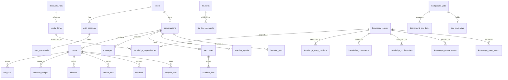

# Persistence specification

Status: MVP specification. Related: [Architecture overview](../architecture/overview.md), [Security and permissions](../architecture/security-and-permissions.md), [Deployment and operations](../architecture/deployment-and-operations.md), [Specification index](README.md).

## 1. Purpose

Aras Insight keeps all of its own state in one PostgreSQL database. This document is the complete logical schema of that database: every table, its columns, keys, relationships, owning module, and retention. Module specifications describe *behaviour*; this document is the single place that says *what is stored*.

The schema is logical. Column types are given as PostgreSQL types because the database is fixed by decision, but physical choices (index names, partitioning, exact JSON layouts beyond the fields listed) are left to the implementing engineers unless stated.

What the database deliberately does **not** hold:

- No copy or history of Aras business data beyond what a conversation transcript naturally contains and the extracted text of files that users have read. The product keeps no history of Aras data (see [roadmap](../product/roadmap.md), deferred item "product-kept history of Aras data changes").
- No query-result cache. Every question re-reads Aras as the user (caching is deferred).
- No vector embeddings. Knowledge is loaded by index and description; files are searched by reading them.
- No model endpoint secrets. Model credentials are referenced from deployment configuration (see [model-configuration.md](model-configuration.md)).
- No Aras passwords. Only tokens issued by Aras sign-in, encrypted at rest.

## 2. Responsibilities and non-responsibilities

The persistence layer is responsible for:

1. Providing one schema, versioned with the product, migrated forward on upgrade.
2. Enforcing ownership: each table has exactly one owning module, which is the only module that writes it. Other modules read through the owner's interface, or read directly only where this document says "readable by".
3. Enforcing referential integrity between tables of the same owner, and between tables of different owners where listed.
4. Applying retention rules through a daily scheduled purge, run by [Audit and progress](audit-and-progress.md#55-retention) against the rules here and recorded as `retention.purged` audit events.

It is not responsible for business rules (state transitions, budgets, confirmation logic), which live in the owning modules.

## 3. Conventions

| Convention | Rule |
|---|---|
| Primary keys | Opaque text identifiers with a readable prefix (for example `cnv_` for conversations, `kn_` for knowledge entries). **Proposed**: random, URL-safe, at least 96 bits of entropy after the prefix. |
| Aras identifiers | Stored exactly as Aras returns them in columns named `aras_id` (typically 32 hexadecimal characters in standard Aras releases; verify against the target version). Never used as our primary keys, except `file_texts.file_aras_id`, because Aras files are immutable. |
| Timestamps | `timestamptz`, UTC. Every table has `created_at`; mutable tables have `updated_at`. |
| Enumerations | Stored as `text` with a check constraint listing the allowed values given in this document. |
| Structured payloads | `jsonb` only where the structure is owned by one module and not queried relationally; the fields inside are listed. |
| Soft deletion | Not used generally. Knowledge entries are retired, not deleted. Retention purges hard-delete. |
| Encryption at rest | Columns marked "encrypted" hold ciphertext produced with a key from deployment configuration, never stored in the database. **Proposed**: envelope encryption with a key-encryption key held by the deployment's secret store. |
| Text search | There is no search index over file text, vector or otherwise. Files are narrowed through the Aras graph and their stored text is searched by reading it (in the Sandbox, or by the background scan in the service). |

## 4. Entity overview

## 5. Ownership summary

| Owner module | Tables |
|---|---|
| [Chat App](chat-app.md) | `users`, `auth_sessions`, `feedback` |
| [Tool Gateway](tool-gateway.md) (credentials) | `aras_credentials`, `job_credentials` |
| [Tool Gateway](tool-gateway.md) (Citation Registry) | `citations`, `citation_sets` |
| [Tool Gateway](tool-gateway.md) (Throttle) | `throttle_leases`, `question_budgets` |
| [Main Agent](main-agent.md) | `conversations`, `turns`, `messages`, `tool_calls` |
| [File Service](file-service.md) | `file_texts`, `file_text_segments` |
| [Analysis Worker and Sandbox](analysis-worker-and-sandbox.md) | `analysis_jobs`, `sandboxes`, `sandbox_files` |
| [Discovery](discovery.md) | `config_items`, `discovery_runs` |
| [Knowledge Service](knowledge-and-learning.md) | `knowledge_entries`, `knowledge_entry_versions`, `knowledge_dependencies`, `knowledge_provenance`, `knowledge_confirmations`, `knowledge_contradictions`, `knowledge_state_events` |
| [Learner](knowledge-and-learning.md) | `learning_signals`, `learning_runs` |
| [Background Jobs](background-jobs.md) | `background_jobs`, `background_job_items` |
| [Model Router](model-configuration.md) | `model_calls` |
| [Audit and progress](audit-and-progress.md) | `audit_events`, `progress_events` |

Product skills are not stored as rows that can be edited: they ship with the product as files and are loaded into `knowledge_entries` with `layer = product_skill` at startup, replacing the previous product version's rows (see [knowledge-and-learning.md](knowledge-and-learning.md)).

## 6. Tables

### users

Owner: Chat App. A local record of each Aras user who has signed in. Identity is always Aras's; this table exists so that conversations, preferences, provenance, and audit can refer to a stable local id.

| Column | Type | Null | Meaning |
|---|---|---|---|
| `id` | text | no | Primary key, `usr_` prefix. |
| `aras_user_id` | text | no | The Aras user's id. Unique. |
| `aras_login_name` | text | no | Login name as reported by Aras at last sign-in. |
| `display_name` | text | yes | Display name as reported by Aras. |
| `identity_ids` | jsonb | yes | Aras identities the user belonged to at last sign-in (list of Aras ids and names). Informational only; never used for authorization, because Aras enforces permissions itself. |
| `first_seen_at` | timestamptz | no | First sign-in. |
| `last_seen_at` | timestamptz | no | Most recent sign-in or activity. |
| `created_at`, `updated_at` | timestamptz | no | |

Keys: unique (`aras_user_id`). Retention: kept while any row references the user; a user with no conversations, provenance, or audit within the audit retention period is purged.

### auth_sessions

Owner: Chat App. One row per signed-in browser session.

| Column | Type | Null | Meaning |
|---|---|---|---|
| `id` | text | no | Primary key, `ses_` prefix. The session cookie carries an unguessable reference to it, never the id alone (**Proposed**: a signed session token). |
| `user_id` | text | no | References `users.id`. |
| `created_at` | timestamptz | no | Sign-in time. |
| `last_activity_at` | timestamptz | no | Updated at most once a minute. |
| `expires_at` | timestamptz | no | Absolute expiry. |
| `revoked_at` | timestamptz | yes | Set on sign-out or when Aras rejects the user's token and refresh fails. |
| `client_info` | jsonb | yes | User agent and source address, for audit. |

Retention: deleted 30 days after expiry or revocation (**Proposed**).

### aras_credentials

Owner: Tool Gateway. The Aras tokens obtained at sign-in, used to run every query as the user. Only the Tool Gateway reads this table.

| Column | Type | Null | Meaning |
|---|---|---|---|
| `auth_session_id` | text | no | Primary key; references `auth_sessions.id`. One credential per browser session. |
| `user_id` | text | no | References `users.id`. |
| `access_token` | bytea | no | Encrypted. |
| `refresh_token` | bytea | yes | Encrypted. Present when Aras sign-in issues one. |
| `access_expires_at` | timestamptz | no | |
| `refresh_expires_at` | timestamptz | yes | |
| `last_refreshed_at` | timestamptz | yes | |
| `created_at`, `updated_at` | timestamptz | no | |

Retention: deleted immediately when the session is revoked or expires. Never copied into any other table, log, or the Sandbox.

### job_credentials

Owner: Tool Gateway. The job-scoped renewable credential used by a confirmed background job to keep acting as the requesting user after the user has left (see [background-jobs.md](background-jobs.md)).

| Column | Type | Null | Meaning |
|---|---|---|---|
| `job_id` | text | no | Primary key; references `background_jobs.id`. |
| `user_id` | text | no | References `users.id`; always the requesting user. |
| `access_token` | bytea | no | Encrypted. |
| `refresh_token` | bytea | yes | Encrypted. |
| `access_expires_at` | timestamptz | no | |
| `hard_expires_at` | timestamptz | no | Upper bound after which the credential is never renewed (**Proposed default**: 24 hours after confirmation). |
| `last_renewed_at` | timestamptz | yes | |
| `dropped_at` | timestamptz | yes | Set when the job ends; token columns are overwritten at the same moment. |
| `created_at` | timestamptz | no | |

Retention: token columns cleared when the job ends; the row is deleted with its job.

### conversations

Owner: Main Agent. Readable by Chat App, Learner, Background Jobs.

| Column | Type | Null | Meaning |
|---|---|---|---|
| `id` | text | no | Primary key, `cnv_` prefix. |
| `user_id` | text | no | References `users.id`. Conversations are private to their owner. |
| `title` | text | yes | Short title generated after the first turn. |
| `status` | text | no | `active`, `idle` (past the inactivity threshold), `expired` (Sandbox destroyed, read-only history), `deleted` (user deleted; purged by retention). |
| `last_activity_at` | timestamptz | no | Last user message or turn completion. |
| `learning_status` | text | no | `none`, `pending` (signals present, batched learning not yet run), `learned` (batched learning ran over all turns up to `learned_through_turn_seq`). |
| `learned_through_turn_seq` | integer | yes | Last turn sequence included in batched learning. |
| `created_at`, `updated_at` | timestamptz | no | |

Retention: **Proposed default** 180 days after `last_activity_at`, configurable (`retention.conversation_days`). A user can delete a conversation at any time. Deleting a conversation does not delete knowledge learned from it; the provenance row keeps the conversation id as a dangling reference marked "conversation deleted".

### turns

Owner: Main Agent. One user question and everything done to answer it.

| Column | Type | Null | Meaning |
|---|---|---|---|
| `id` | text | no | Primary key, `trn_` prefix. |
| `conversation_id` | text | no | References `conversations.id`. |
| `seq` | integer | no | 1-based order in the conversation. Unique with `conversation_id`. |
| `status` | text | no | `running`, `waiting_clarification` (the agent asked one clarifying question), `waiting_confirmation` (a background job was proposed), `completed`, `failed`, `cancelled`. A waiting turn is finished; the user's reply starts a new turn (see [main-agent.md](main-agent.md)). |
| `outcome` | text | yes | `answer`, `clarification`, `job_proposal`, `failed` (see [main-agent.md](main-agent.md#34-turn-result)). |
| `reply_to` | jsonb | yes | Context the user's message replies to: a clarification turn id, a job proposal id, or a contested entry id with the chosen meaning. |
| `user_message_id` | text | no | References `messages.id`. |
| `answer_message_id` | text | yes | References `messages.id` of the final answer. |
| `coverage` | jsonb | yes | Coverage statement of the answer: records considered (count, item types), records with no linked evidence, files unreadable (count and reasons), files skipped for budget, truncations. |
| `assumptions` | jsonb | yes | Assumptions disclosed in the answer, each with the knowledge entry id it came from (if any) and, once the next user message has been evaluated, whether it was accepted, objected to, or left without outcome. The entry ids of disclosed learned entries are what the Learner evaluates for implicit confirmation. |
| `started_at` | timestamptz | no | |
| `finished_at` | timestamptz | yes | |
| `error_code` | text | yes | Shared error code when `status = failed`. |
| `failure_reason` | text | yes | User-readable reason, for example `auth_expired`, `budget_exhausted`, `step_limit`. |
| `created_at`, `updated_at` | timestamptz | no | |

Retention: with its conversation.

### messages

Owner: Main Agent. The transcript, saved as inference proceeds so that a long answer survives a restart and the user can return later.

| Column | Type | Null | Meaning |
|---|---|---|---|
| `id` | text | no | Primary key, `msg_` prefix. |
| `conversation_id` | text | no | References `conversations.id`. |
| `turn_id` | text | no | References `turns.id`. |
| `seq` | integer | no | Order within the conversation. Unique with `conversation_id`. |
| `role` | text | no | `user`, `assistant`, `tool`, `system_note` (product-inserted notes such as "background job finished"). The system prompt itself is not stored per message; `prompt_version` records which one was used. |
| `content` | text | yes | Message text. For tool messages, the tool result envelope as text. |
| `tool_call_id` | text | yes | For `tool` messages and assistant messages that request a tool: references `tool_calls.id`. |
| `prompt_version` | text | yes | Version of the prompt set in use for assistant messages. |
| `model_call_id` | text | yes | References `model_calls.id`. |
| `created_at` | timestamptz | no | |

Retention: with its conversation. Messages are private conversation content; they may contain Aras data values the user was permitted to see.

### tool_calls

Owner: Main Agent (rows for Analysis Worker tool calls are written by the Analysis Worker through the same interface). One row per tool invocation by any agent.

| Column | Type | Null | Meaning |
|---|---|---|---|
| `id` | text | no | Primary key, `tcl_` prefix. |
| `turn_id` | text | no | References `turns.id`. |
| `analysis_job_id` | text | yes | References `analysis_jobs.id` when a worker made the call. |
| `background_job_id` | text | yes | References `background_jobs.id` when a background job made the call. |
| `tool_name` | text | no | One of the names in [tool-catalog.md](tool-catalog.md). |
| `input` | jsonb | no | Tool input as sent by the model. |
| `status` | text | no | `running`, `ok`, `error`. |
| `error_code` | text | yes | Shared error code. |
| `result_summary` | jsonb | yes | Usage (rows, bytes, duration), analyzer verdict, rule ids and cost class, the schema elements the query used, and the number and range of citation ids issued. The full result is in `messages.content` (Main Agent) or in a Sandbox file (worker). |
| `query_fingerprint` | text | yes | For AML tools: a hash of the AML with literal values removed, so repeated query shapes can be counted without storing values (see [tool-gateway.md](tool-gateway.md)). |
| `started_at` | timestamptz | no | |
| `finished_at` | timestamptz | yes | |

The tool call id doubles as the idempotency key: a retried call with the same id after a restart is not executed twice. Messages written by an Analysis Worker's loop also carry the `analysis_job_id` of their tool calls, so a worker's transcript can be read back. Retention: with its conversation.

### feedback

Owner: Chat App. Corrections, ratings, and answers to clarification prompts given on an answer.

| Column | Type | Null | Meaning |
|---|---|---|---|
| `id` | text | no | Primary key, `fbk_` prefix. |
| `turn_id` | text | no | References `turns.id`. |
| `user_id` | text | no | References `users.id`. |
| `rating` | text | yes | `helpful` or `not_helpful`. |
| `text` | text | yes | Free comment from the user. |
| `correction_text` | text | yes | What is wrong or what is right, when the user submitted a correction. |
| `flagged_citation_ids` | jsonb | yes | Citation ids the user flagged as wrong. |
| `created_at` | timestamptz | no | |

A correction also becomes a learning signal (`learning_signals`) and, when the answer cited learned entries, marks them uncertain (see [knowledge-and-learning.md](knowledge-and-learning.md)). Retention: with its conversation; aggregated counts survive in usage metrics.

### citations

Owner: Tool Gateway (Citation Registry). Every record, file passage, and knowledge entry an answer may cite. Rows are created when a tool returns the source, before the model writes any text, so the model can only cite what was actually returned.

| Column | Type | Null | Meaning |
|---|---|---|---|
| `id` | text | no | Primary key, `cit_` prefix. Appears in answers as `[cite:<id>]`. |
| `conversation_id` | text | no | References `conversations.id`. Citation ids are valid only inside their conversation. |
| `turn_id` | text | no | References `turns.id`. |
| `tool_call_id` | text | no | References `tool_calls.id` that produced the source. |
| `kind` | text | no | `record`, `file`, `knowledge`. |
| `item_type` | text | yes | Record: Aras item type name. File: the item type of the parent item the file was reached through. |
| `aras_id` | text | yes | Record: the item's Aras id. File: the file's Aras id. |
| `keyed_name` | text | yes | Human-readable name of the record or file as Aras reported it. |
| `parent_item_type` | text | yes | File: parent item type. |
| `parent_aras_id` | text | yes | File: parent item id. |
| `locator` | jsonb | yes | File: `page`, or `sheet` and `cell_range`, or `slide`, or `section`, plus `char_start` and `char_end` in the extracted text. |
| `knowledge_entry_id` | text | yes | Knowledge: references `knowledge_entries.id`. |
| `knowledge_version` | integer | yes | Knowledge: the entry version that was read. |
| `knowledge_state` | text | yes | Knowledge: state at time of reading. |
| `knowledge_confirmation` | text | yes | Knowledge: `unconfirmed` or `independently_confirmed` at time of reading. |
| `aras_link` | text | yes | Link that opens the source in the Aras client, built from the configured Aras base address (see [chat-app.md](chat-app.md)). |
| `set_ids` | jsonb | yes | Record citations: the citation sets the record belongs to. |
| `cited_in_answer` | boolean | no | Set when the final answer actually cites it. Default false. |
| `created_at` | timestamptz | no | |

Keys: index on (`conversation_id`), on (`knowledge_entry_id`) for finding answers that cited an entry. A knowledge entry read again after its state changed receives a new citation id, so each citation records the state the answer relied on. Retention: with its conversation. Opening a citation re-checks access through Aras; the row is a pointer, not a permission.

### citation_sets

Owner: Tool Gateway (Citation Registry). A named grouping of record citations, so that a computed number over many records can be cited once (see [tool-catalog.md](tool-catalog.md#35-citation-summaries)). A set is not a fourth citation kind; it opens as a list of its member records.

| Column | Type | Null | Meaning |
|---|---|---|---|
| `id` | text | no | Primary key, `cst_` prefix. Cited in answers as `[cite:<id>]`. |
| `conversation_id` | text | no | References `conversations.id`. |
| `turn_id` | text | no | References `turns.id`. |
| `tool_call_id` | text | no | The `aml_fetch` call that wrote the records, or the `submit_report` call that registered a narrower set. |
| `label` | text | no | Plain-language description, for example "change records closed late, last quarter". |
| `member_count` | integer | no | |
| `members` | jsonb | no | Ordered list of member citation ids. |
| `cited_in_answer` | boolean | no | |
| `created_at` | timestamptz | no | |

Retention: with its conversation.

### throttle_leases

Owner: Tool Gateway (Throttle). Concurrency slots currently held, so that limits hold across several service instances.

| Column | Type | Null | Meaning |
|---|---|---|---|
| `id` | text | no | Primary key. |
| `user_id` | text | no | The user on whose behalf the query runs. |
| `scope` | text | no | `interactive` or `background`. Every lease counts against both its user's limit and the system-wide limit; background leases are also capped at a share of system slots (see [tool-gateway.md](tool-gateway.md)). |
| `cost_class` | text | no | `light`, `moderate`, or `heavy`, from the Query Analyzer. |
| `units` | integer | no | Concurrency units held; a heavy query holds more than one (see [tool-gateway.md](tool-gateway.md)). |
| `tool_call_id` | text | yes | References `tool_calls.id`. |
| `background_job_id` | text | yes | References `background_jobs.id`. |
| `acquired_at` | timestamptz | no | |
| `expires_at` | timestamptz | no | Acquired time plus the query timeout plus a grace period; an expired lease is free even if never released. |

Retention: deleted on release; expired rows swept every minute. **Proposed**: an implementation may hold leases in memory when it runs a single service instance; the table is required only for multi-instance deployments.

### question_budgets

Owner: Tool Gateway (Throttle). The budget consumed by one turn, and the sub-budgets handed from it to each Analysis Worker, plus the budget of each background job.

| Column | Type | Null | Meaning |
|---|---|---|---|
| `id` | text | no | Primary key. |
| `scope` | text | no | `turn`, `analysis_job`, or `background_job`. |
| `turn_id` | text | yes | References `turns.id` (scopes `turn` and `analysis_job`). |
| `analysis_job_id` | text | yes | References `analysis_jobs.id`. |
| `background_job_id` | text | yes | References `background_jobs.id`. |
| `parent_budget_id` | text | yes | References `question_budgets.id`: a worker's share draws on its turn's budget. |
| `limits` | jsonb | no | Limits in force when the budget was created (`max_queries`, `max_rows`, `max_bytes`, `max_files`, `max_wall_seconds`). |
| `queries_used` | integer | no | |
| `rows_used` | integer | no | |
| `bytes_used` | bigint | no | Bytes of AML results and file text fetched. |
| `files_used` | integer | no | Files read. |
| `wall_seconds_used` | integer | no | |
| `exhausted_reason` | text | yes | Which limit was reached, if any. |
| `created_at`, `updated_at` | timestamptz | no | |

Keys: unique (`turn_id`) where `scope = turn`. Usage recorded against a worker's budget is also counted against its parent. Retention: with its conversation or job.

### file_texts

Owner: File Service. The extracted text of vault files users have read, keyed by the Aras file id. Aras files are immutable, so a file id always means the same bytes and the extraction never goes stale. Holding the text does not grant access: every use re-checks access through Aras as the requesting user.

| Column | Type | Null | Meaning |
|---|---|---|---|
| `file_aras_id` | text | no | Primary key: the Aras file id. |
| `filename` | text | no | File name as reported by Aras. |
| `format` | text | no | `pdf`, `docx`, `xlsx`, `pptx`, `txt`, `csv`, `html`, `xml`, or `other`. Detected from content, not only the extension. |
| `byte_size` | bigint | yes | As reported by Aras or measured on download. |
| `checksum` | text | yes | Aras checksum where available; otherwise a hash computed on download. |
| `extraction_status` | text | no | `ok`, `partial` (some pages had no text, or the text was truncated at the extracted-size limit), `unreadable` (no usable text), `unsupported`, `failed`. |
| `status_reason` | text | yes | `no_text_layer`, `encrypted`, `corrupt`, `extraction_timeout`, `extraction_failed`, `truncated`, `file_too_large` (see [file-service.md](file-service.md)). Shown in coverage. |
| `extractor_version` | text | no | Version of the extraction logic. A newer extractor may re-extract rows whose status is not `ok`. |
| `page_count` | integer | yes | Pages, slides, or sheets, by format. |
| `char_count` | integer | yes | |
| `text` | text | yes | Full extracted text, with segment boundaries recorded in `file_text_segments`. |
| `extracted_at` | timestamptz | no | |
| `last_used_at` | timestamptz | no | Updated at most once an hour per file. |

Retention: **Proposed default** evicted 90 days after `last_used_at` (`file_service.retention_days_unused`). Eviction only costs a re-fetch; it loses nothing.

### file_text_segments

Owner: File Service. Divisions of an extracted text used for locators and citations.

| Column | Type | Null | Meaning |
|---|---|---|---|
| `file_aras_id` | text | no | References `file_texts.file_aras_id`. Part of primary key. |
| `seq` | integer | no | Order. Part of primary key. |
| `kind` | text | no | `page`, `slide`, `sheet`, `section`, `range` (fixed-size ranges for text without natural divisions). |
| `label` | text | yes | For example "page 7", "sheet Results", "slide 3", or a section heading. |
| `char_start` | integer | no | Inclusive offset into `file_texts.text`. |
| `char_end` | integer | no | Exclusive offset. |
| `has_text` | boolean | no | False for pages without a text layer, so coverage can report them. |

Retention: with its file text.

### sandboxes

Owner: Analysis Worker and Sandbox. One Sandbox per conversation that needed heavy work.

| Column | Type | Null | Meaning |
|---|---|---|---|
| `id` | text | no | Primary key, `sbx_` prefix. |
| `conversation_id` | text | no | References `conversations.id`. Unique while `status` is not `destroyed`. |
| `isolation` | text | no | `container` (default) or `vm`. |
| `runtime_ref` | text | yes | Identifier of the container or VM in the runtime. |
| `status` | text | no | `provisioning`, `ready`, `busy`, `expiring`, `destroyed`, `failed` (see [analysis-worker-and-sandbox.md](analysis-worker-and-sandbox.md#51-sandbox-lifecycle)). |
| `last_used_at` | timestamptz | yes | |
| `image_version` | text | no | Version of the Sandbox image (Python environment and libraries). |
| `disk_bytes_used` | bigint | yes | Last measured. |
| `created_at` | timestamptz | no | |
| `expires_at` | timestamptz | no | Moves with conversation activity. |
| `destroyed_at` | timestamptz | yes | |

Retention: row kept 30 days after destruction for audit (**Proposed**), then deleted. Sandbox contents are never kept after destruction.

### sandbox_files

Owner: Analysis Worker and Sandbox. The manifest of every file the Tool Gateway wrote into a Sandbox, and of files the worker's code produced that the report refers to.

| Column | Type | Null | Meaning |
|---|---|---|---|
| `sandbox_id` | text | no | References `sandboxes.id`. Part of primary key. |
| `path` | text | no | Path inside the Sandbox data area. Part of primary key. |
| `origin` | text | no | `aml`, `file_text`, `python_output`. |
| `tool_call_id` | text | yes | References `tool_calls.id` that wrote it. |
| `analysis_job_id` | text | yes | References `analysis_jobs.id`. |
| `format` | text | no | For example `jsonl`, `csv`, `txt`, `json`, `png`. |
| `rows` | integer | yes | Records written, for AML results. |
| `bytes` | bigint | no | |
| `citation_ids` | jsonb | yes | First and last citation id for the rows or segments in the file. |
| `citation_set_id` | text | yes | References `citation_sets.id` for AML result files. |
| `truncated` | boolean | no | True if a limit stopped the fetch early. |
| `manifest_entry` | jsonb | no | The entry written to `data/manifest.json` for this file, kept so the manifest can be rebuilt. |
| `created_at` | timestamptz | no | |

Retention: deleted with the Sandbox row.

### analysis_jobs

Owner: Analysis Worker and Sandbox. One bounded job handed by the Main Agent to an Analysis Worker.

| Column | Type | Null | Meaning |
|---|---|---|---|
| `id` | text | no | Primary key, `anj_` prefix. |
| `turn_id` | text | no | References `turns.id`. |
| `conversation_id` | text | no | References `conversations.id`. |
| `sandbox_id` | text | no | References `sandboxes.id`. |
| `start_tool_call_id` | text | no | References the Main Agent's `start_analysis` call in `tool_calls`. |
| `brief` | jsonb | no | The job brief as defined in [analysis-worker-and-sandbox.md](analysis-worker-and-sandbox.md). |
| `status` | text | no | `queued` (waiting for a free worker slot), `running`, `completed`, `failed` (including reason `interrupted` after a service restart), `cancelled` (by the user), `budget_exhausted` (budget share or wall time used up). |
| `report` | jsonb | yes | The submitted report. |
| `steps_used` | integer | no | Model steps consumed. |
| `budget_id` | text | no | References `question_budgets.id` for this job's share. |
| `started_at` | timestamptz | yes | |
| `finished_at` | timestamptz | yes | |
| `error_code` | text | yes | |
| `created_at`, `updated_at` | timestamptz | no | |

Retention: with its conversation.

### config_items

Owner: Discovery. The current discovered definition of every Aras configuration element the product reads: item types, properties, relationship types, lists and their values, life cycle maps and states, workflow maps and activities, methods (metadata only, not executed), and forms. Readable by Knowledge Service, Query Analyzer, and the `schema_describe` tool.

| Column | Type | Null | Meaning |
|---|---|---|---|
| `id` | text | no | Primary key. |
| `config_type` | text | no | `item_type`, `property`, `relationship_type`, `list`, `list_value`, `lifecycle_map`, `lifecycle_state`, `lifecycle_transition`, `workflow_map`, `workflow_activity`, `workflow_path`, `method`, `form`. |
| `aras_id` | text | no | The configuration item's Aras id. Unique with `config_type`. |
| `name` | text | no | Name as defined in Aras. |
| `label` | text | yes | Display label, if any. |
| `parent_config_id` | text | yes | References `config_items.id` (for example a property's item type, a list value's list) (**Proposed**). |
| `modified_on` | text | yes | Aras modification stamp exactly as reported. Compared for change detection. |
| `definition` | jsonb | no | Normalised definition: for a property, its data type, data source, length, whether required, and whether computed or federated where discoverable; for a relationship type, its source and related types; and so on (see [discovery.md](discovery.md)). |
| `definition_hash` | text | no | Hash of the normalised definition, so a changed stamp with an unchanged definition is not treated as a change. |
| `first_seen_at` | timestamptz | no | |
| `last_seen_at` | timestamptz | no | Last run that found the element. |
| `deleted_at` | timestamptz | yes | Set when the element is no longer found; kept so dependent knowledge can be retired with a reason. |
| `last_run_id` | text | no | References `discovery_runs.id`. |
| `created_at`, `updated_at` | timestamptz | no | |

Retention: current state only (the product keeps no history of Aras configuration). Rows with `deleted_at` older than 30 days and no dependent non-retired knowledge are purged.

### discovery_runs

Owner: Discovery.

| Column | Type | Null | Meaning |
|---|---|---|---|
| `id` | text | no | Primary key, `dsr_` prefix. |
| `triggered_by_user_id` | text | no | References `users.id`; Discovery runs as the user whose session triggered it. |
| `reason` | text | no | `initial`, `conversation_start`, `sign_in`, `manual_refresh`, `inconsistency_check` (an early check when Aras or the Query Analyzer reports something inconsistent with the stored schema) (see [discovery.md](discovery.md)). |
| `status` | text | no | `running`, `completed`, `failed`, `skipped` (a recent check made it unnecessary). |
| `items_listed`, `items_new`, `items_modified`, `items_renamed`, `items_deleted` | integer | yes | Counts for the run. |
| `invalidation_applied` | boolean | no | Whether the Knowledge Service has applied this run's change set; lets a crash between discovery and invalidation be recovered on restart. |
| `started_at` | timestamptz | no | |
| `finished_at` | timestamptz | yes | |
| `error` | text | yes | |

Retention: 90 days (**Proposed**).

### knowledge_entries

Owner: Knowledge Service. Every knowledge entry in every layer. The field semantics and the state machine are in [knowledge-and-learning.md](knowledge-and-learning.md#41-knowledge-entry-schema).

| Column | Type | Null | Meaning |
|---|---|---|---|
| `id` | text | no | Primary key, `kn_` prefix. Stable across versions; never reused. |
| `layer` | text | no | `product_skill`, `instance`, `user_preference`. |
| `kind` | text | yes | Instance layer only: `discovered` or `learned`. |
| `derivation_method` | text | yes | Discovered entries only: `mechanical` or `model_inferred`. |
| `owner_user_id` | text | yes | `user_preference` only: references `users.id`. |
| `title` | text | no | Up to 120 characters; usually the term or configuration element the entry is about. |
| `aliases` | jsonb | yes | Other words users use for the same thing; used for topic matching and merging. |
| `description` | text | no | One line, up to 200 characters, shown by `knowledge_index`. |
| `body` | text | no | Up to 4,000 characters (**Proposed**). Describes how, never what: no business data values. |
| `subject_refs` | jsonb | yes | The configuration elements the entry is about (`config_items` ids), for merging and topic matching. |
| `state` | text | no | `confirmed`, `uncertain`, `contested`, `retired`. |
| `confirmation_status` | text | yes | Learned entries: `unconfirmed` or `independently_confirmed`. |
| `uncertain_reason` | text | yes | Why the entry is uncertain (for example "referenced lifecycle state renamed"). |
| `version` | integer | no | Incremented on every content change. |
| `product_version` | text | yes | `product_skill` only: the product release that shipped it. |
| `merged_into_id` | text | yes | References `knowledge_entries.id` when this entry was merged into another and retired. |
| `retired_reason` | text | yes | `source_deleted`, `merged`, `superseded`, `corrected`, `product_upgrade`. |
| `created_at`, `updated_at` | timestamptz | no | |
| `state_changed_at` | timestamptz | no | Last state transition. |
| `last_used_at` | timestamptz | yes | Last time it was read into a conversation. Recorded for a future decay policy; not acted on in MVP. |

Confidence (`high`, `medium`, `low`) is not stored; it is computed on read from layer, kind, derivation method, state, and confirmation status (see [knowledge-and-learning.md](knowledge-and-learning.md#41-knowledge-entry-schema)). Keys: index on (`layer`, `state`), on (`owner_user_id`), and a text index over `title`, `aliases`, and `description` for index matching. Retention: entries are never deleted, only retired, except `user_preference` entries, which are deleted when their owner deletes them, and `product_skill` rows of superseded product versions, which are replaced on upgrade.

### knowledge_entry_versions

Owner: Knowledge Service. Previous content of an entry, so merges and corrections can be reviewed.

| Column | Type | Null | Meaning |
|---|---|---|---|
| `entry_id` | text | no | References `knowledge_entries.id`. Part of primary key. |
| `version` | integer | no | Part of primary key. |
| `title`, `description`, `body` | text | no | Content as of that version. |
| `changed_by` | text | no | `learner`, `discovery`, `user_preference_edit`, `product_upgrade`. |
| `change_reason` | text | yes | For example "merged teaching from conversation", "re-derived after configuration change". |
| `created_at` | timestamptz | no | |

Retention: last 20 versions per entry (**Proposed**).

### knowledge_dependencies

Owner: Knowledge Service. The configuration elements an entry depends on. This table is what makes configuration changes the staleness trigger.

| Column | Type | Null | Meaning |
|---|---|---|---|
| `entry_id` | text | no | References `knowledge_entries.id`. Part of primary key. |
| `config_item_id` | text | no | References `config_items.id`. Part of primary key. |
| `sub_element_id` | text | yes | Aras id of a sub-element inside the configuration item's definition (for example one list value or lifecycle state), when the dependency is that narrow. |
| `config_type` | text | no | The configuration type, copied for readability. |
| `dependency_type` | text | no | `derived_from` (discovered entries: the source configuration the entry was derived from) or `refers_to` (learned entries: the configuration element a term maps to). |
| `aras_id` | text | no | Copied for readability and for detecting deletion. |
| `name_at_link` | text | no | Element name when the link was made; a different current name means a rename. |
| `modified_on_at_link` | text | yes | Modification stamp when the link was made. |
| `definition_hash_at_link` | text | yes | |
| `created_at` | timestamptz | no | |

Retention: with its entry.

### knowledge_provenance

Owner: Knowledge Service. Where each piece of an entry came from.

| Column | Type | Null | Meaning |
|---|---|---|---|
| `id` | text | no | Primary key. |
| `entry_id` | text | no | References `knowledge_entries.id`. |
| `event` | text | no | `derived` (Discovery), `taught` (explicit teaching), `inferred_from_correction`, `inferred_from_retry`, `inferred_from_empty_result`, `merged`, `product_shipped`. |
| `entry_version` | integer | no | Version that resulted. |
| `conversation_id` | text | yes | The conversation it was learned in. Kept even if the conversation is later deleted. |
| `turn_id` | text | yes | |
| `user_id` | text | yes | The person who taught it (the teacher). |
| `discovery_run_id` | text | yes | |
| `learning_run_id` | text | yes | References `learning_runs.id`. |
| `created_at` | timestamptz | no | |

Retention: with its entry.

### knowledge_confirmations

Owner: Knowledge Service.

| Column | Type | Null | Meaning |
|---|---|---|---|
| `id` | text | no | Primary key. |
| `entry_id` | text | no | References `knowledge_entries.id`. |
| `entry_version` | integer | no | Version that was confirmed. |
| `user_id` | text | no | Confirming user. |
| `independent` | boolean | no | True when the confirming user is not a teacher of the entry. |
| `kind` | text | no | `explicit` (the user said it is right) or `implicit` (the agent disclosed it as an assumption and the user carried on without objecting). |
| `conversation_id` | text | no | |
| `turn_id` | text | no | |
| `created_at` | timestamptz | no | |

Retention: with its entry.

### knowledge_contradictions

Owner: Knowledge Service. Disagreements between users about an entry, which make it contested.

| Column | Type | Null | Meaning |
|---|---|---|---|
| `id` | text | no | Primary key. |
| `entry_id` | text | no | References `knowledge_entries.id`. |
| `entry_version` | integer | no | |
| `user_id` | text | no | User who objected. |
| `conversation_id`, `turn_id` | text | no | Where the objection happened. |
| `asserted_meaning` | text | no | The meaning the objecting user intends, written without data values. |
| `status` | text | no | `open` or `resolved`. |
| `resolution` | text | yes | How it was resolved, for example one side withdrew or the entry was split into scoped entries (see [knowledge-and-learning.md](knowledge-and-learning.md)). |
| `created_at`, `resolved_at` | timestamptz | | `resolved_at` nullable. |

Retention: with its entry.

### knowledge_state_events

Owner: Knowledge Service. Every state change of every entry, for explanation and audit.

| Column | Type | Null | Meaning |
|---|---|---|---|
| `id` | text | no | Primary key. |
| `entry_id` | text | no | References `knowledge_entries.id`. |
| `from_state`, `to_state` | text | no | |
| `trigger` | text | no | For example `config_renamed`, `config_deleted`, `config_changed_rederived`, `user_correction`, `analyzer_failure`, `user_contradiction`, `independent_confirmation`, `verified`, `merged`, `clarified`. |
| `detail` | jsonb | yes | Ids of the configuration item, feedback, tool call, or contradiction involved. |
| `created_at` | timestamptz | no | |

Retention: kept for the life of the entry.

### learning_signals

Owner: Learner. Signals detected in conversations; only conversations with at least one signal are learned from.

| Column | Type | Null | Meaning |
|---|---|---|---|
| `id` | text | no | Primary key, `lsg_` prefix. |
| `conversation_id`, `turn_id` | text | no | |
| `kind` | text | no | `correction`, `retried_question`, `empty_result`, `explicit_teaching`. |
| `detected_by` | text | no | `main_agent` (the agent flagged it during the turn), `feedback` (Chat App feedback), `tool_result` (an empty result), `batch_scan` (found while scanning the transcript). |
| `evidence` | jsonb | no | Message ids and tool call ids involved. |
| `processed_at` | timestamptz | yes | Set when a learning run consumed it. |
| `created_at` | timestamptz | no | |

Retention: with its conversation.

### learning_runs

Owner: Learner.

| Column | Type | Null | Meaning |
|---|---|---|---|
| `id` | text | no | Primary key. |
| `conversation_id` | text | no | |
| `mode` | text | no | `live` (during a turn, through `record_learning`) or `batched` (over the transcript after the inactivity threshold). |
| `background_job_id` | text | yes | References `background_jobs.id` for batched runs. |
| `status` | text | no | `running`, `completed`, `failed`, `skipped_no_signal`. |
| `entries_created`, `entries_merged`, `entries_rejected` | integer | yes | |
| `rejections` | jsonb | yes | Reasons proposals were refused (for example "contained a data value"). |
| `model_call_ids` | jsonb | yes | |
| `started_at`, `finished_at` | timestamptz | | `finished_at` nullable. |

Retention: 180 days (**Proposed**).

### background_jobs

Owner: Background Jobs. Long-running work: user-confirmed full-text scans and batched learning.

| Column | Type | Null | Meaning |
|---|---|---|---|
| `id` | text | no | Primary key, `bgj_` prefix. |
| `kind` | text | no | `full_text_scan` or `batched_learning`. |
| `requested_by_user_id` | text | yes | References `users.id`. Required for `full_text_scan`; the job acts only as this user. |
| `conversation_id`, `turn_id` | text | yes | Where the job was proposed and where its result is delivered. |
| `proposal` | jsonb | yes | `full_text_scan`: what will be searched, the candidate file set description, estimated file count and duration, and the plain-language summary shown to the user. |
| `status` | text | no | `proposed`, `queued`, `running`, `paused`, `completed`, `failed`, `cancelled`, `declined`, `expired` (see [background-jobs.md](background-jobs.md#51-job-states)). Batched learning jobs start in `queued`. |
| `confirmed_at` | timestamptz | yes | Required before a `full_text_scan` leaves `proposed`. |
| `decided_at` | timestamptz | yes | When the user confirmed or declined. |
| `proposal_expires_at` | timestamptz | yes | After this a proposal moves to `expired`. |
| `estimate` | jsonb | yes | Estimated candidate files, queries, and duration shown in the proposal. |
| `budget_id` | text | yes | References `question_budgets.id` (scope `background_job`). |
| `progress` | jsonb | yes | Items done, items total, current phase. |
| `result` | jsonb | yes | Summary, matched files and passages (as citation ids), coverage. |
| `attempts` | integer | no | |
| `next_run_at` | timestamptz | yes | For queued and paused jobs. |
| `error_code`, `error_detail` | text | yes | |
| `created_at`, `updated_at`, `finished_at` | timestamptz | | `finished_at` nullable. |

Retention: with their conversation.

### background_job_items

Owner: Background Jobs. Units of work inside a job (for full-text scans, one row per candidate file).

| Column | Type | Null | Meaning |
|---|---|---|---|
| `job_id` | text | no | References `background_jobs.id`. Part of primary key. |
| `item_key` | text | no | For example the file's Aras id. Part of primary key. |
| `status` | text | no | `pending`, `matched`, `done` (read, no match), `skipped`, `denied` (Aras refused access), `unreadable`, `failed`. |
| `attempts` | integer | no | |
| `outcome` | jsonb | yes | Match count, locators and short snippets of matching passages with their citation ids, or the read status. |
| `updated_at` | timestamptz | no | |

Retention: with its job.

### model_calls

Owner: Model Router. One row per model request; the basis for usage and cost reporting.

| Column | Type | Null | Meaning |
|---|---|---|---|
| `id` | text | no | Primary key, `mdl_` prefix. |
| `slot` | text | no | `main`, `worker`, `background`. |
| `endpoint_name` | text | no | Configured endpoint name, never its secret. |
| `client_type` | text | no | `openai_compatible` or the name of a native client. |
| `model` | text | no | Model identifier sent to the endpoint. |
| `conversation_id`, `turn_id`, `analysis_job_id`, `background_job_id` | text | yes | Whichever applies. |
| `attempt` | integer | no | 1 for the first attempt of a request. |
| `is_fallback` | boolean | no | True when a fallback endpoint served the request. |
| `streaming` | boolean | no | |
| `input_tokens`, `output_tokens` | integer | yes | As reported by the endpoint. |
| `latency_ms` | integer | yes | |
| `finish_reason` | text | yes | As reported by the endpoint. |
| `status` | text | no | `succeeded` or an error category: `transient`, `rate_limited`, `context_overflow`, `invalid_request`, `auth_failed`, `refused`, `budget_exhausted` (see [model-configuration.md](model-configuration.md)). |
| `started_at` | timestamptz | no | |

Prompt and completion content are not stored here; they are in `messages`. Retention: 365 days (**Proposed**), aggregated beyond that.

### audit_events

Owner: Audit and progress. Append-only record of security-relevant and data-access actions. Readable by deployment administrators through operational tooling only (see [audit-and-progress.md](audit-and-progress.md)).

| Column | Type | Null | Meaning |
|---|---|---|---|
| `id` | text | no | Primary key, `aud_` prefix. |
| `occurred_at` | timestamptz | no | |
| `event_type` | text | no | One of the closed catalogue in [audit-and-progress.md](audit-and-progress.md#51-audit-event-catalogue), for example `auth.sign_in`, `aras.query`, `aras.query_rejected`, `file.access`, `sandbox.write`, `job.confirmed`, `credential.dropped`, `knowledge.state_changed`. |
| `user_id` | text | yes | Acting user. |
| `component` | text | no | Component name from the canon. |
| `conversation_id`, `turn_id`, `tool_call_id`, `analysis_job_id`, `background_job_id` | text | yes | Correlation. |
| `outcome` | text | no | `ok`, `rejected`, `denied`, `failed`. |
| `query_fingerprint` | text | yes | For `aras.query` events: the AML hash with literal values removed. |
| `detail` | jsonb | yes | Event-specific fields as listed in the catalogue: for AML, the calling tool, item types touched, row count, bytes, duration, cost class, analyzer rule ids, and the AML text according to `audit.store_aml_text` (**Proposed**: `full`, `redacted`, or `none`). Never tokens. |

Retention: **Proposed default** 365 days (`audit.retention_days`). Append-only: no updates or deletes except the retention purge.

### progress_events

Owner: Audit and progress. Short progress lines for the live view, stored so a returning user sees what happened while away.

| Column | Type | Null | Meaning |
|---|---|---|---|
| `id` | text | no | Primary key, `prg_` prefix. |
| `conversation_id` | text | no | |
| `turn_id` | text | yes | |
| `analysis_job_id`, `background_job_id` | text | yes | |
| `seq` | bigint | no | Monotonic per conversation, for resuming a stream. |
| `source` | text | no | `main_agent`, `analysis_worker`, `background_job`, `throttle`, `system`. |
| `kind` | text | no | `step`, `worker_step`, `job_step`, `budget`, `state` (see [audit-and-progress.md](audit-and-progress.md#32-progress-event-kinds)). |
| `text` | text | no | The progress line as shown to the user. |
| `created_at` | timestamptz | no | |

Retention: **Proposed default** 7 days.

## 7. Retention summary

| Data | Default retention | Key |
|---|---|---|
| Conversations, turns, messages, tool calls, citations, feedback, analysis jobs, question budgets | 180 days after last activity, or on user deletion | `retention.conversation_days` |
| Sandbox contents | Until the conversation expires (24 hours inactivity) | `sandbox.expiry_hours` |
| Extracted file text | 90 days after last use | `file_service.retention_days_unused` |
| Knowledge entries | Never deleted; retired | none |
| Aras and job credentials | Session or job lifetime only | none |
| Audit events | 365 days | `audit.retention_days` |
| Progress events | 7 days | `progress.retention_days` |
| Model calls | 365 days | `retention.model_call_days` |

All defaults are **Proposed**.

## 8. Behaviour

1. **Migrations.** The schema has a version number. On start, the service applies pending forward migrations in one transaction per migration before accepting traffic. Downgrades are not supported; a rollback restores a backup.
2. **Retention purge.** A daily scheduled task (not a `background_jobs` row) deletes rows past retention, in dependency order (children first), in batches, and records counts in a `retention.purged` audit event.
3. **Product skill load.** On start, shipped product skills replace `knowledge_entries` rows with `layer = product_skill` whose `product_version` differs from the running version.
4. **Transactions.** Each tool call's bookkeeping (tool call row, citations, budget update, audit event) commits atomically. Transcript messages commit as each is produced, so that a crash loses at most the in-flight model step.

## 9. Configuration

| Key | Type | Default | Meaning |
|---|---|---|---|
| `database.url` | secret reference | none | Connection to the PostgreSQL instance. |
| `gateway.credential_encryption_key_ref` | secret reference | none | Key used to encrypt credential columns (owned by the [Tool Gateway](tool-gateway.md) configuration). |
| `retention.conversation_days` | integer | 180 (**Proposed**) | |
| `audit.retention_days` | integer | 365 (**Proposed**) | |
| `progress.retention_days` | integer | 7 (**Proposed**) | |
| `retention.model_call_days` | integer | 365 (**Proposed**) | |
| `audit.store_aml_text` | `full`, `redacted`, `none` | `full` (**Proposed**) | How much AML text is kept in audit detail (see [audit-and-progress.md](audit-and-progress.md)). |

## 10. Limits

- Single database, no sharding. Expected volume for a pilot (hundreds of users) fits comfortably in one instance; extracted file text is the largest table and is bounded by eviction.
- `file_texts.text` is bounded by `file_service.max_file_bytes` on the source file and by a maximum extracted size (see [file-service.md](file-service.md)).

## 11. Failure modes and recovery

| Failure | Detection | Effect on user | Recovery |
|---|---|---|---|
| Database unavailable | Connection errors | New questions refused with a clear message; running turns stop at the next write | Service retries connections; turns resume from the saved transcript once available (see [main-agent.md](main-agent.md)). |
| Encryption key unavailable | Decrypt failure at start | Nobody can sign in | Fail start with an operator-facing error; no plaintext fallback. |
| Migration failure | Migration transaction aborts | Service does not start | Fix and re-run; database is unchanged by the failed migration. |
| Storage growth | Disk usage metrics | None until full | Lower `file_service.retention_days_unused`; purge runs daily. |

## 12. Security considerations

- Credentials are encrypted at rest and read only by the Tool Gateway.
- Conversations are private to their owner; the service enforces `conversations.user_id` on every read through the Chat App API. Operators with database access can read them, which the deployment documentation must state (see [security and permissions](../architecture/security-and-permissions.md)).
- Extracted file text is shared across users only as a cache of immutable bytes; it is never served without a fresh Aras access check as the requesting user.
- Shared knowledge must not contain data values ("how, never what"); in MVP this relies on the product prompts and the Learner's checks (see [knowledge-and-learning.md](knowledge-and-learning.md)).

## 13. Observability

Database size per table, retention purge counts, migration version, connection pool saturation, and slow-query counts are exported as operational metrics (see [audit-and-progress.md](audit-and-progress.md)).

## 14. MVP versus deferred

| Deferred item | Effect on the schema when added |
|---|---|
| Answer and query result caching | A cache table keyed by normalised query and permission scope. |
| Product-kept history of Aras data | Change-history tables; none exist in MVP. |
| Saved questions, dashboards, scheduled reports | Tables for saved questions and schedules. |
| Vector index for knowledge or files | Embedding columns or a separate index; none in MVP. |
| Knowledge decay | Uses `knowledge_entries.last_used_at`, already recorded. |
| Multiple Aras instances | An instance key on users, configuration, knowledge, and file text. |

See the [roadmap](../product/roadmap.md) for why each is deferred.

## 15. Open questions

1. **Proposed**: credential columns encrypted with a deployment-held key rather than credentials kept only in memory. Memory-only would force re-sign-in after every restart and cannot support background jobs that outlive a session.
2. **Proposed**: retention defaults (180 days conversations, 365 days audit, 90 days file text, 7 days progress). Customers will set their own; the defaults need validation in a pilot.
3. Whether a database-native text index over `file_texts` should be added once usage shows repeat background scans are common. MVP deliberately has none: files are narrowed through the Aras graph and read, and the stored text already makes repeat scans cheaper by avoiding re-download and re-extraction.
4. Whether operators should be able to purge a specific learned entry's provenance on request (for example when a teacher leaves the organisation).
5. **Proposed**: `throttle_leases` in the database to support more than one service instance; a single-instance deployment may keep leases in memory.
