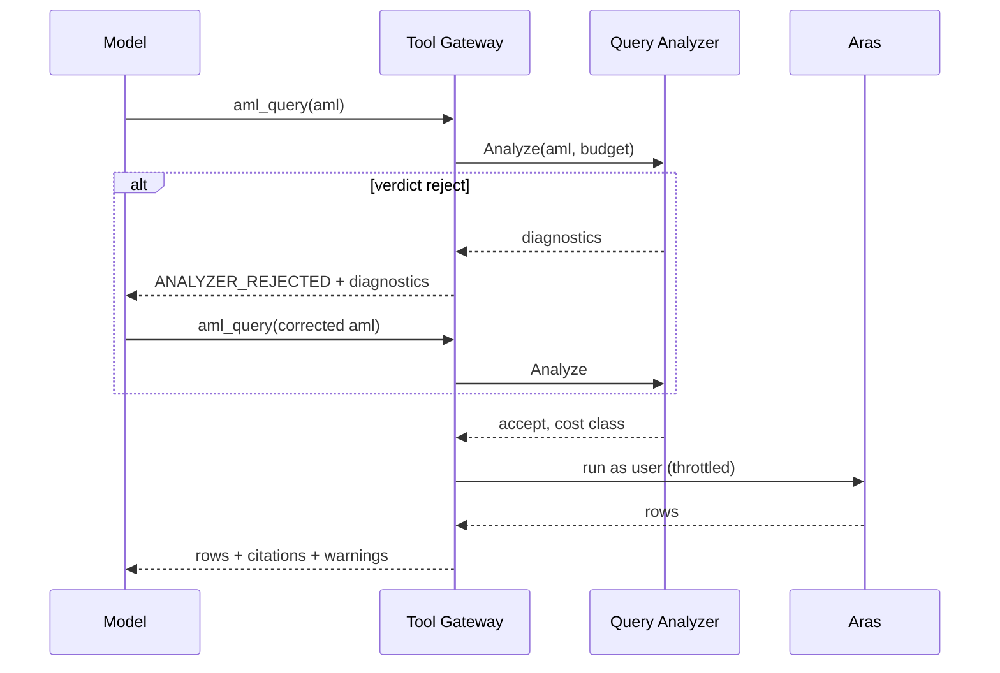

# Query Analyzer specification

Status: MVP specification. Related: [Tool Gateway](tool-gateway.md), [Tool catalog](tool-catalog.md), [Discovery](discovery.md), [Knowledge and learning](knowledge-and-learning.md), [Architecture overview](../architecture/overview.md), [Security and permissions](../architecture/security-and-permissions.md).

Aras item type, relationship, and property names used in the examples below (for example Express ECO, Affected Item, Part, `item_number`) are typical of standard Aras releases and must be verified against the target version; the names of a real installation come from discovery.

## 1. Purpose

The Query Analyzer checks every AML request the model writes before it reaches Aras. It has two jobs:

1. **Validity.** Catch queries that Aras would run without complaint but that do not mean what the model intended. Aras commonly ignores criteria on properties that do not exist, attributes it does not recognise, and values that match nothing, and returns a result that looks plausible. An ignored filter can turn "open ECOs assigned to me" into "every ECO". This is the main source of silent wrong answers when a model writes queries, and the analyzer is one of the product's two hallucination controls (the other is citations).
2. **Cost.** Catch queries that would put avoidable load on the production Aras server: no row limit, select-all, deep nesting, broad wildcards. Every analysed query gets a cost class that the Throttle uses.

Findings go back to the model as structured diagnostics with suggestions, so it can correct the query and retry. The analyzer never rewrites a query silently.

## 2. Responsibilities and non-responsibilities

Responsible for:

- parsing AML and rejecting anything that is not an allowed read action (read-only enforcement);
- checking every item type, property, relationship type, attribute, list value, lifecycle state, and value type against the discovered schema;
- checking structural cost and assigning a cost class and an estimated row ceiling;
- producing diagnostics in the shared shape defined in [Tool catalog](tool-catalog.md) section 3.3;
- reporting which discovered schema elements a query used, so a failing query built from a learned entry can mark that entry uncertain (see [Knowledge and learning](knowledge-and-learning.md)).

Not responsible for:

- permissions. Aras enforces them when the query runs as the user; the analyzer neither grants nor predicts access;
- executing queries, paging, or throttling (see [Tool Gateway](tool-gateway.md));
- estimating cost from data volumes. The analyzer does not count rows in Aras; its cost model is structural. **Proposed**, see open question 2;
- knowing about server methods attached to item types (for example onBeforeGet-style server events) beyond flagging their presence when Discovery has recorded them.

## 3. Interfaces

The analyzer is an internal component of the Tool Gateway. It has one operation.

| Operation | Caller | Inputs | Outputs | Errors |
|---|---|---|---|---|
| Analyze | Tool Gateway, for `aml_query`, `aml_fetch`, and the scoping query of `start_background_job` | AML text; calling tool; the turn's remaining question budget; schema snapshot reference | Verdict (`accept`, `accept_with_warnings`, `reject`); list of diagnostics; cost class (`light`, `moderate`, `heavy`); estimated row ceiling; list of schema elements used; normalised query fingerprint | None. A parse failure is a `reject` verdict with rule QA-V01, not an exception. An analyzer internal fault is reported to the gateway, which fails the call with `INTERNAL` and does not run the query. |

The **query fingerprint** is a hash of the query with literal values removed. It is used for audit grouping and repeated-rejection detection, and stored with the audit event.

The **schema elements used** list contains, for each element the query referenced, its kind, name, and parent, recorded as the configuration item id plus, for an element below the level of a configuration item (a property, list value, lifecycle state, or workflow activity), the element id. This form matches the dependencies recorded for learned entries (see [Knowledge and learning](knowledge-and-learning.md)). The gateway records the list with the tool call.

## 4. Data owned

The analyzer owns no tables. It reads the discovered schema held by [Discovery](discovery.md) in [config_items](persistence.md#config_items), through an in-memory index the Tool Gateway rebuilds when Discovery publishes a new snapshot. Diagnostics are stored by the gateway with the tool call in [tool_calls](persistence.md#tool_calls).

## 5. Behaviour

### 5.1 Analysis steps

1. Parse the AML. Failure: QA-V01, reject, stop.
2. Walk every `Item` element, top level and nested (relationships and item-valued property criteria), recording its depth.
3. For each element, run the validity rules (5.3) against the discovered schema, then the cost rules (5.4).
4. Combine: any `reject` diagnostic gives a `reject` verdict; otherwise any `warn` gives `accept_with_warnings`; otherwise `accept`.
5. Compute the cost class (5.5) and the estimated row ceiling (the product of page sizes along the deepest relationship path, capped).
6. Check the estimate against the remaining question budget (rule QA-C10).
7. Return the verdict, diagnostics, cost class, ceiling, elements used, and fingerprint.

The analyzer is deterministic: the same query against the same schema snapshot always gives the same verdict.

### 5.2 Suggestions

Where a rule finds an unknown name or value, suggestions are generated from the discovered schema: up to 5 closest names by edit distance and by label match, preferring elements on the same item type. When the model used a label where a name is required (a common mistake, since users speak in labels), the suggestion names the matching name explicitly, for example "label 'Delay Reason' is property 'delay_reason'".

### 5.3 Validity rules

Aras names below (attributes such as `select`, `maxRecords`, `pagesize`, `page`, `levels`, `condition`, and properties such as `id`, `config_id`, `is_current`, `generation`, `keyed_name`) are typical of standard Aras releases and must be verified against the target version. The analyzer's list of recognised attributes and system properties is a versioned rule table, not hard-coded knowledge (Proposed).

| Rule | Detects | Severity | Diagnostic to the model | Expected model reaction |
|---|---|---|---|---|
| QA-V01 | AML that is not well-formed, or whose root is not a recognisable AML request. | reject | Parse error with the position, for example "unclosed element Item at line 3". | Fix the syntax and resubmit. |
| QA-V02 | Any action other than an allowed read action. The allowed list is a read-only allowlist (typically `get`; Proposed: also the read actions Aras uses for structure retrieval, once verified). Covers write actions (add, edit, update, delete, merge, lock, version, promote), calls of server methods by name, and any action not on the allowlist. | reject (error code `NOT_READ_ONLY`) | "Action 'edit' is not allowed; this product is read-only." | Do not retry. If the user asked for a change, explain that the product cannot make changes in Aras. |
| QA-V03 | Item type name that is not in the discovered schema. | reject | "Unknown item type 'ECO'." Suggestions: closest item type names and labels, for example "Express ECO". | Use a suggested name. The Main Agent may call `schema_describe` with `search`; a worker, which has no schema tool, re-reads the schema extract in its brief. |
| QA-V04 | Property used in criteria (as a child element or in a condition) that does not exist on that item type. Aras typically ignores such criteria, so the query would silently return unfiltered results. | reject | "Property 'status' does not exist on 'Part'; Aras would ignore this filter." Suggestions: closest properties, for example "state". | Replace with the right property; if none fits, the Main Agent calls `schema_describe` for the item type and a worker re-reads the schema extract in its brief. |
| QA-V05 | Relationship type that does not exist, or exists but whose source is a different item type than the one it is nested under. | reject | "Relationship 'Affected Item' is not defined on 'Part'; its source is 'Express ECO'." | Restructure the query from the correct source item type, or use the right relationship. |
| QA-V06 | A property in a `select` list that does not exist on the item type. Aras typically omits it silently, so the model would read it as empty. | reject | "Select lists unknown property 'owner'." Suggestions, for example "owned_by_id". | Fix the select list. |
| QA-V07 | A value compared with a list-typed property that is neither a value nor a label of that list. When it matches a label but not a value, the diagnostic says so. | reject | "Value 'Released' is not in list 'Part Classification'. Valid values: ..." or "'In Review' is a label; the stored value is 'in_review'." | Use a valid stored value. |
| QA-V08 | A value compared with the state property that is not a state of any lifecycle map attached to the item type. | reject | "State 'Approved' does not exist in the lifecycle maps of 'Express ECO'. States: ..." | Use a listed state, or ask the user which state they mean. |
| QA-V09 | A literal whose type does not fit the property's data type: non-date in a date property, non-number in a numeric property, non-boolean in a boolean property, malformed date format. | reject | "Property 'created_on' is a date; '2024-13-40' is not a valid date. Expected format: ..." | Fix the literal. |
| QA-V10 | A condition operator that does not suit the data type, for example `like` on a number or `between` on a boolean. | warn | "Operator 'like' on numeric property 'cost' compares text and may not behave as intended." | Prefer a numeric comparison; proceed only if intended. |
| QA-V11 | Nested item criteria under a property that is not item-valued. | reject | "Property 'name' is not an item property; nested Item criteria are not allowed here." | Remove the nesting or use the correct item property. |
| QA-V12 | An attribute that the rule table does not recognise on the element, for example a misspelled paging attribute. Aras typically ignores unknown attributes, so a misspelled limit becomes no limit. | reject | "Attribute 'page_size' is not recognised; Aras would ignore it. Did you mean 'pagesize'?" | Fix the attribute name. |
| QA-V13 | A range whose lower bound is after its upper bound, or a date range entirely in the future for a creation or closure date. | warn | "Range on 'closed_date' has start after end; the query will return nothing." | Correct the range. |
| QA-V14 | A value for `id` or an item-property id criterion that is not in the Aras id format (typically 32 hexadecimal characters). | reject | "'ECO-0042' is not an Aras id; filter on 'item_number' or 'keyed_name' instead." | Filter on a name or number property. |
| QA-V15 | Criteria or sorting on a property that Discovery recorded as computed, federated, or populated by a server method rather than stored. Such filters may be ignored or may behave differently from stored properties. | warn | "Property 'total_cost' is computed; filtering on it may not work as expected. Consider fetching and filtering in analysis." | Remove the filter and filter the fetched results with code, or accept the warning. |
| QA-V16 | A query on a versionable item type that does not state which generations are wanted. Whether Aras returns only current generations by default must be verified per version; the analyzer reports the ambiguity rather than assuming. | warn | "'Part' is versionable; state whether you want only current generations (is_current) or all generations." | Add the generation criterion that matches the question. |
| QA-V17 | Criteria on an item type that Discovery recorded as having read-time server events (for example an onBeforeGet-style handler). Results may be filtered or altered by the server. | warn | "'Document' has a read-time server event; results may be filtered by server logic. Report counts as 'as returned by Aras'." | Proceed; mention it in coverage when counting. |
| QA-V18 | A query that references a schema element whose discovered definition is marked as changed since the last snapshot and is still being re-read. | warn | "Schema for 'Express ECO' is being refreshed; names were checked against the previous snapshot." | Proceed; if the query is rejected by Aras, the Main Agent re-checks with `schema_describe` and a worker re-reads the schema extract in its brief. |

### 5.4 Cost rules

| Rule | Detects | Severity | Diagnostic to the model | Expected model reaction |
|---|---|---|---|---|
| QA-C01 | Select-all: an `Item` element with no `select` list. | warn when the element has a row limit of at most 25 and is not in an `aml_fetch`; reject otherwise. | "No select list on 'Express ECO'; Aras would return every property. Select only the properties you need." | Add a `select` with the needed properties. |
| QA-C02 | No row limit and no paging on a top-level `Item` (neither a maximum-record attribute nor a page size). | reject | "Query has no row limit or paging. Add a page size of at most 500." | Add paging; for large sets use `aml_fetch`, which fetches all pages. |
| QA-C03 | Page size or maximum-record value above `gateway.max_page_size`. | reject | "Page size 5000 exceeds the maximum of 500. Use paging; aml_fetch fetches all pages." | Reduce the page size. |
| QA-C04 | Nesting depth of related items. | warn at depth 3; reject above `analyzer.max_nesting_depth` (Proposed default 3, so depth 4 and deeper is rejected). | "Nesting depth 4 exceeds the maximum of 3. Fetch the levels separately and join them in analysis." | Split into separate queries; join in the Sandbox. |
| QA-C05 | Broad wildcards: a pattern that is only a wildcard (matches everything), or a leading wildcard on a text property. | reject for a pattern that matches everything (it is a no-op filter that hides an unfiltered query); warn for a leading wildcard. | "Pattern '%' matches everything; remove it or use a real filter." / "Leading wildcard in '%valve%' prevents index use and scans broadly." | Use a real filter; for leading wildcards, prefer an exact or prefix match, or accept the warning when needed. |
| QA-C06 | An unfiltered top-level query: no criteria at all other than paging. | warn | "No filter on 'Part'. This will page through every part you can see." | Add a filter that matches the question (time window, state, owner), or proceed if the question really covers all. |
| QA-C07 | Relationship fan-out: more than `analyzer.max_relationships_per_item` (Proposed default 4) relationship types expanded under one item. | reject | "6 relationships expanded under 'Part'. Fetch them in separate queries." | Split the query. |
| QA-C08 | Large value lists: an `in` condition or OR group with more than `analyzer.max_in_values` (Proposed default 200) values. | warn above 200, reject above `analyzer.max_in_values_reject` (Proposed default 1,000). | "1,400 values in an 'in' list; split into batches of at most 1,000, or filter by a parent item." | Batch the query, or filter by a relationship. |
| QA-C09 | Selecting large text or file-content properties across many rows (Discovery records text and formatted-text properties with no length limit). | warn | "'description' is a long text property; selecting it for 500 rows is heavy. Use aml_fetch for analysis." | Use `aml_fetch`, or select it only for the rows needed. |
| QA-C10 | Estimated row ceiling, or the query count after this query, exceeds the remaining question budget. | reject (error code `BUDGET_EXHAUSTED` when nothing remains; `ANALYZER_REJECTED` when this query alone is too big) | "Estimated up to 250,000 rows; the remaining budget is 12,000 rows. Narrow the query." | Narrow, or answer with partial coverage. |
| QA-C11 | Recursive expansion depth: a levels-style attribute (or the version's equivalent) larger than `analyzer.max_levels` (Proposed default 2). | reject | "Recursive expansion of 10 levels is not allowed; the maximum is 2. Fetch level by level." | Fetch one level at a time and recurse in analysis. |
| QA-C12 | `aml_query` (direct to the model) with an estimated row ceiling above the model return cap (100 rows). | warn | "This query may return up to 500 rows; only 100 will be shown. If you need all of them, use start_analysis." | Narrow, or hand the work to an Analysis Worker. |

### 5.5 Cost class

| Class | Assigned when | Throttle effect (see [Tool Gateway](tool-gateway.md)) |
|---|---|---|
| `light` | Has a filter, row ceiling at most 100, nesting depth at most 1. | Normal query slot. |
| `moderate` | Row ceiling at most 500 per page, nesting at most 2, no QA-C05, QA-C06, or QA-C09 warning. | Normal query slot. |
| `heavy` | Anything else that is accepted: unfiltered, leading wildcard, long-text selection, depth 3, or multi-page fetch above 5,000 rows. | Counts as two concurrency units; subject to the system-wide heavy-query limit. |

All thresholds are Proposed defaults.

### 5.6 Interaction with learned knowledge

When a query fails validity rules and the model's turn had loaded learned entries that refer to the rejected elements, the Tool Gateway reports the rejected element names and the loaded entry ids to the Knowledge Service through its Mark uncertain operation, and the Knowledge Service marks those entries uncertain (see [Knowledge and learning](knowledge-and-learning.md#52-state-machine)). The analyzer itself only reports which elements were rejected.

### 5.7 Interaction diagram

## 6. Configuration

| Key | Type | Default | Meaning |
|---|---|---|---|
| `gateway.max_page_size` | integer | 500 (Proposed default) | Maximum page size or record limit (QA-C03). |
| `analyzer.max_nesting_depth` | integer | 3 (Proposed default) | Maximum nesting depth (QA-C04). |
| `analyzer.max_relationships_per_item` | integer | 4 (Proposed default) | Maximum relationship types expanded under one item (QA-C07). |
| `analyzer.max_in_values` | integer | 200 (Proposed default) | Warning threshold for value lists (QA-C08). |
| `analyzer.max_in_values_reject` | integer | 1,000 (Proposed default) | Rejection threshold for value lists (QA-C08). |
| `analyzer.max_levels` | integer | 2 (Proposed default) | Maximum recursive expansion (QA-C11). |
| `analyzer.select_all_small_limit` | integer | 25 (Proposed default) | Row limit under which select-all is only a warning (QA-C01). |
| `analyzer.allowed_actions` | list of strings | read actions only (Proposed default: `get`) | The read-only allowlist (QA-V02). Values are verified per Aras version; write actions can never be added. |
| `analyzer.rule_overrides` | map of rule to severity | none | Lets an operator downgrade a warning-level rule to off, or raise a warning to reject. QA-V01 to QA-V06, QA-V12, and QA-C02 cannot be downgraded. **Proposed.** |

## 7. Limits

- Maximum AML size analysed: 256 KB (Proposed). Larger requests are rejected as QA-V01 with a size message.
- Analysis time target: under 50 milliseconds for a typical query (Proposed), so it never dominates latency.
- The analyzer only knows what Discovery has read. Elements Discovery could not read are unknown, and queries using them are rejected with a message saying the schema element was not discovered.

## 8. Failure modes and recovery

| Failure | Detection | Effect on user | Recovery |
|---|---|---|---|
| Schema snapshot missing (first start, Discovery not yet finished) | Gateway has no index | Questions wait or fail with a clear message | Gateway returns `ARAS_UNAVAILABLE` with "schema discovery in progress"; Discovery runs at conversation start. |
| Schema stale after an Aras configuration change | Discovery change check | Some valid queries rejected, or ignored-field errors slip through | QA-V18 warning while refreshing; Discovery re-reads changed items cheaply via modification stamps. |
| False rejection (rule table wrong for this Aras version) | Rising rejection rate on one rule; operator report | Model cannot express a valid query | Operator override for warning rules; rule table fix in a product release. Core validity rules are not overridable. |
| False acceptance (ignored field slips through) | Not detectable by the analyzer | A wrong answer is possible | Citations let the user check; a correction marks related knowledge uncertain; rule table improved. |
| Analyzer internal fault | Exception in analysis | Query not run | `INTERNAL`; the query is never run unanalysed. |

## 9. Security considerations

- The analyzer is the enforcement point for read-only. Rule QA-V02 cannot be disabled or overridden, and the allowlist can only contain read actions. A query that is not provably read-only is not run.
- The analyzer fails closed: when in doubt (parse ambiguity, unknown action), it rejects.
- The analyzer does not decide access. A query it accepts is still run as the user and is subject to Aras permissions.
- Diagnostics reveal only schema information, which every Aras user can already read.

## 10. Observability

- Every analysis is stored with its tool call: verdict, rule ids, cost class, fingerprint.
- Metrics: rejections per rule, warnings per rule, retry success rate after rejection (by rule), cost-class distribution, queries rejected for budget.
- A rising rate of QA-V03, QA-V04, or QA-V06 for one item type is a signal that the discovered schema or the product skill on AML needs attention.

## 11. MVP versus deferred

In MVP: all rules above, structural cost model, rule table per supported Aras version.

Deferred (see [Roadmap](../product/roadmap.md)):

- data-volume-based cost estimates (for example approximate counts per item type);
- analysis of an SQL path, if one is ever added, which must preserve Aras permissions;
- operator-facing rule editing beyond the overrides above.

## 12. Open questions

1. **Proposed:** the exact allowlist of read actions beyond `get`. It must be verified per supported Aras version, and every addition must be shown to have no side effects.
2. **Proposed:** a structural cost model only. Would cheap approximate counts per item type (obtained as the user) improve the heavy classification enough to justify the extra queries?
3. **Proposed:** all numeric thresholds in sections 5.4 to 7.
4. **Proposed:** the operator override mechanism and which rules it may touch.
5. **Proposed:** QA-C01 severity split (warn for tiny direct lookups, reject otherwise).
6. How should the analyzer treat queries on item types whose discovered definition is incomplete because the user could not read part of the configuration? Proposed: reject with a "not discovered" message rather than guessing.
