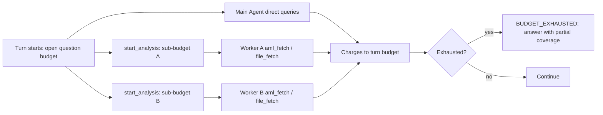

# Tool Gateway specification

Status: MVP specification. Related: [Tool catalog](tool-catalog.md), [Query Analyzer](query-analyzer.md), [File Service](file-service.md), [Analysis Worker and Sandbox](analysis-worker-and-sandbox.md), [Background Jobs](background-jobs.md), [Persistence](persistence.md), [Security and permissions](../architecture/security-and-permissions.md), [Architecture overview](../architecture/overview.md).

## 1. Purpose

The Tool Gateway is the only component that talks to Aras. Every read of Aras data, configuration, or vault files passes through it, as the signed-in user. It exists so that four guarantees hold in one place rather than being spread across agents and prompts:

1. **Permissions are Aras's own.** Every request runs with the user's own Aras credentials, so the user sees through the product exactly what they could see in Aras, and nothing more.
2. **Read-only.** Nothing that is not provably a read reaches Aras.
3. **Load is bounded.** Every query is analysed for cost and passed through the Throttle, so analytical questions cannot saturate the production Aras server.
4. **Every source is citable.** Every record, file passage, and knowledge entry that an answer may cite is registered with an id before the model sees it.

The gateway contains five sub-components: the **AML Executor**, the **Query Analyzer** (specified in [query-analyzer.md](query-analyzer.md)), the **Throttle**, the **File Service** (specified in [file-service.md](file-service.md)), and the **Citation Registry**. This document specifies the gateway as a whole, the AML Executor, the Throttle, the Citation Registry, and credential handling.

## 2. Responsibilities and non-responsibilities

Responsible for:

- holding each user's Aras credentials and renewing them; holding job-scoped renewable credentials for background jobs;
- executing AML as the user, including paging for `aml_fetch`;
- running the Query Analyzer on every query and refusing rejected ones;
- enforcing per-user and system-wide concurrency, question budgets, job budgets, and timeouts;
- writing fetched results into the conversation's Sandbox as files, through the Sandbox file channel;
- registering every citable source and resolving citation ids for display;
- emitting an audit event for every request to Aras.

Not responsible for:

- deciding what to ask (agents decide);
- permission decisions (Aras decides; the gateway never filters or widens results on its own);
- caching query results (deferred; there is no result cache in MVP);
- text extraction (the File Service does it inside the gateway);
- storing a history of Aras data (the product keeps none).

## 3. Interfaces

### 3.1 Agent-facing tools

The gateway serves the following tools. Their full contracts are in [Tool catalog](tool-catalog.md).

| Tool | Agent | Gateway path |
|---|---|---|
| `aml_query` | Main Agent | Analyzer, Throttle, AML Executor, Citation Registry, rows to model |
| `aml_fetch` | Analysis Worker | Analyzer, Throttle, AML Executor (all pages), Citation Registry, file into Sandbox |
| `file_read` | Main Agent | Throttle, File Service, Citation Registry, text to model |
| `file_fetch` | Analysis Worker | Throttle, File Service, Citation Registry, files into Sandbox |

Knowledge tools (`schema_describe`, `knowledge_index`, `knowledge_read`) do not touch Aras and are served through the [Knowledge Service](knowledge-and-learning.md); `schema_describe` answers from the configuration that [Discovery](discovery.md) has stored. Their knowledge citations are registered through the Citation Registry interface below.

### 3.2 Internal service interfaces

| Operation | Caller | Inputs | Outputs | Errors |
|---|---|---|---|---|
| Establish user credential | The service's sign-in handler, at sign-in | User, auth session, Aras token material the service obtained from the Aras authorization server | Credential reference | `ARAS_AUTH_EXPIRED` (token invalid), `ARAS_UNAVAILABLE` |
| Drop user credential | The service's sign-in handler, at sign-out or the end of the session | Auth session | None | None |
| Issue job credential | Background Jobs, at user confirmation | Background job, requesting user, the user's live credential | Job credential reference, expiry (where the installation issues renewable grants; otherwise the job runs on the user's session credential) | `ARAS_AUTH_EXPIRED` |
| Renew job credential | Background Jobs, on schedule | Job credential reference | New expiry | `ARAS_AUTH_EXPIRED` (job pauses), `NOT_FOUND` |
| Drop job credential | Background Jobs, at job end | Job credential reference | None | None |
| Run configuration read | Discovery | AML for configuration items (fixed template queries, marked system-origin), user | Configuration rows | As for `aml_query`; validity analysis is skipped for system-origin templates and no question budget is charged (5.2) |
| Open question budget | Main Agent, at turn start | Turn | Budget reference | None |
| Allocate sub-budget | Main Agent, for `start_analysis` | Budget reference, requested share | Sub-budget reference | `BUDGET_EXHAUSTED` |
| Close question budget | Main Agent, at turn end | Budget reference | Final usage | None |
| Register citations | Knowledge Service, Analysis runtime | Conversation, turn, tool call, source descriptions | Citation ids | `INVALID_INPUT` |
| Resolve citation | Main Agent (validation), Chat App (display) | Conversation, citation id | Citation record, Aras link | `NOT_FOUND` |
| Write Sandbox file | AML Executor, File Service | Sandbox, relative path, content stream | Bytes written | `SANDBOX_UNAVAILABLE`, `PATH_INVALID`, `RESULT_TOO_LARGE` (a write over the Sandbox disk quota) |
| Health | Operations | None | Aras reachability, schema snapshot age, throttle occupancy | None |

The gateway is a service boundary: the Main Agent, Analysis Worker runtime, Discovery, and Background Jobs reach Aras only through these operations. In the MVP the gateway is a module of the one service: the credential tables are encrypted and are reachable only through the gateway's interface. As an optional production-hardening setup, the gateway can run as its own process (or set of processes) with its own database role, so that a compromise of an agent process does not expose stored Aras credentials; the deployment document shows the option ([ADR 0037](../decisions/0037-single-instance-mvp-and-optional-gateway-process.md)).

## 4. Data owned

| Table | Sub-component | Summary | Schema |
|---|---|---|---|
| `aras_credentials` | Credentials | One row per signed-in auth session: user, encrypted Aras access token and refresh material, expiry, last renewal. The row is deleted at sign-out or when the session ends; the sign-out time stays on the auth session. | [aras_credentials](persistence.md#aras_credentials) |
| `job_credentials` | Credentials | One row per background job: job, user, encrypted renewable credential, scope (the job), expiry, last renewal, dropped time. | [job_credentials](persistence.md#job_credentials) |
| `citations` | Citation Registry | One row per citable source per conversation: id, conversation, turn, tool call, kind, item type, Aras id, keyed name, file id, file name, locator, parent item, knowledge entry id, knowledge version, state, and confirmation at citing, link. | [citations](persistence.md#citations) |
| `throttle_leases` | Throttle | One row per in-flight query slot: user, scope (`interactive` or `background`), cost class, units, acquired time, lease expiry, holder (tool call or background job). Every lease counts against both its user's limit and the system-wide limit. Required when more than one service instance runs; a single instance may keep leases in memory (5.3). | [throttle_leases](persistence.md#throttle_leases) |
| `question_budgets` | Throttle | One row per turn and per sub-budget (worker or job): limits and consumed queries, rows, bytes, wall time; parent budget. | [question_budgets](persistence.md#question_budgets) |

The gateway writes tool call results into [tool_calls](persistence.md#tool_calls) (owned by the Main Agent) and audit events into [audit_events](persistence.md#audit_events) (owned by Audit and progress) through their owners' interfaces.

The gateway stores no Aras query results. Rows returned to the model become part of the conversation transcript (owned by the Main Agent); rows fetched for analysis live only in the Sandbox and expire with it.

## 5. Behaviour

### 5.1 Credentials

1. **Sign-in.** The Aras authorization server is the only sign-in path ([ADR 0033](../decisions/0033-sign-in-through-the-aras-authorization-server.md)). The browser is redirected to Aras, and the service's sign-in handler exchanges the returned code for Aras token material (see [Chat App](chat-app.md)); Aras Insight never sees the user's password. An installation without an authorization server is not supported in the MVP: it is a deployment prerequisite and is checked by the compatibility checks in [Deployment and operations](../architecture/deployment-and-operations.md). The handler passes the token material to the gateway, which validates it with one lightweight request to Aras, encrypts it, and stores it in `aras_credentials`. The browser holds only an opaque product-session cookie; it never receives the Aras token. Encryption uses one key supplied by the deployment as an environment variable or a mounted secret file (referenced by `gateway.credential_encryption_key_ref`), never stored in the database ([ADR 0034](../decisions/0034-credentials-encrypted-at-rest.md)).
2. **Use.** Every Aras request looks up the credential for the conversation's auth session, decrypts it in memory for the request only, and attaches it.
3. **Renewal.** When Aras indicates expiry, or the stored expiry is near (by default within 5 minutes, `gateway.credential_renew_margin_seconds`), the gateway renews with the stored refresh material, if the Aras authorization server issued it. If renewal fails, the request fails with `ARAS_AUTH_EXPIRED`; the Main Agent ends the turn as `failed` with reason `auth_expired`, keeping everything done so far in the transcript. After the user signs in again, the Chat App offers to continue, which starts a new turn that resumes from the saved transcript (see [Main Agent](main-agent.md)).
4. **Sign-out and session end.** At sign-out, the credential row is deleted and the tokens are discarded (Aras is not asked to revoke them); the sign-out time stays on the auth session and a `credential.dropped` audit event is written. Running turns of that session are cancelled. A running turn counts as session activity, so the idle limit never ends a session while a turn runs; when the absolute session lifetime ends, the credential row is deleted in the same way and a running turn ends `failed` with reason `auth_expired`, so the user can continue it after signing in again. Background jobs are not cancelled by sign-out: where the installation issues a renewable grant they continue on their own job credential; where it does not, a job runs on the user's session credential and pauses when that session ends.
5. **Job credentials.** When a user confirms a background job, the gateway derives a job credential from the user's live credential: a separately issued renewable refresh grant, where the installation's Aras authorization server issues one. Whether it does is a property of the installation and the target Aras version, which the compatibility checks verify; where it does not, the job borrows the user's session credential, runs only while that session lives, and pauses when the session ends. No other identity is ever used. A job credential is usable only for requests carrying that job's id, is renewed on a schedule (`gateway.job_credential_renew_seconds`, default every 15 minutes), has a hard maximum lifetime (`gateway.job_credential_max_hours`, default 24 hours; these keys are defined here and referenced by [Background Jobs](background-jobs.md)), and is dropped when the job ends, fails, or is cancelled: Aras is asked to revoke it where it supports that, the secret material is deleted, and the timestamps are kept. If the credential cannot be renewed (the account is disabled, access is revoked, the grant expires) or its hard lifetime ends, the job pauses with its checkpoint, the user is notified, and the job resumes from its last completed item after the user signs in again; a job not resumed within `jobs.max_pause_hours` (default 72 hours) is cancelled ([ADR 0035](../decisions/0035-job-credential-lifecycle.md)).

The gateway never uses a service account or administrator identity to read Aras data. Discovery also runs as the user.

### 5.2 Request path for `aml_query` and `aml_fetch`

1. Receive the tool call with its session context (user, conversation, turn, budget, and for workers the job and Sandbox).
2. Run the Query Analyzer. It also compares the query's estimated size with what remains of the question budget (rule QA-C10), because it can tell the model how to narrow the query. On `reject`, return `ANALYZER_REJECTED` or `NOT_READ_ONLY` with the diagnostics, or `BUDGET_EXHAUSTED` when nothing remains of the budget. The query is not sent.
3. Check that the question budget (or sub-budget) is not already exhausted. If it is, return `BUDGET_EXHAUSTED`.
4. Acquire a query slot from the Throttle (5.3). If none is available within the admission wait, return `THROTTLED` with `retry_after_ms`.
5. Send the AML to Aras as the user, with the request timeout.
6. On an Aras fault, map it (5.4) and return the mapped error. When Aras refuses an item type the stored schema lists, or names a property the stored schema does not contain, or the Query Analyzer reports another inconsistency between a query and the stored schema, the gateway asks [Discovery](discovery.md) for an early change check (reason `inconsistency_check`). The check bypasses Discovery's minimum interval but is made at most once per short window, so one bad query cannot cause a storm of checks.
7. Parse the result into rows. Register every item and nested related item in the Citation Registry.
8. For `aml_query`: apply `max_rows` and the character cap (rows beyond the cap are left out and the result is marked `truncated` with a `truncation_hint` and, where Aras reported it, `total_rows_reported`; if the text alone exceeds the character cap at the row cap, return `RESULT_TOO_LARGE` instead of rows), flatten, attach citation ids, and return.
9. For `aml_fetch`: write rows to the Sandbox file as they arrive, with each row's citation id; if `all_pages` is set, repeat steps 3 to 7 for the next page until the last page, `max_rows`, the budget, or the time limit; then write the citation manifest and return the summary.
10. Release the slot after each page, charge rows, bytes, and time to the budget, and record the tool call and audit event.

Discovery's template queries (the configuration read) use the same path with three differences. They are marked system-origin in the audit record. They skip validity analysis: they are fixed product text, verified for each supported Aras version before release, and the read-only check still applies to them. And no question budget is charged, because a background check must not consume the budget of the user's question; they do use the triggering user's query slots and the system-wide Throttle limits.

### 5.3 Throttle

The Throttle protects the Aras server and shares capacity fairly.

| Limit | Scope | Default | Behaviour when reached |
|---|---|---|---|
| Concurrent queries per user | User, across all their conversations, workers, and jobs | 2 | Wait in a per-user queue up to the admission wait, then `THROTTLED`. |
| Concurrent queries system-wide | Whole deployment | 8 | Wait in a fair queue (round-robin across users), then `THROTTLED`. |
| Concurrent heavy queries system-wide | Queries with cost class `heavy` | 2 | Heavy queries wait; light and moderate queries are not blocked behind them. |
| Query timeout | Each request to Aras | 60 seconds | Request abandoned; `TIMEOUT`. |
| Question budget | Per turn, including all its workers | 200 queries, 50,000 rows, 200 MB fetched, 30 minutes wall time | `BUDGET_EXHAUSTED`; the agent answers with partial coverage. |
| Job budget | Per background job | A total bytes cap and a total wall-time cap, set in [Background Jobs](background-jobs.md) in addition to the scan's file cap and per-minute query rate | Job pauses or completes partially. |
| Admission wait | Each request | 10 seconds | `THROTTLED` with `retry_after_ms`. |

Rules:

1. A `heavy` query occupies two concurrency units of the user's and the system's allowance.
2. Interactive turns are served before background jobs: a background job's request is admitted only when the system-wide occupancy is below a configured share (`throttle.background_share`, default 0.5: background jobs may use at most half of the system-wide slots), so a long scan never delays a user's question.
3. Leases have an expiry slightly longer than the query timeout; an expired lease is reclaimed, so a crashed process cannot hold capacity.
4. Throttle state lives in the database (`throttle_leases`, `question_budgets`) when more than one service instance runs, so limits hold across processes. A single-instance deployment, which is the MVP default, may keep leases in memory, but budgets are always persisted so a resumed turn keeps its accounting.
5. Abandoned queries (timeout or cancellation) are not retried automatically by the gateway; the model decides.
6. Waiting and retrying after `THROTTLED` or `TIMEOUT` is bounded only by the question budget (its query count and wall time); the gateway sets no further cap. The agent waits as the result's `retry_after_ms` advises.

### 5.4 Aras error mapping

| Aras outcome | Error code | Notes |
|---|---|---|
| Fault meaning "no items found" | Not an error | Returned as zero rows. The gateway records every zero-row result of `aml_query` or `aml_fetch` as the `empty_result` learning signal (see [Knowledge and learning](knowledge-and-learning.md)). |
| Fault meaning authentication failure or expired session | `ARAS_AUTH_EXPIRED` after one renewal attempt | |
| Fault meaning access denied | `PERMISSION_DENIED` | Not retried. |
| Other fault with a fault string | `ARAS_ERROR` | Message carries the fault code and fault string, with internal details (stack traces, server paths) removed. |
| Connection failure, server error status, malformed response | `ARAS_UNAVAILABLE` | Retryable. |
| No response within the timeout | `TIMEOUT` | |

The exact form of Aras faults (for example the fault code for "no items found") varies by version. The mapping is a versioned table like the analyzer's rule table, with one table per supported Aras version, shipped with product releases; the list of supported versions is kept with the deployment compatibility checks in [Deployment and operations](../architecture/deployment-and-operations.md). A fault that is not verified for the installation's version maps to `ARAS_ERROR` with its fault code and string; it is never assumed to mean "no items found".

### 5.5 Citation Registry

1. Every tool that returns or writes citable content asks the registry to register each source before the result is released: records (item type, Aras id, keyed name), file segments (file id, file name, locator, parent item), whole files reported as unreadable, unsupported, or too large (file id, file name, parent item; a file the user may not access is not registered or named), and knowledge entries (entry id, layer, kind, version, state, confirmation, and the confidence computed from them). Knowledge citations are registered for discovered and learned entries only; no citation is registered for product skills or for the user's own preferences.
2. Within a conversation, the same source is registered once: registering the same item, the same file segment, or the same knowledge entry with the same version, state, and confirmation again returns the existing id. A knowledge entry whose version, state, or confirmation changed since it was registered gets a new id, so a citation always shows the entry as the answer relied on it.
3. Ids are opaque, prefixed `cit_`, and unique within the deployment. The registry also records **citation sets** (prefix `cst_`, table [citation_sets](persistence.md#citation_sets)): each `aml_fetch` call registers one set over every record it wrote, and `submit_report` may register narrower sets; a set groups record citations and is not a fourth citation kind (see [tool catalog](tool-catalog.md#35-citation-summaries)).
4. **Resolve** returns the stored record and builds the link that opens the source in Aras: an item link from the configured Aras base address, item type, and Aras id; a file link through the parent item where one was recorded. Links use the Aras client's standard deep-link form for the target version, which the compatibility checks in [Deployment and operations](../architecture/deployment-and-operations.md) verify for each supported version; the link is a navigation aid only and Aras re-checks access when it is opened.
5. Resolve is scoped to the conversation: an id from another conversation returns `NOT_FOUND`, so one user cannot resolve another user's citations.
6. Citations live as long as the conversation's transcript and are deleted with it.

### 5.6 Writing into the Sandbox

The gateway writes fetched results and file text into the conversation's Sandbox through a **Sandbox file channel** controlled by the service host: the Sandbox has no network and never connects to the gateway or to Aras. The rule is that the Sandbox has no network path and the host-side write is the only inbound path. The reference design is a per-Sandbox data directory mounted into the container, written only by the host-side gateway and read-only to code inside, with a separate writable work directory for code output; it also covers a Sandbox on a separate host, because the host-side write stays the only inbound path. Any other mechanism that meets the rule (the container runtime's file-copy facility, or a host-side volume that only the host can write) is acceptable. See [Analysis Worker and Sandbox](analysis-worker-and-sandbox.md) for the layout and lifecycle.

1. The gateway chooses every path it writes: AML results go to `data/aml/<name>.jsonl` or `.csv` (the name defaults to the tool call id), file text to `data/files/<file id>.txt` with its segment map beside it as `data/files/<file id>.segments.json`, and an entry for each file is appended to `data/manifest.json`; code writes its own files under `work/<job id>/`. Every record is written with the reserved fields `_cite` (its citation id), `_type`, `_id`, and `_keyed_name`, and each date has a normalised `<property>__iso` beside it. A model-supplied name with path separators, parent references, or characters outside letters, digits, hyphens, and underscores is rejected with `PATH_INVALID`.
2. Writes are streamed so a large fetch never sits in gateway memory.
3. Each written file is recorded in [sandbox_files](persistence.md#sandbox_files) with its source tool call, size, row count, citation set, and manifest entry, and audited as `sandbox.write`.

### 5.7 Turn budget flow

## 6. Configuration

| Key | Type | Default | Meaning |
|---|---|---|---|
| `gateway.aras_base_url` | string | none (required) | Aras server address. |
| `gateway.aras_database` | string | none (required) | Aras database name, where the target version requires one. |
| `gateway.max_page_size` | integer | 500 | Maximum page size per request. |
| `gateway.credential_encryption_key_ref` | string | none (required) | Reference to the deployment secret (an environment variable or a mounted secret file) that holds the key used to encrypt stored credentials. |
| `gateway.credential_renew_margin_seconds` | integer | 300 | Renew credentials this long before expiry. |
| `gateway.job_credential_renew_seconds` | integer | 900 | Job credential renewal interval. |
| `gateway.job_credential_max_hours` | integer | 24 | Hard maximum lifetime of a job credential. |
| `gateway.tls_verify` | boolean | true | Verify the Aras server's certificate. |
| `throttle.user_concurrent_queries` | integer | 2 | Concurrent queries per user. |
| `throttle.system_concurrent_queries` | integer | 8 | Concurrent queries system-wide. |
| `throttle.system_heavy_queries` | integer | 2 | Concurrent heavy queries system-wide. |
| `throttle.background_share` | number | 0.5 | Maximum share of system slots usable by background jobs. |
| `throttle.query_timeout_seconds` | integer | 60 | Timeout for each request to Aras. |
| `throttle.admission_wait_seconds` | integer | 10 | Maximum queue wait before `THROTTLED`. |
| `throttle.question_max_queries` | integer | 200 | Queries per turn. |
| `throttle.question_max_rows` | integer | 50,000 | Rows per turn. |
| `throttle.question_max_bytes` | integer | 200 MB | Bytes fetched per turn, including file content. |
| `throttle.question_max_wall_seconds` | integer | 1,800 | Wall time per turn, including workers. |

Operators should size the system-wide limits to their Aras server's capacity; the defaults assume a modest single application server. The limits agreed for a pilot are recorded during pilot preparation: start at the defaults and lower them first if interactive users are affected.

## 7. Limits

- All Aras access is through the Aras server as the user. In MVP there is no read replica, reporting copy, or SQL path, so the product adds load to the production server; the Throttle and cost analysis are the controls. A path that keeps analytics off production is deferred (see [Roadmap](../product/roadmap.md)).
- No result caching: a repeated question re-runs its queries.
- Results are only as complete as the user's access; the product never reports data the user cannot see.

## 8. Failure modes and recovery

| Failure | Detection | Effect on user | Recovery |
|---|---|---|---|
| Aras unreachable | Connection failures | Questions cannot be answered; clear message in the Chat App | `ARAS_UNAVAILABLE`; health check reports it; retry when reachable. |
| Aras slow under load | Timeouts, rising latency | Slower answers, partial coverage | Throttle queues; operators can lower concurrency limits. |
| User credential expired | Aras auth fault, failed renewal | Turn ends with reason `auth_expired`; asked to sign in again | Re-establish credential; the user continues, and a new turn resumes from the saved transcript. |
| Job credential cannot be renewed, or its hard lifetime ends | Renewal failure or lifetime reached | Job pauses; user notified | User signs in again; job resumes from its last completed item; cancelled if not resumed within `jobs.max_pause_hours`. |
| Schema snapshot missing (first start, Discovery not yet finished) | The gateway has no schema index | The Chat App shows that the product is preparing and does not accept questions | `SCHEMA_NOT_READY` (not retryable; not `ARAS_UNAVAILABLE`, which tells the agent to retry); questions begin when the schema is ready. |
| Gateway process crash mid-query | Lease expiry | The tool call fails; the agent may retry | Leases reclaimed; budgets persisted; Sandbox file left incomplete is marked incomplete. |
| Sandbox write fails | Channel error, or a write that would exceed the Sandbox disk quota | Worker reports partial coverage | `SANDBOX_UNAVAILABLE`, or `RESULT_TOO_LARGE` for the disk quota; the worker retries or submits a partial report. |
| Encryption key unavailable | Startup check | Product refuses to start | Operator fixes the secret configuration. |

## 9. Security considerations

- The gateway is the most sensitive component: it holds every signed-in user's Aras credentials. Credentials are encrypted at rest, decrypted only in memory per request, never logged, never passed to a model, never written into a Sandbox, and deleted at sign-out or when the session ends. With the optional separate gateway process and database role, a compromise of an agent process cannot read even the encrypted credential rows.
- There is no privileged account. If the product is compromised, the attacker can act only as users whose sessions are live, and only read.
- Read-only is enforced by the Query Analyzer's allowlist before any request is sent (see [Query Analyzer](query-analyzer.md) rule QA-V02). The allowlist is the plain read action `get` only; another action is added only by a product release after it was verified on a named Aras version, never by editing the list at an installation.
- The model never supplies a server address, credential, or identity; the gateway takes them from configuration and the session.
- Citation resolution is scoped to the conversation owner.
- Responses from Aras are treated as data. Fault strings are sanitised before reaching the model.
- See [Security and permissions](../architecture/security-and-permissions.md) for the end-to-end trust model.

## 10. Observability

- **Audit:** one `aras.query` audit event per request to Aras (`aras.query_rejected` when the Query Analyzer or Throttle refuses it; `credential.issued`, `credential.refreshed`, `credential.expired`, and `credential.dropped` for credentials; `sandbox.write` for Sandbox writes), with user, conversation, turn, job, tool, AML text (according to the setting below) and fingerprint, cost class, row count, bytes, duration, outcome, and error code (see [Audit and progress](audit-and-progress.md)). The setting `audit.store_aml_text` has three values: `full`, `redacted` (the default: literal criteria values are replaced by placeholders, and the query shape and its fingerprint remain), and `none` (only the fingerprint) ([ADR 0039](../decisions/0039-audit-and-usage-records.md)). It governs only the audit record, including the `aras.query_rejected` event. The query as the model wrote it also lives in the private conversation transcript (the tool call input and the assistant messages) for the length of conversation retention; a customer who wants less retention shortens conversation retention.
- **Metrics:** request rate and latency to Aras, timeouts, throttle queue length and wait time per scope, budget exhaustion rate, credential renewal failures, Sandbox bytes written.
- **Health:** Aras reachability, schema snapshot age, throttle occupancy.
- Credentials and token material never appear in logs or metrics.

## 11. MVP versus deferred

In MVP: everything above.

Deferred (see [Roadmap](../product/roadmap.md), which gives each item its revisit trigger):

- result and answer caching keyed by normalised query and the user's permission scope;
- an analytics path that does not load the production Aras server (read replica, reporting copy, or a permission-preserving SQL path);
- multiple Aras instances per deployment;
- exposing the gateway's tools to outside agents over MCP;
- any write path.
